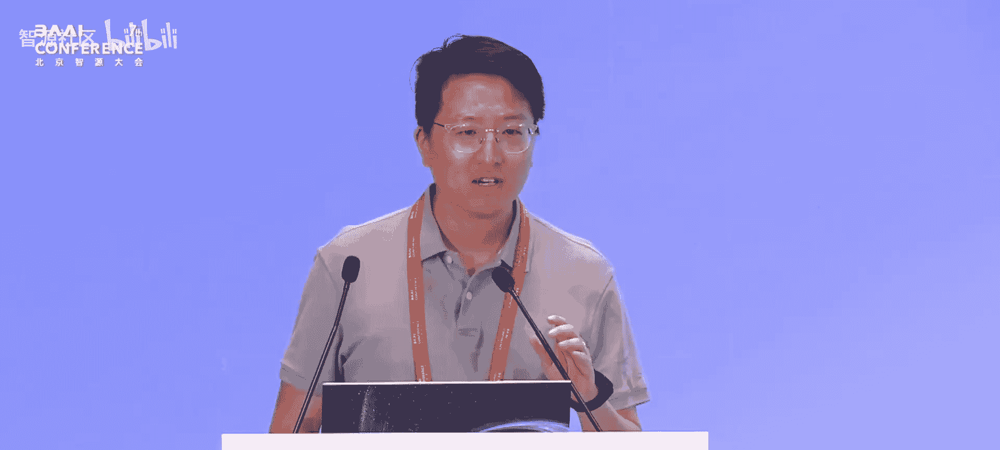
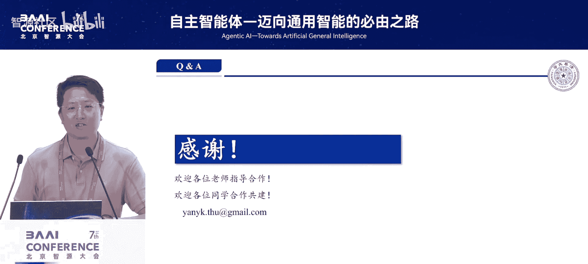

# 2025北京智源大会-自主智能体——迈向通用智能的必由之路 p03 知识导向的智能体能力提升：闫宇坤 -BV1ccN7z5ETU_p3-

首先呢非常感谢大会的邀请，感谢刘老师的介绍。然后接下来呢由我来分享一下关于这个知识导向的智能体能力提升的一些相关的工作。呃，那么刚才就大家非常关注就是大模型，它其实它是有自己的知识局限的。

刚才我们也刚才有呃有有一位老师也提问，提到了说我们这个呃有一些专业性知识，那么怎么样让智能体掌握这些专业性知识。啊，那么首先呢这个大模型它的知识局限呢，我们可以表现在这个以下几个方面。

首先呢它会有一些幻觉问题。这个呢是因为大模型它本身它的过去的训练数据，它的规模以及它的这个分布的产生的一些限制。比如说我现在问大家这个澳大利亚的首都是哪个城市。😊。

啊，我觉得应该现场很多的这个老师们也会出现幻觉，就是安利亚首都既不是悉尼，也不是墨尔本，是坎培拉。所以说这个大模型它的这个知识局限，这种幻觉问题其实是呃和人类一样，它也是很难被消除的。

它是需要外部知识来加强的。再有呢就是大模型，它其实有这个知识过时的问题。比如说呃openI它在4月份发布的这个GBT所谓的GPT4。1。那么它的训练数据呢，官方的这个总结是截止到了24年的6月份。

也就是新产生的这些数据呢，它其实是没有学习到的。另外呢就是有些数据其实是不太适合放在预训练数据当中，甚至不适合放在SFT数据当中的。比如说我们的一些隐私数据。那么早期的比如说GBT3它的模型。

如果我们用这个所谓合适的pro去诱导这个模型的话，它可能会把一些隐私信息进行一个泄泄露。再有的话就是一些研究呢也发现，那我能不能在训练之后，我通过不断SFT这种方式来让模型掌握更多的信息，更多的知识呢。

其实也不是太行的。就是它更倾向于去学习这个回答的模式，而非这个回答真正的这种内容。那么当这个知识局限的问题，碰到了我们现在所谓的reasoning model。

碰到了我们的这个深思考能力之后会发生什么呢？可以看到我问了一个这个比较具体的这样一个问题。然后我们以这个QWQ32B模型为例的话，它其实会陷入到一个不断的去思考。他说哎对对对，不对不对不对。

它一直陷入到这这种模式下，然后最后呢输出了一个不太可靠的这样一个答案。は。那么其实整个学界对于大模型知识局限的解决呢，其实是提到了提出了一系列的方法。那么也就是我们呃呃这个R所要RG的这样的一个技术。

那么从22年的时候，最早期的大家提出基础的RG这个范式到这个23年的时候，大家去关注到。那么我们要想怎么样去检索什么时候去检索。呃，到这个24年25年大家去思考说我的COT怎么和RG相结合。

我的这个knowled力ge怎么样去配合这个RG的整个范式。那么到现在呢大家又开始在做这个深思考模式，呃，这个下面的它的知识获取和利用，可以看到大模型它这个知识获取和利用的问题，它是从一个相对边缘的。

就是为了解决我原来没学过的问题，没学过的知识，我就给他检索一下，对吧？为了解决呃它是一个边缘问题。那么现在呢慢慢的随着问题越来越深入，场景越来越丰富，它变成了一个核心的问题。

首先呢我们介绍一下这个呃RE技术的它的一个基础范式。其实它的思路非常简单，我就是分成检索和生成两个模块。那检索模块呢负责我们在呃遇到一个真实问题的时候去找到相应的相关的这样的知识。然后生成模块呢。

呃它就是把这个相关的知识和我的用户问题拼接在一起，让模型去进行一个输出。那么一般情况下呢，这种RG技术呢更多的是被用在这种知识密集的场景下。比如说一些通用域的一些呃一些这知识性问答呀。

比如说一些医疗场景啊，教育场景啊法律场景等等。😊，那么我们这个小组或者我们这个团队呢，也是呃非常系统性的从呃23年开始对RG技术进行了一个研究。

那么一开始呢我们也是关注的话它的这个基础检索的基础能力提升。啊，所谓基础能力提升呢，我们一方面呢是指我这个检索模型或者是大家常说这个bedding model，我们怎么样去进行提升。

那么我们也是利用这种呃de only的这种强基做模型去训练了自己的embedding model呃，里面呢也会研发出一些比如说同质化小批次。

比如说我们这个分任务的这种呃learning rate调整等等的这样的一些技术。呃，我们是在去年发布了这个miniCM embedding这样一个模型。当时发布的时候呢。

也是在MTEB我们这个检索榜单上呢排到了第一位，同时呢这个模型下载量已经超过现在这个数字应该更新一下这数字已经是整体超过35万次了。对，然后除了这个模型检索性能的提升。还有一个很非常重要的点。

就是模型检索。对象模态的扩展。就是说我们现在的主流模型其实只能检索到这个纯文本信息啊，它其实但是我们现实生活当中呢，很多有的信息其实是以多模态的形式存在的。比如说我们的很多的这个教学材料里面。

它的这个里面的配图，其实包含了非常非常多的信息。我们也是训练的这样的一个多模态的跨模态的这样的检索模型来进行这种多模态信息的呃检索。然后提出了这个visr这样的一个工作。啊。

它是使这种3B级的这个模型能力呢超越了GP4O的这样一个水平。但是就是基础性能的提升，基础模态的拓展都不是解决我们复杂问题的这种呃一个根本的解决方案。

那么我们其实是对这个整个检索增强的这个尤其是检索过程当中，它的一个模式进行了一些反思。那么首先呢我们最基础的ragra方呃ra技术，它其实采用这种单次检索的方式。

也就是说我拿到一个query去检索到相应的问题，然后直接丢给生成模型去做。那在这个过程当中呢，很明显它会出现一些检索信息呃覆盖不全啊呃比如说我的这个呃我的这个生成模型的上下文是有限的那我只能召回有限的这种信息。

同时呢随着我呃检索。如果比如说我从top三提升到toptop10这样的一个检索的这个容量的话，那也会引入很多噪声。呃，再有呢大家就是在这个基础上呢变成了一个多轮检索。OK那我一次检索，既然覆盖不全。

那我就检索多次不就行了吗？比如说这种KNLM他会说我每隔N个 token我就去检索一次来增强我的生成过程。但是这个呢也是难以避免的去造成了这种呃这个噪声引入的问题。

而且它的成本也是非常高的那在这个基础上，大家又纷纷提出了我们所谓的这种自适应检索。那伴随生成过程呢，它会自动化的去判断我现在是不是需要检索，只有当需要检索的时候，我才去执行这样一个操作。

但是它里面也会有它的问题。就是我每次每一轮检索的这些信息其实是独立存在的，就意味着这些信息之间的融合交互是没有的，是缺失的。那么我们就基于这种观察。

提出了我们叫做deep note这样一个基于笔记的多轮检索和深度整合的这样一个工作。那么引入了一个大模型可以记的笔记，然后从而建立呢这个知识获取当中，我们去进行一个整体的规划，进行动态的拓展。

信息的整合以及自适应的启停。那具体来看呢，我们可以有一个例子来说明一下这个工作。首先呢我们拿到了一个用户的一个问题。然后在这个基础问题的上面呢，我们去进行一次检索。进行一次检索以后呢，我在笔记中会记录。

记录什么呢？记录我已经掌握了哪些信息。然后同时记录我还需要哪些信息。那么在这个基础上呢，我们就进入到我们的多轮的这样的一个循环当中，啊，每一次循环呢，我们会基于当前笔记的内容去提出新的问题。

我还需要获取哪些信息，把这个还需要获取的信息拿过来去进行检索。再把检索过来的这个新的知识整合到我们的笔记当中，真的就像人在拿着一个笔记本进了图书馆一样，我再看看这本书记一些看那本书记一些。

然后最后我们去呃呃每次笔记更新完之后呢，我们去进行一个判断，说我现在笔记的内容是不是已经足以回答我当前的问题。那如果足以回答了呢，我就直接把这个自由自由笔记拿出来来。回答我的问题啊。

如果说我觉得还有一些信息可以更新啊，可以进行这个知识呃信息的增长，那么们就再进入这个循环当中。那么这种deep note的方式呢，它其实很有效的去提升了这个呃模型，解决这种QA问题，尤其是这种多跳的。

或者是这种长呃长跨度依赖的这种问题。那平均提升呢，相比这个基础的RG版本呢，其实有有一个大概1010个点的这样10个百分点的这样的一个提升。那么除了这种性能上只非常直观的一个提升呢。

我们还进一步对这个笔记进行了一些分析。那么笔记呢我们可以看到呃右边这右边这个图。可以看到呃，相比于这种基础的RG，我们在减少它的输入的检索文本的同时，提升了它的这个有效有效信息。

我们叫evidence的呃一个一个一个量和密度。我们叫做这个evidence density是有一个明显的提升的。那么这个是在知识获取方面，我们做的一些呃研究。啊，第二个问题是知识的利用。

其实呃大家如果是做RG相关的，或者是做这个智能体信息利用相关的话，很呃很有可能会观察到一点什么呢？就是哪怕我把这个真实的信息呃非常准确的信息，非常完备的信息给到模型。它模型也未必能正确的给出这个输出。

这是因为模型对于外部知识，它的利用能力是非常有限的。而且有的时候它内部记记录的一些知识会和外部知识产生冲冲突。那其实很难就是很好的分辨我到底是用外部知识还是内部知识。

那比如说我们呃问1个这个24年的一个模型，说就是美国大选权的模型，说美国总统是谁？他可能说的是拜登。然后我即使在那到现在我告诉他现在美国总统是已经是川普了，我再去问这个模型。

这个模型还是会犹豫到底是选选哪个人，对吧？那么这个呢其实一定程度上呢嗯也会这个造成这个性能的下降。那同时呢还有一个问题，就是我的检索系统肯定是不完备的。我检索系统一定是会引入噪声的。

那么也就是模型一定是要加强抗噪声的能力的这其实是非常有挑战性的。为什么呢？因为我们的模型其实都是经过这个instruct tuning的这样一个过程。那instruct tuning它在做什么呢？

就是教模型，说你要严格的follow你的input，我让你做什么，你就做什么，我给你哪些信息你就要充分的用上。但是我如果引如果我的检索内容当中有噪声的话。

它就会陷入到一个我不知道如何处理这种情况的这样的一个陷这样一个呃呃状态。也就是说我们要对这种生成能力呢进行调优。那么对于这个生成能力的调优呢，其实我们有很多选择，对吧？我们有监督学习监监督式的训练。

我们有强化训练。那么我们呃根据我们的经验呢，监督监督呃训练的话，它其实它的好处就是数据我的数据合成非常直接，非常简单。但是呢它会一定程度上牺牲通用能力，而且不适合这种auoma的场景。

然后它是一种直接对齐的这种暴力的方式。那么经过我们探索呢，其实这种强化训练是更适合RG系统，对尤其是生成模块的训练的。它的优势在于它的数据需数据规模需求比较低。同时呢它适用这个al门场景。

而且它能保持呃这个通用能力。但然他也有一些缺点，就是它的这个数据采样是相对困难的。哦，这个我们会在后面讲到。那么我们也是提出了这种我们叫做RGDDR的这样的一个基础的生成链路的调优。

它是可以呃调优整个多智能多个智能体组成的这种生成链路的啊，基它的基本思路是这样，我们通过调整模型的这个temperature，调整外部知识的组合。

然后以及补充这种纯粹内部知识依赖进行的采样的方式呢去呃得到正负力啊，得到这个或者是不同reward的这样这样的一个sample。然后呢，它的长链路调思路是怎么样的呢？我们可以想象一个多智能体组成的链路。

它作为RG的一个生成模块的话，啊有可能第一个智能体我负责信息的过滤，第二个智能体我负责信息的整合。第三个智能体负责答案的生成。那么它我们可以类比一下，它就像是一个多个齿轮组成的这样的一个齿轮系统。

那这个齿轮系统怎么样去进行调优呢？呃，如果按照现在的这个模式的话，我们很可能去采用一个常链的这样的一个jaPO的方式，或者是R的方式去进行一个非常直接的调优。但是我们知道这个RG过程。

它其实涉及多轮多多轮的采样，又涉及多个多多个模块或者多个智能体。所以这样的成本会非常高。所以我们就提出了这个DDR的方式。也就是说通过一个后向对齐的方式来进行整个系统的调优。那什么是后向对齐呢？

就是我们类比这个齿轮系统的话，就相当于我认为我最后一个齿轮是一个完美的齿轮，我不需要对它进行任何调优。然后我们去训练第二个齿轮，跟它跟它匹配，去打磨第二个齿轮跟它有一个更好的匹配，有一个更好的传动效率。

那么具体而言呢，也就是我们会把呃我们当我们调优一个系统的时候，我们会把它的后面的系统给固定住。然后它后面系统只负责root这种这个呃样本去采用这个reward来做。

然后这样子我们调优好倒数第二个这个齿轮之后，我们再把它也固定，再去调优倒数第三个齿轮。那么通过这个方式呢，我们可以看到，我们就可以从最后一个齿轮一直到最前面的一个齿轮。

把它的整个的这个多智能体组成的链路进行一个有效的调优。而且调优之后，我们会发现啊我们可以产生新的采样了。因为我整个的调优整个的齿轮系统都已经打磨一遍了，我可以再来一轮优化啊。

也就是说我们可以实现这样的多轮优化过程，让它的这个系统的性能一直有一个比较好的一个提升。那具体来看呢，我们呃试验当中呢。

我们采取了一个refiner加一个ja generator这样一个简单的两个正能体的这样的一个模式进行调优。那使用DDR之后呢，我们可以发现我们用一个这个miniCPM2。4B的这样一个模型。

就可以达到就是在多种这个多种任务当中，包括open domainQV啊，包括这个呃这个多跳的问题啊，包括这种各种对话问题等都会有一个非常好的一个提升。呃，而且呃这张幻灯片可能没有售出来。其实我们这个2。

4B的模型，经过这样的训练之后是可以超过这种拉嘛3这个拉嘛这个8B的模型。对。另外呢就是我们呃对比SFT方法的话，所可以看到呢，就是经过这种DDR训练，就是它的generator。经过这种训练之后。

它的通用能力就是非常神奇，它的通用能力不仅没有下降，而且会有一定的提升，尤其是在种在这种这个知识性的这样的一个任务当中。那么作为一个典型的多链路，多智能体系统化调优的这样一个方式呢。

它其实可以和我们很多的呃，当然也不只是RG就是我们这里试验主要是用了这个RG的各种范式去进行一个试验。比如说和前面讲到的deep note去进行一个组合。那我我们在这个笔记的初始化问题拓展。

笔记更新答案生成的过程当中都用DDR的方式来进行一个调优。可以发现它可以也是非常显著的进一步调优了这个整体的性能啊，有些这个调优之后的这个复杂问题的解决的成功，这个这个准确度可以提升20个百分点左右。

然后另外我们也尝试说那我能不能把这个知识图谱也引入进来RG里面。那么我们也是把这个知识图谱的读取检索的模块也加入到整个链路当中，也用DDR去进行一个采样调优。

发现这个也是非常有效的提升了这个下游任务的这个解决能力。同时呢我们。也在进一步探索他这个DDR和其他的各种各样的一个呃模式进行一个联合的过程。但是呢就用DDR就够了嘛，用DPO方式去调就够了嘛。

其实是远远不够的啊，为什么呢？因为我们呃RG它的解决过程当中，我们知道我们那个强化学习它能够起作用的一个非常关键点。就是我有一些哪怕是比较低频出现的一些正力被采样出来。

这样子才能激发这个模型去越来越呃以正确的方式来解决问题。那么但是但是RG这个场景下就会出现。我有的时候这个模型是需要通过内部知识解决。有些时候会需要通过外部知识解决。然后有很多时候呢。

我需要内部知识和外部知识进行一个有效结合以后才能解决。所以说它的采样成功率是非常低的。而且这种QA任务呢，呃，它往往伴随尤其是伴随这种强烈的reaing之后呢，它的反馈信号相对来说是非常稀疏的。

那么我们后面的工作呢也是围绕着说我我要呃一方面我要提升这个采样的成功率。另一方面呢，我要进呃我要呃提升这个反馈信号。的这个密度围绕这两个点来做。那对于这个采样成功率提升呢。

一方面我们可以用双向思维链去进行一个采样。另一方面我们可以呃不是通过直接采样的方式，而是通过一个大模型指导下的小大模型指导下的这种修正的方式来进行采样啊，对于反馈信号密度呢。

我们可以通过这个特殊的细化特殊的细化处理来得到更细力度的反馈信号，让这个数据的它的训练效能有一定的提升。那么具体而言呢，首先我们做了这样一个叫care的这样的一个工作。

那这个工作呢其实思路也是非常简单啊，就是我原本呢作为QA任务的话，我只能在回答的时候，我拿到一个信号来进行反馈来进行监督来进行调优。那么既然如此呢，我们就把这个大模型。

它在推理过程中的知识给它进行一个展开啊，具体而言呢，我们把它展开成了一个知识图谱的方式。也就是说我把检索到的信息，把呃让模型。把他认为有用的信息整理成一个完善的一个知识图谱，包括里面包含的一些实体信息。

还有一些关系信息。那么通过这种方式呢，首先我们可以知道，那最终答案的正确与否，这是一个reward。同时呢我可以让一个大模型做同样的这样的一个知识展开的一个过程。

让他去帮小模型去发现小模型在知识整理过程中，具体哪一个点出了错误啊。那通过这种方式呢，可以让这个呃监督信号的这个密度有一个极大的一个提升。那具体的这个方法呢，我我我这里就不展开讲了啊。

大意呢就是说我们在DPO计算的时候，我们会着重去看那些错误的token，只对那些错误token进行一个权重的提升，来调优整个模型。那可以看到就是本来这个DPO的效果已经非常好了。

然后我们又进行这个DDPO的这样的一个训练。它其实在不管是in domainman还是alldoman的这样的一个不同模型。不同的呃任务上都有一个很好的效果。而且最让我们惊喜的是什么呢？

就是呃它在训练数据的需求的规模上也有一个显著的一个下降也呃，对比如说我们这里的对比是呃DDPO的话，我们只用了3000条数据。那么DPO的话，我们用了3万条数据啊，达到了差不多这样的效果。

OK那么在这个呃统一优化的这个角度上，我们再去思考一下这个问题。我们呃刚才讲了，我们一方面是知识获取，我们需要进行一个提升。一方面是知识利用，我们需要进行一个提升。但是其实两者也是很难分开的。

也就是尤其是在现在这种呃这种呃常链的raing过程当中，其实我们是要一边获取知识，一边调优一边调优生成啊，一边获取知识，一边再去调有我们的生成。那基于这种动机呢啊我们引入了这个REro这样的一个工作。

这个工作其实是把我们之前的很非常多的经验都集成到了一起。那它引入了一种动态路由的机制啊，会对这个不同的信息源。首先它在检索过程当中，它是一个多轮的，它是一边检索，一边思考一边提出新问题，一边再检索的。

然后与此同时呢它的检索的对象也不止限于这种文本的这样的知识库。而是引入了包括。呃，这个图像包括表格这样的多模态的信息。嗯，可以看这里的这个图有一个对比啊。

比如说现在我们比较知名的一个工作叫这个serv售 one对吧？然后serv售 one的话，它其实是就是用这个文本模态会呃在这个提拿到用户问题之后，在文本模态当中不停的搜索知识，提出这个新问题。

然后进行推理。那么对于我们这个RErotor呢，我们会在这个过程当中不仅去搜索新知识，还会对不同模态的是不同的信息源进行一个选择来进行一个整合。那么这个训练过程就变得更加复杂起来。

整个这个训练过程呢会呃它里面会包含我的这个知识库如何选择我的这个查询的语句，怎么样去生成。最后我的整个过程的信息怎么整理。然后最后答案怎么怎么输出这样的一个过程。

那么我们也是提出了一个叫做step GRPO的一个方式。然后通过常链的这样的一个step by step的采样来进行多个能力的这样的一个联合调优。那可以看到这个这个模型的效果是非常非常这个出乎意料的。

这提升的幅度是非常大的。尤其是相比这种其他的基线方案，不管是我们利用各种多模态的这个模型去进行呃去进行整合，再交给reing model去呃去做。

还是说我们用这个呃现现有的这种多模态模型直接去进行整合啊，都是都是不如我们这个REroot的方式呢。而且这个RErotor它是1个7B的模型，可以看到它的这个性能是超过32B模型的。

同时呢我们也对这个性能提升的原因呢进行了一个分析。可以看到，通过我们这种sstep这种力度的这种呃奖励调优呢，可以呃有效的让模型在多个信息源中去获取该有的信息。我们这里可以看到这样一个例子。

就是呃这个例子是说呃问这个鸟它是属于哪一种呃这个种类的，或者哪一种品品属的。我们叫做那么可以看到我们的RErotor呢，它其实会先去对图像进行一个rettri，去找到哎有没有类似的标准的鸟类的图像。

然后拿过来去进行参考，然后再去呃去检索这个文本相关的描述来进行这个问题的回答。嗯，可以看到它那个最后的右边这个右边这张图，那它最后的这个输出呢，它确实也是综合了各部分的信息。

首先他说我通过这个呃texax retrievetriver呃，我找到了一些相关的鸟类的描述，然后同时他提到说这种描述就符合我这个图像呃检索到的这个图像以及我们给定的这个图像的这种模式。好啊。

以上呢就是我们最近这一年半以来吧，然后给呃在这个知识获取知识呃利用这个方面的一些探索。然后呃我们组呢其实和呃这个清华大学铁实用LP实验室，然后东北大学的呃这个信息检索呃小组。

然后以及我们的这个open bMB社区。然后还有我们的那个AI9star社区进行了一个呃联合发布了这样一个开源项目。然后呃我们会持续的把组内的很多先进的非常新的非常这个前沿的工作。

我们自认为做的还不错的工作，然后逐步的去集成上去。然后也欢迎大家关注这样一个呃开源项目。呃，另外的话我我们也是在呃我们也是在寻求各种各样的合作，不管是跟各位老师也好，还是各位同学也好。

如果大家有兴趣的话，可以呃加入我们这里呃我有两个二维码，这里可能没更新上去。然后大家可以给通过邮件然邮件的方式然后联系我们，也可以呃通过关注清华大学铁实LP实验室的公众号来联系我们。哦，感谢大家。好。

感谢宇坤博士。😊。

啊，那个我们站着的观众，其实在这个角落还有非常多的空位，然后大家可以过来啊。那我们由于时间关系，我们可以应该接受两个提问啊，请举手示意啊，那边啊。杨老师你好，我是来自于寒武纪的呃一个验证工程师。

然后我现在带队做一个面向芯片研发的垂类RG应用。然后呃我们现在遇到的问题其实就是应该是各个行业都遇到比较基础的问题。第一个问题就是我们遇到的我们的 knowledge都是比较脏的。以我们遇到了的问题。

然后还有第二个问题的话是呃就是这个RG的检索它的完整性和精确度不高啊，这些都是比较常见。然后我今天的问题其实比较宏观，就是我想请呃请问一下，就在选数界是否有一个对这种行业数据的呃处理了一个收敛一个趋势。

也就是说是否找到一一条范式能够处理所有的数据。然后另外还有就是这个RG是否也有一个这样的一个收敛趋势，能够就是一套RG可以处可以处理所有的这样的一个呃一个知识问答的功能。然后第二个问题呢。

就是呃其实也是我们现在遇到一困难。就是基于我们。我们的这个呃如何量化的去衡量我的这个检索精度，这个是否在业界也有一个这样的方法。老可以简短回答，我可以再有一个问题好的好的，我简短回答一下。对。

首先那个关于数据处理这块呢，我觉得您可以关注一下，比比如说tra web这种呃，有一些开源的这种数据处理的一些方式。比如说做这个断码的去除啊，这个格式整理啊等等。然后另外这个R一系统呢。

它的这个使用我们确实在追寻这样的一个标准化的范式，包括我们的这个开源项目的目标其实就是提供一种能够呃就是一一键是解决这样的一个方式。但是可能还是在持续进行当中。啊，然后第二个问题的话，其实呃。我想想啊。

第二个问题的话，其实是那个你你可以再提，不好意思，我有点我有点那个什么忘了。😊，不要紧张。第二个问问题是这样，就是关于RG这个的性能。其实我们是已经有很多的方法。我想想好的好的，对，就是RG它的评估。

尤其是场景相关的评估，确实是一个非常难的难题。然后我们这边其实也有相关的研究。比如说我们做了一个呃RG的这样一个工作。它其实是就是针对这种场景。我们通过场景的一些文本快速的去构建这个评测评测级。

同时我们会把这个评测级里面的回答进行一个事实性性关键点的抽取。然后通过关键点是否去集中来评估这样的RG系统。我觉得还比较呃适用于这种场景化的这种RG。对，谢谢老师好，那我们还可以接受一个非常快速的问题。

嗯，看有谁要问。😊，呃，如果没有没有问题的话啊，这这边这边。想问一下您一个比较大的问题，就是您对LLP下一步发展就是呃技术路线大概是怎么看的对。好的，这个比较宏观。我我简单回答一下。

就是这个这个抛砖引玉式的回答。就是嗯我我们认为其实RRT系统或者是呃整个这个这个复杂问题解决吧，它其实需要各个环节的一个各个模块的一个配合。那么目前来看。

我们认为比较比较关键模块一个是知识库知识库怎么整理怎么建立它以什么形态，什么样的方式去存储。第二个是说它的中间阶段的这个推理过程的信息收集。就比如说我们工作其实就在做这件事。

那第三个呢是说我们要有一个比较好的一个路由。就比如说我们ro在做这件事，我们要对知识库进行一个选择，对各种推理路径也好，对检索路径也好，有一个选择。

那第四个模块就是ing模块也是大家现在比较关注的这个推理模块。然后我我认为啊个人认为就是四个模块联合发挥作用，才能够解决更加复杂更加真实场景的下面的这个复杂问题。好的好的，谢谢你。😊。

