# 2025北京智源大会-自主智能体——迈向通用智能的必由之路 p04 大模型自主智能体及端侧应用：林衍凯 -BV1ccN7z5ETU_p4-

大家好啊，非常荣幸，也非常感谢刘老师的介绍啊，能在这里给大家介绍我们团队最近关于大模型自主智能体啊的一些思考。那么啊就是呃就是在过去的啊就是5年之间，那么其实大模型已经走过了从啊就是小模型到大模型。

通过不停的去增长模型的参数量以及训练的数据量的这种来法来提升模型智能的效果。那么在其基础上呢，那如果我们要迈向所谓AGI的话，那么不可避免的。

其实就是我们有可能我们需要像人类智能一样让大模型去学会所谓的啊工具使用以及社会分工。那么今天呢我们啊这个报告会啊就是主要集中在啊，如何让大模型学会使用，用这些外部的工具来解决一个真实的复杂的问题。

也就是所谓的工具型的智能体。那么啊怎么让大模型学会使。

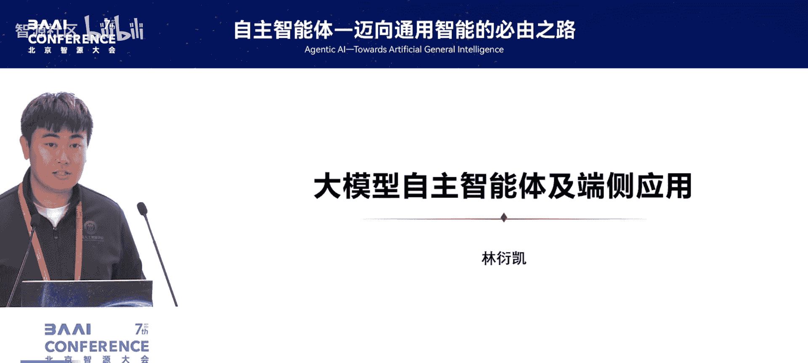

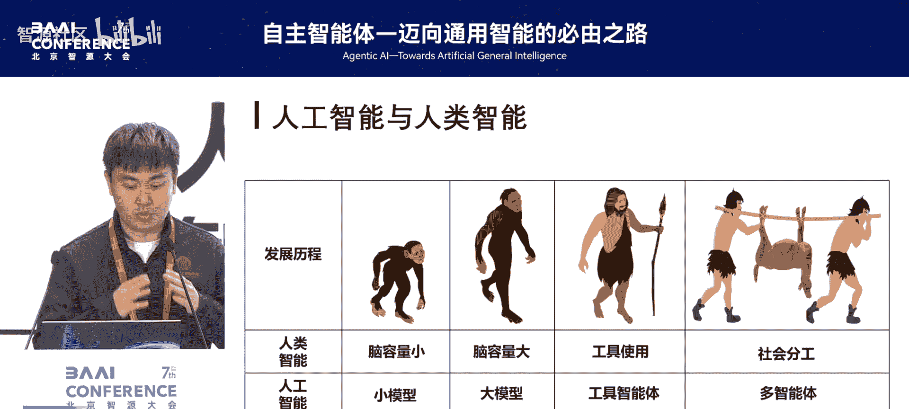

一个工具呢。那么其实啊其实我们能看到的目前的很多的工作，其实啊在大模型自主智能体方向的工作，很多都是说哎我基于一个啊闭缘的大模型。比如说在gB4O，比如说像germany，比如说像cloud。

然后呢在上面去 design在一个所谓的enttic wordflow来去激发它模型自身啊本身的这种啊就是agenttic的能力。但是如果我们的目标是所谓AGI的话。

那么我们希望的是说什么我们应该有一个所谓的enttic model能够自己学会所谓的这种啊使用工具，能够跟环境交互去解决一个复杂的问题。因此呢啊工具学习技术，其实就是其中的一项非常重要的技术。

我们希望通过啊所谓的工具学习，能够让智能体去学会使用搜索引擎等啊这种一系列的复杂的认知工具来提升啊所谓大模型智能体的这种能力偏见。那么。啊，这件事情呢其实从啊就是大模型出现以来，其实就一直被关注着。

那么从20啊20年OPI发布GB3之后，那么其实在2021年他们就啊探索了所谓的webGT如何去使用啊搜索引擎啊来啊就是帮助大模型去执行一个直业任务。那么在短短的4到5年间。那么其实我们可以看到。啊。

近乎是成千上0百的工作在研究就是我怎么让大模型学会使用一一项外部工具，或者说多项外部工具，并结合着这些外外部工具呢，通过啊反复的跟环境的这种复杂交互来完成具体的问题。

那么具体的我们怎么让大模型去学会使用一下工具呢。那么啊从啊学习范射角度，我总结了三点，第一点就是我们可以进行所谓的示范学习。也就是说我们可以让大模型去通过啊学习啊人类使用工具的这种行为啊，的这种潜折腿。

然后呢，让大模型来模仿人类行为来习得使用工具学习的能力。那么第二项就是所谓的这种教程学习的能力。那么我们可以通过让大模型去阅读工具的这种使用手册，像人一样，通过工具手册去理解一个工具。

它的这种功能以及调用方式。那么最终最后一个也是啊就是人。

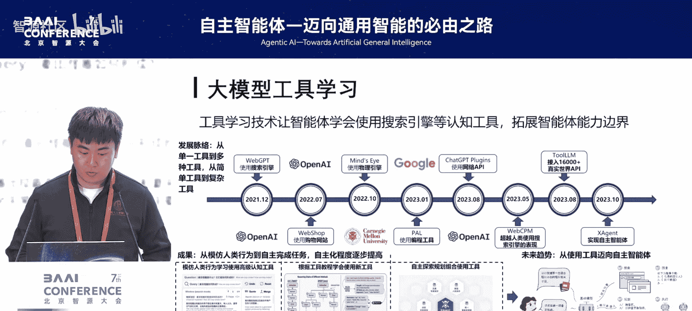

类监督最最小的一种，其实就是所谓的探索学习。我们希望大模型能够通过这种自我探索，基于强化学习，根据环境的反馈以及啊这种人类的反馈，能够去纠正错，从而去实会使用出。

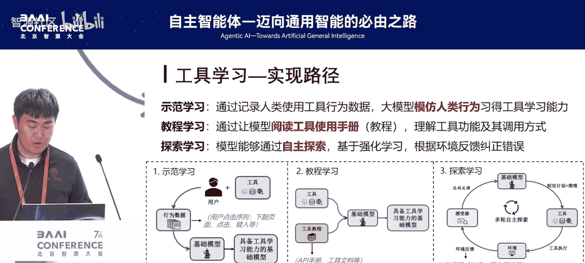

使用一个具体的工具。那么在这一块呢，其实我们团队也去做了一些相关的探索。那么在示范学习方面，那么我们提出了一个啊就是啊就是中文啊互联网首个基于交互式网络搜索的这种啊就是中文领域的问答框架。

那么在这个问答框架里面呢，我们去标记标注了非常多啊人类怎么去使用一个开源的这种啊就是搜索引擎去啊回答一个开放域的问题。那么基于这这些标注的数据，我们去啊微调了当时的这个C片模型，1个50亿参数的模型。

我们发现说我们仅仅需要5500条这种啊记录呢？那么啊通过这种微调，我们就能够让大模型去学会使用啊这种搜索引擎能力。那么展现出类人的搜索策略。那么啊相比于啊就是不使用这种搜索引擎工具的模型的话。

那么它在这种开放域问题上的这种啊能力呢，其实是有了一个极大的增强。

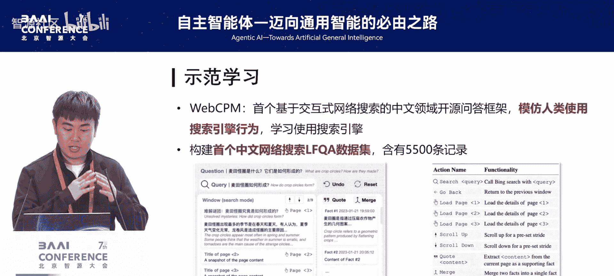

但是啊师范学习它固然很好，但是它其实极大的依赖于就是说我们每一个工具都要收集大量的这种人类的这种使用的这种啊就是transjectory，那么非常的耗时耗力。

那么因此如果联想到人类是怎么去使用一个工具的？人类的对工具的泛化是怎么做到的。那么我们希望的是说哎大模型有没有可能像人类呀。我看到一个工具，它的使用手册，上面只要描述一下，哎。

你这个工具要它的名字是这个，你只要输出这个参数，你只需要按这个快门，我就能够去理解这个工具该怎么用。那么我们发现就是说其实当时啊像GBO这样的model其实是有这样的能力的。

但是我们怎么让一个开放域的模型去学会这一点呢。那么基于此呢，我们提出了基于self poor cell in的这种工具啊，大规模啊高质量的这种工具指令微调数据的这种构献方式。那么使得呢就是说。

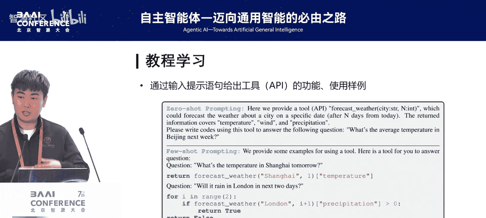

大啊在大概49种领域工具啊啊场景，16000个真实呃API下，我们能够去通过啊调用大模型自主的去构建啊这种啊就是使用大模型工具的这种数据集。那么在这个数据集下。

我们支持能够根具工具的描述去自动的生成工具指令微调的数据集。同时呢支持多种复杂的这种工具调用场景，以及自动的工具推荐自动工具能力的自动评测。那么基于这么框架呢。

我们去自动构造了这种工具啊学习的这种数据集的to bench。那么基于这个to bench的数据集，我们啊去训练当时的拉ma啊啊三的mod。

那么啊就是啊的 model训练后我们的模型去哎发现它就能高效的泛化到我们没有建过的新的API上啊，对于这些新的API我只要给到它这个工具的手册，那么它就能够去高效的调用这个。

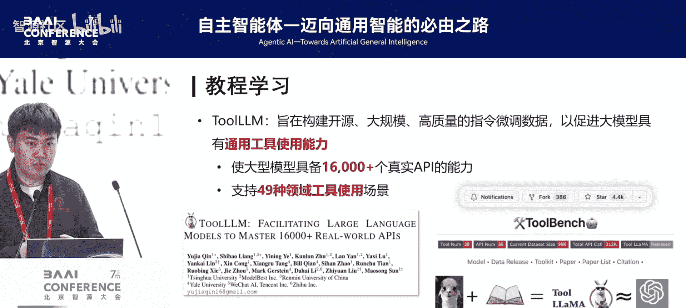

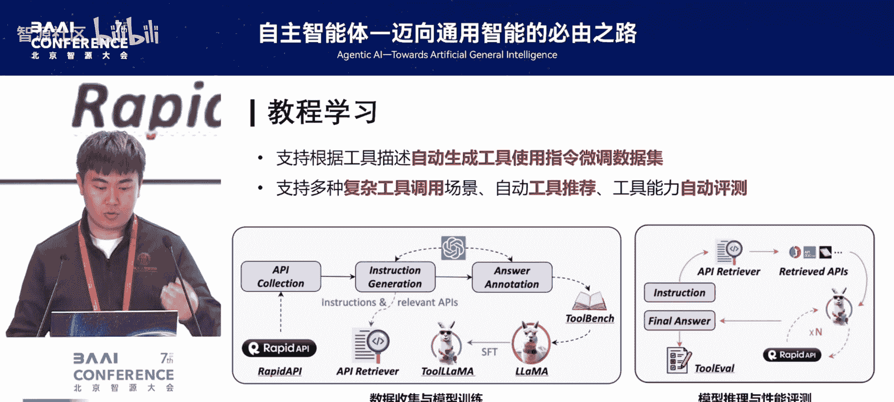

工具它的啊工具的使用能力接近GP啊GPT。那么到这里呢，其实我们当时发现就是说唉我们其实已经能基于这么一个model去build一个还不错的啊这种所谓的啊就是 large model的这种agent了。

但是啊这就够了吗？我们啊就是基于基于智能去buil我们基于自己的模型能去build啊，我们是不是就已经说实现了所谓的大模型智能体呢？或者说啊其实如果啊我们接下来啊的目标。

我们是说能够沿着所谓的啊整体的AI去迈向所谓的AGI那么我们应该去关注智能体啊，什么样的命题呢？那么对于我来说啊一个啊真正的好的智能体，它应该具备三个关键的特性，所谓的啊自主性泛化性和长城性。

那么什么是泛化性呢？那么其实我们希望的是说啊我我们的智能体大模型。

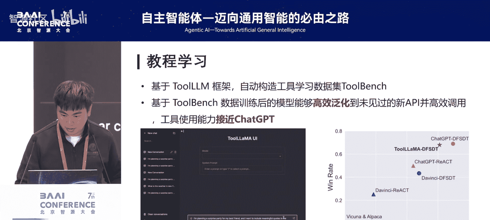

能够在多种环境，多种任务上都能够去胜任啊，我们能看到的是什么？现在很多的这个啊智能体大模型都十分缺乏这种泛化性。那比如说我们有这种GI的一整。我们有做se agent阵，我们有code的 agent整。

我们可以看到的就是说其实他仅仅啊就是能在有限的环境上去运行。那么希望的是什么？我们像人一样能够去啊迈向所谓的这种通用制度智能体能够去实现啊就是one for。那么啊为了去达成这个目标。

那么其实啊就是刚才王老师也提到了，就是说其实MCP其实是最近啊非常火的一个协议。那么他想要去解决一件什么事情，就是说原本啊就是啊就是这种大模型和外部工具，它的交互逻辑啊，往往其实是非常静态。

而且不标准不统一的。也就是说其实我们每一个啊就是大模型的版本和每一个工具的版本，它本身啊。

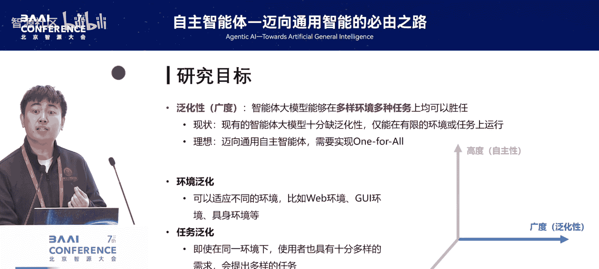

两两之间都有专用，而且静代的交互方式，任何一方的这种版本变动。那么我们都要去啊就是依次的去重写所有的这种啊来法。那么MCP其实就希望去解决这个问题。我们能够去通过定义一个标准化的协议。

也就是一个类似这里adap的啊就是我们啊电脑adap的一个作用。那么通过啊就是啊定义好这个协议之后去解决原本成本过高不可扩展。交互历史难以复有，以及设计标准割裂，重复劳动一个问题。

那么因此呢面向这个问题，那么我们其实是在啊就是啊最近的miniCPM上去实现了这种啊就是MCP能力的增强。那么啊在这里面其实有几个啊非常非常关键的问题。

第一个就是说其实我们需要去啊为啊就是这种MCP能力的增强，真的去把啊就是一个稳定的全面化的这种MCP环境给它啊搭建出来。第二个。是我们能够让啊就是啊在不同的MCP啊啊环环境feback回来之后呢。

能够去啊根据海量的信息海量的这种呃工具里面去获取到关键的信息。包括呢就是我们能在啊就是规划成啊进行这种高数据的摄像采量能够让模型去学会这一点。那么啊总体来说我们目前其实做了啊还啊比较初步。

但其实已经啊达到了不错的效果。那么我们啊的来法是说我们通过啊这种啊数据构造的方法，先让我们的这种啊MCP agent能够甚至1到2部的这种MCP的工作调用任务。然后呢通过这种RL去训练它所谓的长征能力。

那么最终呢啊我们目前的版本啊，我们在环境层集成了大概15个啊就是字面上比较常见的啊大家使用的比较多的MCPserv。同时呢我们啊从啊交互程序定向的去除了必要。

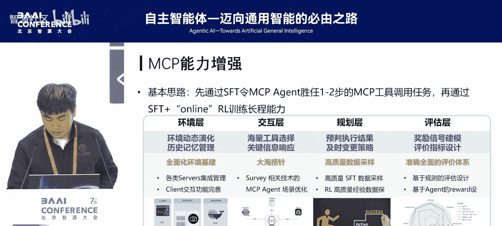

到的啊不不必要的冗于信息。然后呢啊在规划成了我们开拓了4种造数据的呃稳定的这种来法。那么最终呢啊我们其实是造了非常多的数据进行了这种啊就是ST和啊就是RFT最终达成的效果，就是说啊在啊就是15个工具上。

那么我们其实超过了啊就是目前千文三的一个呃就是啊就是MCP的调用能力。同时呢其实我们也达到了啊就是超过就是GPCOO的一个工具使用能力。那么在此技础上啊我们其实就在思考下一个问题。

就是啊我们有了MCP我们就啊足够泛化了嘛。那么其实还不够啊MCP能实现的只是啊工具层面的泛化。但是其实如果我们希望模型啊拥有任务层面的泛化的话，那么其实啊仅仅1个MCP还不够。

那么因此呢我们在想说那么我。

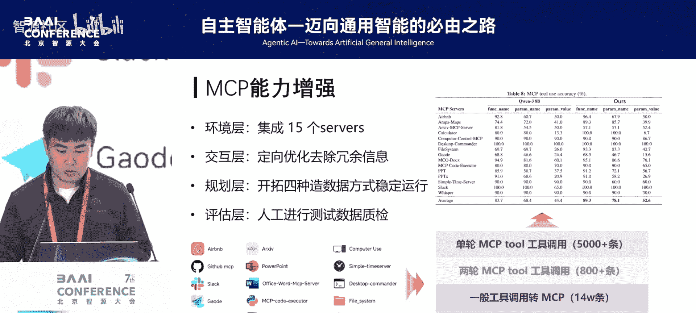

我们怎么让模型去实现所谓的这种任务泛换。那么我们发现就是说唉在智能体任务上，哎，我们这个奖励模型比策略模型其实是拥有更强的泛换性的。那么啊同样是仅仅在于啊就是一些啊就是啊ID的任务上啊去训练。

我们发现就是说他在OD上的啊调点的话，那么啊奖励模型ge的 model啊deding和非奖励模型啊就是直接deding的 model。那么它可能会超出20到30个点。

那么因此呢我们最近的工作也是通过啊就是在啊就是环境中动态采样，通过模特采样方式去训了一个啊就是所谓的过程奖励模型。那么基于这么一个过程奖励模型，我们去啊geit的这个pocy model去解码。

那么发现就是说哎去啊就是用这么一个奖励模型。那么我们能够实现的就是说哎在啊就是啊就是啊就。

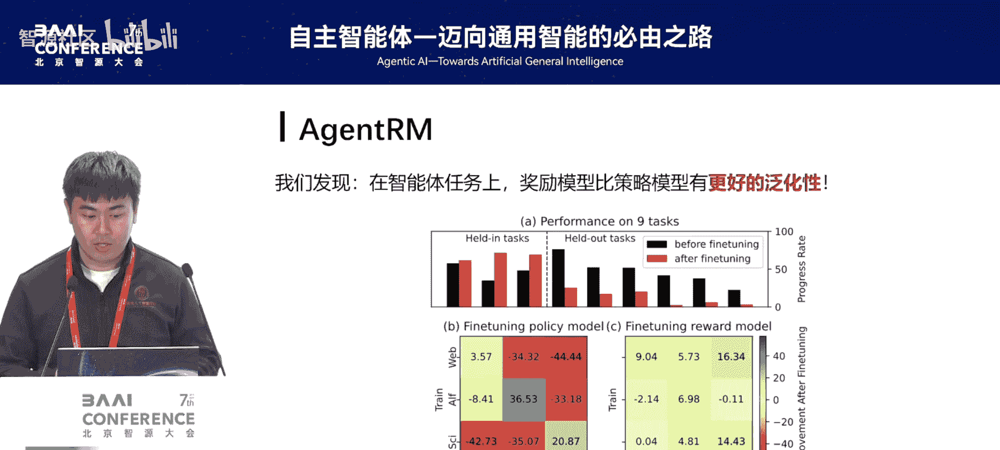

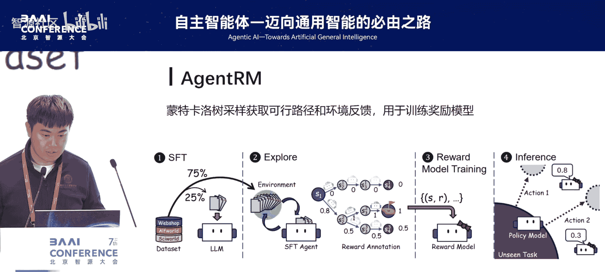

ID的场景下，那么它有稳定的提升。同时呢就是说在OD的场景下，还有足够的泛化性。那么啊这是啊就是我们希望的所谓的这种啊泛化性。那么除了泛化性之外，那么其实我们还希望的就是说我们的智能体能够有足够的常性。

也就是说我们的智能体大模型能够在长时间跨度内去处理啊，足够长步骤的任务。那么目前的现状是什么呢？那我们其实我们其实之前做了G做了啊就是啊就是比如说S agent。

我们发现就是说啊大模型智能体在完成长程任务的时候，那么有啊就是你可以看到的就是说即使你的单步的成功率，比如说你有95%，甚至98%的成功率。但是啊这么一个成功率，当你的啊执行的部署。

比如说是二0步30步之后，那么你的95的二次释方，那么你你的成功率可能就只有大概百。

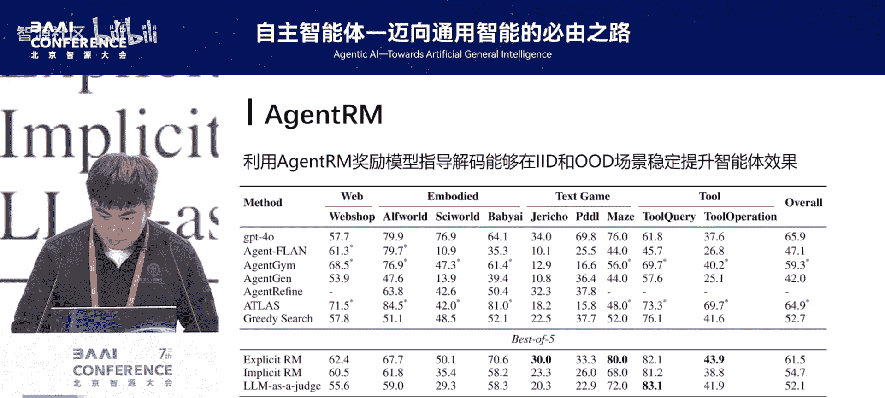

分之二三十。那么这件事情其实是现在啊就是大模型啊一直以来其实是没有去啊就是真实稳定的去执行，没有去解决的一个事情。那么因此呢其实我们就啊希望啊通过所谓的这种啊多步的强化学籍来去解决这个问题。

那么啊为了去解决这个问题呢，我们找了两个具体的场景。第一个场景是所谓的长报告的生成啊，那么这个场景是什么呢？其实是最近啊也是比较火的一个dely search的场景。

那么它的难点就是说其实如果用户要找啊就是生成某一个啊就是啊场景的这种调研报告的话，那么其实我们的难点是说我需要根据用户的quary去反复的寻找外部的信息进行总结反馈。

那么他其实事实上它跟环境的交互人数非常多。他跟啊里面环境的交互信息也非常杂。那么我们为什么选取这么一个。

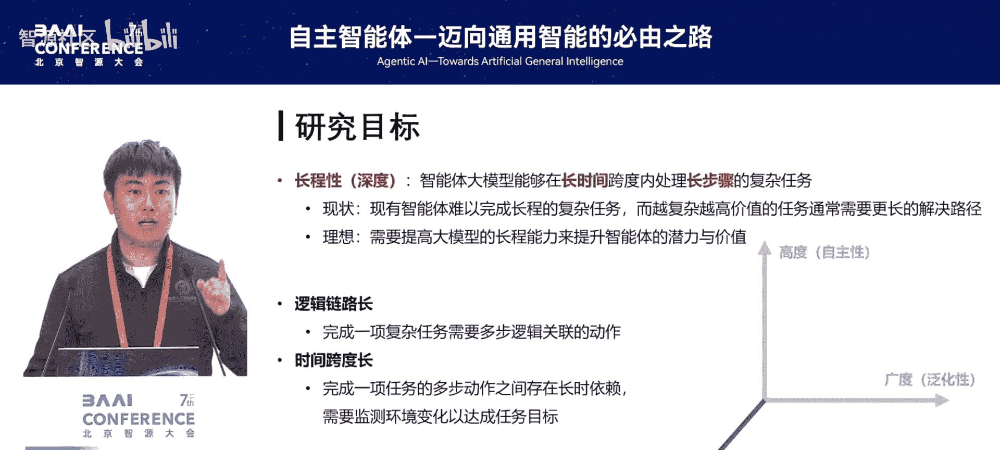

场景来去啊就是啊做探索呢啊，那么其实它的好处在于说它相比于前面的MCP的也好，或者说将比于GY也好。那么它里面就有且仅有一个工具。我们可以把这个工具啊，就是它的执行速度优化到非常非常高。

那么啊它一定程度上可以先去规避目前去做啊智能体L需要去解决的。比如说我执行的时候啊就是我的这种强化学框架有气泡。我的这个啊就是一步的更新可能会带来的这种呃模型的perform啊。

就是online modelreference model，它两者的gap。但这个目前啊在这个这个啊就是呃领域里，我们可以看到的就是说这些必人的model啊做的还不错。

但是大多数的开源 modelel都集中在奖励反馈非常明确的一些偏向于简单的问答。也就是说它的回答其。

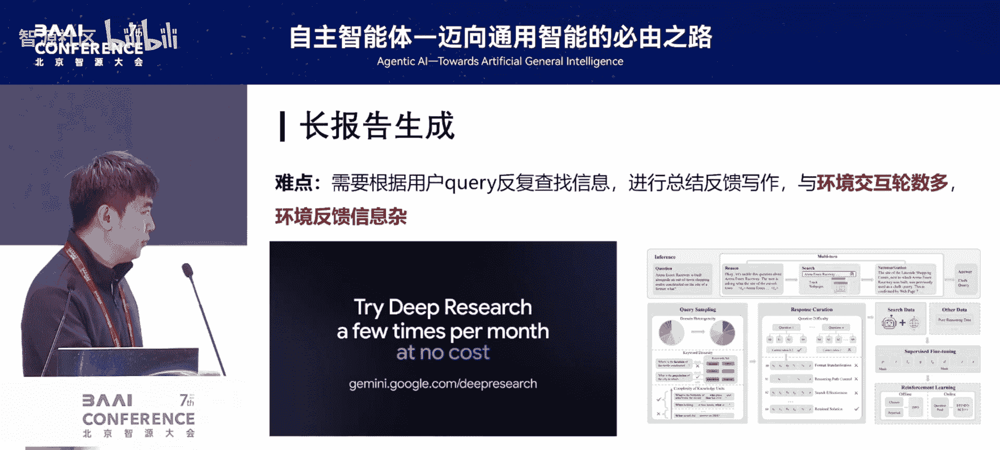

是一个非常短的，可能是一个词到至多10个词左右的这种啊简单的QA类这务上啊，因此呢啊面向这个场景呢，那么我们就去探索了啊怎么用多步的强化学习去进行啊，就是长报告的生成。

那么啊我们其实总体的框架是用一个所谓的这种啊就是啊就是啊规划型的模块以及一个写作型的这种智能体去协同啊。首先呢就是说我的啊就是大模型，首先会去写出一个啊我总体的啊这边啊就是长报告要写成什么样的规划。

然后呢啊我通过不听不不断的去retribe paperper啊，通过不断的去啊就是对retribe回来的paper的啊内容进行总结进行分析，然后呢通过一个写作智能体去把啊就是每一段慢慢的写出来。

然后不停的实现就是啊我报。内容的这种啊就是写作和更新。那么啊你搭了这么个框架之后呢，那么我们就可以在上面去进行强化学习。那么。针对啊这个强化学习呢，我们也有一个比较啊呃就是细致的dign。

我们去进行了一个两阶段的强化学习。那么在单session阶段，我们可以用啊原来的reference，就是人类写出来reference，就去对整个的这个。呃，就是单段去进行评价。然后在全文阶段呢。

我们啊就认为就是说其实我们也不并不能认为就是说目前啊就是上我们所能下到的设位就是最好的。所以我们在全文阶段呢要去用了一些啊就是 model再去进行一个全文化的评价。那么这是我们的总体的奖励设计。

那么cover了从结构到啊就是逻辑到啊就是啊就是新鲜度到幻觉到f的一个life。那么啊总体我们最终实现的就是说其实我们啊最终模型的这种啊就是内容的综合评分质量。我们以一个8B左右的model。

最后它的perform是超过了erman20的版本。那么和B open其实是相当的同时呢就就是在face这项实度的就是评价上也就是说去评价我写出来文章跟我re回来的这个文章。

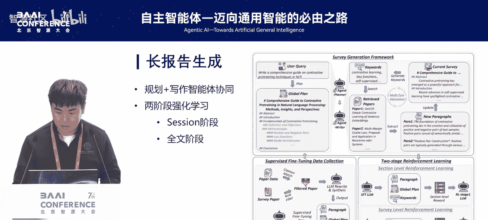

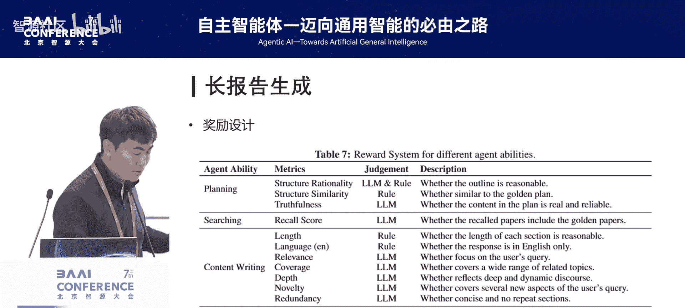

它相关的重视度。那么它的一个啊效果是最最好的啊，那么在此基础上呢啊有了啊就是啊所谓的啊就是d research这个探索之后呢，那么我们同时去面向了啊就是GI agent也去做了这种啊就是强化学习的探索。

那么啊就是Gagent相比于啊就是啊就是serv generation这个场景的话，那么它的复杂点就是说它其实是一个多模态的场景。它的呃就是工具的呃就是交互方式其实是通过模拟点击的方式去进行交互的。

那么啊它其实需要的是说你能够去啊比较好的去理解啊所有的GI控件，理解不同的APP那么面向这个场景呢，我们就去开发了所谓的agent cPM跟GI。那么在这个啊场景里面呢啊我们有三个比较大的共献点。

一个是我们面向啊就是中文。

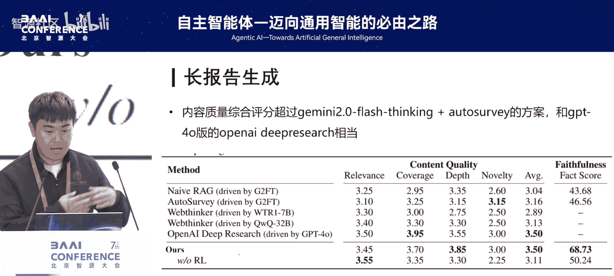

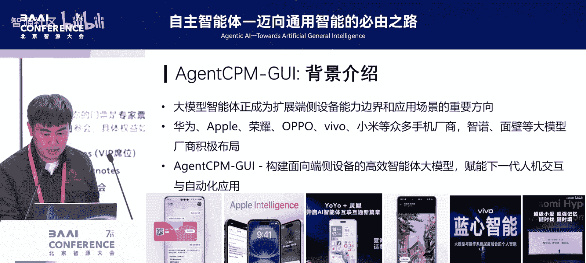

场景，然后变向英文场景去做了一个非常高质量的数据。把现目前市面上所有数啊就是呃就是在GY这个场景上啊的数据进行了集成吧，并且把里面的重复的啊里面的噪声都啊进我们的可能过滤掉。

第二个呢是我们通过啊就是强化微调的方式，让模型去学会了啊就是真正的怎么去在GY的场景下进行申品。同时呢我们面向端测，我们去啊就是d在一个面向端测的这种紧凑的schema。

那能够极他的去啊就是加速它的啊端测的解码。那么具体来说啊我们面向啊就是mini象去继续预训练。那么从OCR图标理解图标检测等三个方面去增强了它的这种基础视觉理解能力，以及GI grounding的能力。

在此基础上，我们去做了一个啊就是安卓的操作轨迹的SF啊。

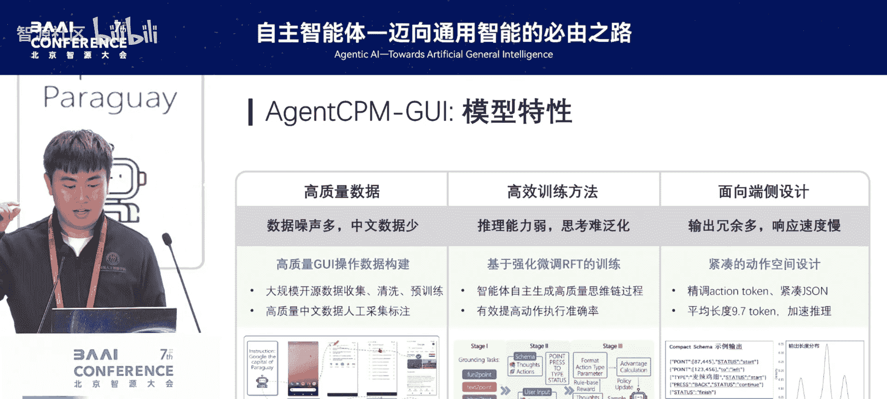

那么里面用到的数据，包括我们人工构建的这种啊就是国产安卓系统的这种APP操作数据，以及呢混合了啊目前AITW安卓 controll等啊开源的英文安卓数据啊。

我们对这些数据进行了啊非常详细的啊就是仔细的清理啊，把里面的噪声都去掉了。最后呢啊在此基础上我们在SFT基础上去啊让模型啊尝试out这中间的啊啊思考过程。

然后呢通过你在一个奖励模型去啊就是啊就是引导大模型能够去啊通过强化学习的方式去生成高质量的思考过程。那么在这里面呢我们的ge的其实就是啊这所谓的这种啊就是chema的re的re就是你动作执行长功率的re以及动作参数的re。

那么在做了啊这么一件事情之后呢，我们发现就是。就是我们啊通过啊这么一套来法之后，我们能够在所有的中英文的这种agent的上都取得啊so塔的效果。

包括比如说安卓 controll o disney然后包G啊ITZ以及中文的这种APP超过了啊目前比如说像UI task啊像千问啊等一系列的这种啊就是GI的 model。最后就我们啊还关注一个点。

就是我们其实希望智能体啊，不要啊就是能够在尽可能在减少人类介入的情况下去完成这种任务。那么啊第一它不太需要很多的人类先验。第二它也不太需要人类干预。

那么啊面向这个呢我们也去探索了所谓的主动式的工具型智能体啊，什么是主动式的智能体呢？就是说就我们认为目前大多数的智能体都是所谓的被动式的智能体。也就是说你需要有一个啊所谓的这种啊就是人。

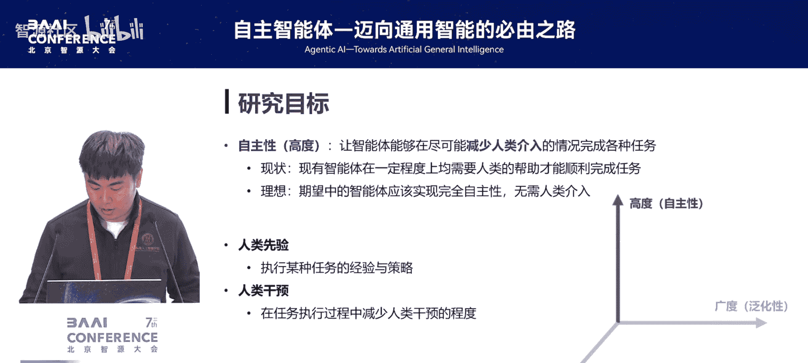

类给他一个指令，那么他才能够去啊就是理解这个指令，然后去为人类提供服务。那么什么是主动是智能体呢？我们希望的是说他能够去啊比较主动的去预测人类的需求。比如说我现在啊就是拿开手机。

他可能啊能够感感受到我要拍照，他自己打开了这个拍照的APP或者说我中午12点的时候，我啊就是打开我的手机，他可能知道就是说我现在要点一份啊黄焖鸡米饭。

那么啊他其实自动的就弹出来你是不是要点一个黄焖鸡米饭，我按一下试，我可能就啊就是啊可以关掉我的手机了，甚至乎更自足一点就是什么呢？那么比如说我现在啊就是明天可能有一个啊去西安的出差。

那么我也不用啊就是预定我的飞机，也不用预定我的啊车，可能我每天到到明天早上8点一起来，我发现我的那辆啊就是我预定的这个专车就已经在楼下接我。那么为了去啊达到。这一点。

那么我们希望的就是说其实我们的智能体能够去理解啊环境。然后呢啊根据啊环境发生的事情去主动的预测人类的需求啊，面向这个场景呢，其实我们就去构建了一个基于啊就是这种环境模拟的啊。

就是这种基于进的的这种啊主动式任务的这种生成啊主动式任务数据的这种生成场景。那么在这个场景里呢，我们有三个啊不啊不模块，第一个是一个环境的模拟器。第二个是一个主动式的智能体。第三个是一个用户智能体。

那么这个环理环境模拟器呢能够去啊根据我们的啊就是提出的要求去模拟一个特定环境。那么为啊就是啊我们主动式智能体和用户智能体去提供一个沙核条件。那么这个主动式的智能体呢。

能够啊干的事情就是说通过环境模拟器去提供的这种信息去预测用户的意图去生成预测任务啊用。

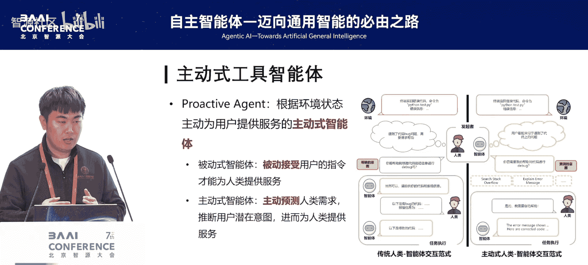

用户的智能体呢是将模拟用啊模拟用户的行为，并对主动的啊智能体提出的任务去反馈说它是呃合理的还是不合理的。那么啊具体来说呢。

我们针对代码编写文章写作和智能家居三个场景去构建了这种场景模拟器来模拟啊用户跟环境啊交互的这种事件序列。然后呢啊在里面呢，我们就可以去构建需求啊，就是这种啊就是主动式的这种需求预测智能体去提出用户啊。

所有可能在某一个事件发生时，他啊就是可能会有的一个需求。然后呢，我们最后让标注人员对提出的需求去进行判定，得到一个用户数据。我们最终构建了136个场景，一共7000多个事件。那么基于我们构建的这种数据。

我们训练的这个拉ma相product的模型呢啊在代码编写文章写作和智能家居三个场景里面，那么我们都验证了它有主动。

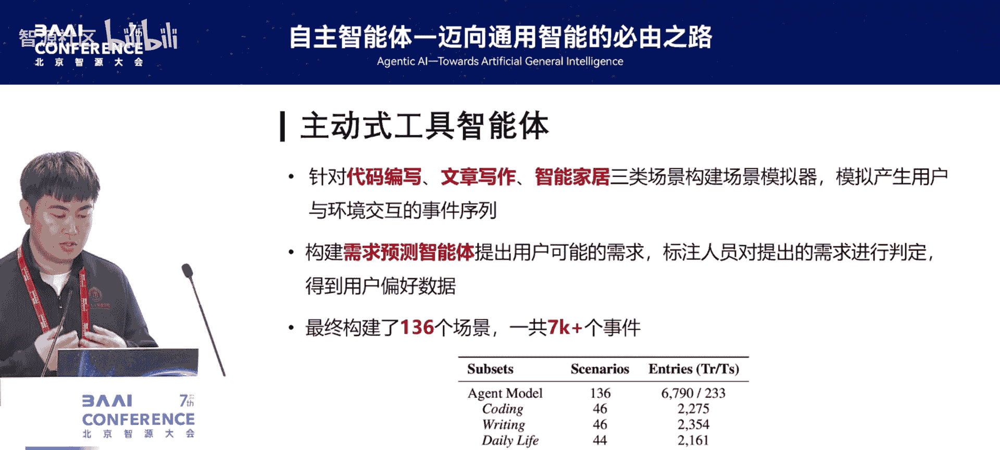

测人类需求能力。那么它的一个呃就是预测的性能呢达到了一个啊就是包啊超过啊就是市面上包括cloud啊GB4O等一系的模型达到了百分之呃66的最高的FE score。那么这是一个呃就是具体的啊scase。

那么其实啊就是具体大家可以看到，就是说哎比如说我现在啊收到啊有人发给我在课件共享群里发给了我一份课件。那么其实我的模型就能够主动的理解到，就是说哎我可能需要把这个课件去存到我的一个具体的名地方。

而且我希望把它从命名成一个我以后能理解的一个名字。那么啊这件事情呢啊如果其实啊就是智能体能够主动的做到这一点，那么我就其实不用啊去布置任务。那么其实我们训练的主动是智能体就能够去啊完成这样的一个目标。

那么啊最后呢其实也是啊非常啊就是啊感谢大家提供的报告。

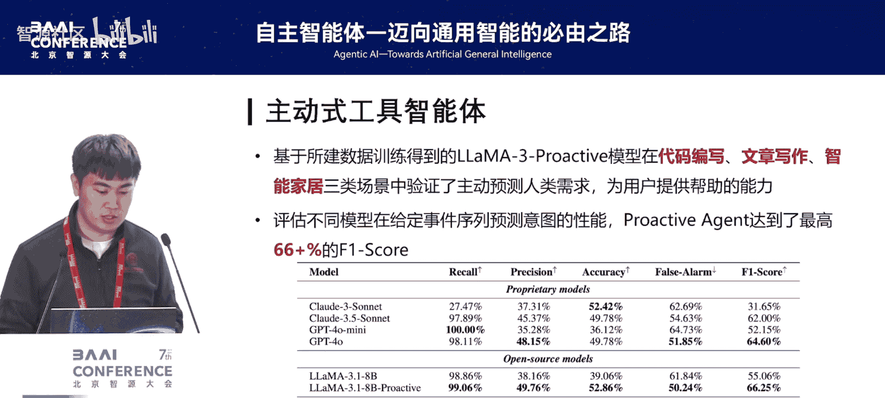

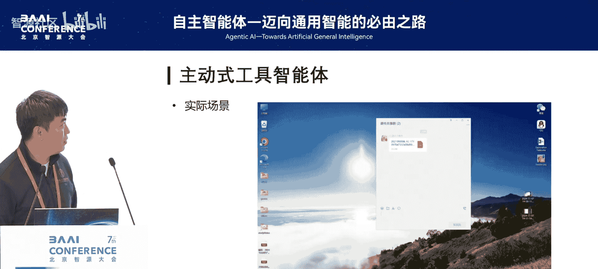

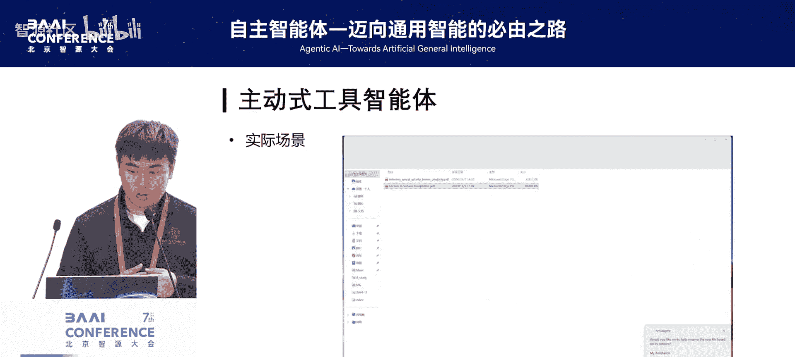

然后其实我们啊就是我们的团队一直在啊focus on的，就是说我们能够持续的啊沿着大模型自主智能体的这个方向走，把他的能力推向所谓的通用的啊，就是AGI。那么啊也是欢迎大家加入我们，谢谢大家。好。

由于时间关系，我们给一个比较快速的问题，看大家呃举手示意嗯。有吗？想问一下，这个就是思维链还有什么改进的，就是呃空间吗？呃，思维链其实本身呃就是我觉得它呃就是第一其实呃就是呃结合着外外部环境。

就是其实rereact的思维链。其实本身这套架构应该是相对比较泛化的。那么它的改制空间，其实更多的其实来自于就是说我们能让模型输出更加合理的思维链，就是去增强模型本身的这种呃就是呃能力的角度。

其实啊会呃更多一点。当然就是其实也有一些所谓的什么ch of sort啊，或者说graph or sort。但其实从我个人的角度就是其实这些更多的是把人类经验加进去了。但啊就是目前的改进空间。

更多的是把人类经验慢慢去掉，把它啊学到模型里面去。哦，好的，谢谢你哦，还还可以再再问一个问题吗？呃，快哦，好的，就是就是呃。😊，啊。

就是之后的发展是就是会有呃有些系统是多个agent在一起这种会效率更高，还是说就是使用使用单个agent这样呃。

对我觉得其实啊以后肯定是会有所谓的多agent的就是单agent本身其实就是就是他的能力其实更多的层面，它会面向于啊就是单个任务。因为其实啊如果我们啊最终面向端测的话。

我们希望的是说我们能用最小的这种模型能力去完成一件事情的话，那么其实mtyagent，其实就能够把啊就是具体的解决某一个特定事情的这种能力再给它啊凸显出来。

那么其实以后肯定是一个mtyag的协作的这种来访。那么一会也可以听一下钱博士的啊钱老师的报告。