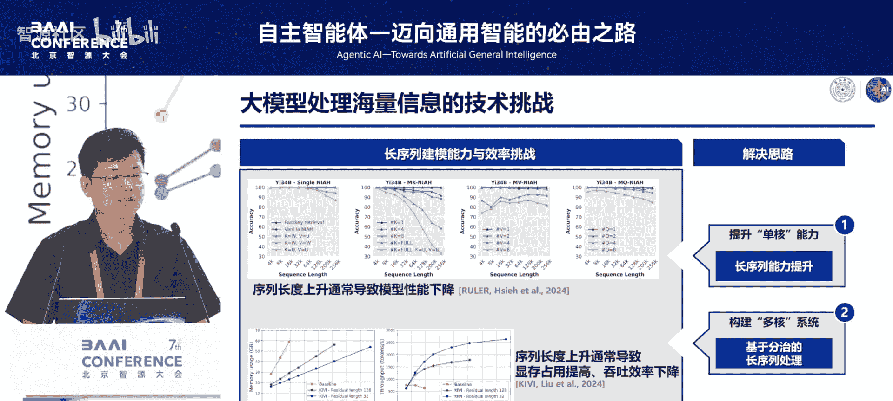
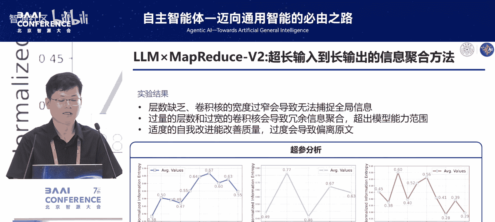
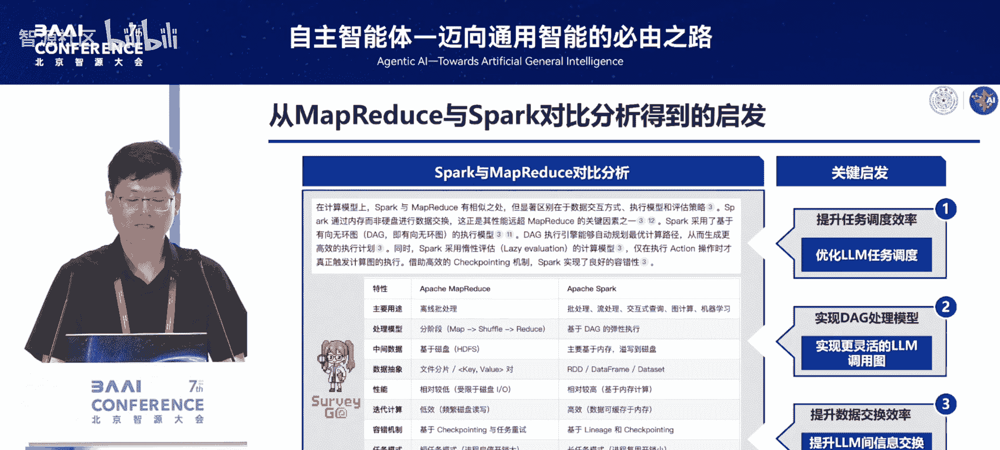
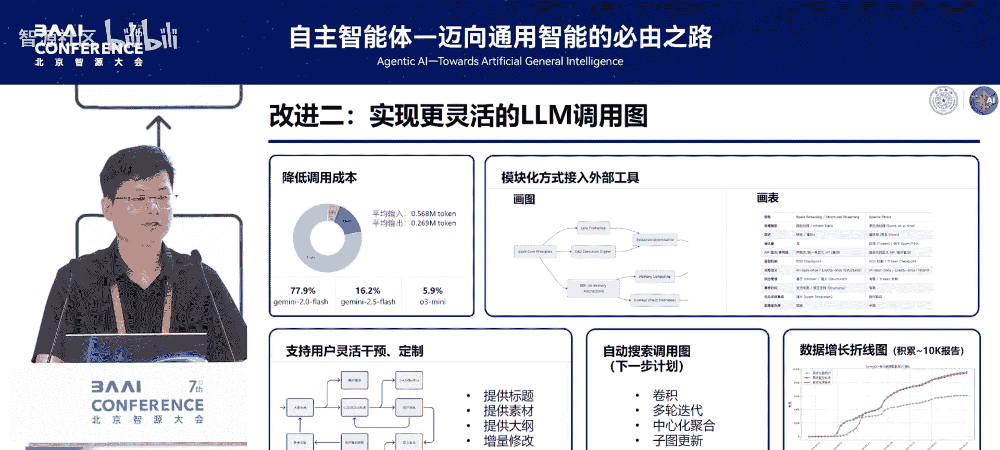
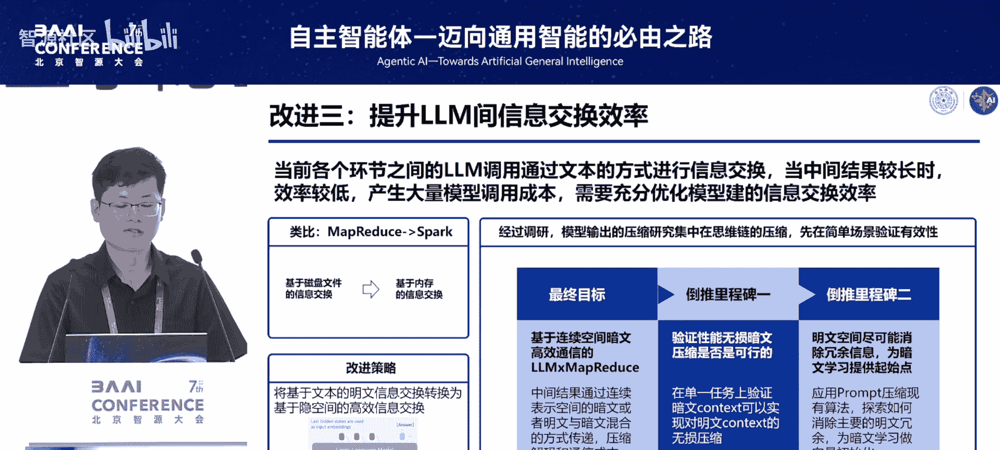
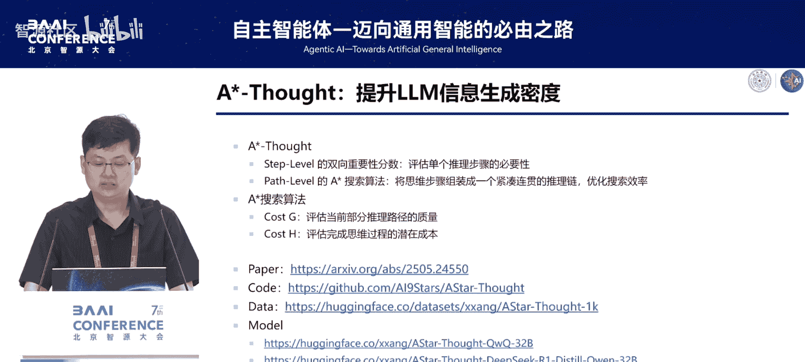

# 2025北京智源大会-自主智能体——迈向通用智能的必由之路 p05 LLMxMapReduce--基于分治思想的长序列处理：王硕 -BV1ccN7z5ETU_p5-

大家好，我是呃来自清华大学的王硕，非常荣幸参加今天的论坛。今天我将为大家分享我们团队在长序列处理方面的一些探索和实践。我们提出了一个基于分制思想的框架。

称之为呃LLM乘mre这个想法的灵感其实来源于大数据领域，一个非常经典的呃技术。我们将这个经典思想与当前强大的大模型相结合，希望能够有效的解决呃大模型在处理超长文本时遇到的一些挑战。呃，今天的报告中。

我我将首先回顾大数据领域m reduce的历史。然后引出我们在大模型时代遇到的问题，并详细的介绍我们呃这个框架的两个版本，以及我们为了提升效率所做出的一些改进。在正式介绍我们的工作之前。

让我们先花一点时间回顾一下大数据领域的mre呃，其实mreuce诞生是呃源于21世纪初呃数据量的爆炸式的增长。呃，像谷歌这样的工。😊。

公司他需要处理海量的网页和用户的日志，呃，这远超当时传统的这个呃单机处理的能力。呃，为了解决这个问题呢。呃。

谷歌的工程师们就借鉴了呃那个list呃lisp这个函数式编程语言当中的这个呃map和reduce两个操作言原语，设计出来一个能够呃大规模呃并行处理的一个计算框架。呃。

其中这个map的这个操作的呃这个顾名思义，就是我们将输入的数据进行转换，生成一呃一组中间的这个键值的对，然后reduce的操作是呃将呃具有相同中间建的这个值聚合起来，得到最终的结果。

这个泛而致至的思想配合上容错机制和一些呃廉价的商用机群，使得谷歌能够高效的处理。这个大规模的数据。呃，好的，让我们把这个视线呃拉回到大模型时代。现在大模型的能力是越来越强。呃。

但是他们在呃他们现在也面临着和当年大数据系统非常类似的一个挑战。那就是如何处理长的信息。呃，首先在输入端，当文本的序列变得非常长的时候，呃，现有的模型的性能会显著的下降。呃。

这张大海捞针的实验图就展示了呃，随着序列长度从几千增加到呃几十万。然后模型的准确率会出现一个明明显的掉头的一个现象。模型在这个长篇大论中会迷失它的方向。呃，同时呢长序列的处理也带来了巨大的计算开销。😊。

呃，从这个图表我们可以看到呃序列越长，对显存的占用就越高，而处理的呃效率就会急剧的下降。呃。面对这样的问题，我们很自然的有两个解决思路。第一个就是我们去提升大模型它单核的能力。

也就是我们呃去训练一个具有长序列处理能力的呃这个模型。然后第二个思路呢就是我们构建一个多核的系统，呃，使用基于分制的思想，让多个模型相互配合来完成这个长序列的处理。我们我们主要就是关注于第二点。

这个基于分制思想的呃长序列处理。

其实把分而治之这个思想应用到呃这个任务上，它是非常直接的。呃，就我呃我们可以把一篇长文档把它切分成若干个呃短的片段，然后让模型分块去读，最后再把这个结果汇总起来。呃，这样做有一个好处，呃。

就是它的可扩展性比较强，理论上是可以支撑呃任意长度的输入。呃，但是呢它也呃从同样存在很多劣势。主要的这个问题就在于我们通过这种切割的操作，很可能会破坏掉原文当中呃跨片段的这个呃关键信息。比如说一个事件。

它完整的逻辑链条，可能分散在好几个片段里面。呃，如果模型只看到其中部分的片段的话，可能会产生一个断章语呃断章取义的问题，从而导致一些错误的结论。呃，具体来说这种呃断章取义的问题，它主要是呃分成两类呃。

第一类是这个跨片段的依赖的问题。比如说多个片段，它的信息是相互呃相互依存的，我们需要综合起来才能得到答案。然后第二个就是跨片段冲突的问题。就是当我们即使是呃回答同一个问题，当看不同的片段的时候。

可能得到的结论是不一样的。为此呢，我们也分别提出这个呃结构化通信协议和上下文知信度校准这两个技术来缓解这两个问题。呃，基于呃基于以上的分析，我们正式提出了这个呃LLM乘ma这个框架。呃。

这张图呃展示了我们这个工作的流程。首先呃将一篇长文本切成呃切分成多个片段，然后进入m呃map这个阶段之后，我们让大模型像一个呃这个大数据领域的这个mpper一样，它呃抽取出来一个结构化信息。

然后在大数据领域的这个markap，它它是抽取出这个KV的pe，然后我们在这里是呃得到呃包括answer，然后以及它的这个它中间的这个理由呃这个COT，然后还有一个对应的知信度的分数。

如果模型认为当前片段不包含任何有用的信息的话，这个片段也会被直接丢弃。呃，接着让这些结果会被模型呃呃逐次的呃reduce成最终的结果。呃，那么这个呃框架的效果。

我们在长文本的呃评测基准infin奔驰上进行了一个全面的测试。呃，这个表格展示了我们框架和当时主流的呃闭源模型开源模型，以及呃其他基于分制的框架的一个对比结果。从这个数据我们可以清晰的看到，呃。

无论是搭配呃这个呃当时的这个呃比较知名的开源模型，像拉ma和千问还是呃基于呃我们我们自研的一个模型miniCPM这个框架都可以取得非常好的效果。呃，并且。呃，并且基于一个即使仅基于1个4B的模型。

它的效果就可以媲美。当时像那个呃kimi，还有呃GB4这样的模型，在这个长序列任务上的评分。此外呢我们还进行了一系列的对比实验和分析。呃。

左上角这个对比实验的表格是呃来验证我们这两个呃组件它的呃一个效果，分别包括呃呃这个知信度校准和结构化通信协议呃，我们发现如果分别去掉这个知信度校准和呃结构化通信协议的话，模型的性能都会出现明显的下降。

呃。第二点呢就是右上角这个图，我们也展示了。呃，这个在处理长达呃呃超过100万的。在这里我们是1。28m的这个token它的一个表现。呃，可以看到，即使是呃处理这呃这样一个超长的序列。呃。

我们这个框架同然同样能够具有比较好的这个信息的召回和处理的能力，然后下方这三个实验分别是一些实验分析。比如说我们当我们使用re的时候，这个使用不同的这个创size的呃，它的这个实验效果。

我们发现确实这个呃创客比较小的时候，可能会导致信息过于碎片化，它的质量会低一些。然后当这个随着创客的升高，然后这个效果会逐渐的上升。呃中间的这个是推理速度的对比。

其中这条路呃这条绿色的线是呃我们的方法呃，它它在不同的GPU数量下，这个呃完成同样的这个长度的序列处理的所需要的时间，可以看到相比于呃无论是模型直接的推理还是其他的这个主流的。

像long agent或者呃google提出来这个ch of agents呃，都有更高的这个处理效率。啊然后最后呢也我我们也呃展示了一个例子，就是当呃当我们看不同的片段它的答案冲突的时候。

确实这个知信度会帮助模型呃，确认最后的呃这个正确答案是什么。呃，在探索如何使用分支思想之后，我们也进一步思考能否将这种思想用于训练的阶段。呃，特别是生成高质量的对齐数据。呃。

目前主流的长文本的数据生成方法，比如说longline呃，主要是基于全文的内容来生成呃，或者像IN two这样的工作，它是从文档的局部片段中生成问答，然后再关注呃细粒度的信息感知。这两种方法各有优劣。

前者是考察的这个全局的信息整合能力，而后者呢主要关注呃局部的细节。呃，为了结合二者的优点，我们提出一个新的这个数据生成方法，叫做呃pyyramid line。

它的核心思想就是首先用大模型将一篇呃长文档处理成一个具有层次化结构的金字塔的一个树状结构。呃，这个树的呃叶子节点对应每个原始的片段，而上层节点则是对下层的概括和总结。有了这样一个结构之后。

我们就可以在不同层级进行采样来生成问题。呃。呃，在根节点采样的话，就是类似于lanline。然后如果是呃在叶子节点采样的话，其实就类似于Iin two。然后我们如果在不同的层次进行提问的话。

就能生成呃不同力度的一个呃对齐的数据。呃，最后实验结果也表明我们这个呃当使用相同的呃这个这个模型进行训练，并且使用相同的文档进行数据合成的话。

这个pyramid line确实具有更好的这个呃数据合成的质量。呃，前面讨论的这个框架主要解决是长输入到短输出的任务。呃，当时我们做完之后感觉还不够实用。

因为呃其实在大数据领域的这个micer就它处理的都是PB级的数据，我们最多也做到了呃也也只做到了呃one million的这样一个长度，还是大海捞针这样的合成任务。

那么能不能进一步的就是在真实场景之下发挥这个呃奋而置之它的处理的潜力。通过调研，我们发现其实还有一类更复杂的任务适合这种分而知志的场景，也就是呃超长输入到常输出的这样一个呃一个应用。

典型的例子就是我们可以根据海量的呃参考文献来生成一个呃一个长报告。这个长报告它具有较高的信息密度，并且中于原文的呃是中于原文的一个长篇的综述。呃，那么这个问题呢，它的核心挑战主要有两点。

第一个是呃资源的收集。呃，在这里有一些有有一些工作，像s或者欧methink这样的工作，就是我们更好怎么去更好的去找到我们需要的素材。呃后第二个呃维度呢，就是有了这些素材之后。

我们怎么去给它进行更好的利用。比如说像autoserv位这样的呃一些非常呃和我们非常相关的一些工作。呃，那么在这个资源利用的这个角度上呢，其实有两类。呃，两两两个范式。第一个就是抽取式呃。

就是我们从这个资源当中抽取一些片段来进行使用。它的风险就是我们可能会遗漏一些细节。或者说因为每次我们只是抽取局部信息，缺少高级的这个全局的抽象。然后因此呢我们就采用这个聚合式的方法。呃。

就是如果我们类比CNN的话，那个这个卷积神经网络，它在处理图片的时候，每次其实只看一个局部的感受也，然后通过逐层的卷积来抽取高呃来获取高级的这个呃全局特征。

然后因此我们我们的设计就是呃通过这个map的操作来进行单篇素材的理解。然后通过反复的去reduce类比卷积神经网络来呃得到这个全局的特征。

然后具体的做法是呃我们首先在第一个阶段呃获得对每一个就是这个每每一篇素材它的一个理解。然后在呃第二个阶段。

我们通过呃去反呃这个多层累计的这个convolutionalt time skin的方式来得到一些高级的呃这个结构。然后为了保证我们在进行这个多层的呃这个累计的时候。

它的信息是一直在提升并呃不是而不是去探索的。我们在这里面也引入了一些这个信息商的一个评估方法来来使用这个enttrophy来指导中间的这个过程。呃，右边这个图展示了我们这个方法整体的一个框架。呃。

为了评测这类任任务呢，我们首先构建了一个新的评测集叫做这个serv e。它是呃也是计算机领域首首个将大量的这个呃学术学术综述和它引用的呃参考文献的全文匹配出来的一个数据集呃。

一共包括呃呃384篇综述和超过26000篇去虫后的参考文献。呃，从这个表格可以看到，相比于其他的数据集。呃，这个serv e在输入的长度和参考文献的呃呃数量方面都是呃呃都给这个大模型提出了更高的挑战。

啊，以上呢是我们呃从其中抽取出来比20篇比较高质量的呃代表性的这个综述作为我们的测试集。对于生成的综数，我们也设计了多维度的评估指标。呃，我们不仅使用大模型来进行自动化的评分。呃。

考呃这个考虑它的结构质量、内容质量，还有引用的准确度。然后同时呢我们也呃进行了严格的人工评测呃，右侧展示的是我们当时人工人人工评测的一个界面呃。

这个呃这个我们人评的结果呢呃显示的是在与auto设位的这个直接对比当中呃，这个map reduced VR取得了62。7%的胜率。呃，这也是一个非常显著的优势，证明我们这种聚合式的信息利用的范式。

还是有一定的优越性的。呃，我们再来看一下更详细的自动化评测的结果和超呃这个一些超探的分析。呃，这张表格对比了我们的方法和和一些呃代表性baseline的一个对比。呃。

可以看到在呃无论是内容的质量还是引用的准确率，还是呃这个呃它的这个信息的密度方面，我们的方法都具有更高的这个得分。我们也对卷积的过程进行了一些超参数的分析。比如说呃左边图显示的这个卷积层数的影响。呃。

我们可以看到在呃当我们这个卷积层数上升的时候，它的质量是先升高的，但是也不是一直升高。当呃当这个呃累积的层数特别多的时候，也会由于这个信息的失真，导致一定质量下降。啊。

我们也探索了卷积核它的宽度对质量的影响，以及这个selfre的次数对质量的影响。

基于我们这个呃LLM乘mpreuce V2这个技术，我们开发了一个在线的应用，叫做serv go。然后用户只需要输入一个主题，或者上传相关的文献。呃，系统就可以自动的进行呃网络的检索文献的整理。

并最终生成一篇这个结构呃结构详实的这个报告。然后右侧这个呃也展示了我们的一个实际写的一个例子，可以看到呃，无论是从长度还是呃引用的这个情况来看，呃，也是呃在当时来看都是一个呃。

我我们认为还是一个非常可实用的一个系统。呃，目前呢我们这个呃这个呃所有的这个算法的代码已经进行了开源。呃，并且这个在线的系统已经生成了近呃近万份这个长报告，包含超过40万的这个参考文献。

也欢迎大家呃免费试用我们的这个系统。呃，报告的前半部分我们主要介绍了这个LM乘mapre。但就像我们开头提到的一样，呃，其实在大数据领域，map reduce也有它呃非常多的这个固有的局限性。呃。

这个他们的这些局限性也催上了呃后续的一些工作，像spark的这些呃这些这个呃这个改进的产品。呃，我们呃我们让让这个servwego对这个spark与marketer就进行了一些分析。

然后呃这个是servwe购总结的一些特点。然后通过我们实际去调研，也发现这些特点也是切实存在的。呃，就是呃。呃，spark相比mpred主要从这几个方面进行了改进。呃。

首先它使用内存的计算来代替了磁盘的IO，提升了数据交换的效率。第二个呢是它采用了基于呃有向无盘图的执行模型，呃，调调度更加的灵活和高效。同时它的这个惰性评估和长任务的模式，也优化了资源的使用。

然然后这里的这里的优势总结呃，也也也启发我们怎么去改进我们的这个呃mapre这个系统。然后主要有三个方面。第二第一个就是提升任务的调度效率。呃，第二个呢就是实现DAG的这个处理模型。

然后第三个就是呃提升数据的交换效率。

呃首先是这个任务调度层面，我们最初的这个色位购的这个系统采用的是和pre一样的这个批处理的模式。呃，用户提交一个任务之后，有时候可能需要等待呃长达数小时才能拿到最终的结果。而右边这个耗时的分布。

我们可以看到呃，无论是呃网网页的检索模式，还是用户自己上传素材，它每一个环节都呃都有可能存在一些呃耗时非常高的一些任务，从而拖慢整个这个批处理的效率，导致大部分的任务响应的时间都非常的慢。呃。

因此呢我们也是呃正在优化，目前已经实现了呃类似于从这个spark的这个批处理到VP处理的这样一个演进。我们对系统进行了呃一个重构，将大量的这个批处理任务拆分成了呃队列式的VP处理。经过优化之后。

这个大部分的环节，它的运行时间都大幅缩短。目前用户提交一个任务，这个响应的时间可以呃最快达到10分钟。左右和呃无论是jamnet的deepre，还是open eye deep research。

都是一个呃可比的速度。呃，这样会带来一个更好的一个用户体验。第二个改进方向呢是呃我们可以实现更灵活的调用图。呃，当前的我们这个mpreduce工作流在很大程度上还是一个呃固定的线性的一个流程。

是呃呃通过应编码的方式实现的。呃，这样就会导致它缺乏灵活性，呃，就像早期的这个大数据领域的mpreduce一样。呃，我们目前正在做一些重构的工作。呃，就是将整个的这个算法进行呃结耦。

从一个固定的一个线性的结构改造成一个基于DAG的弹性的执行模型。我们把每一个环节都封装成独立的呃MCP to kit，这样可以通过呃灵活的呃算法策略，并支持在中间的过程引入人工干预。

来实现呃整个工作流的自动搜索和人工定制。呃，这一点呃这一点我们目前正在实现和完善。然后这种呃结构化的设计呃其实带来了很多优势。呃，首先呢就是呃我们的可以通过呃让不同的模型去参与不同的环节，呃。

来实现整个成本的降低和效率的提升。呃，因为在整个报告生成的过程中，有些任务是比较容易的。比如说单篇文章的这个呃map的操作。呃，有些任务呢它是比较复杂的。它可能需要呃对呃模型的能力要求比较高。

因此这种模块化的设计让我们可以呃把一些简单的任务去分配到呃这个呃便宜点的模型或者说弱一点的模型。然后这个复杂的任务呢，我们可以使用一些更呃更昂贵的模型来处理。呃。

这样呢呃最终我们现在这个平均下来这个设维购线上的系统呃，它其中有77。9的这个任务，我们只使只使用一个呃像ja奈2。0flash这样一个中小贝的模型就可以。呃。

这样的话对整个的这个呃生成的质量也不会有太大的影响。然后同时这种模块化的设计，也让我们更好的去接入外部的工具，可以进行一些呃画图或者呃制表的一些呃一些操作。呃。

目前我们呃我们的这个数据呃进行了这个呃呃接近两个月的这个积累之后，也在和各位用户进呃进行这个呃呃交流和沟通。如果有机会的话，我们也会把这个呃高质量这个报告数据作为开源数籍的方式进行在开源社区进行分享。

呃，第三个呢也会也是我们认为最关键的一个改进是呃提升大模型之间的信息交换效率。呃，在我们的框架之中，呃，不同阶段的这个呃这个大模型，他们是通过文本的方式来进行呃信息的传递的。

也就是铭文的这样一个信息传递过程。它的呃当这个中间结果很长的时候，呃，这个过程的效率会非常低，产生大量的这个呃token的消耗和调用的成本。呃，这其实好比这个mapreduce，它是呃在大数据领域。

它是基于磁盘文件来进行数据交换。而sk呢是基于内存进行数据交换。我我们就想我们能否呃类似于从呃m到park这样一个演进，我们也提升这个呃大模型之间的这个信息的交换的效率。呃，这样做的好处是比较明显的。

但是呃这种暗文传递的这个这个这个方式，我们通过调研其实目前来说还比较的呃比较初步。因此我们通过倒推打呃呃多步倒退之后，我们就发现需要现在呃明文空间进行这个冗余信息的消除。

这也是我们来进行一个暗文学习的一个起始点。

啊，这就启发我们呃就是引发我们做了最近的一个工作，叫做这个astar salt。然后这个工作它的主要的目标呢就是提升啊这个大模型呢它的信息生成的密度。呃，经过调研。

我们发现就是这个目前这个long to shot这个最先进的方式呃，最先进的这些算法都是在呃这个四维链压缩的任务上进行实验验证的。因此我们也选择了这样一个场景来定位铭文空间的这个关键信息。

并且进行信息的这个冗于消除。呃，我们发现这个冗余信息它其实主要存在于两个呃两个层面。第一个层面就是呃呃这个steppe level或者说token level的。呃，它的这个问题定义呢。

就是我们呃需要去判断哪些token具有较高的重要性，或者说较高的信息量。呃，然后第二个呃层面呢就是这个呃pass level的。呃，我们需要去判断哪些句子或者片段。

他们对于模型得出最终结论呃是不可或缺的。然后这就启发我们去呃呃设计一个启发式的这个呃呃搜索算法，利用这个呃同时呃兼顾spe和pass level两个级别的信息来消除模型输出的冗余。呃。

首先我们先定义一下我们这个呃这个问题呃，就是呃我们为了这个呃去消除冗余信息。我我们的这个目标呢是呃去处理模型的思维链呃，比如说模型它是它在生成过程中会包括呃N个呃推理步骤。

从TE到TN然后以及呃模型根据呃问题得到的答案。然而随随着这个推理步数的增加。呃，这个序列会非常长。然后因此呢我们需要先对这个思维链当中的每一个呃token进行一个重要性的一个呃一个估计呃。

在这里我在这里我们提出了这个呃呃双向的重要性估计BIS，然后它具体的算法是呃我们从两个层面，第一个是在attention层面，我们使用注意的权重来计算每个token的重要性。

然后同时我们也使用这个呃这个呃这个 log在模型层面来对这个呃每个token进行重要性的。一样，然后最后我们把这两两两类分分数结合起来，得到呃最终的这个呃。呃，这个重要性的估计。呃。

但是我们仅呃仅对单个的呃步骤进行排序还是不够的。我们还需要把这些重要性的步骤来串联起来。这就是我们在呃pass level做的这个呃a star search的这个工作。呃。

这个过程就像在一个巨大的所索空间里进行一个呃最优路径的一个呃一个查询。然后我们这个整个过程分成初始化呃验证和和这个exploration三个阶段。

然后整体的这个这个这个算法也是一个典型的一个一个Astar search的一个过程。呃，其实呃在这个A star的这个A star search的过程，最关键的是我们如何去定义它的呃代价函数。

然后在这里我们同时设计了两类呃代价函数。第一个是呃它如何去估计当前的代价。这里我们是使用一个验证模型来去衡量中间的这个呃思考过程的质量。然后第二个呢是我们去定义它的呃未来的代价。

这里我们是当我们有了这个当前的这个思维链之后，它去估计这个最终正确答案出现的呃自信息。也就是说它呃它有没有可能这个呃在我们当前的这个步骤上呃，找到正确答案，依然是呃一个比较低概率的事件。

通过同时结合这个呃当前的current cost和se cost，我们来完成这个整个的这个a star search试的一个过程。呃，最终我们在多个数学呃数学推理的数据集上对这个方法进行了验证。呃。

我们也计算了这个ACU指标。它的意思是呃这个呃模型的这个准确率和呃最终生成长度的一个比值。呃，我们发现在不同的模型和这个inence budget这个呃设置下。

我们这A2 salt都相比于基线方法和其他的这个呃token压缩的方法，取得了更优的这个ACU的分数。呃，特别是在一些low budgetlow budget这个场景之下，呃。

不断它可以提高这个ACU也可以提高模型的准确率。而且在呃在一些high budget这个场景之下，呃，模型也可以呃更好的去呃降低这个思维链的长度，同时提升呃这个大模型信息生成的呃信息密度。呃。

为了验证A star salt的这个泛华性，我们也在多个不同系列的模型上进行了实验。包括呃像呃QWQ呃R one disQ和这个呃S1。1的这些模型。我们发现呃在不同模型和不同预算下呃。

A这个Astar salt都具有更高的这个ACU的表现。呃，一个非常呃。呃，一一个非常一致的趋势呢，就是当我们的这个呃这个。呃，inference budget越小，这个ACU往往越大。

这也是呃展示了这个C维链压缩的一个呃非常呃非常好的一个应用前景。呃，除了推理时性能的提升，呃，Astar salt也也也也可以去提升训练的效率。在这里我们计算了一下。

用于呃A4R salt压缩后的这个训练数据，它呃它可以呃保留思维量当中更多的精华。然后我们从这个表格可以看到，相比于原始的这个呃这个数据呃，我们这个呃训练数据的长度可以压缩将近呃百分之呃呃将近70%。

然后这个训练时间也相应的减少了20%。更重要的是，我们从这个呃training loss的曲线可以发现呃，使用我们的方法进行训练模型的呃收敛的这个lo更低。呃。

这个其实当时呃也是比较呃让我们比较surprise一点。因为呃可能我们对这个思维链进行了压缩和裁剪之后，它的这个呃它这个呃这个文本不是非常自然的，可能是比较难学。

但其实我们发现它它这样呃经过这个加工之后，会反而会得到一个更低的一个training loss。呃，我们可以通过一个例子来直观感受一下，左侧的这个是呃是被算的这个推理过程。

然后右侧是使用呃碎维链压缩之后，可以看到模型可以针对这个一个这个披萨配料组合的这个问题，更呃更直接的去找到这样一个组合的呃通过呃通过这个组合的公式来进行推理的一个呃一个过程，直奔主题。

然后可以呃更加精简和集中的使使用这个思维链。然后总结一下的话，呃我们呃通过这个a star的这个在sstep level和pass level的组合优化，来提升了呃这个呃思维链的信息密度。

从而呃从而从而进一步提升模型的推理效率。我们相关的这个呃论文代码和呃模型都已经在网上公开呃，也欢迎大家呃和我们访问和交流。呃，我的分享就到这里谢谢呃谢谢大家。

好，啊由于时间的关系，我们应该也只能有呃一个问题。我在后面上面。老师好啊，我是北邮的博士生。就是我有个问题就是在于现在我们agent通信之间是用自然语言进行通信的是吧？但是就是我在思考一个问题。

就是说因为之前我们用大模型的话，是因为人和模型要做交互，所以它输出的是自然语言或者图像音频的。但是之间交流的话，就是一定要用到自然语言嘛。因为如果用自然语言的话，就会我们不得不做一件事做压压缩，对吧？

会有冗余信息，人可以接受冗余信息。但是模型可能都不需要冗余信息。就是如果说我们模型和模型之间A是通信直接用向量来做通信的话，可能会使得效果更好嘛。因为实际上我们做数学角度出发的话。

你把向量模型参数全都敲死了，其实生成的结果是大差不差的那如果说我们模型和模型之间用向量直接进行通信的话，有没有可就是会不会会得效率或者生成效果更好呢？我只是一个自己的一个想法和猜测。😊，嗯，好的。

我呃我感觉这这个问题非常好，就是呃我个人还是非常相信，就是通过向量的通信可以最终呃取代或者在某种程度上取代基于文本的通信。因为这天然是就是模型之间信息交互的一个更好的方式。呃。

但是呃受限于当前的这个呃技术呃可能是需要一个多步骤的这样一个策略。比如说我们能不能先把这个文本做的呃冗于越来越少，然后进一步的它能不能作为一个起点，让模型去学习这个lant space的一些通信。

我感觉这个是呃非常值得研究的一个问题。嗯，好的，谢谢老师。