# 2025北京智源大会-自主智能体——迈向通用智能的必由之路 p06 大模型群体协作的高效化机制：钱 忱 -BV1ccN7z5ETU_p6-

呃，大家好，我叫钱程，然后目前来自这个上海交通大学人工智能学院，然后也很荣幸。呃，其实去年我来了，然后去年其实给大家介绍了一些大模型智能体群体协作的一些呃新呃新鲜的一些技术吧。

那么这次呢其实我也呃也做了一些呃新的很多页PPT。然后想和大家在这个时隔一年之后来分享一下，说这个大模型或者智能体的一个群体协作的新的一些机制。😊，呃。

首先我们在第一页我们需要界定一下什么是呃我们今天介绍的这个智能体。那么其实智能体的范围其实很广。那么今天我们的这个PPT里面界定的智能体呢是以大模型驱动的。那么大模型和智能体呢。

大家如果想对它做一个区分，也可以参考PPT的左上角。那么可以理解为大模型其实在做一个封闭式的一个快思考。然后智能体呢利用这个呃长城规划也好，或者工具学习也好。

或者长短期记忆来做这样的一个开放性的开放性的一个慢思考。对，大这大概是一个比较初步的一个定义。那么我们也能从右侧看出呃右侧是一个那个minus智能体。它呃我们我们给他的一个任务呢。

是这个北医三院附近常驻人口及疾病流行率的一个预测。那么其实刚才我们从动画里也能看出来，它在做了一些呃网页的一些搜索啊，以及信息的一些采集信息的一些总结之后，最后生成了右图这样的一个报告。

那么所以说其实我们非常庆幸的是。说其实大模型不只是让呃相对传统的小模型来讲，它其实不只是让计算机学会了说话呀，学会了翻译，学会了分类，学会了剧类。他反而能通过这种序列化的模式来进行能力的一个延伸。

包括说呃如何做更长城的规划，如何做工具的使用，以及如何我们后面介绍的如何做协作等等。所以我们可以看到说呃语言的作用其实非常强大，甚至超过了我们觉得机器只呃只能说话这样的一个层面。对。

那么这个其实刚才林老师也介绍了，其实我们目前呃其实比如说第一位严严宇坤老师，他介绍了RAG那么RAG呢可以理解为是智能体里面的解决长短期记忆的一种模式。那么那个林彦凯老师其实介绍了这个自主智能体。

那么里面有很多的这个planning，就是做长城规划这方面的一些内容。那么王硕老师其实介绍了分呃分制法。那么分制呢其实也是planning的一种模式。所以其实我们呃今天讲的这个智能体，其实。

我我我理解可能大体会包括两层，一层是这个planning。我们先做任务的一个上层规划。其次呢我们需要做底层的一个执行，也就是这个to using就工具使用。那么有了呃有了会做规划的一个模块。

且我还能执行呃一些行为。那其实我可能软件层面的问题我基本都能做。对，那么其实上图展示的是说呃站在这个工具学习这个角度。

传统的这个工具学习的一个模式和现在MCP就是模型上下文协议新呃产生的一个新兴的心态新新兴的生态。那么我们也能看出说通过MCP这种标准化的一个协议的接入。那么其实我们制造智能体的这个工具这个方面。

其实从以前的这种push型，就是我去研发每一个场景或者每一个tsask的工具转成了这种p型，我其实直接去拿一些现成的直接来使用。

那么也可以发现说它极大的提升了这样的一个呃呃生态的一个开放性啊共享性啊以及工具的复用率。那么所以其实我们大概能呃猜测哈可能就是MCT的这个生态能使得智能体的构建，其实更加容易了。但是这个。

我觉得更多是一个将来时哈，目前还不是一个现在时，因为可能面临到这个呃其实生态还远不足，包括说这个token管理啊或者工具的可用性等等，其实还还是有一些欠缺的。但这个可能是一个未来的趋势。

所以说其实我我想讲的是说，目前其实基本上已经有了一个智能体市场了。我们刚才讲的MCP大家你可以把它理解为工具。但但是你愿意把它理解为智能体，其实也没有问题。

那么今天我们团队大概也搜索了6月6号在ive发布的呃关呃和agent包含agent的论文的新论文的一个数量，我们发现大概是500篇。对，那么去年这个时候大概是5十篇。

所以你可以想象说就今天就发了55百个agent出来。那么实际上呃比如说50%是开源的。那么你可想象一个月或者一年之后，这市场上有多么大的一个agent空间。

所以我们也想说站在这样的一个agent市场或者agent的空间的这样的一个发展的一个情况之下，我们下一。😊，不该做什么。那么其实讲到这里，我稍微岔开一下哈，我拿我曾经呃就是工作的一个实验室为一个例子。

然后以这个例子作为今天就是贯穿整个这个talk的一个呃这个这个这个例子，然后给大家做一些我们的一些启发。对，这个呢是我们的呃主要的实验室的成员哈，我我我以匿名的形式来做一个呈现了。

包括我们的大领导孙老师，以及两位师兄分呃绰号分别叫帅大哥和杨晨。对，然后下面呢是四位我们的同事，他一个叫新耶，一个叫这个掌中宝，一个叫天天一个叫似井。对，实际上我们平时的工作的一个日常呢。

可能是下面这样的一个模式。O就孙老师就说了，我们最近要写一个大模型论文的文章，且要投稿。那么请大家仔细去校验自己负责的部分。比如说这个新椰呢，他就可以负责长城规划的部分。

这个掌中宝呢就负责这个工具学习的部分。然后天天呢负责长文本的部分。似井呢负责呃这个群体。😊。

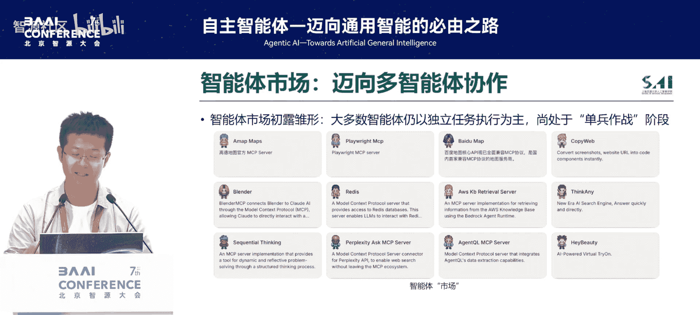

呃这个这个这个智能体的部分。那最后呢两位呃师兄呢负责这个技术指导和流程管理。那么同时呢这个事情就就开始了。OK我们陆续就陆续收到。那么你可以发现呃这是平平无奇的一个例子哈。

他其实和我刚才介绍的智能体市场非常相似。其实在实验室的这个角度来看，我们每个人不管是学生也好，呃，或者是一些呃高年级的博士生或者低年级的本科生也好。其实我们也许是这个实验室的一个人力资源。

所以说我我我其实通过这个例子呢是想说O我们下一步也许应该模拟我们实验室这样的一个工作模式，各取所长，我们把智能体市场里面大家应该有的特长给他总结出来，我们做一个群体的协同。

通过分工和协作的形式来形成这种多方的优势互补，来进一步拓展我们作为群体共同可完成的一个任务的空间，来释放大模型群体智能的一个魅力。对，这个其实我是想呃就可以可能就是。

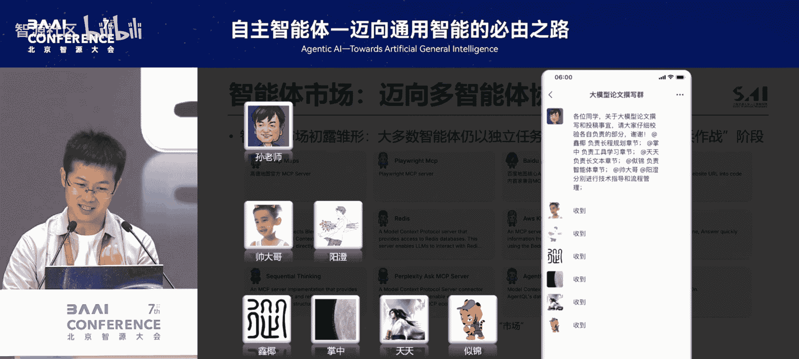

🎼今天可能呃稍微更新一点的内容。那么后呃因为其实有很多智能体协作的技术哈，但是就因为时间原因也不具体展开。那么我以这个ched为例子。因为这个例子其实去年第六届呃这个智源大会讲过。

所以今天我们通过一个很短的视频来看一下这个智能体协作到底能做什么。那么我以一个这个开发清华简的一个网页制作来我们来看一下智能体它的一个具体的能力。😊，🎼OK其实这个是智能体整个的一个协同过程。

在收到了这个自然语言所表达的需求之下呢，他们就可以自主的去做一些呃，不管是作为分工也好，编程也好，测试也好，文档撰写也好。

他们会形成这样的一个分工协作的一个形式来共同把右侧展示的这个氢华简的网页给它制作出来。那么我们可以看看说它在经过了多轮迭代之后，这个清华简的网页。哎，看起来是那么回事，其实基本是能用的。

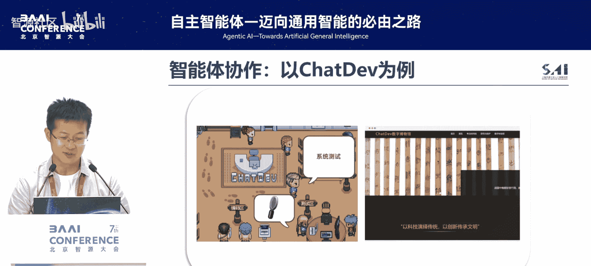

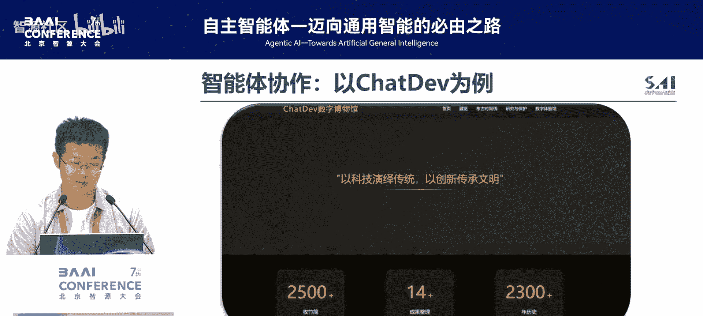

🎼对，那我想说的是呃，其实人类在这个过程里面仅仅提供了图片素材，所有的网页的逻辑啊，代码其实全是由Aent生成的那么它是通过这种呃群体交互的形式来共同做一些分工啊，编程啊，以及反馈来共同形成的。

甚至他也会有一些呃它不只是静态的一个网页，可以是动态交互的这样的一个形式。那么其实我想说的是说，其实告诉了我们说这个大模型智能体的协同是可行的。这个其实大概是我们上次智愿大会聊到的一个结论。

但是其实我们后来发现。

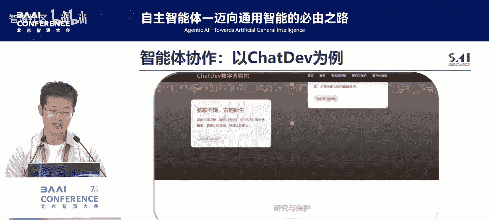

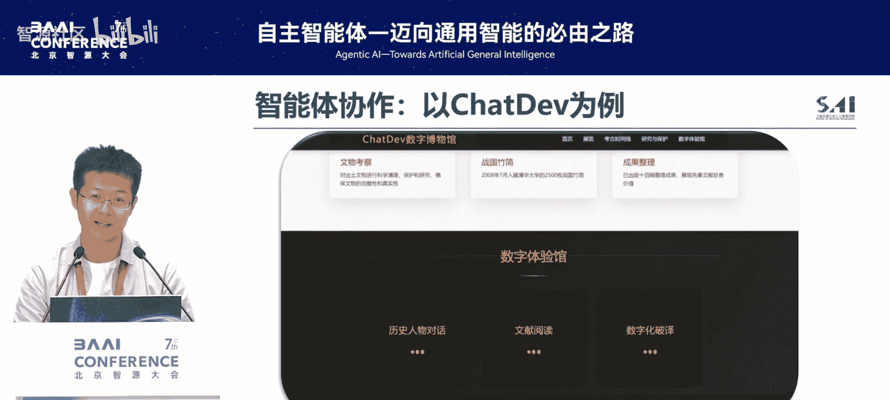

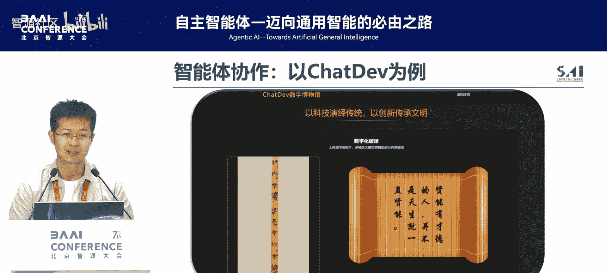

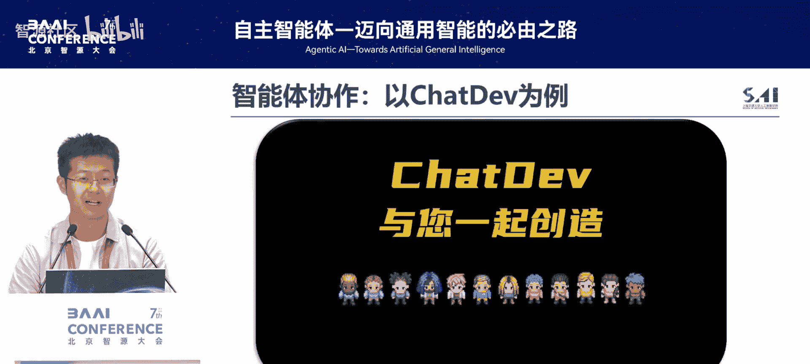

可行是OK的，没有问题。但是协作需要付出代价。那么这里其实我们也做了一些呃一个研究哈，就是我们构建了一个多智能体协作网叫mnet。然后我们在这个mnet里面连接了不同的智能体，让他们形成一个群体。

同时呢我们探索了这个最差情况下的呃沟通复杂度，其实也就是全连接的情况之下，我们可以发现它的token消耗的复杂度呢是N的3次方N的话是这个智能体的数量。

你可以发现说它几乎是一个指数型增长这样的一个数量级，几乎不太可能应用到我们的现实生活当中。比如说左下角就是我们通过，它是一个链式的结构和我们全连接的一个mnet结构一个graph。

你可以看到说我们做同样规模的软件开发现行的只需要花938秒。但是我全连接型的需要100呃17587秒。这个如果我把这个系统给大家，它能保证代码基本是对。😊，但是你需要等几个小时，你会等吗？

所以这个其实冒出了一个问题，就是其实任何的协作呃都不是都不是免费的午餐。所以说其实多智能体协作往往会伴随着更多的资源消耗以及流程上的一个摩擦。那么这个其实造成了一个棘手的问题。

是说这个智能体协作的性价比。它有可能会决定未来落地的一个广度。所以这个其实我们也是我们一直思考的问题，就是呃智能体协同是work的。但是它太耗费了。那我们下一步我们该怎么做。

所以这个其实也是今天呃想和大家分享的呃三个主要的一个方向。那么首先呢我们需要定义一下呃这个性价比到底是什么，尤其多智能体协作的一个性价比。那么其实很简单，其实无非就是我们得到的除以我们输出的。

那么其实总结成公式的话，就是我们得到的呃就多智能体能解决任务的一个性能除以它所消耗掉的开销。比如说token token也好，时间也好，其实都可以。

所以说我们其实后面想从性价比优化的角度来做这样的一个智能体的一个高效化。但是呢我们发现性能这个东西你很难去控制。对，所以我们更多的从这个分母的角度，就降低协作成本的角度来解决这样的一个事情。

那么首先我们需要知道说我需要降低成本，但是成本发生在了哪里。我们首先知要需要知道说我这个成本在哪里。所以说我们呃分析一下说这个多智能体协作的一个主要的一个模块，包括说它这个token消耗在了哪些地方。

那么首先呢是这个通信的一个协议。其次呢是它合作的过程的一个模式。那么最后呢是说智能体也许它在做一个多轮啊，不管是COT也好，或者是多轮交互造成推理能或者推理试错这样的一些消耗。

所以说对应的我们就想从这三个层面来做一些多智能体协作的一个高效化的一些一些探索，包括说从信息交互我们该怎么做行为路由我们该怎么做，以及推理的试错，我们该如何去减少。那么后面呢一。从三个方向。

然后给各位专家老师们做一些汇报。那么首先是我们从通信协议这个角度来看一下哈。O那么其实还是继续我实验室的那个例子，就是孙老师已经把这个大模型论文撰写的任务发下来了。O我们其实也去执行了。

然后我们需要对上面做一个汇报。O那么左图就是就是那个新耶，他所说的哈，就是孙老师你好，近期怎么怎么样，我已经做了什么什么工作，巴拉巴拉大概有1000多字。对，然后呢那个四井同学呢，他也回了。

他说我也做了什么什么工作，中间可能省了好几十页哈，大概就是我们花了这么多的调研的时间，把这个事情完成了。O最后孙老师回了一个好，对，就是会感觉字虽然少一点哈，但是其实没什么问题。

他说明了我们这个思路的方案其实受到了孙老师的认可。所以这其实就是我们想要的结果。所以他给我们的启发呢，是说山不在高，有先则明嘛，其实就是信息交互的字数不在于多，但是答意。😊，则0。所以说智能体也是。

比如说我们让智能体去做一个类似于刚才我们说的网页开发，他先需要决定用什么语言去编程。他们可能会在聊说OO编程智能体你好，我目前我们想做一个网页开发。

你觉得用什么编程语言会好一点呢编程智能体就回说O用这个java怎么样，他说不行，java太复杂了，不太便于呃不太便于开发，他说用pyon怎么样，他说OK那么整个过程呢其实可以精简成这样一张图。

就实际上你可以看到智能体交互其实刚才说的那么长，只需要四个词，他就能够把我我所表达的意思所表达到。所以我们想说的意思呢是说智能体之间的信息传递可以做大范围的一个精简，也许他们不需要问好，也不需要说谢谢。

我们只要把主要的核心的意思，通过关键词的形式给释放出来，也许就OK。所以呢针对这个问题我们也做了一些探索。那么第一个呢是说我们呃通过pro的形式来让智能体直接使用非自然语言的交流模式来进行推理。

那么这个非自然语言呢，包括说这个jason也好，XML也好，或者代码等等不同的形式，或者markdown。对，那么我们也呃先不做微调的情况之下，也看到智能体通过这样我们的要求来进行一个沟通。

OK发现一个效果，说哎，即使不训练模型，我们仅仅通过提示不同的模型，也基本具备了给定任务，然后通过不同的这个这个这个交流的形式来进行推理。且它的性能还是增长的，它不仅仅是对对回答的话进行了一个缩减。

它反而会有些性能的提升。这个也许是可能在于呃减少了这个大规模的上下文之后，也许达到了信息更凝练或更精简更准确这样的一个目的。所以说呃删寒就解其实智能体是可以做的。OK那么这里其实是一个例子。

就是智能体采用常规的交流方式和非自然语言的交流方式，它的一个区别的一个对比。对，那么呃可能就是可能比较细节，所以我就不再深入了。那么其实基于这样proing的形式呢，我们还有一些更多的思考。

说唉有没有可能我把这种交流的模式给它训到它的模型参数里面，让它天生具有这样的一个能力。所以我们也提了这个opim，就是高效的智能体协同呃，智能体沟通这样的一个训练方案。

那么大概的意思呢是说我们会让智能体做N轮的交互的一个模拟。然后呢我们会在交互模拟的这个数上面去打分，就其实你可以看到每棵树就是智能体交互的一轮一轮的过程。

那么每一个树的轨迹就可以看成是ag的交互的一个ject。那么我们会对这个 trajectoryject打分，包括说这个它所完成的任务完成度也好，token的消耗量。我们会。选选两个一好一坏。

那么这一两一号一一好一坏，我们可以做什么呢？我我们要么去做一个SFT的训练，要么做一个DPO的训练，其实都OK我们就可以把这种形式就交互的模式给注入到这个agent交互的这个参数内部。

那么也能看到说相较于训练之前，我们的效果提升了20%的情况之下，我们的词源消耗量大概也减少了79%。这个其实极大的减少了agent之间的一个上下文的一个长度。O那么其实还是以这个例子来讲。

O这个是刚才我们所看到的例子。那假如我们实验室采用了agent这样的一个精简的交流方式，那会发生什么样的一个未来，我们可以看到哈O那么我们呃你会可以看到这个新业，那他已经完成它自己的部分了。

那就说已完成待验收。O另一个同学也说了，已完成待验收。哎，那其实还有的同学是未完成的。他就未完成，请等待。那么甚至更离谱的，有的同学未开始对。😊，那么不管怎么样哈，孙老师看到了这样的一个现象。

就是我们整个技术报告是没有写完的。OK他就开开始来做规划。他艾特了帅大哥说协助其实也没有很复杂的上下文。然后收到在在艾特了杨城说这个组织开会，然后杨成回了一个8-505。

这个8-505其实是我们实验室的一个密语哈。大概的意思呢是说8点在fe特楼4-505开会。对，其实很非常精简的只用四个数字来形成了这样的一个信息的传递。OK然后在艾特四井说查重O完成。对。

那大概是这样的一个形式，呃，就能够把就是我大概的意思呢是说，如果智能体能以这种形式来进行交流。那么其实我们仅仅花了一页的聊天记录，就做成了这个信息的同步啊，呃这个协助的安排啊。

会议的组织以及查重等等事宜，这个也充分体现了行善语言这样的一个态度，就多做事少说话。😊，对，那么这个其实是我们在通信协议上的一些探索。那么后面呢我们想给大家介绍的是是在这个协作的模式上。

我们如何去做一些方方向的优化。教了智能体如何说话之后，我们还得教他如何干活。对，那么我们可以看到刚才这个孙老师给大家安排任务的这个过程了。你可以发现说哎其实孙老师运筹帷幄哈。他其实知道什么步骤。

该做什么，该at特谁。那么其实我们也是基于这点的启发。我们想通过这个中心化的一个编排，动态的来调整多智能体协作任务的一个分配和触发。这个就类似于像图所示的这个。😊，呃，这个这个我们就这个叫提现木偶。对。

其实你看似是一个多智能体在台上表演，实际上他的幕后是有人在体现的。他知道什么时候我该提谁OK这个。通过中心化的一个编排哈，我们且不讨论它是多智能体还是单智能体系统，它能够达到对多智能体场上的一个表演。

或者说推理的过程来做一个很好的一个编排。对，那么这个其实我们大概过一下它的技术的一个思路哈。是说我们其实需要训练一个中心化的一个poli。那么这个poli呢它可以在每一步决定我该调用谁。

而且是动态的基于当前任务完成的过程，然后动态的决定我该去提谁提了之后呢，呃提新提的那个agent又任务做了一轮刷新，他又该去动态决定，下一轮又提谁。所以整个过程呢，你可以看作是一个比喻吧。

就是多智能体推理的过程，可以看成是一个多智能体在舞台上表演的过程。OK我们通过这个幕后的这个policy，能够把多智能体编排成一个很优美的一个呃舞台剧啊等等。对。

但是同时呢我们需要考虑的是说我我们对他做了一个强化我们用什么样的一个reward。那么这个reward其实我们采用了这个任务完成的准确性也好，和包括这个token的消耗。

我们才能让这个体现木偶这个poli知道我该朝哪个方向去提对，那么我们从结果上也能看到说这个我们提的这个技术叫他也能够形成这样有效的一个协作。这个其其实这个工作的结论是非常有意思的。

还包括了很多一些没有没有呈现出来的发现。大家大家如果感兴趣的话，可以去看原文的一些总结。对，那么同时呢我们看出我们把这个中心化的这个抛掉。我们仅仅看这个他所调度的这个多智能体在做什么。

我们也能看到说为什么多智能体协同达到了效率更高的一个目的。因为他做了组织结构的一个精简。那么从比如说下面居中的部分可以看到说呃一开始的智能体实际上需要耗耗费十几二十个慢慢慢慢的这个体现木偶就会把。

表现不好的智能体抛掉，把保现表现好的留下。那么其实也许他只需要花费一个到两个智能体就能够完成同样的一个事情。OK那么其实我们这里讲到的是说，我们其实学会了高效的一个调度了。但是也许还有一个问题哈。

是说O我查重查了我我我回回回我回孙老师查重率是2%，但是我发现DDO已经过了。整个事情没有办法，我们只能明年再来。所以你可以看到说他卡在一个什么问题啊，就是我六点发送的信息。

23点才有人回这个中间的过程其实会被呃怎么说，被一颗老鼠师毁了整个汤。对，所以说我们也想说我们高效化的过程，除了考虑推理路由的高效化，我们还需要考虑的是说资源有限的情况之下。

我们如何去在资源有限的程度去完成这样的一个事事情。所以说我们总体的思路呢，类似于呃类似于如图所示哈，你可以理解为是一个多多智能体的思维链。我们这个思维链的智能体。

它会动态决定下一下一步该路由到哪个智能体，它是一个跳跃的过程。我们把中间。😊，那些曾经划水摸鱼的智能体给它抛掉，我们仅仅留下那些工作强度或者工作这个这个有效性更强的一些智能体下来。

那么通过这样的一个模式呢，我们也能发现说呃多智能体系统的系统性能啊效率啊均得到了提升。对，且这个推理的消耗啊和推理部署也都得到了降低。所以这个其实我大概介绍了这个er和 saving这两个工作。

大概的意思呢是说其实呃最开始讲到了规划和这个执行。其实我们也觉得说执行的话，也许有一个强工具他可能能够解决。所以但是这个规划其实目前还是智能体技术的一大乌云。

就是假如有一个百分之百好的智能体能够做百分之百好的规划，他知道什么是他自己可以不知道这个问题怎么解，但他知道谁能解，他去调谁就行了。所以这个其实也是我们提这个er这样中心化这个智能体系统的一个初衷。

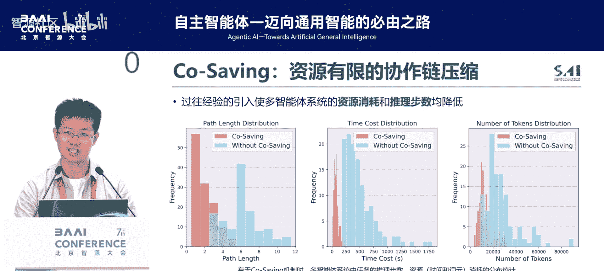

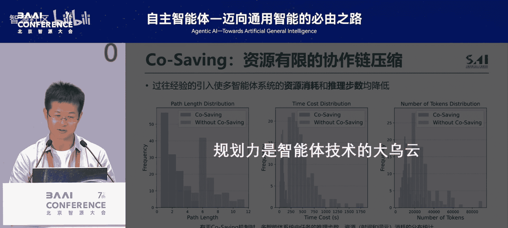

对，最后呢是一个推理能力的一个分享吧。对，那么这个是我们其实还是基于刚才那个图哈，就假假设我没有错过这个投稿哈，我们第二年又来了，查重已经完成了，我告诉孙老师，查重率30%。这个文章查重率太高了。

我需要重写O那么我的师兄啊就会给我提议，我如何在哪些方面做一些修改。这个帅大哥就说了说这个相关工作是容易重复的，你需要在这个地方做一些改动O我改了，他又说这个参考文献的格式是错的，我需要做一些改动。

我也改了，甚至有的呢会说页数太多没人看你得你得做压缩以压缩。有的呢是说图文并茂更易懂O你去做一些图文的填图等等。我们把整个过程做了，以你看似也是平平无奇哈。但实际上这个例子告诉我们两个启发性的一个意义。

第一个在于说经验是可以化化为己有的，就是别人的经验，其实就是我图示高量的这几条语句。他其实可以画我己有，只要我记记下来了。那么第二个告诉我们的是说经验。😊，可以被持久化。

持久化是说我可以靠文本的形式把它存下来。那么存下来就有一个很好的意义。就在于说我们可以构建多智能体的经验库，它可以慢慢的对这个经验库做一些积累。以在未来做一个更好的改进。对。

所以说我们其实想说的一个主要的问题呢，是说经验其实是可以被持久化的。那么有了这样持久化的一个呃思路之后呢，我们就可以对这个多智能体演化的这样的一个过程，做这种呃经验持久化的一个推理。

那么我们可以把这些经验都存储下来，未来做更更多的一些使用。

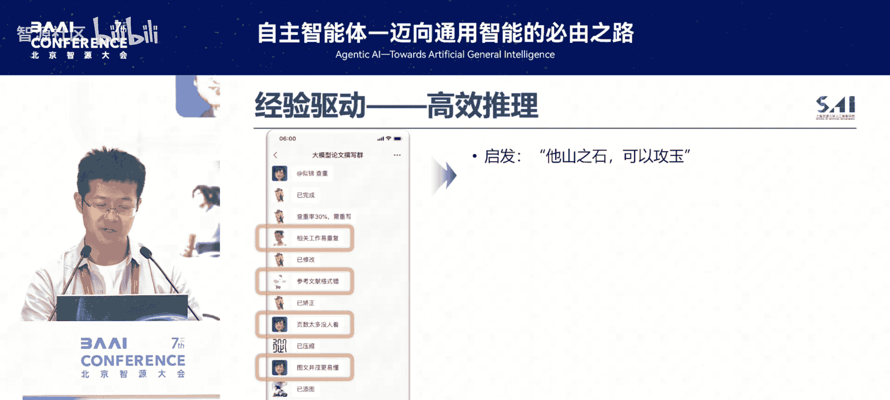

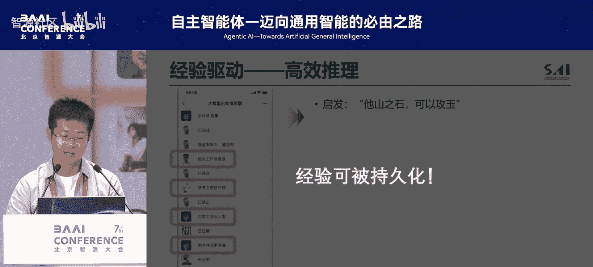

对，因此呢我们提了这个呃多智能体呃协同过程的一个经验存取，并且借鉴这样的一些形式，也是也是今年呃5月份刚发布的。那么大概的意思呢是说，智能体它记得住曾经推理过的布。的reward哪些是高的，哪些是低的。

他会把高reward对应的那些推理过程全都存下来，供未来检索来做feel show的使用。其实就是这么简单。但是我们可以发现说每一个智能体都把自己推理的呃好的那些步记下来了之后，每人进步一小步。

这整个群体的推理的过程，它会变得非常高效。对，也可以看到说我们这个高效的一个结果，以及说我们对高校为什么高效做了一个分析哈，实际上就是我们对经验做了一个feel short之后呢。

呃群体的推理能够更快的达到一个收敛的速度，从而节省推理的轮次和资源的消耗。😊，那么同时呢上交这边也在今年提出了一个叫musPT这样的一个工作。它其实刚才我们介绍的是这个推理的经验。

实际上这个呢是编排的一个经验，就是我怎么去调度这些智能体，也就是我那个那个体现目偶该怎么去提。刚才我们介绍的模式呢是说我一根一根的提。那么这个masT呢，其实它的它的思路很简单，它调用一次大模型。

直接生成整个多智能体协作的workflow。对它是它是一步生成的。那么一步生成的话，我们就需要把这个workflow做一个线性化。那么这里采用的是这种代码的形式来做一个线性化的处理。

那么多智能体之间的调用的形式呢，就可以映射为代码之间的函数调用调用。那么通过这样的一个形式，我仅仅通过大模型生成代码，我就可以把它看作一个多智能体系统的一个后背后的一个workflow。对。

那么这个也是我们大概看到的一个表现的一个结果，是推理的效呃推理的消耗更低了，并且运行的效率是更高的。那么最后呢，其实也总结一下刚才我们所呃总结的这几个方向。那么一个是高效的交互。

我们教这个群体如何表达我们需要压缩和聚焦它的信息流来提升单次交互的有效的信息负载。那么第二个呢是这个高效的路由，就是呃教智能体如何去协作。那么这个架构的设计呢。

我们能灵活的让这个智能体之间来做一个动态的一个调度来实现动态调配的这样的一个目的。那么第三个点呢是这个高效的推理，减少试错。这个其实交了智能体如何做成长。我们需要持续的呃沉淀。

并且迁移我曾经的这样的一个推理经验，以供未来复用。那么最后呢是可能不太成熟的一些未来方向吧。其实也是基于刚才的三个大点。一个呢是说其实高效的交互。我们也许我们可以看到刚才的交互其实都是基于token的。

基于词源的。那么基于词源就有本身的一个问题是词源是需要解码的。那么其实刚才也有观众提到说，如果不解码，我们直接使用嵌入，通过bedding来实现智能体的交互O不O其实我觉得一种方式是OK的。

但是实需要解决的一个问题是说我我智能体之间通过bedding交互可以，但是前提是它的dding得在一个空间。如果你不是在同一个空间，说就是你如果你是独立训的那实际上通过inbedding交互。

他们并不在一个空间，它是不会理解你的语言的。那么第二点是这个如何做高效的路由。其实我们看刚才er就是那个提前木偶，他告诉我们的形式是我自顶向下的去对智能体做一个编排。如果在最最下层智能体可以执行了。

OK那你去执行。那其实可能有一种模式是说我上层也不知道下层智能体有什么特长。比如说我们孙老师假如明年招了5个博士生，他也不知道大家特长是啥。那么有没有可能我们自底向上的去做一个编排。

我们自主的去告诉孙老师，我擅长啥，我和谁应该协同起来，我和谁应该做一些信息交流来达到这样的一个呃可能是另一种模式的一个高效的一个路由。那么同时呢还有一个高效推理。那么其实我们能看到说。呃。

之前的群体协作的一些工作看似是群体协同了，但是他不太可结偶。就是就大概的意思呢是说，智能体从这个团队里面脱离出来，它不太能够融入到另一个团队。因为经验其实是不一样的。这个和人类其实不一样。

人类在大学里学的东西，你毕业了，你是可以拿到工作去使用的，但智能体目前还不太OK。所以说我们也在想说有没有可能让智能体的粘性更低。🎼来做一个解偶。未来他可以从这个团队毕业，然后到另一个团队去工作啊。

这样的话其实也是我们所呃觉得可能比较有意思的一个方向。那么同时呢就是呃就是开放式的一些问题哈，就是你如果把横轴想成市智能体协作的一个数量，纵轴想成市这个系统的一个智商。有没有发现，如果我们做了高效化。

它可能会达到一个目的，就是我对这条智能体的智商的曲线做了一个压缩，做了一个做了一个压缩，往横坐标更低的地方去做了一个压缩。那么如果压缩的很极致的话，它有可能会造成群体的一个涌现。

就是我只需要花费两个4个智能体，能够达到百个智能体的一个智能。那么这个可能会造成这样的一个现象。那么目前还没有，但是我们也希望说未来会有这样的一些高效化的一些机制发生。

那么最后是这个因为开头没有讲很多智能体协同的一些技术。这个可能在去年的这个智能体大会的论坛有一个回放。如果大家感兴趣的话，可以去查。

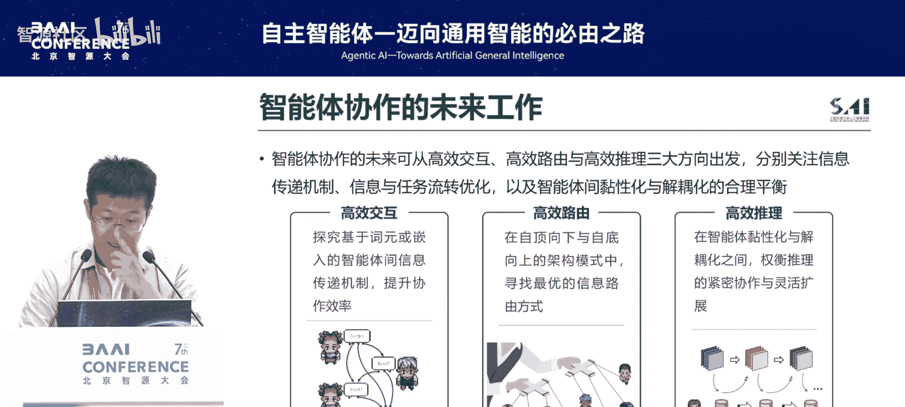

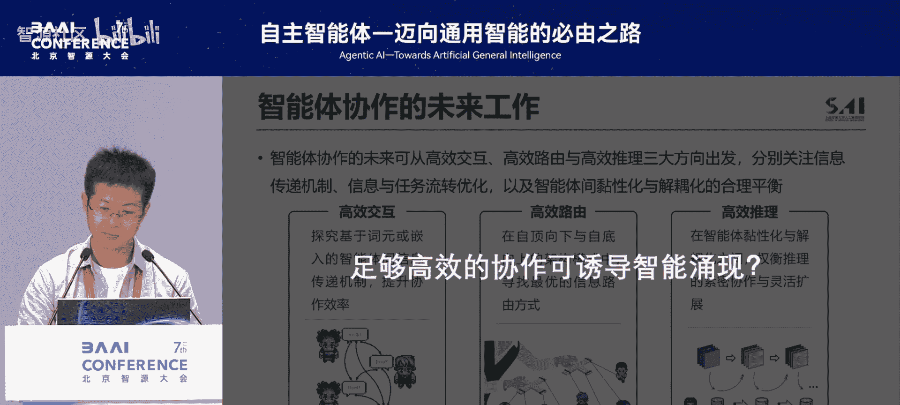

🎼看然后后面还有我们呃做的这个电子整理的电子书，帮大家梳理一下说有哪些核心的一些文章，以及说呃其他团队整理的包括这个mes lab，就是多智能体呃系统的一个总体的一个仓库，来便于大家使用啊。

开发或者做一些评估等等。那么其他的参考文献呢，我都列在了正文的角注的部分。总体起来这个参考文献是全的。好，那么以上就是今天所介绍的内容。

最后呢就是也孙老师也就是我们团队也欢迎大家说加入我们这个非常呃温馨又团结的一个大家庭。好好，谢谢大家。😊。

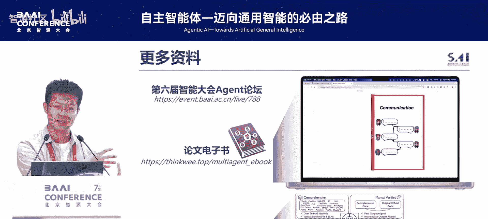

好。由于时间啊的原先，我们还是允许一个提问一个提问。接外控。啊，老师你好，我是一位连续创业者。现在呢我在做那个人工智能的优秀创业者的这样一个社群。然后呢，我们现在社社区也链接了非常多的呃创业者。然后呢。

我们我上个月上周上个月吧参加了那个一个智能提交flow，他的一个闭门的发布会。然后呢，我关注到就是说这个团队做的是一个事情，他的呃成本比minus低了10分之1，他只有minus的110分之1的成本。

然后呢，他我看我看下来的话，我感觉这个产品它解决了一个呃就是结构化的这种自然语言去基于这种文本知识库的这样一种创作。而我觉得他可能在做一些复杂任务的时候，他的那个成本也会飙升，就我很好奇。

就是说他为什么能够做到呃minus的这个成本的10分之1。他在这个技术上到底有什么样的魔力。然后我问了他们团队，他们会他们是不说然后他们说他他们做的太早了，比minus做的早。

所以呢他们这个技术就就做的更加成熟吧。😊，我就想呃问一问您就是有没有一些相关的一些看法对好的好好，谢谢你的问题哈。就是我感觉可能我还没有资格回答。因为那个发布会我没参加，但是我大概从我的角度来讲。

就是你你如果他如果是性能层面来讲，它超过了的话，我觉得也许有一条路径是他可以针对他的业务场景或者是一些具体的t去编排出定定制化的一些workflow，这是一种模式。这个其实也是呃其实最高效的一种模式。

但它的造成的问题是它不太可迁移。所以说其实我们其实刚才林老师也介绍了，为什么我们要做一个泛化的系统，实际上是说能够在解决不同的任务当中，它是可以泛化，这个从性能的角度，如果是从这个高效化的角度的话。

我觉得我们能考虑到的维度，其实刚才的PPT里面基本都介绍了。包括说交互的协议如何做一些缩解，以及说推理的过程如何做一些经验化的借鉴来减少一些推理的试错。同时说协同的过程，你可以理解。😊。

workflow如何做一些削减，就有没有可能10个压缩到两个等等。我觉得可能他也做了多方面的一些尝试吧。然后选了一个最优的一个策略。好，谢谢。😊。

