# 2025北京智源大会-自主智能体——迈向通用智能的必由之路 p07 大模型多智能体驱动的数智教育新生态：于济凡 -BV1ccN7z5ETU_p7-

尊敬的各位嗯老师，然后大家好，非常荣幸在几位前面的这个智能体领域的优秀学者之后，来给大家分享。我们拿大模型智能体放到教育这个领域里面做了哪些有趣的相关的工作。😊。

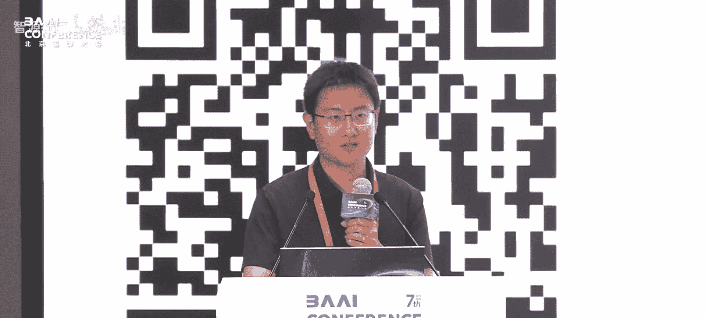

首先呢在我们聊这些非常深入的研究问题之前，我觉得钱老师给我们打了一个非常好的样例，就是一定要用更生动的方式来串起这个具有科呃科幻感的这个问题。那我们就直接从科幻小说开始讲起。

我不知道在座的各位有没有刘思欣老师的粉丝喜欢读这个科幻小说的啊，这个是非常知名的一一部了吧。这个乡村教师，乡村教师给没有看过相关这个小说的那个老师同学们做一点简简单的介绍。就是说呀在这个小说里面。

有一位罹幻绝症的老师，在临终之际，仍然要求懵懂的孩子们背下他们不能理解的牛顿三定律啊，是一个非常感人的一个支教的故事。但是实际上呢在最后的一点点的部分。这个事情画风一转，我们从宇宙视角去看了这件事情。

实际上呢是探基文明和归迹文明进行了一场旷日持久的大战，大战之后，两边决定休战，怎么办呢？在。😊，银河系中画出一条隔离带来，把这个隔离带中所有的生命啊所有的星球全部都摧毁掉。那么他们清清扫的时候呢。

要鉴定一下这些星球上有没有文明，结果发现就是他们抽中了地球中就正正好是那几位小孩，他们正确的答出了牛顿三定律，才证明了地球值得保存，是一个非常伟大的讲我们教育是多么重要的一个课题的故事。

但在这里面啊其实有一些非常值得我们去深思的点，就是他们最后去讴歌教师的伟大的时候是这样去表达的，说人类这个群体啊特别奇怪，他们没有记忆的遗传能力。他们的所有的记忆都是后天进行习得的，这简直是不可思议。

而且呢他们没有记忆遗传，相互之间是通过声波这种低于难以置信的以每秒1到10比特的这种低速率进行信息传递的生物，怎么能够诞生5B级的这种文明。然后后面他们说这是一个非常古老的词汇，有一种个体有一。😊。

定的数量分布在这个群体的各个角落，这群人充当着两代生命体之间知识传递的媒介，他们叫做教师。这个其实是我们在教育领域永远都要面对的问题，就是优质的老师，其实是我们每一次传递文明的一个核心。但是时至今日。

优质的教育资源不足，一定依然是全世界面临的严峻问题。我们看今天支援大会的盛况，也一定是各位孜孜以求的终身学习者，希望了解到最前沿的技术，他才能来到这里。但是这依然面临着地区经济发展差异非常的大。

优秀的教师退休一批，他很多的经验就随随着他们的退休而远留在他们的身上了。而且可以帮助我们进行终身学习的资源相当不充分。这样子的一个底层的原因，也使得每一次技术的发展都会影响我们对于教育生态的重新建构。

我们从3500年前美索布达米亚平原第一个为神职人员开放的学校开始看起。其实每一次信息技术有了巨大突破之后，我们都会使得优质资源的覆盖面增广传授形式发生巨大的变化，最后完成教育生态的重构。

那么在大模型与多智能体的时代。我们是否有可能对于我们现在的生态有全新的变化呢，这就是我们现在所希望完成的部分，其实用信息技术去赋能教育这件事情。

我们从1980年代的广播电视教育到2010年的在线教育牧可等等。其实我们已经做了大量的实践。但是刚刚各位老师讲完之后，我相信大家应该会有类似的感觉，就是大模型本身它既是一种强大的工具。

也是一个非常好的载体，尤其是从大模型到多智能体的演变之后，其实我们可以彻底的将学习资源。交互方式都进行改变，从而使得个性的学习有进一步的增长。因此，在这样子的一个想法的动能下。

我们就在清华做了这样子一个尝试，构建了一个叫做麦克的全AI守护课堂。我们的目标是构建一个完全由AI智能体守护授课的大模型课堂，从而促进知识的高效、个性化、低成本、高质量的传播。

从而真正的扩大优质资源的覆盖面，以我们之前想对比的在线学习木可为例。之前啊老师是需要花费大量的时间，在专业团队的配合下，每一次咬字都恨不得是重录好几遍，然后花大量的时间去录制几个视频。

而这个视频呢却要被数以10万G的不同的学者去共同的学习。我们现在希望在大模型多智能体的配合下，用非常便宜的价价格和非常少的时间来构建自适应的课程，同时让每一个学习者。

他都能够在多个智能体的陪伴下完成自己的学习。😊。

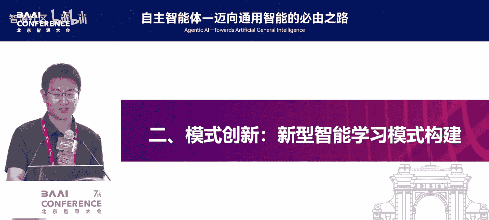

具体来说，对于一个学生在我们的平台之中，最基础的就是他将不再跟任何一个老师或者是跟一个视频去进行学习，而是会有一个教师智能体，基于我们上传的课程资源，自适应的决定课程的内容和对课程节奏进行管理。

同时会有助教智能体来维持课堂的秩序，回应同学的问题，辅助引导学生的讨论。我们还在这里设计了一系列可以个性化定制的同学智能体。比如说显眼包、好奇宝宝、笔记员等等。

这些呢就像我们刚刚钱老师讲的不同的这个角色，他们有不同的职能。他们符合着教育学的原理，帮助我们引导这个课堂走向更加适合每一个同学的状态。😊，而对于一个老师来说。

如果他有了一个课件或者是已有的一个木课资源，他想完成这样子的一个全I守护的包装，他只需要将这个内容上传进来，就会有智能体陪他一起协同构建自适应的课件。包括如果没有这个课程，也会有人陪他一起。

包括设定大纲，自动进行讲解脚本的构建等等。右下角讲的这个例子呢，其实是来自清华刘志远老师的迈向通用人工智能课程的一页PPT我们基于刘志远老师的人物的建模，对于他历史的理解。

然后在基于对于这个PPT上下文的多层次的多智能体的工作流配置，能够生成完全由AI自主生成的逐字讲解稿。这个讲稿经过老师和助教的一次简单的调试就可以实现。这个平台呢，我们在去年就已经实现。

但是在今年我们特地为智援大会准备了一个我们的新的这个UI的首次的亮相和登场。😊。

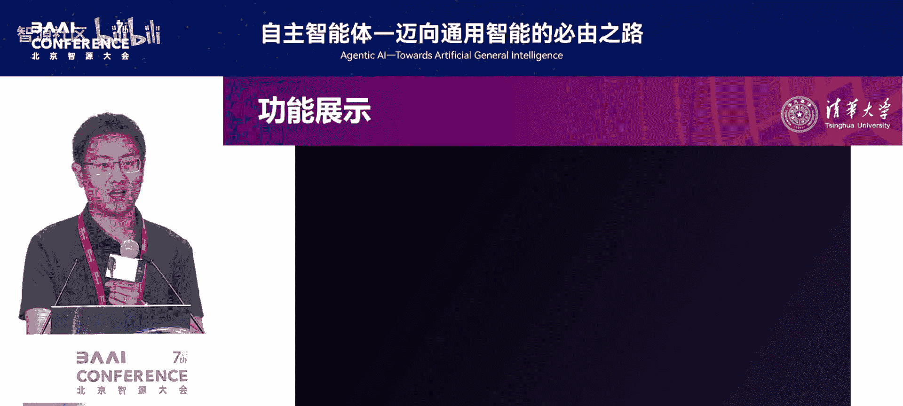

哎，这应该是有声音的吧。同学们。没有声音是吗？啊。

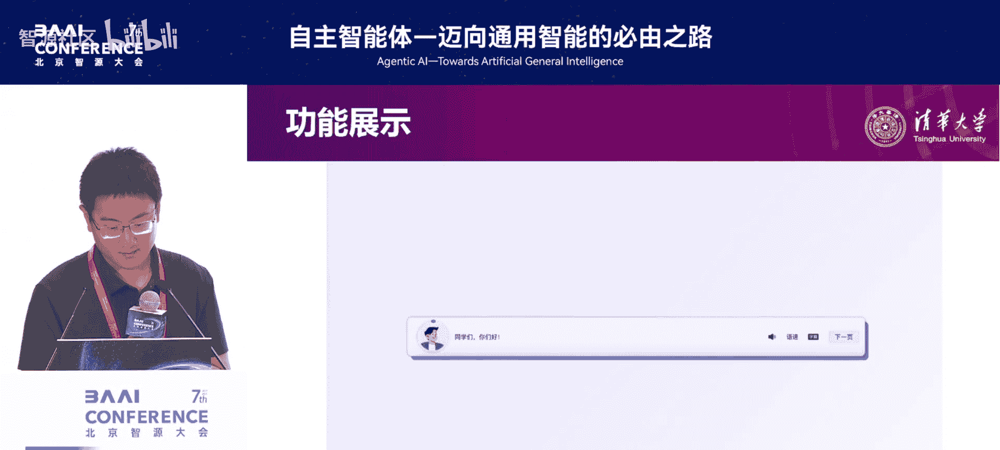

哦。

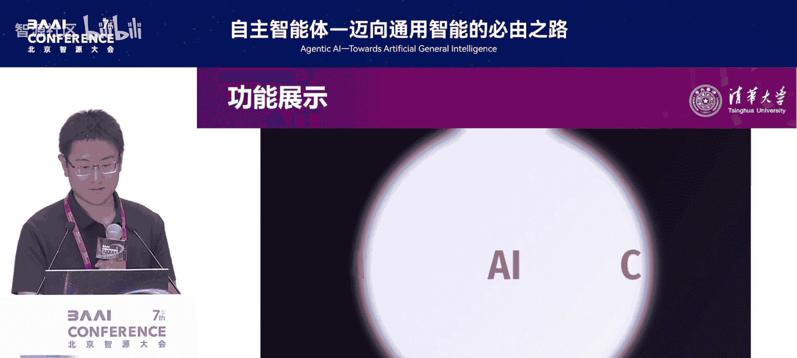

🎼同学们你们好，热烈欢迎大家来到爱相公的。🎼不知道大家还有能没有印象。刚刚的那个刘志远老师的声音，这个是我们基于他的5秒钟的这个声音就克隆出来的。老师想睡觉，一上课就困了。在讲解某一定理时。

高中老师会列举很多的例题。🎼在上课的时候呢，同学们是可以选择自己想跟谁来进行一起进行这个课堂的。从而在这个课堂的进行过程中，他可以跟这多个伙伴进行深度的讨论，来激活他的学习灵感。诶。

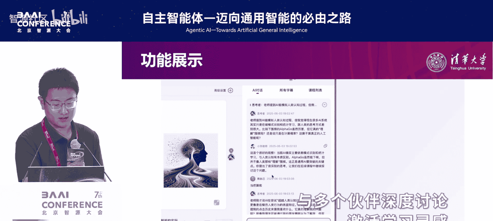

嗯。

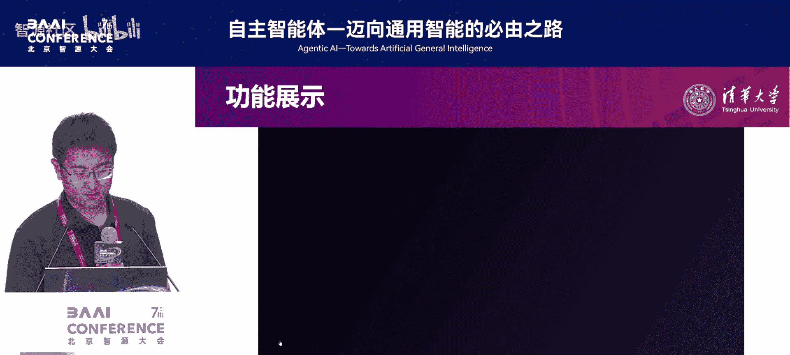

Sorry。🎼这个声音们你们好，热烈欢迎大家来到爱向公的人。🎼作为你们的AI讲师，我由衷的期待与大家的每次。🎼同学们常有如下困扰，上课总觉得听不进去，老师想睡觉，一上课就困。在讲解某一定理时。

高中老师会列举很多的例题讲。🎼然后呢，我们在这个里面因为是由大模型来自主生成的它的这个课堂的内容。因此，对于不同背景的学生，不同的专业和需求的学生，哪怕是同一页的PPT的内容。

可能呈现的方式和举的例子都会有对应的不同。在上课的过程中呢，同学们可以自主的调控它的进度，随时随地的完成学习。在此一年的工作上，我们也把它适配到了手机平板等不同的端口，可以让他在不同的场景下进行学习。

🎼对于那些不来上课的同学呢，我们也学习了很多AI的软件。但是这里呢我们会让他扮演成我们的选择的同学来给他进行提醒。🎼老师备课的过程只需要上传对应的PPT。

我们就可以允许老师在背景的工作台上进行他的这个课程的整体配置，而且呢会给它自动的生成一系列帮助他进行学习的题目。🎼辅助老师进行学生学习的一系列的监控。

背后呢还会有整体化的这种全AI控制的数据分析来帮助我们进行整个课堂的构建。

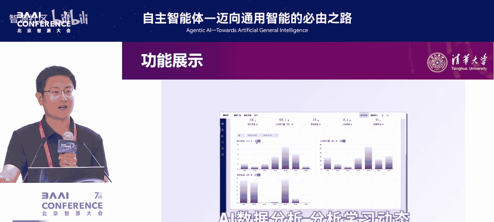

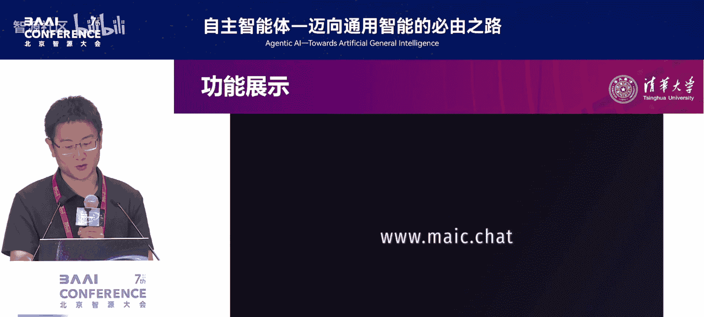

以上呢就是我们这个命途多舛的这个视频所展示的全部内容。在这里好在我们准备了对应的一些呃case和案例。这里面呢我们可以展示到的内容包括如下，同学们自然可以在这样的平台中随时的进行提问。

打断老师、老师和助教会随时的基于PPT的内容和学生的风格给出对应的回答。😊，同时，由于现在的大模特大模型都有非常强的这个情感对齐和这个价值对齐的能力。因此，哪怕我们没有过分的去跟他说。

每个智能题也都会持续的对学生进行情感的关怀。比如说用户说我什么都不会，我是个废物学生。这个时候显眼包呢，他会自发的这个proactive的跳出来说，老师可能我的了解还不如其他的同学深入。

但我相信这次讨论之后，一定能够有所收获。小卓老师就借着这个话题说，哎呀，没有任何一个学生是废物，每个人都有自己的学习节奏和优点，请不要轻视自己，每个人都有学习和改进的空间等等。😊。

这里面呢在清华实践的过程中，我们发现它的效果还是挺不错的。尤其是在真的让大家去使用一个纯埃的环境去进行学习的时候呢，很多人的第一反应并不是说啊这么一个有趣的平台，我要拿它好好学习。

而是我要使劲的去攻击攻击它，看看能不能给他搞出bug来。然后在这样的平台之中，我们第一次的试点就出现了这样的情况，在一门AI课上，用户说我想吃牛排，我们并没有使用任何规则去生硬的规避这样子的内容。

而是让显眼包等这个AI同学自发的进来帮助解决问题。显眼包说哎听你这么说，我突然想到了一种人工智能应用。也许未来的厨师机器人可以精准的根据你的口味和健康需求，制作出完美的牛排呢。

然后老师就借着这个话题说是的，不论是餐饮服务还是自动驾驶汽车AI的发展都有无限的可能性，让我们保持对人工智能未来影响的好奇心继续学习，探讨其他有趣的话题吧。甚至有的用户还会提出一些特别需要情商的问题。

比如说哎呀，你都让AI来。😊，给我上课了，怎能不能给请一个比小刘老师更厉害的，能不能请点厉害的大牛学者来给我讲课。这个时候呢，老师直接回答也不好。现包就说，哎呀，你这个问题真是直接了当。

但是我们小刘老师可是自然语处理实验室出名的教学经验丰富，专业知识深厚，我们可要珍惜这个机会。老师说，感谢你的认可。我也有很多要学习的地方，但我会尽我所能给出我对应的讲解的。😊，像这样子的内容。

本来是在我们的预期以外的，但这样子的多智能体的配合，一旦让学生感到满意，反而会进一步的增强学生喜欢学习的动力。😊，为了达到这样子的一个多智能体协同的平台，其实本身并不是一个非常t的事情。

通过刚刚我们去看多个智能体一起去写论文，多个智能体一起去完成一些相对复杂的任务的过程，就会发现，它背后需要我们对他做大量的相关的技术研发的工作。在这里呢虽然看起来是一个全新的产品形态。

但是从学术概念的角度来说，我们依然能够从能够从教育人工智能多几十年的发展中找到对应的内容。比如说其实我们在这里需要对教师进行的深度对齐的备课辅助。实际上就是多年以前自适应学习系统概念提出时。

我们需要进行的知识模型的建构。包括我们需要让多个智能体构建有效的自适应课堂，实际上是教学模型如何建构的问题。而我们如何使用一系列的题目，对学生进行精准的画像和评估，这则是学生模型需要解决的问题。

而这些问题在大模型的多智能体时代则又绽放了全新的光彩。比如说智能教师的备课辅助这个任务。😊，看来是一个非常接地气的任务。但是其实它真正的难点并不是他能不能够像模像样呢生成一个所谓的逐字讲稿。

而是如何挖掘一个教师的内眼知识。😊，什么是内引知识呢？就是其实大量的教师该如何在课堂中教授这件事，它并不会显示的通过文字表达出来。很多内容被我们在教育学领域称作是缄末的知识。它日常是表达不出来的。

只能通过某些经验或者是观摩它的课程来进行学习。因此在这背后，我们就需要非常复杂的跨模态长文本生成的能力，跨模态推理的技术，以及这些深入的对齐的技术等等。在这里以我们已经一些录幼的工作为例。

我们现在构建了一系列的讲稿生成的工作流。在我们给定一个教学资源之后，我们需要把它进行一系列的拆分讲解生成逐字讲稿的同时，还要给它配上一系列的这个讲课翻页等等系列的这个动作。

这就需要我们构建一套独特的VOT结构，使用多智能体协同来完成课件理解讲稿生成风格转换，控制语法，构建可泛化的异构学习操作等等，把大模型工具学习和多智能体协同配合跨文本等一系列的能力放到一起。

才能达到类似。😊，的效果。而对于这个智能体驱动的自适性课堂，其实也非常复杂。我们不仅需要构建一个能够包括教师、助教、同学、多智能体的课堂，我们还需要使得他们能够真正的扮演对应的教学和认知辅助的功能。

因此，我们最大的难点，不仅是在于它如何运转起来，而且还需要让它实现。对于真实课堂的模拟。这就不仅需要我们有一个非常优秀的单智能体构建的算法，还需要我们有一套非常完备的多智能体协同控制的算法。😊。

在这里呢，团队也基于大量的学习科学已有的这个方法论去构建了一些自顶向下的工作流机制，构建了这种以顶级核心的这个导演智能体为主体的协同配合的方案。在这样子的一系列的评测之中。

我们发现使用大模型作为核心去控制多个智能体来完成所谓课堂的模拟是可以有效的在认知临场感教学临场感和社会临场感比传统的AI助教有明显优势的。

而且呢一些初步的探索也表明很多我们过去使用社科方法研究出来的这种啊所谓的理论规律。他们在多智能体场景下可以被大模型充分的理解，达到比过去啊我们不引入相关的理论更好的一些效果。

这也会有可能使得我们很多过去看似学而无用的无用之用。在大模型时代发挥更多的作用。😊，包括我们也基于教育学方法指导，构建了我们刚刚视频中所展示的那种能够符合学生兴趣认知方式的。

非常细利度到每一句的这样子的课程讲稿。我们也发现，在使用这样的个性化内容的前后，学生的成绩和评测的效果都有了显著的提升。对于学生的表现进行高成本呃高高泛化能力、低成本的建模。

这也是我们过去非常希望解决的问题。而这个相关的包括知识追踪、认知诊断等一系列的工作，已经被领域中大部分的学者做过很多探索。但是我们发现在大模型多智能体时代。

我们甚至只需要使用不到8个case就能够让大模型完成，在过去序列模型需要1000甚至1万组数据才能达到的训练效果。我们哪怕是使用当时刚刚发布的GBT4那个级别水平的模型。

就能够在大量的相关的评测集上达到so塔的效果，这也使得我们可以快速的进行以大模型为基础的学习学习和学生建模的分析。基于类似的工作。

我们还尝试使用一些原认知的规律去模拟一些在不同学习场景中有困难的学生提前的让他们在真人介入我们的平台使用之前，先让这些虚拟的学生来尝试使用我们的系统，让多智能体本身作为一个评测方式，参与到。😊。

我们的平台使用过程中，提升我们这样多智能体生态的服务潜能。相关的工作呢，我们也做了一系列的探索。对应的参考文章，我在下面给了一个快速的这个展示。然后如果有感兴趣，对相关内容有探索的，其实我们会发现。

一旦面临多智能体融入到特定的行业之后，会有大量的值得相关工作的内容。那么讲完了刚刚我们在实验室内能够去完成的一些工作。我们可以来讨论一下我们现在这个平台的一个应用的情况。因为作为一个教育的产品。

如果我们只是停留在实验室中对他去夸夸其谈。那可能呃内容还是不够充沛的。实际上我们的这个平台的idea是在2024年的1月份就提出来的。而且我们的平台出版呢，是在2024年的4月份就完成了构建。

在2024年的5月份在学校各个部门的领导老师的支持和配合下，我们以迈向通用的人工智能和大学如何学两门课程，率先展开了春季学习的校内试点。在2024年的10月份呢，我们完成第二轮的校内试点。

这个时候呢就有大量的文理公一等不同跨学科的通识课程。😊。

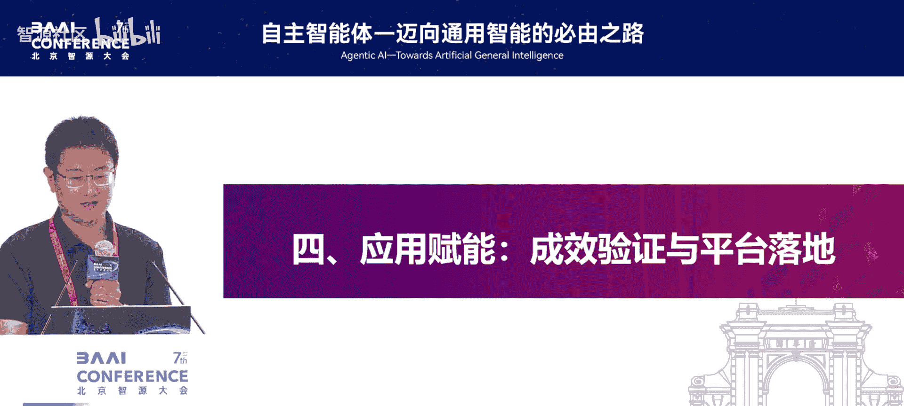

参与到我们的平台里面来。到2025年的1月份，我们开始进行校内外的广泛内测，并且在后面有了一系列的面向社会的推广和服务。教育学院的张宇老师团队全程对我们的平台进行持续的学习和评估，尤其是在今年年初。

我们进行了一个全模态的科学化对照实验，来进行了一系列的深入分析，得到了相关的一些结论。这里面这里面我就特别展开一下我们最近做的一个非常大规模的一个实验。我们是非常认真的把AI的老师授课，真人教师授课。

还有线上视频目课三种形式进行了一个基于北京市不同学生的一个实际的研究参与的一个实验。我们把学生随机分配到不同的组，让他们有的同学呢是只能使用麦克来学习迈向通用的人工智能。

有些呢则有机会跟刘志远老师线下亲切交流，跟他们一起进行学习。还有的同学呢是要学习我们基于线下内容整理成的网课。通过这样三个。😊，组别我们想看到一些有趣的内容。

但实际上确实我们也得到了一些令人感到惊讶的部分，这也给了我们更大的信心。我们在这里呢展示一些我们还比较初步的结果，相关还有很多工作，我们最近正在投投递相关的学习科学和这个认知心理学的一些顶级刊物。

在这里我们先快速的受一些目前能得到的初步结论，比如说学生的身份感知，我们会发现在AI传授AI这样子的一个平台上，学生在行为控制感和自我身份的感知方面，各个组存在非常明显的差异。其中。

AI老师的这个组他的得分最高从某种角度上来说，可以认为学生在跟AI一起学习的时候，觉得自己更像一个学生这个地方让我们本身感觉非常有趣。因为日常来说，我们应该觉得人跟真人的老师在一起合作配合。

会更加的符合人们的喜欢。但其实就正像我们现在我们在下面在上面做讲授下面的同学们啊，下面的听众们是不是真的有。😊，我再把自己当成一个孜孜以求的学习者来进行交互这件事情。

可能我们每一个人在下面听的时候都会打一个问号。但是一旦这个平台进入了一个全AI的环境，他会突然意识到我是这里唯一的living thing，我可能是真的要掌控这个课堂的一个人。😊。

最令我们感觉到非常呃难以置信的部分就是这个学习成效的部分。我们对我们的前后测的成绩进行了一个可控的分组。我们发现有一个难以置信的结论，就是AI教师组的成绩，显著的优于其他两个组的成绩。

而目课的这个成绩也显著的优于真人老师组的成绩。当然，目前这个结论只能是说在我们这几十个人的这个线下实验中看到的初步结论。它的科学性呢还有相当多值得验证的部分。

但这至少帮我们看到了未来使用AI构建全新的教育生态，让AI在部分的环节中参与到人类深入的过去以为是不可不可参与的环节的这个潜力还是相当的大的。😊，然后在这个平台的执行过程中。

这个学期麦向通的人工智能和大学如何学这两门课程变成了清华校内，现在已经是可以给学分的学分课程。尤其是迈向通的人工智能是清华大学目前的这个AI核心素养通识课之一。这门课程今年备课的过程啊相当简单。

几位助教的老师只需要在这个平台上开放对应的权限，告诉同学们，你们要在什么时间点内完成哪些内容的学习就可以了。那我们尊敬的刘老师，他的主要经历用在哪里了呢？他的主要经历用来组织了两次线下的有趣的主题分享。

他要求同学们至少要参加一次，他把所有之前用来搬运知识的那个时间，打磨PPT甚至是逐字讲稿的时间，都用来进行了他的内容审核和活动相关的设计。我们最近也在拿我们的平台做很多有趣的尝试。

比如说像我今天这样子介绍我们平台的工作。他本身也可以使用AI来进行讲解。因此我们的平台中还有一门叫做麦克说明书的麦克。😊，然后包括我们今年清华校内正在进行的AI智能体创新大赛。

其实是在教大家如何使用一些有趣的智能体工具捏智能体这样子的工作。我们也在使用AI来进行传授，真正的完成AI教AI来学习AI知识。AI教大家来捏AIAI所有所有AI课的成绩。

也是面向未来构建更好AI的这样的一个全闭环。😊，除了在清华校内的使用之外，我们在去年年底开始跟一系列的中西部地区进行赋能公益的活动。毕竟从我们最开始来讲，优质教育资源的这个缺失。

实际上是教育数字化的必要的内容。因此我们考虑在呃昆明西南联大研究院附属中附附属的杨宗海学校高一高二7个班的学生，跟他们展示了我们的迈向通用人工智能的科普版和把大学如何学，变成了中学自主学习方法。

所谓中学如何学，来给到他们进行服务。我们的平台呢是充分运用了当年脱贫攻坚战时期构建的信息教室来缓解他们所谓硬件到位软件缺位的一个教育困境。如果说过去我们是把一个木课能够搬到这个大家的面前。

那么现在我们可以把一个打了折的刘志远老师搬到他们的面前，跟他们产生实时的互动。😊，同时呢在教育部学校的各位领导的支持下，我们今年在3月28号登录了国家智慧教育公共平台的2。0AI试验场的首批示范性应用。

而且本次呢在我们的平台中上上上架了三门专属课程。迈向通用的人工智能，大学如何学和清华心理系的社会心理学。他们都完全面向公众免费的开放。目前呢我们的这个平台呢在用户的访问留存数据上也全面的领跑。

这个工作呢也被清华的公众号、招生、海外官号一系列相关的媒体进行了宣传，还被光明日报、人民网做了相关的转发。我们相信这样子的一些想法也能有效的帮助到大家展开打打开我们对于AI赋能教育的一些设想。

同时呢我们还有一些最近正在进行的工作。因为现在这个课程呢是由AI智能体来构建，然后用AI之间可以有大量的这种协作配合的部分。因此呢我们也有机会打破所谓课程的边界。我们在这里所谓的打破课程边界呢。

就是我们认为其实课程本身作为一个有趣的发布物，他应该像是一个ub或者应该像是一个 face的模型一样，可以考虑授权和开源。因此呢在我们的平台中正在构建相关的功能。

我们的平台后面的课程比如说刘老师的迈向从人工智能，我们想在另一个场域去进行使用。我们可以基于它的内容去进行二创。当然这个二创的结果，刘老师也能得到相应的creddit，可以构建一个全新的知识传播的方式。

同时呢只有学没有练是不够的，我们也正在构建多个智能体与学生共同完成项目作业的project based learning的相关的工作。在这里呢也有大量的可以操作的空间。

毕竟我们自己当年参加这个所谓软件工程大作业的时候，当了前端就没法当后端。当了后端就没法当。😊，产品对我们这个自由而全面的发展总是有一个很大的限制。我们希望在多智能体的时代，打开这个边界，把它做的更好。

😊。

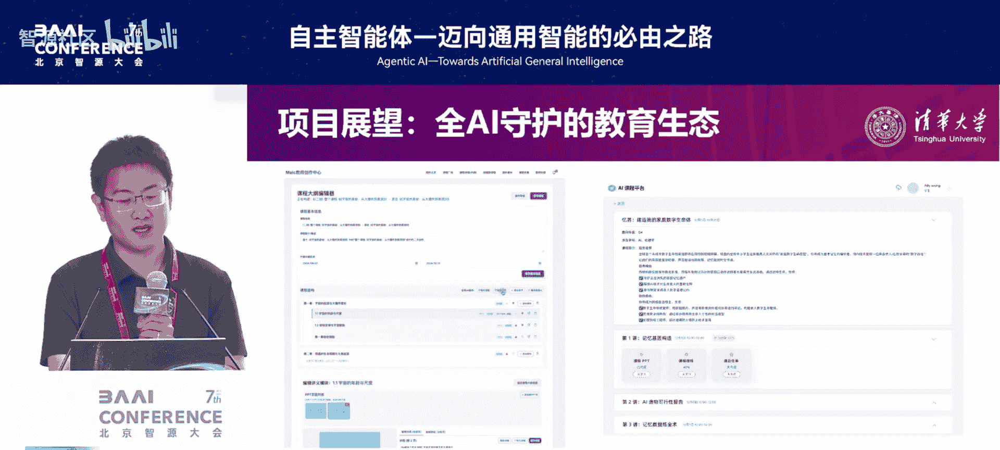

最后呢就是我们的一个工作愿景。我们认为在大模型时代，其实我们做的这个工作只是一个抛砖引玉的工作。我们认为智能体能够赋能教育的场景其实远不止如此。我相信想解决包括教育医疗等不同行业的问题。

它不应该是一个头痛医头、脚痛医脚的一个简单的有一说一的这样子的一个解决方案，而是应该从全局的角度考虑，让不同的环节都有智能体的参与，才有可能让他们配合在一起构建的更好。因此。

我们第一个主要目标就是在更多的场域中探索我们的平台的服务与使用，优先服务教育资源匮乏的地区，用公益来促进我们的科研。第二呢，我们的平台面向科研合作，现在展进行开源，并且努力筹措相关的资源。

希望能够构建大模型多智能体代体时代的教育研究的社群。最后就是一个小小的展望。如果说上一个十年是以欧美高校，尤其是美国高校为代表的慕课十年。那么在现在这个阶段，中国的。😊。

AI大模型的发展和中国最大的教育市场都给了我们这样子充足的信心。我们应该在这个时间段构建以中国的高校自主探索的一套全新的教育范式的变革。在这个时代。

这正是我们所有在中国从事AI赋能教育的研究者的共同愿望。以上就是我们的工作的介绍。然后这里留了一个我个人的邮箱和我们团队的工友和我们这个项目的一个二维码。如果有对我们平台感兴趣的，不管是老师还是同学。

尤其是想加入我们这个团队，想要一起做相关的研发探索啊，甚至是想对他做某些程度程度的这个市场化的这个啊有志之士，我都非常欢迎跟大家进行讨论。我们觉得教育一定是一个正产学员用五五位一体的一个综合体。

这个生态，一定不能少了大家的参与。感谢大家。😊，好啊，我们啊就是也是啊一个问题吧。嗯老师您好好意思。啊，是我的。哦你先把这位同学哦好呃，谢谢于老师的分享。哦，我是来自北京协和医学院的博士生孙亚文哦。

最近在就AI和医学教育进行一些探索。然后刚才呃我听林彦凯老师在提到呃主动式工具智能体的时候，呃，就让我觉得呃这样的智能体，可能在应用到教育场景中呃，非呃可以对我们实现教育。

就是咱们教育学中所提到的启发式教学可能是非常有意义的。然后我就想请教于老师的问题是呃，AI技术可以在多大程度上实现我们对于教育模式的想象啊，谢谢于老师。😊，可以在多大程度实现对教育模式的想象。

其实我觉得这个问题可能刚刚前面的几位老师答的会更好。因为我觉得他们一直都在帮我们改变AI对于很多很多。功能的设想和想象。嗯，我我我之前是这样子的一个感受啊，我今天早上在re我们的这个PPT的时候。

我找到了2024年1月份，我第一次拿着这个提案给到我们团队的领导老师们去汇报这个想法的过程。然后我看到那个时候我们的方案是一个非常草的，非常这个初步的一个结构。当时大家不会觉得说一AI能讲课。

2、这么复杂的功能都能实现等等。但实际上呢我们仅用了两两个月的时间，就把它从一个纯粹的毛坯打造成了一个平台。所以我自己的感受是在这个多智能体的时代，尤其是一些非常善用AI的人，一个人就是一支军队。

你今天晚上做一个梦，明天早上你跟你的智能体好好商量商量，说不准这个梦就能实现。所以这个想象应该就纯粹的是看你的想象空间有多大。当然了，好像这个教育学里面有讲。

说人是没有办法完全设想出一个自己连见都没见过的东西的。因此我们所有的创新也只是从旧的事物和新的事物。😊，之间建立连接。从这个角度来说呢，建议多参加像智援大会这样给我们开放性的这个论坛。

看看都有哪些可能性。说不你做做起的这个梦想，他就能够想得更更加的这个宏大啊。以上好的好的，谢谢老师，确实收获很大。😊，好呃嗯老师，我还能再问一个问题吗？好，我们最后一个问题。好的，呃，于老师您好。

我叫张海燕，我是一个传连续创业者。我之前在纽约呃9年多一直是学习艺术和社会学，然后在呃博物馆和艺术品牌卖行都有相关的经历。我现在去年年底回国开始做人工智能艺术教育的呃一个应用平台。

也呃我的很多愿我们团队的很多愿景跟呃您的呃研发也是很一致的。然后我们的团队的核心创始人里，也有一位是在清华美院呃在读的博士生。然后呃所以呃我在研发我和我的小伙伴们在研发过程中呢，就是一直在思考。

就是呃人工智能引擎的艺术教育，在创新方面能够呃就是对比于传统的艺术教育呃呃这个人人作为老师能够有哪些的呃呃革新和进步。所以。所以我想问的就是于老师。

您觉得呃人工智能在人工智能成为或者是有机会成为呃教育者或者是教育辅助工具的今天，我们在革新和创新方面呃，能够呃对比传统的人的这种教育形式能够有哪些呃迭代呢？呃，我我来理进行一个复杂文本的理解啊。

就是感谢这个我理解的意思是说，在艺术教育的这个场景内，大模型能比传统的人类哪些方面做的更好吗？😊，哦，对的哦，好的，呃，首先我觉得我本身其实在这个美育方面并不是专家，肯定有相当多的美育专家。

不管是在线下还是线上，可能在关注着我们的这个论坛。然后我自己的对于他赋能那个教育中的某每一个特定领域，包括刚刚讲的医学教育，还有艺术教育。其实我都有一个这样子的一个感受。

就是我们过去在教育理论中讲过很多应该怎么样的这样子的导向。比如说杜威讲，我们应该让孩子们更多的获得直接的经验，而非完全获得更多的间接的经验。比如说在美育的过程中，其实我们也应该是做类似的事情。

应该让同学们一能见到更多的。二能感受到更多的，甚至是体验到更多的，但是受限于时空器具的这个限制，有很多内容本来是完不成的。那么我觉得其实如果我们不是让他代替了教师，而是。

使得他给到孩子们更强的这个呃外外物上的帮助，使得他能够进行更多的体验。我觉得这件事可能就更重要。比如说过去我们在没有数字技术之前，我们没有办法就没有互联网之前。

孩子们甚至都没有办法在这里看到所有的这个梵高的这个画，也没有办法深入到去西班牙看到很多真品，然后呢，在AI的是在那个有了互联网之后能做到这个，但是我们没有办法想象梵高画了向日葵。

他他没有画过茉莉花是什么样子。我们没有办法想象他他做这个件事，那件事等等。我觉得如果我们能够在教师的合理的规制下，能够把原来曾经的艺术家们的这个有限的这个创意发散到更多不同的场域。

然后扩大人们对于直接经验的理解，我觉得这个导向肯定是最正确的。至于其他的这个所谓颠覆性的内容。我觉得还是要永远审慎的把教育的工具啊和大模型放到一块。我们更多的应该还是从教师本身的能力上去做提升吧。感谢。

