# 2025北京智源大会-自主智能体——迈向通用智能的必由之路 p08 构建基础智能体的认知引擎：刘邦 -BV1ccN7z5ETU_p8-

啊，非常感谢主持人的介绍，也非常感谢呃自然大会和刘志远老师的邀请。然后有机会在这里分享我们近期关于呃AI智能体的研究工作。呃，那我今天的报告是呃叫做构建基础智能体的认知引擎。

首先当我们讨论AIag的时候，我们第一个问题，自然是呃什么是一个agent。比如这是来自这经典的教科书，arificial intelligence a modern approach中的一个定义。

说一个智能体，它就是任何能够感呃接受环境中的呃信号，并且做出决策，做出行动的这么一个东西。所以大家可以看这个框图，我们有个environment。

然后我们有一些sensor能够从environment里面感知它的信号，然后通过一个决策过程，我们得出我们应该做什么样的行动，然后去执行。

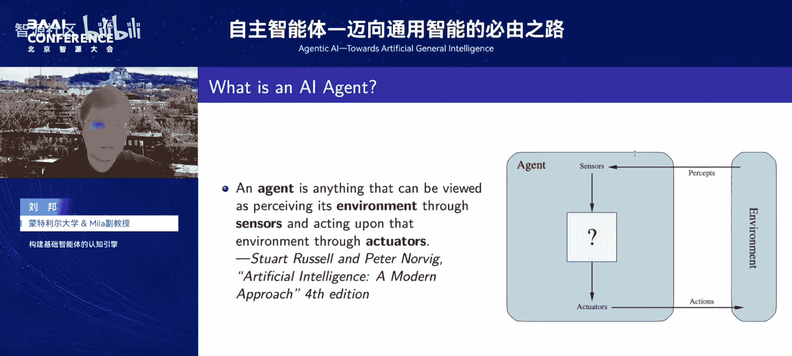

那我们想说的是这里有一个问号，代表它的cognitive component，它的认知核心。那我们怎么样去构建这样的一个认知核心呢？它里面有一个什么样的结构和状态。

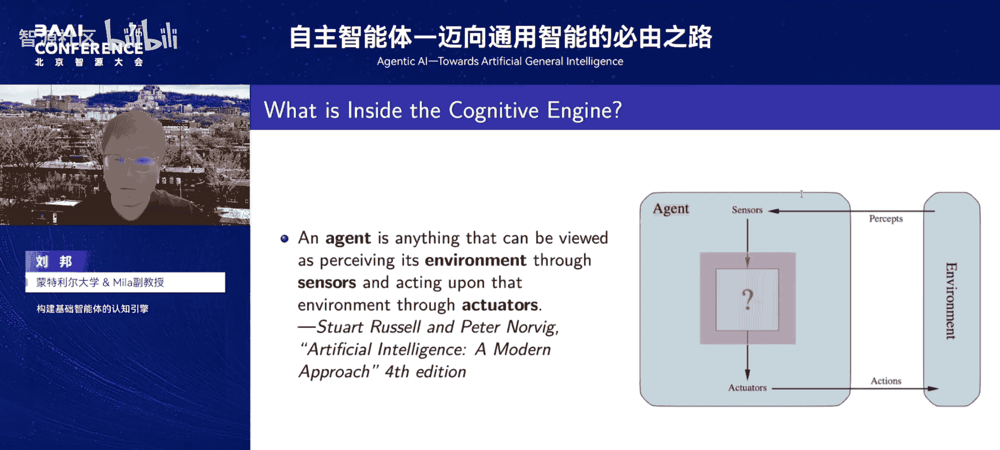

那这张图来自呃不介得受温瑞联的一个block，呃，这是一个非常tpical的一个agent的一个架构。那我们知道早期agent它的实现。

比如说可能通过re based或者doomaspec的一些implementation。那随着大模型时代的到来。啊，AI模型在自然语言理解的程度上有了质的呃提升，同时它的推理能力等等。

它对于不同场景的一个适应性也有着长久的变化。那我们可以看到呃，基于LM的这些能力，我们再加上一些核心模块。比如说记忆planning呃工具等等等等。我们就形成了一个非常简易的一个智能体架构。

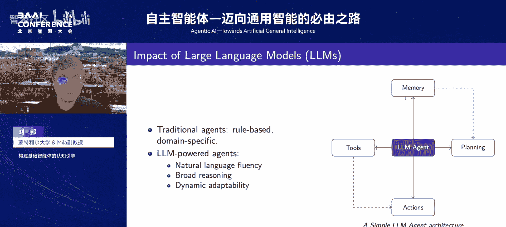

那我们不仅要思考到现在为止，我们可以看到有非常多的研究，关于AI智能体的每天都有出现。刚刚听了几位老师的演讲，我们也可以看到有非常丰富的一个应用啊，可以看到说啊他们有很强的一个语言模型的能力。

他们有很强的推理能力等等等等。同时除了能力上的提升之外，也依然存在着各种不足。比如说它的安全性它可靠性，以及它的复杂推理，对于不同情况的一个适应性等等。那我们不禁要思考啊。

如何构建对于AI智能体的一个统一的framemework，以及怎样去提升它的各种核心能力。比如说它的呃终身学习的能力，它在复杂场景下的推理能力。

以及他在需要情感支撑下的一个emotion grounding，还有mmodality多mat态等等。那基于这个动机，我们近期联合全球20多所不同呃院校的老师同学一起做了一个大规模的调研。

叫做advance and challenges in foundation agents。呃，这个时位呃已经在archip上呃可以看到。同时我们这个月也在进行精修，很快会有一个呃V two出现。

那我们想法是说，其实我们知道呃人的大脑可以说是我们知道唯一的呃自然界一个智能体的一个存在。那我们希望对比机器智能和生物智能的一个区别。比如说嗯机器的agent和呃human brain。

他们各自有一个什么样的特点和区别，他们分别在哪些方面呃，有长处和弱点，同时，我们希望能够构建一个以human centered的 socially beneficial的1个AI来促使AI和人的一个有益的一个合作。

并且加强它的trans和trans。那比如我们思考一下呃人的大脑和LMag有什么不同。我们看到从硬件层面，那我们大脑是呃biological的生物的一个细胞组成的那LM它是有大型的神经网络。

它们本身在功耗上就有明显的不一样。呃，一个可能只需要20瓦左右的能量。但是LM它需要大规模的集群的训练，以及在inference也依然有吞吐量的一呃消耗等等。同时在呃casciousness意识层面上。

我觉得迄今为止我们还能够安全的说呃LMag不存在像人一样的这样一个主观的呃意识。对于学习的特点，那人是很自然的，我们有终身学习的能力，持续学习的能力。并且我们能很快的适应不同的新的任务，新的场景。

那相对比而言，LM呃在这方面有所不足。那同时我们是非常呃有具有社会性，具有丰富的情感等等。那相对而言，LMag在这方面也略有不足。那当然我们这里讲了很多human brain的好话。

对于IM agent，我们指出了它的众多不足，但不代表说机器各方面都弱于人。比如说机器能够很好的存储大量丰富的知识，而我们是不太可能读完它预训练阶段的各种数据的。同时他们很容易进行规模化。

做非常深度高效的一个搜索推理等等。所以我们的目标是说，我们希望从生物智能得到启发，可以看看在整个领域里面，哪些呃子问题已经发展的比较好，探索的比较充分，哪些还在高速发展当中，哪些可能比较冷门。

但是有呃进行探索的潜力，可能对于这方面的研究能带来一个质的飞跃。那比如说我们呃检验了一些呃大脑的功能特点，我们把大致的功能分为三大类。第一类以绿色表示，我们认为这方面的能力当前的研究做的已经比较好了。

可以认为它呃非常实用。第二个就是说呃也做的不错，但是依然有很大的一个探索空间。那第三类粉色的就是说可能我们相对而言研究会比较少。那有相当大的潜力可以进行探索。

那比如说大模型是以呃LM以自然语言建模为主体，那它在语言理解方面的能力已经非常非常强了。那同样的对于多模态模型，它的视觉感知能力也非常的强。我们可以认为接近于L一档。那第二档。

比如说呃像reing推理能力，然后memory planning这些核心的认知功能，我们也有非常非常多已有的优秀的研究工作。但同时我们也能看到这方面也依然在快速的发展当中，还是有很多的就是带探索的空间。

那还有一些topic相对而言探索的没有那么多。比如说他的情感的处理能力，它的触觉的呃处理能力等等等等。但这些也是有非常大的一个应用前景的。当然这里可能L1L2和LL3之间存在一些模糊的空间。

会有一些呃主观判断的存在。但我们大意是说，我们需要去思考对于生物智能和现金的机器智能，我们存在怎么样的一个能力的一个gap。那同时我们也看到现在关于AI和AIag。

我们有很多很多热门的 domainomain。但是他们会有一些零碎化。比如说我们有reing planningninglening，还有workflow。

它的呃模型的protocol of reasoning等等等等。那这些不同的topic，他们怎么样有机的形成一个整体。啊，我们需要有一个比较好的framemework来统一这些不同的功能。

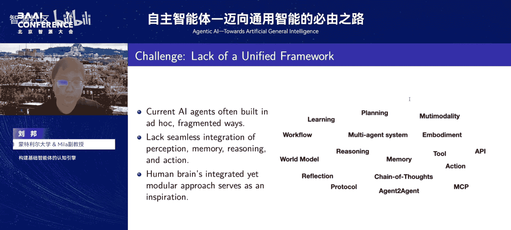

那基于此目的呃，我们就在刚刚提到的一个所谓paper中present了一个呃大致的framemework。比如这里有一些呃smbol，当然大家不用去记住他们到底是什么。

我我们可以通过这个图可以直观的感受到它是什么。

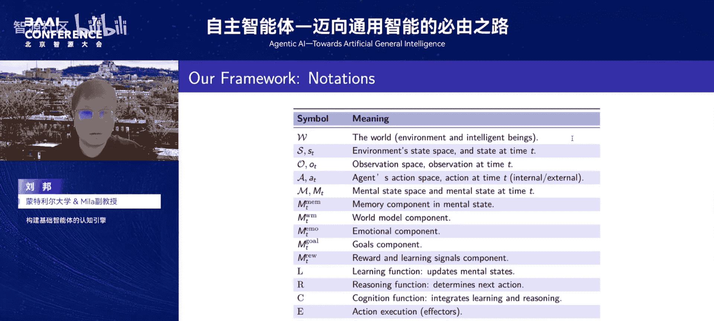

那首先我们定义了我们叫做呃基础智能体的存在。呃，基础智能体就是说呃首先我们叫它基础。也思就是说我们希望它能够gen applicableable to呃不同的一个场景。呃，所以它有充足的一个泛化性。

第二个它是个智能体。所以它需要有强大的一个理解认知和行为能力。第三个是呃我们希望它有非常强的一个coabor呃合作的一个能力。这样的话我们能依靠单个智能体。

多个单个智能体组成一个强大的magent system去解决更多复杂的任务。那这里我们定义了它的agent loop，也就是整个智能体的一个呃工作循环。比如我们从environment出发。

那一个environment可以有它的一个状态表示为SFT就是在时间T时刻的一个状态。那我们有sensor，我们可以用一个function向，比如P来代表我对环境的一个感知功呃功能。

那有了这个perception之后，我们会得到它的observationOFT可以看到它的输入是当前环境的一个状态和认知体上一呃智能体它的上一时刻的一个状态。MT minus one。也就是说。

比如我们在心情不一样的时候，我们对同一个现象的观察关注点也会不一样。所以说它的呃观察取决于外部世界的状态和智能体内部世界的状态。那什么是智能体内部识别的状态？

这就是我们刚刚提到的一个认知核心那个msask的呃粉红色的问号那一块。那我们把智能体的认知结构定义为由一些不同的核心mental state组成的这些mental state包括比如说word model。

它是用来预测通过呃当前预测未来的这么一个技术模块。呃，它的memory它是用来记忆我的。过往的经验和信息的一个模块，还有你的不同的目标goemotion，你的情绪模块，你的reward奖励模块等等。

那他们共同组成了一个智能体的mental state。那进一步基于这些mental state，我们定义它的认知功能。比如我们把它的认知定义为一个function，一个C。

那我可以认为所谓的认知就是基于我们上一时刻的mental state m minus one和上一时刻我们做过的action A minus one和当前的一个observ of t我们来推导下一时刻。

它更新的mental state以及做出决测action A ofT那什么意思呢？就是说啊我们是在维护一个mental state的一个变化。

就好比简人来说就像 recurren network它的一个hier state的一个变化一样。第二个就是我们是在基于我们过往的经验。因为AFTmin one和OT其实就定义了我们过去的行为。

以及它对环境造成的一个变化。这些序列就形成了我们的一个exper。那进一步我们可以定义更清晰的认知函数的两个子函数，一个是它的学习函数learning，一个是它的推理函数reing。那所谓的学习。

我们认为就是对你的mental state的一个长期的一个影响。比如说我们可以定义一个learning function L，它是基于MT minus one。

你上一时刻的mental state和你的观察AT minus one和OT我们就可以去update这个MFT。

那有了更新之后的内部状态MFT我们的reing就是基于当前的mental state去对action做一个决策。

AFT所以这样的话我们就可以将这个认知函数C拆解为learning and reasoning。那我们可以认为reing是对我们要做什么action的这么一个思考过程。

那你得出了我们要执行什么样的action之后，你需要对它做一个具体的执行。所以我们还有一个actctor，它有执行函数excusionFT这样的话，你输入你的AFT就得到实际可执行的一个动作。

A ofT。那比如说如果你是在做巨生机器人，那这个执行难度就会变得更加的困难。这也是呃将智能体应用在3D居生环境下具有难点的原因之一。那有了这个呃执行之后的action之后，它就会对环境产生一个影响。

这样的话你环境就会进入到下一个呃state ST呃plus one。这样我们就形成了一个完整的agent loop。可以看到在这里我们核心是定义了就是认知模块的内部状态结构以及认知功能的一个信息的定义。

对我不见。那我们再次强调一点呃，具有这样的一个结构，我们希望防tag能做到什么呢？我们对它的定义其实主要关注三个核心的特点，exational，它是理性的，它具有强大的学习和推理能力。

第二个是generalizable，它是可通用可泛化的。就是我希望它在不同的环境下都能够去呃存在不同的任务。第三是coaboperativeative，它是能够互相协作，形成多agent的系统的。

也就是说，相对于构建一个大额全的超人一样的singleag。我们认为构建可组合的magent system是更加高效更加精济的一个模式。这就是我们所定义的ag的这么一个框架。嗯。

那今天我们主要想思考关于呃memory构建和推理能力增强的这么两个工作。第一个工作叫做CM architecture。这是我们近期发表在ACL2025上的一个工作。呃，论文也在arch上能够下载到。

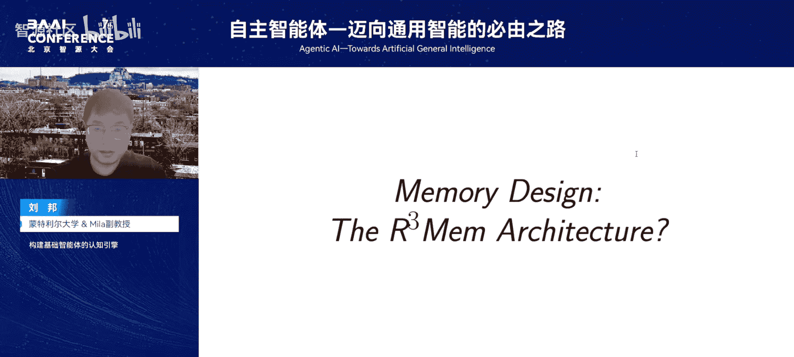

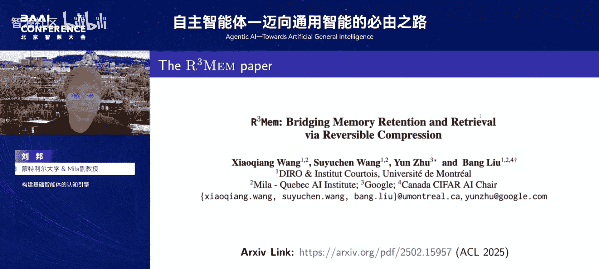

那首先。我们知道就是LM它是无状态的，什么意思呢？就是说你上一时刻输入了一句话，你下一时刻有个输出。那假如你下一次又来了一个新的用户，他又输输入了一个input。

这个时候其实LM是没有对过往的一个记忆的，所以它是一个无状态的。他过去的experience是没办法被保留的。那。😡，如果说你给LM增加了一个记忆模块，你可以认为我把它形成了一个最小化的A键的方式。

那这个记忆模块能够帮助我们去留存LM的过往的一个经验，使得我们能够进行一个连续的对话，并且产生个性化等等等等，能够执行一个需要多序列的复杂的一个task。

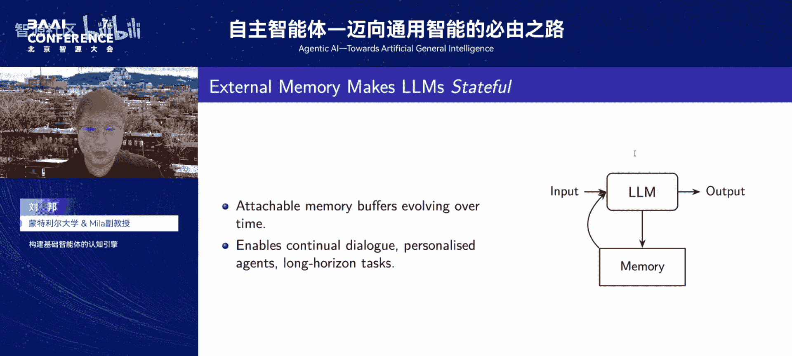

那记忆以怎样的形式来表示呢？我们可以大致分为两类，一类就是以外部存储的这么一个明确的形式。比如说我们用向量数据库，或者说我们直接构建原始文档的一个index或者KV catch等等。

那它的好处就是在于它非常容易去编辑，它是完全能够理解的。你能够很精准的呃留存下来，原来的信息到底是什么。那同样的，随着你的规模越来越大，它在检索方面存储方面以及它的一个latency，它的时间之后等等。

都会有一个影响。那另一种格式就是我们以一种影视记忆的方式来表示它是存在于模型内部的。简单来说就是比如说神经网络本身的一个权重。那这样的话，它是永远存在里面的。因为它在模型呃内部当中。

所以你的latency不会因为外部的一个检索而而增加。但同样的，你会比较难以编辑你的内部的记忆以及监控它的质量等等。

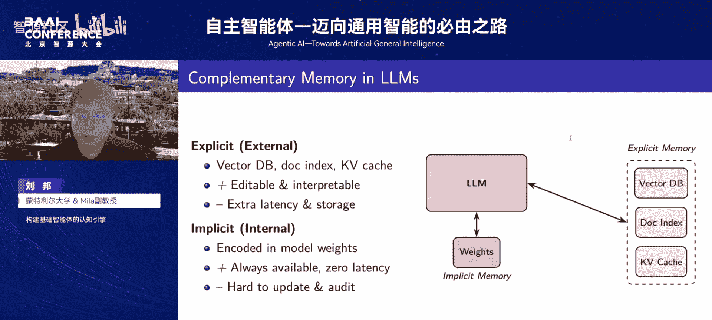

哦，不好意思。所以这是我们称为就是记忆的留存和检索的一个traade off。如果你用一个exlicicite memory，比如说外部的下链数据库，你很能很可靠的记录信息，但是它的存储和管理存在困难。

如果你利用implicit memory模型的参数来表示记忆题，它的检索就可能说它的信息记忆的不太准，但是它的存储方面没有太大的问题。那我们怎么样能够鱼和熊掌都兼得呢？我们能不能提高它两方面的一个能力。

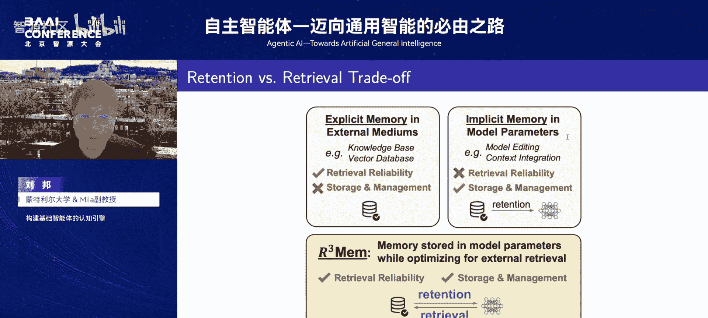

所以这是我们在这篇论文中想探索的一个问题。我们希望同时最大化它的memory retention和rettririeval，它的记忆的流程，以及它的检索效率。

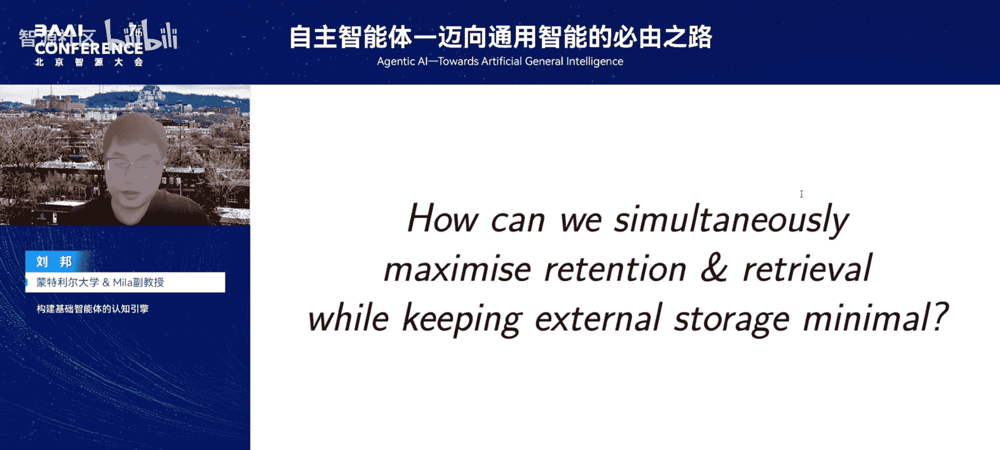

那我们有几个核心idea。第一个idea就是说我们认为可以把记忆认为是对信息的一个压缩，就好比你对信息的一个压缩和解压缩一样。但记忆的流程其实就是说我们有一个长的上下文。

我们需要把它压缩成一个记忆的表示，但就像一个zep的过程。那它的检索是一个解压的一个过程。当我们需要一些信息的时候，你的收入是个query。我希望把相应的context给解压说出来。

那我们可以看到它其实是一个队友的一个过程，它是一个双向的过程。

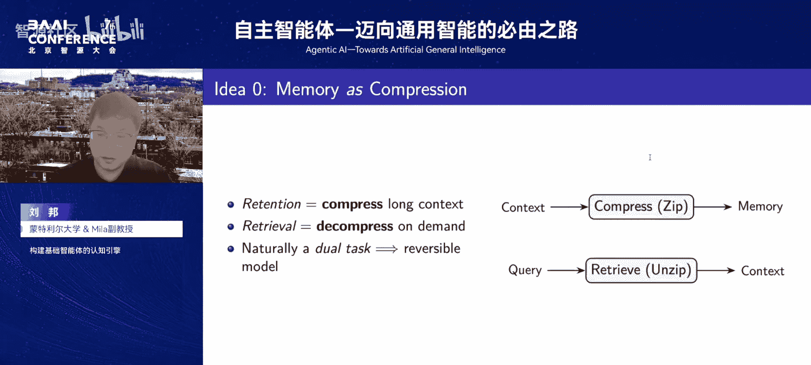

那这样自然的就引出了我们第二个 idea。我们希望我们构建的记忆网络，它是一个reversible memory network。也就是说它是可逆的。

比如这是这张图是来自于经典的关于reversible network的一个图。也就是说假如你的输入是X输出出Y。那你希望从X能够得到Y，以及从Y能够反推到X还原出来。

你只要去定义这样类似于一种reial connection，只不过它是一个变种，你需要有一个F模块和一个G模块。通过FG模块，你就能够从X算出Y，以及反过来从Y能够算出X。的具体的细节。

大家可以去参考原始论文。

那。我们还第三个idea就是说我们希望我们的记忆网络是从一个已经预训练的网络而来的。我们不希望说去重新预训练一个，比如说lama规模的一个网络，为什么呢？因为我们认为一个记忆网络。

它应该是有对语言的理解能力的那假如说给你一个lamaTB的模型，它已经有leguage understanding和 generation的能力了，我怎么把它变成一个专职的记忆网络。

所以我们需要把一个拉马或者说其他的任何一个开源的transformer based neural network，变成一个reverive network。

那这样可以通过给它增加两个F andGadaper模块来形成。这样的话你就可以用一个perft trained algorithm去把这个已有的模型finune成为一个memory network。

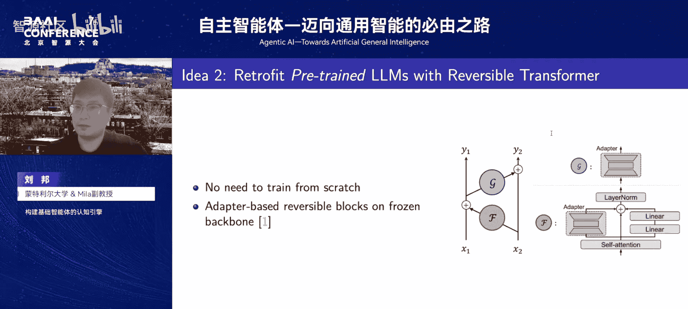

那最后一个idea就是说我们怎么去构建训练记忆网络的呃数据。我们其实可以通过对文档的一个hiarchical的压缩。比如说你来一个传文档，我把它压缩成pagraph level。

把以及从 paragraphagraph level，我压缩成 sentence level，最后压缩成entity level。那这样的话，这个压缩过程，我们可以用一个已有的智能体。

比如说GPTCO等等来完成。因为他们对于呃tex summarizemarization有一个很强的能力。同时我们进行一些过滤，过滤掉低质量的数据。

这样的话我们就形成了一个多力度的query到context这么一个arere。那这张图展示了我们Cm的一个网络的架构。首先我们可以看到，基于刚刚自动构建的数据。

我们就可以形成一个hierarchical压缩和解压的这么一个训练数据过程。从 paragraphgraph level一直呃降级到NT level。那对于网络这一块。

我们构建了刚刚提到的一个reveribletranser network。同时我们在网络里面增加了一个呃就叫做呃reading and writing token，其实它是一个记的 token。

它用于对上一层级的一个力度呃信息的一个压缩。这样的话，当我们推进到下一层级的时候，这个memory token能够以压缩表示啊长长的上下文的内容给表征出来。通过这种层级的表示。

以及可逆的trans network以及这种compressed memoryory token，我们就能够去高效的训练一个memory network。那它的训练los就包括三个方面。

一方面就是你压缩的一个lo，一方面是你的解压的一个lo。最后就是它的cyclcle loss。我们原始的文本和反解压出来的文本，它们之间是不是相似。通过这三个los的组合。

我们可以去高效训练的这样一个网络。

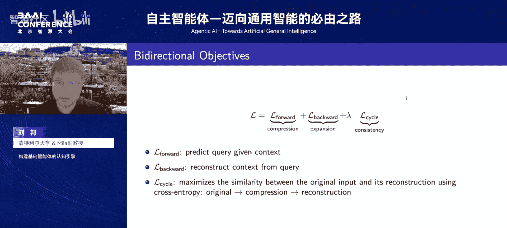

那实验我们通过多个不同的呃数据集证明呃RCM能够超过很多呃当时论文写作时的一个sta的各种baseline performance。

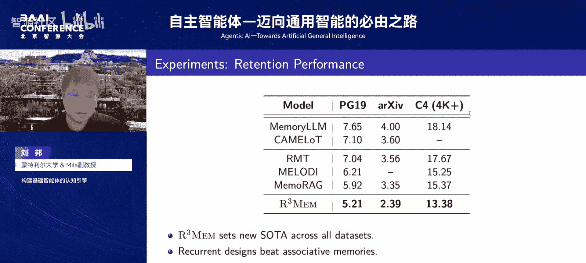

同时我们看到嗯通过更好的压缩，我们得到更好的一个retriver的一个效果。并且我们在in domainoma和out of domain的场景都有测试，发现我们RCM能够达到很好的一个效果。

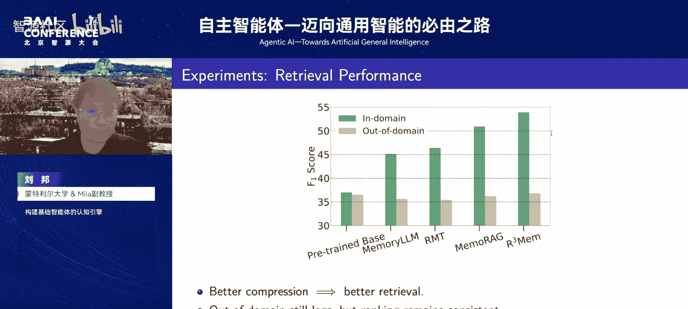

我们也把呃这个SCM作为记忆模块嵌入到不同的呃嵌入到智能体里面去对比不同的memory模块的一个效果。可以看到对比memory bankmemory呃 rack等等啊ICM能取得更好的一个效果。

同时这个评测是基于不同的指标，包括context coherenceresponse correctnessrack score等等等等。

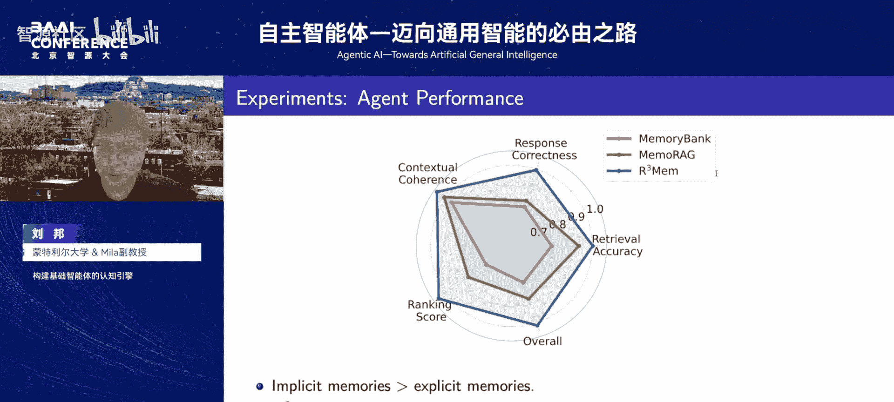

那同时我们也做了一些ab study，会发现呃这种双向的路径，以及它的cycle loss都对呃最终的performance非常重要，以及数据的质量等等。简单来说呃，在这个工作中。

我们将记忆的存储和检索呃建模成一个可逆的压缩问题。然后我们设计了ICM这么一个记忆模块，它是通过adaper将transformer变成一个reversible transformer。

然后通过vi token来代表mm呃记忆的压缩。同时我们发现经过实验的评测。我们的记忆模块能够达到色彩的一个效果。这样的话为构建新型的这么一种影视记忆模块打开了一一种方式。

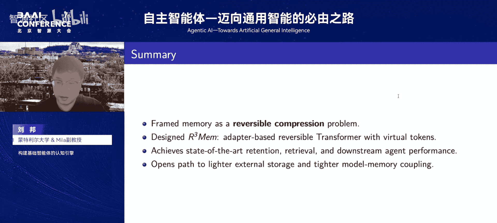

那接下来第二个工作就是说我们怎么样能够呃结合快速的heuristic和deepreing。也就是说我们通常说呃认知存在stem一和stem2stem一是这种比较下意识的快速的一个认知过程。

而stem2是这种一步一步的深思熟虑的过程。所以我们把它叫做stem1。5，我们希望能够兼顾这两种reing pattern的一个呃长处。

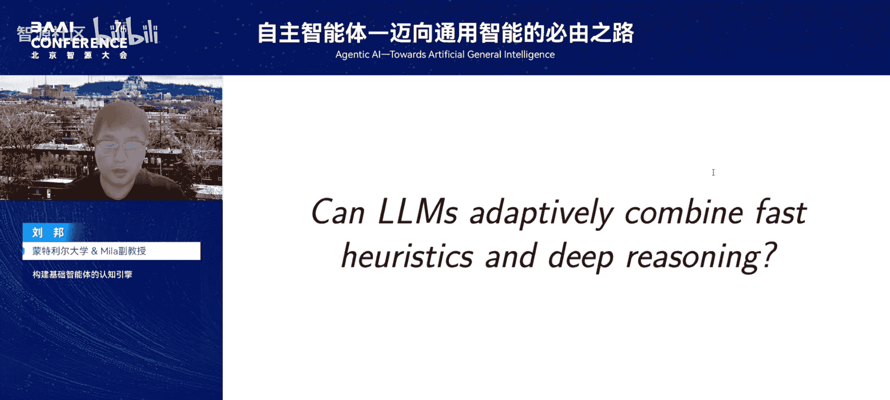

那这个工作现在也已经在cap上，大家可以去下载原文，去了解更多的细节。

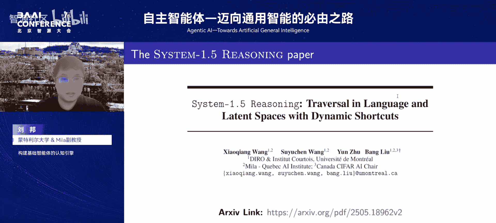

那首先我们先思考一个问题，就是说che sort它的练试思维，它是不是真的高效。我们知道它非常通过一种逐步的推理，一步一步的把一个问题去解决。但这里存在一些问题。第一个就是它比较冗于。

比如说我问你一个很简单的问题，2加3等于几。那正常人可能会说直接就说等于5。但是如果你把它送到一个chef sort model里面，它会呃很冗余的告诉你说，哎，首先我们先来加10位，然后是个位。

然后等等。你你就会看到即使是非常简单的问题，它像教幼儿园小朋友一样，一步一步的给你穿出来，这个并不是一种很高效的做法。那第二个问题就是他非常容易overthink，他会想太多。

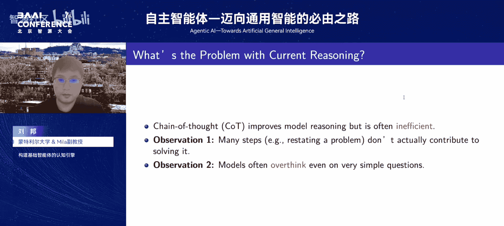

那比如看这个例子，这是在呃QWQ呃32B这么一个模型上，这是看到的一个例子。那我们这里问题依然是说R加三等于几？你会看到模型给出了很多种不同的解法。比如说用数呃手指数用罗马数字数物体呃代数表达等等等等。

所以你想到的不同方法，它几乎都用了啊，这样的话，整个题目其实模型输出了接近900个token的推理过程，这就是典型的一个过度思考的一个过程。计算这个答案，一目了然。

模型也会生成非常冗然呃冗长的一个思维链。那这两个问题是我们重新思考模型推理资源的一个分配方式。那理想情况下，我们认为就是说模型它应该在关键的思考步骤上去花费更多的算力。

而在简单的步骤上保持一个非常简洁的一个过程。这就是我们Cem1。5这种自适应的潜在推理n想实现的一个核心目标。那之前一一个重要的研究方向，就是说我们如何在语言空间中去提升推理效率。这里有两个不同的思路。

一个是减少总的token的数量，第二个是降低生成每个token的计算开销。

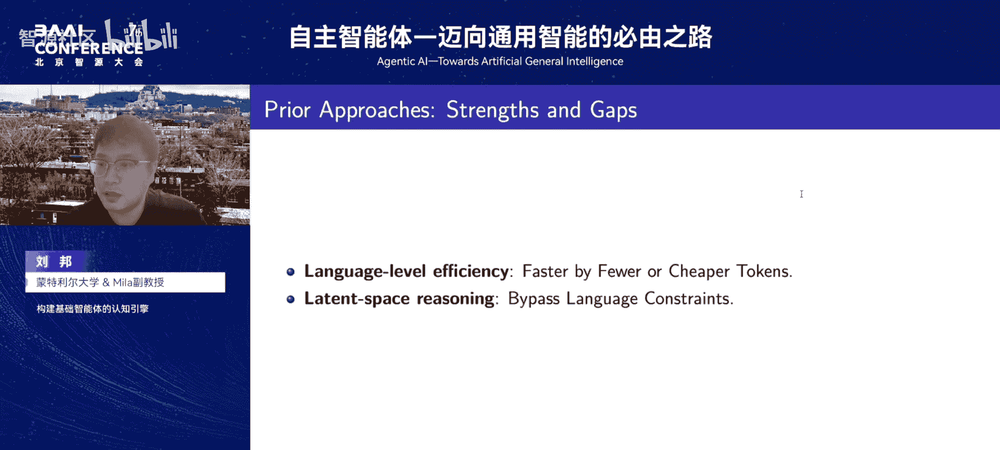

那比如说对于第一减少总托坑的数量，比如说呃che呃dft，它通过一种迭代式起草和编辑来缩短提示长度。S one通过解码值的干预机制来压缩生成内容。呃chef则通过冗藏的呃推理轨迹，压缩成更少的步骤。

那第二种方式是降低生存每个token的计算开销。比如说allyex可以在模型已经具备较高知信度的时候，提前终止计算，这样把你的深度压缩啊，lay skip也通过动态跳过标准计算的成来减少计算量。不过。

尽管这些方法带来了节省，它本身上依然是在生成完整的一个文本。也就是说模型依然要花算力去生成一些流畅的语言。尽管说这些token可能对推理本身没有太大的帮助。

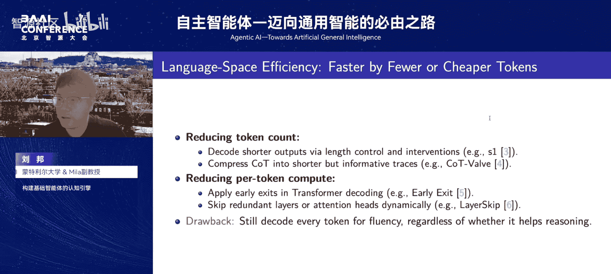

那。潜在空间推理这lightin spacevis，它提供了一种更高效的替代方式。我们在中间过程中跳过语言的生成，直接在模型的内部去进行思考。也就是说，我们不再将每一步想法都显示的解码成文字。

而是在影空间完成一个推理过程。那这疗方法可以大致分为两类，一类就是说压缩型的潜在推理。比如说呃coconut和CCOT，它可以把原本很长的1个COT轨迹压缩成一个更紧凑的盈空间表示。

这样就有效的减少了推理步骤，从而降低计算成本和响应延迟。第二类就是扩展型的潜在推理。它通过插入一些特殊的token，比如说pos暂停或者filess等等，来模拟延长思考的时间。但是在在这个过程中。

它并不会生成更多的文字，只是让模型在引空间多想一会儿。不过这类问题依然存在一个关键的问题。就是他们对所有的推理步骤一视同仁。无论是重新表达问题，还是合并两条事实等等。模型都会使用同样的计算深度。

花同样的算理，这样依然导致了效率问题。所以我们希望让推理过程能够更加具有动态的一个适应性。在难的地方花更多的时间思考，在简单的地方快速跳过。

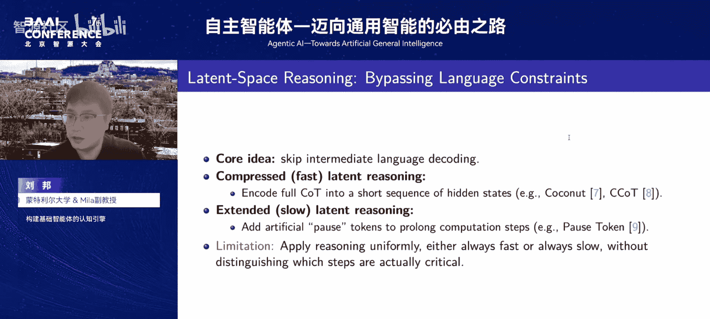

那这张图就展示了两类不同的研究方向。我们也看到这里有原始的che，我们在每一步都会解码出一个文字，并且走完了神经网络的整个深度呃 exit我们可以看到这里白色的 token中间的白色矩形代表说这些深度我们其实被跳过去了。

所以我们在不同的步骤解码单个 token的时候，我们走过的网络深度是不一样的。然后comppressing，我们可以看到它的token数有减少。这样的话我们其实是在影空间压缩了步骤。

以及extraleing。我们相当于在有些关键步骤上，我们去增加了它的reing的呃影空间思考的一个过程。那这两类方呃方向各有进展，但是都没有做到说根据推理难度去动态的调整计算，这就是我们想解决的问题。

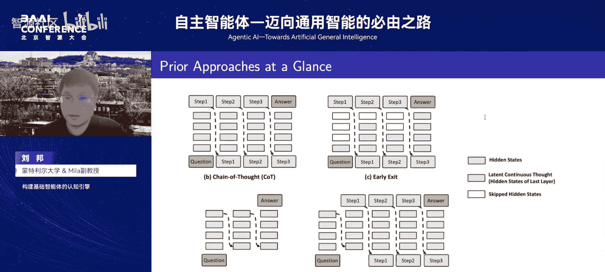

那system1。5引入了一种新的潜在空间推理的方式。我们希望它既适应又高效。那核心思想就是说模型根据每一步的推理难度，动态的调整所投入的计算量。因此我们提出了两种shortcut。

第一种叫做呃深度的stcut。它在模型的垂直方向。比如说我们有20层呃transformer layer。那有些步骤我们可能只需要十层，有些只需要五层，有些可能需要走完全程。这取决于你推理的难度。

第二个是呃步骤的捷径，step shortcut。它在推理的时间线上做了一个呃捷径。比如说如果我下一步非常频常，我们不需要复杂的推理，我们可以直接快速的跳到下一个步骤上面去。

这样模型可以复用之前的引程状态做一个简单的计算。那通过这种横向和纵向的捷径配合。我们就可以让模型在模型的引空间做非常灵格的灵活的一个traveral。那你现在看到的图就是这个机制的一个表示。

通过简单步骤和捷径快速穿过而复杂的推理则会沿着更长的路径投入更多的思考。这也是模拟人类思考的一个策略。

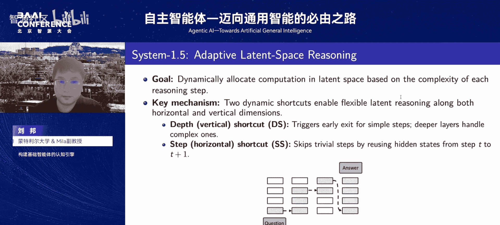

那。这场幻灯片我们展示了st1。5在推理和训练过程中的一个核心机制。那在推理过程中，我们每一层每步的隐程状态都有三种可能的路径，一个是默认路径。也就是说我们一层一层往上一直到解码出最终的token。

一种是叫stshot cut。也就是说我们在当前这个层的中间层，我们直接跳到下一层。这样的话，当前步骤其实是非常简单。我们模型会复用前一时刻同一层的一个隐程状态，经过adapter的一个转换。

得到当前时刻这一层的一个状态。第三个是dstr cut。也就是说，如果模型在某个浅层已经决定提前退出了，就是我已经有足够的信息，足够的信息知道说当前的answer应该怎么去解码，那我就提前退出，呃。

不需要进行更深度的一个推理。那这些路径的选择有一个每层的小型呃root network来控制，它就是一个小型的fit forward network，它能够输出一个知行度的分数来判断走哪条路。

那这样的话在训练阶段，这些路不会被硬性的选择，而通过一个soft wait把它们混合在一起。这样的话，路由器的输出决定了每条路径被赋予多少权重，从而允许模型在学习过程中探索各种捷径的策略。

那右侧是一个示意图，我们可以看到这里横向的箭头表示步骤捷径，也就是这个step shot cut啊，纵向的跳跃表示深度捷径的d short cut，它能够让我们提前退出。这样的话整个架构会变得更加灵活。

节省计算，并且支持引任务的复杂度。

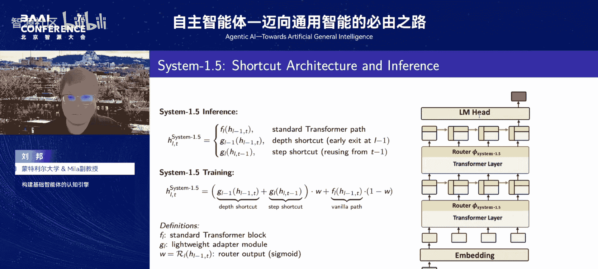

那训练这样的sem1。5的reing面临两个核心挑战。第一个挑战就是说它预训练语言模型天生是为语言空间，这个token space服务的。它按照足够的token去生成文本。而ssem1。

5是在这个lighttin space做一个推理，因此中间它不会生成很多的自然语言。那为了解决这个gap，我们设计呃引空间的这么一个蒸馏机制。也就说我们让一个学生模型的隐成状态。

对其在cheap shot上呃训练过的一个teacher model。那这样的话，即使你的student model不生成中间的文本。他依然可以学会怎么样去解决这个任务所需要的一个内部的表示和推理轨迹。

那第二个挑战就是模型的知适应性。我们怎么知道哪些步骤我们应该跳过去，哪些步骤我们需要深思熟虑。那我们引引入叫做shortcut learning的机制。

我们先通过原子思维分解atom decom来标记每一步的重要性，从而得出哪些是关键步骤，哪些是可以跳过的简单步骤。然后我们设计一个阿里ax plus来监督每一层的路由模块。

它是不是符合我们得到的这些呃步骤分类的一个标记。最后这个损失函数来鼓励非关键步骤来尽快的exit。呃关键步骤我们保留足够多的计算资源去进行处理。那这样两阶段的训练流程就是stem1。5的一个关键设计。

那这张图是对训练流程的示宜，那左边是stem teacher模型，它会生成完整的chap store的一个推理轨迹，也就是一步一步的推理。那我们提取它呃中间层的隐程状态，让它视为浅空间中真实的推理路径。

也就是它最后一层的引擎的隐程状态。那这些表示会被输入到学生模型里面。那学生模型它不再生成中间文本，而是直接在引空间做一个推理。然后啊为了实现这种捷径的学习。

我们利用atom of sort方法来标注每一步的一个关键步骤。决定就是说这一步是不是关键，是不是可以跳过。那每一层的路由模块根据这些关键性信息的label去学习，决定在哪些步骤可以提前退出。

哪些步骤进行更多的思考。而这样的训练机制实现了在保证正确率的同时去大幅的提升计算效率。那这是我们呃训练的一个损失函数的设计。在第一阶段，我们希望学生模型去模仿呃ch sort教师模型的推理过程。

但是它是在lein space进行的。因此，我们在最终答案对应的隐生状态上计算它的一次性损失，使用卷方误差，并对教师模型部分使用stop呃 gradient，来防止反向传播。那在第二阶段。

我们训练路由器模块来控制是不是呃使用简禁。因此，我们引入这个alliex loss来引导模型在简单步骤上尽早退出，在复杂推理步骤上进深入处呃处理。那同时早退损失还会去动态的调整每一层的误差权重。

如果这个是关键步骤，那越生层的误差越重要。并且同时我们还继续呃用标准的语言模型的损失来生成正确的推终档案。那这样多重损失的机制，能够让stM1。5，在保持推理正确的同时来精准的控制计算资源的使由。

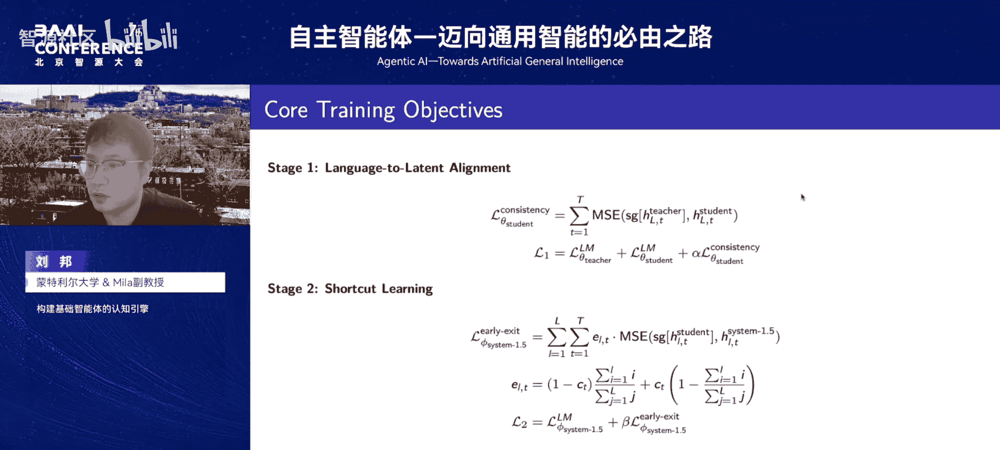

那这是我们实验，我们在三个基准任务上进行评估，包括JSM8KJSM hardd和呃strrategyQA。那这些不同指标，包括它的准确率呃，平均解码部首等等等等。那我们可以看到C31。

5它实现了目前最优的整体加速效果。它在JM8K上实现了最高20倍的提速。在呃strrategyQA上甚至超过了55倍。那同时我们保持甚至提升了呃相较于che的这么一个呃准确率。

也就是说我们在影空间的推理的效果，达到或超过了在显空间一步一步解码它到的效果。所以不同于以往的潜空呃浅空间的推理方式，我们显著降低了计算开销，同时保留了强有力的推理能力。

那同时我们注意到其他方法需要大约26到61步去完成推理。而我们模型只需要2到4步就能得到正确的答案。

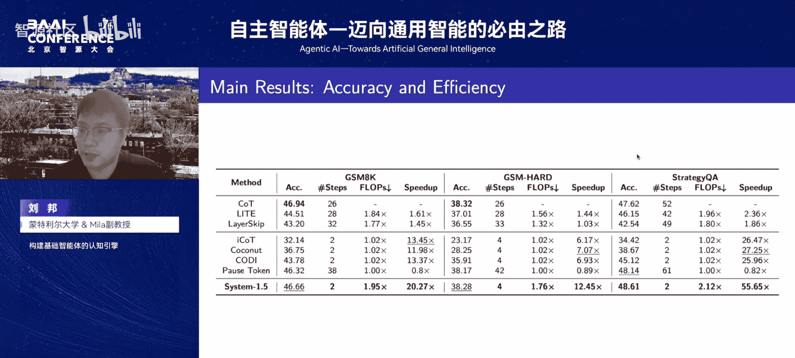

那我们实验总结来说，我们实现了显著的推理加速啊，然后即使我们减少了计算量，但是我们在准确率上依然和che shot相当或者更优。并且我们在GSM8K上和GSM heart上几乎与che的基线持频。

然后我们效率的提升主要来自对影呃影状态的一个重用。因为我们动态捷径机制可以跳过容易计算，让中间拓片的生成量减少90%以上。这我们的方法具备高度的可控制性，我们只需要调整两个简单的参数，呃。

就可以去控制模型的深度和部署。可以看到这张图，我们。这是我们C31。5的一个非常大的一个优势。我们去可以控制它测试时的推理缩放能力。据和很多基于语言模型的推些方式不一样。C31。5它不需要复杂的技巧。

比如说数形搜索或者说多路径的一个设置，我们只需要调节这个le depth和limit来控制你的推理深度。这里啊第一个limit depth，它是一个深度的阈值。

也就是说当我的gatet它的输出的confidence是不是大于这个阈值。如果大于这个阈值，我就决定ex提前退出。那假如说我将它设为一，本质上你的输出不不会大于等于一。那其实我们是在强制它走完全程。

假如你有20层transformer，你就必须走完20层。但如果是0。5，它可能会在中间某一步分退出。那第二个参数是的呃step，你的最大部数，也就是说我的隐程思考最多走多少步。

这样的话你就可以去控制你呃思考的部骤。通过这两个相当于参数或者旋钮，我们就可以在不需要重新训练或改变结构的前提下实现准确率和计算开销之间的一个平衡。那总结一下，我们实上1。

5提出了一种高效灵活的潜空间推理方式，它能够根据每步的推理复杂度、动态计算计算资源，呃，可以沿着模型的纵向调整，也可以跨时间步骤横向的优化。这样的话我们去提升了它的速度，以及保持了它的推理的准确性。

同时，我们在测试阶段有非常强的可控制的计算控制能力，使得它能够成为真正可部署的推理架构。那展望未来我们的下一步是希望在影空间去深度的融合检呃记忆检索和推理模块，从而构建更强大的一个认知核型。

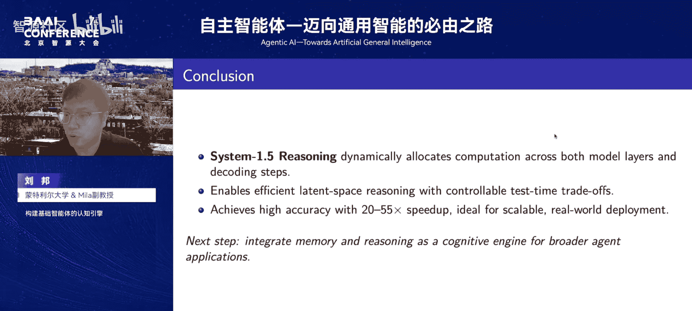

啊，谢谢大家。😊，好，感谢刘邦老师的精彩报告。那么呃也是由于时间关系，我们也比较晚了到有一个问题吧。嗯，还还是。刘老师好，我啊，我有个问题，就是关于刚才您刚才讲那个脑科学那个，我其实很感兴趣。

但是就是我说agent的嘛，就是我们现在发现因为你调都掉API嘛，但是实际上我们人脑其实是神经元会变多变少嘛。最近研究发现人脑它神经元是会变化的。也就是说我们的可能是不学习，可能头脑头皮就更光滑。

可能学习加折皱更多。但是实际上我们用大模型的时候，它的权重一般是固定的。虽然你可能有根据用户来进行行为偏好。但是我们一般会总结到它的memory里面，而不是去直接动它的模型的具体的参数。

或者说即使动的是微量动，而不会去增加模型的权重大小，比如说一B变2B3B变510臂变成00多B对吧？就是目前就是您是怎么看待当前实际使用这种模型权模型权重大小本身的固定化的这个问题的。😊，啊。啊。

谢谢你的提问。我觉得这个问题非常好。首先就是这种所谓权重大小的变化。我认为已有的研究工作中，有一些是接近于这种设置。比如说呃MOE对吧？对于不同的任务，你是分配了不同的expert来解决这个任务。

那同时你也提到就是记忆的问题。就比如说当我们随着输入信息越来越多，什么信息应该说我们让大脑或者说我们让模型记录它，什么信息，我们应该直接存在外部数据库里面，这样的话不增加我们认知模型的一个负载。

其实这个问题我会以认为你得判断这个信息是属于长期有价值的信息，或者说我们认为它是一个knowledge，还是说它只是一个information，那什么是knowledge，什么 information。

我认为knowledge就是说它是能够generalize到other场景，并且说它是有共识的。也就是说不只是这个agent的认为这个信息是对，那放在其他人身上。放在其他a上上，这个信息也是对的。

那信in会相对而言更加personalized。也就是说他可能对于某个用户而言，这是他的个人信息，它不是一个大家所拥有的共识。所以，为了平衡这种模型规模和认知负载的问题。

我们需要去思考说什么样的信息会被这种lain memory去学习和吸收什么样的信息会直接作为explit storage放在外部，这样的话，我们就能够平衡这两种过程。

