# 2025北京智源大会-青年科学家发展与创新动能论坛 p03 研究+成长：Alex Lamb -BV16JNxzPEAd_p3-

Thanks a lot for having me， so I was asked to give a talk about my academic career。

 how I got to where I am today， and some of the lessons that I've learned through the process of doing research。

 so I'll be talking about eight of them。Um so like I said。

 this is just going to be an overview of my academic life and career and some of the lessons that I've learned。

So in my early life， I grew up in Northern Maryland in the United States so where I grew up initially my parents rented house。

 a house on a dairy farm and you can see a picture that shows roughly what this area looks like。

 so the area has a lot of horse farms， dairy farms。It's about a one hour drive Baltimore to the east。

 Washington， DC， to the south。And then I guess if you go west there's Harper's Ferry。

 which was the site of the John Brown Sla revolt， so it's kind of an interesting historical area。

Additionally， it's close to Bethesda， Maryland， which is where the games elder scrolls fall out Skyrim where those are made。

 so it's kind of an interesting area。So in terms of the first steps I took to get into like research is when I was in high school。

 there was a website called New grounds where you could make and share video games using a software program called Flash and you could program with action script。

 and I remember downloading this software and really enjoy using it and in this software program。

 you can sort of like directly draw an animate entities like the player in a game or the different enemies in a game。

So it' was very easy to just attach pieces of code to those entities in the games and just to give one particular example I remember learning how if you wanted to program the player to be able to move around in an angular way like they turned their angle and then that gives them some velocity you could use the trigonometry like the sine in the cosine function to calculate those actions and how it would affect the game world。

 so for me that was really the first time that I started to enjoy like mathematics was when I got into programming。

So I guess one lesson I personally take away from it is I think in research it's good to do things that you enjoy and I feel like if you find problems that you just love doing then it'll make things easier and maybe to give another example of where this came up is when I did my PhD later I spent a lot of time working on classical Japanese document recognition even though like it wasn't related to my。

PHD or career advancement， I just enjoyed working on it。

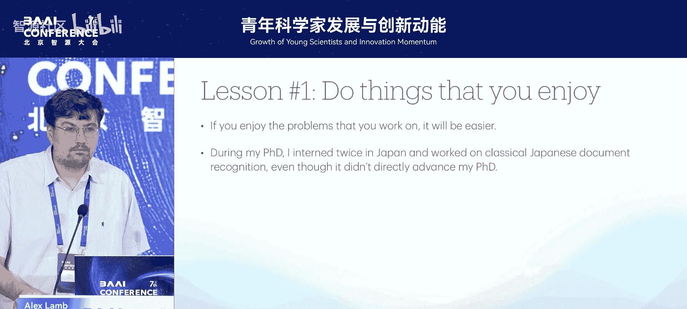

So following high school， I did my undergraduate at Johns Hopkins University。

 so I majored in computer science and applied math。

So I just remember at the time I really enjoyed a couple of classes。

 so one was there's a machine learning class that I really liked。

 so I guess that had a large influence on where my career would end up going and with that professor I did a research project on natural language processing for Twitter flu analysis。

 so that paper was published in NAL in 2013。And I also started getting into。

Programming language theory around the time， so I'd also enjoyed that a pretty good amount。

Another thing that was happening around that time that was kind of interesting was。

If you follow what the neural net literature was like at the time around like 2011， 2012。

 there was a very large amount of interest in a type of network called the Deep belieff network。

And the basic idea there， so it's very different from the types of neural nets we mostly think about now。

 but there was a lot of interest in regarding the hidden units of the network as an undirected graphical model and the basic idea is that you could achieve deep generative neural network via layerwise pretraining so initially you would try to you would just have your observed units and you would try to learn this undirected graphical model to get a single a single layer network and then once you've learned that first layer of hidden representations you can just recursively kind of apply the same algorithm on it one more time。

to recursively just get a deeper network and people were able to observe that in the deeper layers of these networks。

 indeed some kind of interesting features would end up getting learned。

While I was doing my undergraduate， one kind of interesting experience I had was I worked in the mission control room for a satellite。

 so this was at the Johns Hopkins appliedlied physicsic lab and it was kind of a fun experience。

 so it was like I sit in the control room I would like make calls to people who were operating different parts of the satellite although I have to say the fact that the satellite hadn't launched yet。

 maybe made it a little bit less interesting in some ways。

 but we were still doing the preparations for the satellite launch。

I guess one of the big things I learned from this is that I really wanted to do research because working in the operations center for the satellite wasn't。

It wasn't something that was that engaging for me， at least in the long run。Yeah。

So one thing that I learned from this is when you pick research problems or what area you want to work in。

 I think it's good to try to find comparative advantage。

 So when a new problem emerges or when a new field starts。

 I think it's often the case that more intuitive and empirical research can move faster than theoretical research and we saw that。

Early in the field of deep learning， but I think once a solid theory is developed。

 it can take over an area so that kind of happen in convex optimization。

 and I also think that once a field matures you tend to see more specializedization between engineering and basic research and I think you're seeing more of that in LLM scaling where the groups that are building the large models tend to be specialized from basic research。

嗯。So because I had had thatnale paper during my undergrad and I had a connection with the professor Mark Dreadza there。

 I was very lucky to get a research scientist position at Amazon， this would have been around 2013。

So it was a significant development in my career because it was my first chance to do research in a good industry lab with a lot of room for intellectual freedom。

And it was kind of interesting when I joined the team was using very large random forests as a way to forecast demand。

And I was doing some of the early work there on quantile regression neural networks for demand forecasting。

And working in this area led me to become a lot more excited about generative models and sequence models。

 and I will just say even though I left the Amazon forecasting group eventually。

They've continued to do some very interesting work on reinforcement learning for inventory control。

 so they directly use reinforcement learning and policy gradient to control what products are bought for Amazon。

 which directly bypasses the demand forecasting step。

So I'd say the third lesson I took from research is something called customer obsession。

 so if you work at Amazon there's a set of things which are taught to you and one of them is they say like be customer obsessedess so they say like when you're working on product or when you're making something don't work on things that are exciting to you or that。

You find the most interesting think about what your customer needs and try to produce things。

Which really satisfy your customers and I think it's also just a good value to have in research in general。

 so when you put out an algorithm or a paper or a piece of code do you find that people enjoy using it。

Is it something that？Works out of the box like the first time they try to use it。

 it generally helps or is it something they have to fiddle with or have a hard time using it to get it to work。

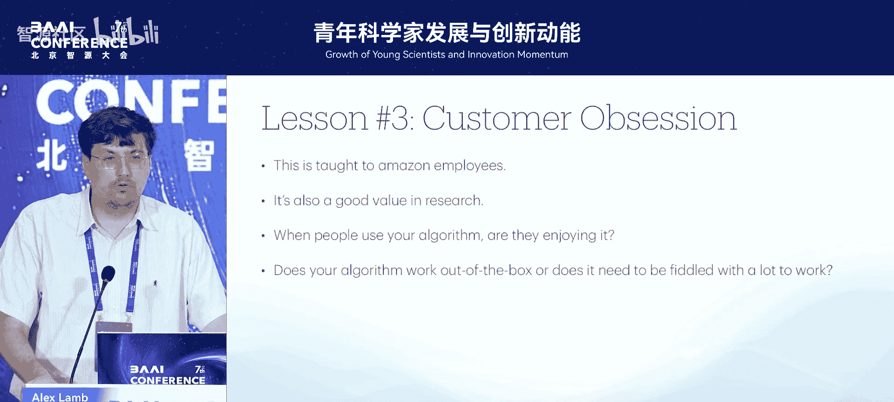

So I think that's generally a good value to have。

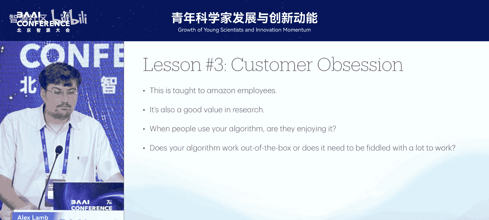

U。So while I was working at Amazon， I realized I wanted to do a PhD to do more research。

 so in the Canadian system you always have to start with a research masters before you do your PhD。

 so I did my research masters at the University of Montreal under Aaron Corville。

 then I did my PhD with Yahua Bengeio。And it was there at the University of Montreal that I developed a lot of my closest friendships and collaborations。

 so I really enjoyed it and just to give one example of what I did at University of Montreal we developed a technique called manifold mix up which tries to make the hidden representations of a neural network more linearly separable and we also showed in the paper some theory and some analysis showing that this also makes the hidden units in the hidden space more concentrated。

 so I really enjoyed this line of work。U。Now I'll talk a little bit about what I think some of the lessons are that I learned in graduate school。

 so one of them that I think is interesting is the trade off between cooperation and defection so。

What I mean by this is the trade off between sort of prioritizing others and helping your colleagues versus being more self centered or focusing more on your own advancement。

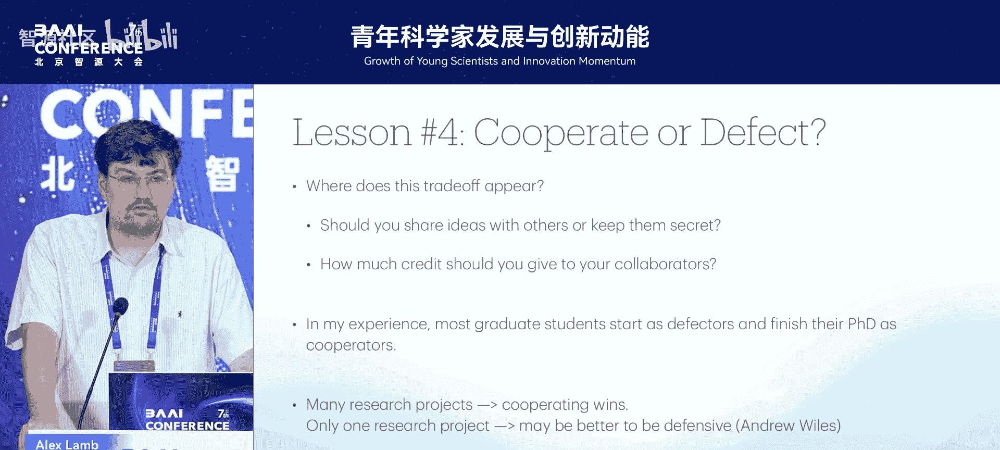

And there's a number of places where I think this trade off happens in research。

 so one is if you have a new idea and you're really excited about it。

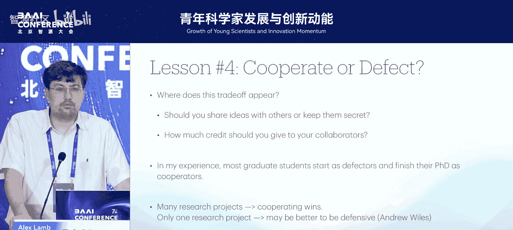

Should you share the idea with other people or should you keep it secret and try to develop that？

Additionally， when you have a paper， how much credit should you give to your collaborators versus trying to take more credit yourself and I would say my experience here is that most graduate students start their career in grad school as defectors like their very。

They're very self centered and they're very focused on themselves and they finish their PhDs as cooperators。

 so they care a lot about the other people that they're working with and they're much less self centered。

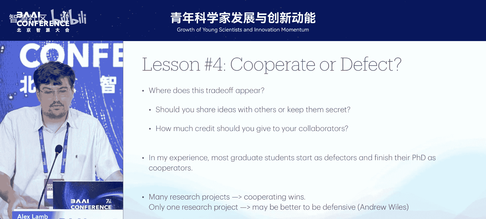

And I think even if you go to like the game theory literature on this。

 there's some analysis of what like the optimal policy is so if you have many research projects。

 many papers and you continue working with the same people。

 it can generally be ti your advantage objectively speaking to have a cooperative and non- self-centered strategy but at the same time if you're in a situation where there's just one research idea and that defines your entire career。

 you may actually rationally have to pursue a more defensive strategy。

 so there was an interesting example of this with mathematician Andrew Wildles where he was working on a big problem called for Ma's last theorem which he eventually solved。

 but my impression was a。

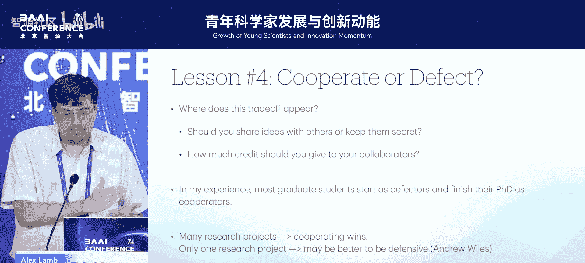

Large part of his career was just this one problem that he was working on and because of that。

 my impression is he was very defensive， so he wouldn't share the ideas or any progress that he was making until he published his final proof。

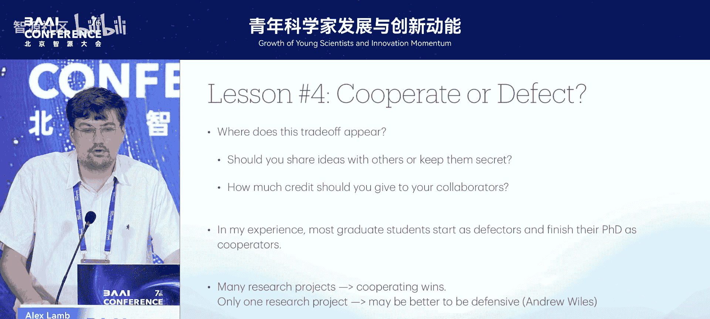

So I guess what I'm getting at here is there are choices between being more cooperative or being more defensive。

 but I think typically in grad school in the long run， it's better to be a cooperator。

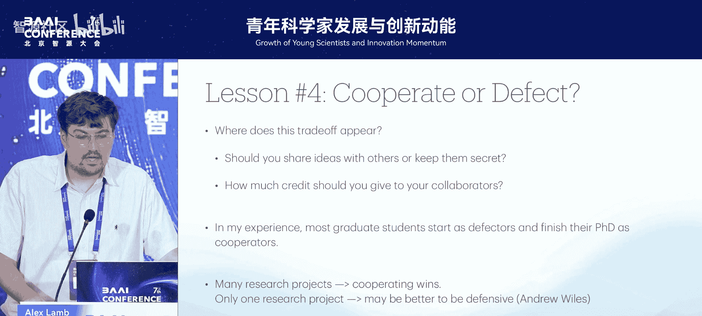

Another lesson that I learned from grad school， I think。

 is to try to judge new ideas and old ideas equally and just judge them on their merits。

 So I feel like you can kind of see different。I guess thinking patterns here。

 So sometimes people have the tendency to think， okay。

 if if an idea has been around for decades or it's a very old idea， it must be a good idea。

 And at the same time。You see a tendency for people to think， okay， if an idea is new and different。

 it must be good， and in my opinion， it's better to try to judge ideas based on the merits and ideas themselves without having these kinds of biases。

And in my opinion， it's kind of hard to do that， but I think it's a good practice to try to follow。

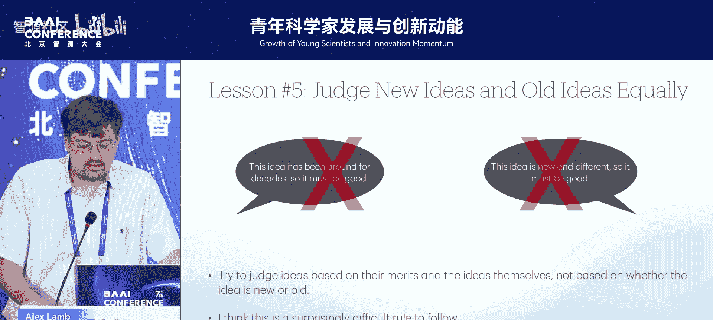

Going along with the last one， I think another way to try to be unbiased is to try to judge your own ideas and other people's ideas equally just based on their merit without having having a bias。

So you know， one tendency， I guess I personally felt myself in grad school is when I have my own idea。

 I put it out there， I have some like emotional connection to it， so I want to think okay。

 this idea was my idea so it must be a good idea。Um。

And then maybe you could also have the same or a similar risk where people put out an idea and they have some anxiety。

 or they have some。I don't know the term， but a concern that if an idea is their own， it must be bad。

At the same time， I think there's a risk of seeing an idea from a big and famous lab and assuming it must be good。

Or being excessively biased against rivals or competitors。

I think overall the best thing to do is to try to just judge your ideas and other people's ideas equally。

And to kind of have a balancing act between humility and confidence and it's a good value。

So following the completion of my PhD， I joined Microsoft research in New York City。

 so I worked under John Langford there， so it's a very good reinforcement learning theory group。

I really enjoyed it so one of the big things I did there was I worked on multistep inverse models。

 so a way of learning representations and reinforcement learning and Inter environments so we published a patent and we presented a tutorial on this at ICML 2023。

 so just to give you an illustration of the basic idea。

 there was a game called Zelda Links awakewakenning which was originally released in I think 1998。

And the game file was only， I think， 10 megabytes。And it had an HD release in 2018 and the file size was like 10 gigabytes。

 so about a thousand times larger。 so in spite of the fact that this is basically a shot for shot remake of the game。

 so the dynamics of the game are identical and the agent dynamics are essentially identical。

 so if we could learn some way of automatically mapping from this rich visual space down to a simpler space。

 it could make the learning of agents much more efficient。

 so this was one of the topics of my research。Um。So one lesson I guess I learned during both my PhD as well as wellbeing at Microsoft to New York is I think it's good to I try to before I start working on an idea I try to think about like the P10 and the P90 for my idea so I feel like when you have a research idea there's always uncertainty in how well the idea will turn out。

 so the P90 is maybe like the 90th percentile of the distribution。

 so I say if the idea works really well， is it something that's exciting something that's really valuable and then for the P10。

 I try to think okay if things go pretty badly do I still have a strategy to move on gracefully or to wrap up the research project in a reasonable way so one。

I'll try to do is if I can quickly prove some theory or analysis。

 it often means I can have a pretty good like P10 for the research project because you can always at least just say that this theory or this property holds。

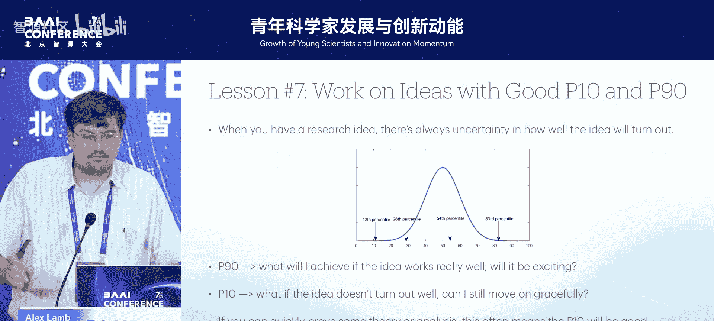

At the same time， you want to make sure the idea sufficiently general or interesting for the P90 to be good。

Another lesson that I learned in research is if you just have a desirable goal or you just have something you want to achieve。

 it's usually not a good way to start a research project because there are a lot of goals that are extremely hard to reach or you may not be able to reach them so in my opinion when you have an idea for research it's usually good to have both a desirable goal as well as a plausible path in mind for how to reach the goal。

So I guess the most recent development in my career is I became an assistant professor at the Xinghua AI College here。

 so I came here last week and you can see a picture in my office here it's on on the Xinghua campus I've been recruiting and interviewing students so I got a lot of great applicants and I've been interviewing them and I guess one thing I can say is the applicants are so good that for the the better of them a lot of them already meet the bar for completing a PhD which is to have like。

Like four first author papers that good conferences。

 so I'm very excited about the quality of the students here。

And then one just fun story is I've been living in Beijing for the last week and I found this lost dog at the park walking along the highway and I picked up the dog and I helped connect with the local police and were able to find the original owner so I was able to find this lost dog。

So here are the research lessons in review， and I guess what I'll say is most of it comes from watching researchers who I've worked with。

 who are much more successful than I am， and it's just my opinion on things that are good to do。

 so with that I'll open it up to questions。

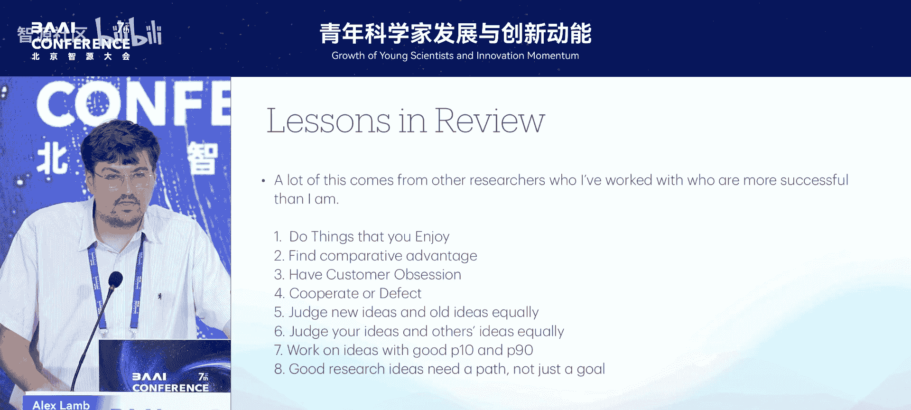

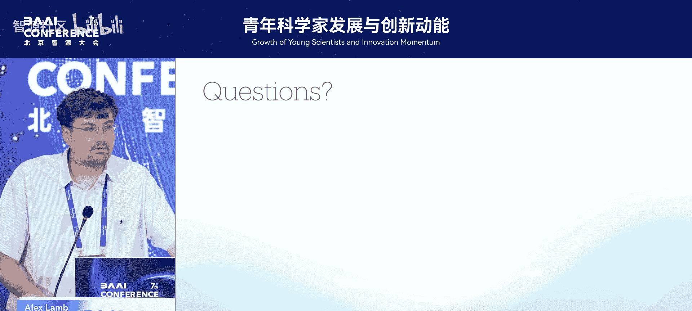

系嘅。Thank you。Okay， are there any questions from the audience？

That's very interesting and enlighten you talk。 Did you pick the room number intentionally， this 404。

 No， that is funny though， Yeah， okay， all right。😊，Any questions？

I think I really relate to some of the points that you raise， for example。

 do something that you like but may not directly you know related to your PhD thesis I think that's very important but it's extremely difficult you will find it you know it's in Tinghua University also in Peake University I'm from Pe University to convince your student do something that does not directly advancing his or her Ph thesis they're more you know you know more utilitarian in a way thank you。

Okay， yeah。Thanks for the talk and very useful suggestions for the young researchers I think most of these suggestions are quite general and the high level so do you any do you have any I mean special suggestions to the young people in the current AI stage。

 you know that the research culture has changed a lot most of the AI research actually are dominated by the industry and now because you return to the amy and come to the Tinghua University so do you have any I mean specialized advice to the current young researchers on how to conduct a valuable AI research Yeah。

 one thing I can say is like AI coding tools and agents have gotten super good so if I could go back to being like a very young person or starting a PhD I think the opportunity。

To use the AI tools to become like an extremely productive engineer for research or for developing products is something I'd really focus on or I think that's a way to be extremely productive。

But what about fundamental research so what kind of you know research in the core of AI that can still that we as you know people from the university can still do meaningfully comparing to people from the you know the big。

High tech comedy that has a lot of computes。Yeah I think there's I think there's still value in algorithmic research things at a smaller scale I mean sometimes using theory or could just be experimental I think maybe you just have to be a lot more deliberate about what your like research hypothesis is and how you analyze things because youre not you're not just going to get the state of the art result by yourself you're going to have to show some property and make the argument that it'll also work at scale but I think it's definitely still possible like one example I can give is there was a new optimizer that came out just like a couple months ago called the muon optimizer and it works really really well at scale like all the big labs have started using it but it was developed at a very small scale just on a few GPUs thank you。

Hi， Dr。 Lam， because you just mentioned about the AI tools and AI cool and multiag things。

 I'm wondering that have you ever visited any startup company in China that working on this this specific field。

 and I want to hear some of your comment about the Chinese current progress on this field。Like。

 how are they going， How are they doing like in AI coding and multi agent。Oh， I haven't。

 but that's a pretty interesting subject。 I mean I guess if I could。

 I'd love to work as an engineer at deepse and see how they do things。

 I've also heard of a startup called Manus that has agentantic tools。

 but I actually don't really have any detailed knowledge of it。Thank you。

