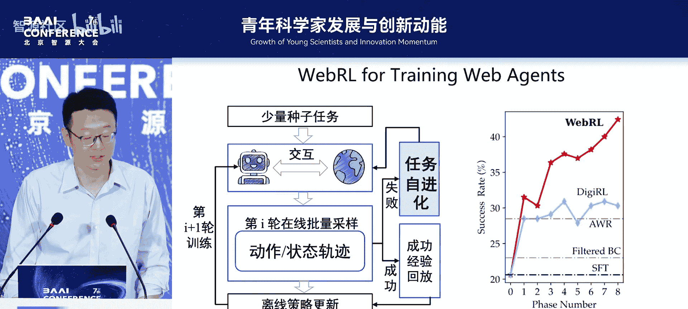
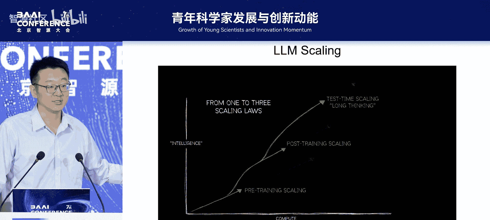
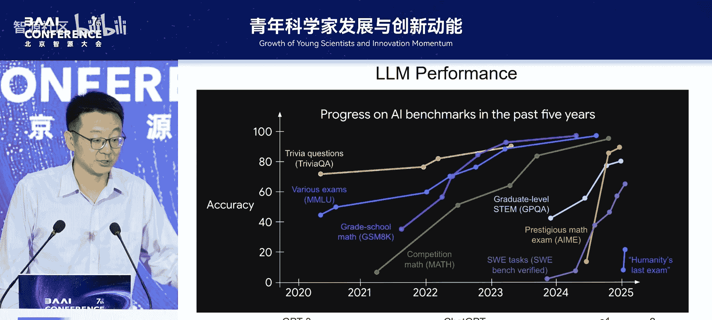
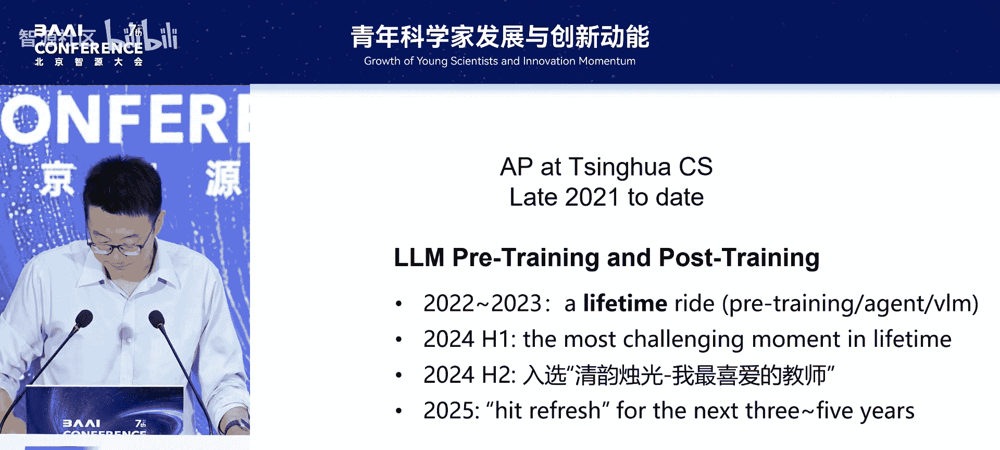

# 2025北京智源大会-青年科学家发展与创新动能论坛 p04 主题演讲：东昱晓 -BV16JNxzPEAd_p4-

呃，大家早上好，非常感谢那个崔鹏老师和董杰老师的邀请，非常荣幸有机会呃在这里给大家分享和汇报。其实这个算是学术生涯以来的一些呃成长过程吧，以及一些经验和一些less。然后这个其实我周四的时候。

就是崔老师当时说来做个报告吧，我当时没仔细看要讲啥，然后周四的时候，前天我一看题目准备PPT的时候，一看题目是青年科学家成长。然后我就问崔老师到底预期要讲什么。崔老师说讲讲你的职业生涯中间的一些过程。

然后有什么成长的经验跟大家分享，就感觉早知道是这个肯定没法答应，这个非常成惶成果。然后这个压力也非常大。所以呃但是就今天有20分钟的时间。

20多分钟的时间给大家呃其实就是汇报一下从读PD开始呃做的一些研究，做了一些探索。然后中间的一些过程吧。呃尤其是我我我是感觉到到。😊，今天为止很重很多的呃一些呃算是成长或者说一些成果吧。

主要还是靠呃运气比较好。然后这个在合适的时间很幸运的踏上了浪也好，踏上了船也好，对大约是样的一个情况那我大约的题目是说from social network那我D是2012年到17年读的。

后当时就是我D的这个是那个titlecompcomp social and information当时其实还跟崔老师经常请教，也经常读崔老师的文章。

其实当时主要是想说研究这个尝试理解soc和后因为我们是计算机的。然后理解了之后尝试用计算模型来尝试解决net里的一些问题然后这里我昨晚上还有前天总结的时候，我感觉我读D时候大约的一个经历。

就是呃真的是很幸运的找到了其实都不是找到了，就是碰上了第一个要做的top，就是那一段时间自己非常感兴趣的一个top就是social network information network。

然后当时的目标，当然今天在座的很多同学可能都非常厉害。当时我的目标非常简单，就希望早尽早发一篇一做的顶会。当时我们那个的顶会就是发一篇一做DD然后PD第三年第二年年底的时候才才才做到这件事。

就是但是当时没发之前其实压力还是很大的。所以我也非常理解我现在开始带学生很多同学这个无论是焦虑也好，或者是这个这个这个这个对文章的一些诉求。

然后第三个呢呃可能就是说在读PD的时候尝试呃呃发现问题问题以及某种程度是尝试解决问题。😊，呃，那PPD我我给大家汇报一下，我们当时做的一些非常有意思的研究。这个是在呃。201几年的时候。

欧洲的一个700万人口的一个国家，它整个国家的这个手机的通话和短信数据。O当然我们没有这个通话的内容。

但是是有这个social network或者communication network这个呃conction。

然后我这里是visualize了呃这个 socialial graph里那个angle那个structure，就三个人呃如果都有通话或者短信记录。然后红色呢这里表示的是这个fa mail。

就是这个这个这个user，就是他当时注册这个电话号码的时候，注册自己是个fa mail，然后或者蓝色的注册自己是个mail。

然后我们就是很简单的看了一下这种structure在整个700万人口的一个国家大约几个月的一个通话时长呃，这个阶段之内它的一个diion。然后这四张图呢实际上是分这四种结构。

然后横纵坐标分别是这个三个人当中呃横坐标是这三个人当中年龄最小的那个呃用户的年龄，纵坐标呢是年龄最大的那个用户的年龄。大家几个规律吧。

第一个很清楚的看到年轻人和年轻人之间的这个传过三角形structure非常这个这个在不同的年龄组合里都非常紧密，对吧？三个男生两男一女两女一男三个女生其实都非常呃紧密。

但是比较特别有意思的是其实也非常符合常规。就是过了35岁以后，三个男生呢三女生的这个这个这个frequent这种communication这个其实一直是在的。

但是两男一女或者两女一男这种sial relationship其实这个从统计上来看，其实就少很多所以这个当时是我们发现一个很有意思的一个现象。然后另一个我没有实际上是。这一块。

大家看其实相当于是呃cros generation就跨带的通信呃行为。比如说父母，其实主要我个人理解可能是父母和子女之间的一个通信行为，其实也是非常频繁的。

大家看那个那个第二个那个为出来然后这是一个研究。另一个研究呢其实也非常有意思。从我的视角当时觉得来来尝试从从数据中发现这些规律，那非常直接一个问题，这个图我猜大家非常呃非常直观的能知道答案。

就是说对于两个人来说，如果他有更多的common friends，他们之间成为friend或者就是在social network之间有connection的这个这个概率，肯定是右边的大于左边对吧？

那当时我们受呃的一个研究的启发，就是说问这样一个问题。那比如说左边和右边都有4个共同好友，那这四个共同好友在左边呢这四个共同好友相互不认识。但是在右边这四个共同好友相互是认识一茬子。

那在这两种structure的情况下。左边还是右边这两个人成为共同好友或者friends的呃，不是共同成为fends的这个这个这个这个概率哪个更高，对吧？就大家感兴趣可以考参考论文这个的一些发现。

其实这个最终的结论其实相对来说还没有那么intu，其实非常呃这个surpriing的一些result然后尤其是我们这里只是列举了两种情况。大家但是大家可以想象一下。

如果是四个点组成的这个graph从这个这个这个同构性的角度，其实有11种组合，然后5个点6个点不同的组合，最终是什么呃这个这个子图的什么property属性，然后drive了这个概率的这个这个这个高低。

那有了这些搜索发现之后，我们实际上当时就尝试从计算的角度，就是用graphic model来建模这个呃social network或者inform network尝试无论是来预测一个点的属性。

比如说一一个用户的在social network里的性别年龄，democraographic一些 information，或者说做link prediction。

或者做这个三角形形成的这样的一些呃建模和预测的任务。OK那PD最后一年的时候，实际上呃我当时的PD老板。说你必须去做一篇与 neural network有关的研究，你才能毕业。所以那当时感觉挺不开心的。

就是我做的挺开心的。做数字，你为什么一定逼着我去干这个但是后来现在其实还非常感谢他当时的这个这个比较强硬的一个这个这个push，然后来做这件事。然后当时的一个想法。

或者要尝试解决的一个问题也非常直接就是呃把 neural networkgraph结合起来，然后尝试怎么能够解决graph面临一些问题。

那当时的一个常用就是说我们做学术这个这个mic collaboration network比如说上亿上千万的用户这样很多的连边relation的情况下怎么来学习这个这个graphrepresent当时的这个in也是来自于这个非常经典的word这个P里的模型。

然后这个是我们做了graph之后，大家看比在学术网络上右边是我把。😊，当时把当时认为的这个48个计算机的顶会visize之后，project之后的一个聚类的一个效果，这个是自动聚类出来的。大家可以看。

比如说其实效果还呃挺符合咱们的对这些学科这些conference的一个认识，对吧？然后另一个我们也浮现了在graphra structure的结构上，某种程度上现了这个word在LP里的那个发现。

就是所谓的这个呃男人女人国王和呃王后之间的这个这个向量的这个德ta之间的这个方向和长度我们而且是从异构的角度。

比如说这个学术会议就是所在的field以这个会议里比较这个这个这个faous或者leaing leading之间的一个个关系。大家可以清楚的看到，比如说当比如说OSDI和ff之间。

其实大家看那个那个向量的这个德ta其实方向和长度基本上也非常吻合。O这个实际上也是从这个呃大规模的学术合作网络和网络。模型自动学出来的一个呃发现的一个patter。然后到PD毕业的时候。

就很幸运的当时提交了那个dierationKDD的dieration word，然后也很幸运的拿了当年的on。然后这个也是非常感谢真的是自己的导师呃，一直在帮忙做呃推荐。然后以及整个过程中。

他很做了很多的这个尝试。😊，然后毕业了之后就去indusstrtry lab，现在呃MSR呃，然后在后来去facebook AI一共在西雅图待了大约整5年的时间。

然后当时做的主要的事情还是followPPD做的事情，做graph representation learning。然后当然后来也做了很多这个graph pre training上的一些尝试可以。

然后这个其实跟刚来刚才alex的一个其实还比较接近。当时呃。其实非常直接PD毕业嘛，直接去industry。然后大家可能很多至少我我接触的很多同学可能会认为说去industry labs。

其实可能就是发 fun论文很爽。啊后业界论文。然后拿高薪特别开心。但是其实在一个无论是indu还是在indus个这个team里其实最终对于这个teamwhat the team most其实就是product或者business其实这个在这个过程当中也是从一个freshD毕业之后尝试说呃在这两者之间发现那个那个所谓的找到那个结合点就是在做学术研究发论文和之间的一个算是一个尝试的一个情况那也就是说做自己研究的top以及个team或者业界希望解决的一个问题那当时我们team想解决的问题特别直接在微软的时候最开始我们是用。

😊，微软的academic graph和这个这个专利graphra来做做研究。后来呢呃微软就特别想说，在office graph和他后来收购了linknkin。

在linkin的 economicconomic graph做大规模的这种图的。训练希望通过大规模这个graph的训练，能够图的训练，可以帮助到下游的一些很多的一些application。

然后后来去呃呃facebook也是尝试在做类似的事情。怎么在facebook的 socialocial graph和social entity graph上做这种大规模的呃训练。呃，然后在这个过程中呃。

很幸运的也是跟呃实习生和合作者发了一些文章，包括无论是从理论上和呃这个实际落地应用。无论是在微软还是在facebook都做了呃一些尝试。然后包graph以graph上做了一些尝试。

然后可能最开心的就是呃刚才说的其实基把论文发了。然后这个背后的研究，最后能够ship到production system某种程度上那个这个在微软的时候。

其实那个木那个metric主要是siness就是是那个因为微软当时我们team合作的这个这个product team主要是说他的主要客户是商业客户就是entterprise其实那个你你进去了之后。

只是说有一封邮件说你ship效果很好，但是其实就这封邮件，你没有其他感受。但是到了FB之后那个感受特别明显。因为它有大规模的这个然后它有30亿的活。然后你做了一个或者做。ature后shift进去之后。

你能实时的看到当你切百1的这个3030亿用户的流量，你看到你这个model或者你这个feature对这个me的po或者n的一个影响。然后当你shift10%的流量，30%流量一直到最百的流量之后。

你能切实的感受到你那个或者你个ature。后比如说让这个推荐效果涨了0。03看上去很小是吧？但是在30亿这个规模上其实就会让你非常exciing这个是当时觉得说去FB最大的一个切实的体会。

就是做无论是研究或者做呃这个学术探索，可能如果有机会能 move这样的indusmetric能切实的让用户或者是呃让大家能用到我们所做的一些研究。然后其实非常个人是非常ex的一个当然反过来说。

后来发现在industry其实目真正metric都是非常simple的 idea。😊，的飞ature并不是特别fy的这个这个这个几个我们发论文所需要的那些呃一些思路或者component可。

OK然后在20年的时候，也跟ford呃，他们合作做了graph领域的一个 benchmarknch叫open呃graph benchmarkch OGB然后也在KDD和new上分别组织了当年的那个那个所谓的ch就是挑战赛。

然后呃在indus这45年的时间做graph的那个 training，然后也很幸运的得到了那呃清华唐杰老师的一个提名。然后当时去申请了KDD的一个 star。他主要是说呃博士毕业5年之内的一个学术成果。

但是不包期间不包括博士求学期间就博士毕业之后的5年之内的一个成果的一个 evaluationval。然后呃虽然假设我拿了就非常幸运。但是其实我回过头看，其实当时材料里的研究，还有文章。

其实主要是呃这三位实习生同学这个发的，所以也非常感谢他们，所以我我真的是非常幸运。在节中和子牛，他们都是在读一年级PD的时候，然后招了他们去实习，然后在一个暑假3到4个月的时间，12到16周的时间。

其实大家一起来探索graph还有graph上的一些探索。然后他们俩后来更牛他们俩就拿了KDD的那个他们毕业那一年的。😊，对比我当时好好好一些O然后来清华之后呃，算是应该不能算招的第1个PD。

但是呢因为他是硕转博，他是转播的时候，我招了他他应该是我第一个毕业的PPD所以呢他在graph training也是我们在graph training可能做的最后一次呃最近几年嘛。

最最后一次尝试就是graph就是尝试把这个这个AE的这个思想用到graph上。然后他当时发了一篇文章，现在这个从引用的角度，虽然引用不是最重要的。

但是从引用的角度目前看起来还还比较ok但是呢在这个过程中，其实呃。😊，怎么形容呢？其实呃说的好听一点叫思考了很多。但是其实背后也很挣扎，为啥呢？就是如果大家仔细看我刚才列的。

我们在这两条线三条线上做了一些研究。我们在bro上提出很多算法，看上去影也很高，有的还拿了一些小奖。但是呢回过头看这背后用到的呃fuamental的技术，其实。😊，很遗憾，也不能说很遗憾。

应该是很幸运的来自于比如说LLP或者来自于C微领域。也就是说当时就感觉自己做这个事情，为什么总是需要从别的mun idea如果一次两次可能是一个非常好的情。

但是当多了之后当你发现你说回过头过去45年的研究都是这个方别的领域借鉴过来后应用到graph后解决graph虽然也很重要，但是当时就会经常跟自己的实习生跟自己team里的一些新讨论就是这个top重要。

但是是不是说如果有机会能进去这个源头，看看源头到底在发生什么。比如P在什么有没有可能能一些一些ide或者一些研究这是第一个情当时其工作之后一直在相当于思考的一件事情后第二件事情呢。

这个其实对我的震撼相对来说更大一些就是2021年。😊，时open eye出了这个codeex这个模型。当然最近open eye又以同样的名字出了新的feature。

叫那个那个做做做agent的一些feature。这件事情对我个人的震撼为啥非常大呢？因为当时GPT32020年出来之后，这个这个 model training这个非常。

这个无论是这个美国还是国内这个很多公众号，还有很多媒体，很多从业者，甚至很多研究呃community都是说这个GBT3改变了这个NLP改变了AI。但是我当时对NLP的理解非常浅显，就没有什么sense。

就是哦你说改变了就改变了，但是对我好像没有什么影响。但是一年之后这个codeex的出现，对我的这个冲击非常大。因为在industry lab读PAD的时候，天天是写代码的。就你写着写着代码。

突然发现说之前在这之前的，无论是所谓的AI model或者是 model，你看都是为了这个在 mark上零点几个点一两个点对吧？其实他最终帮你生成代码，就是当时主要是补全，其实并没有什实际的效果。

但是当看了论文以及那个他那个open个de demo之后其实这个非常这个受冲击，就感觉好像说这个事如果有机会一定要。后在这个过程中也很幸运的是个唐老师说这个国内有opening你要不要申请试一下。

然后他那会也在做语言模型的这个预训练就是M大模型。所以当就是交了材料申请回国也很幸运的能够有机会加入清华计算机系做所以就开始了这我从21年年底的一些这尝试吧，主要在做大语言模型的预训练。

当然后来也做很多。😊，甚至最近在做agent和reaing一些事情。但是我我其实觉得还比较有意思的一点是，其实刚回国的时候，还是希望有同学能做graphra的。😊。

但是就发现从chGPT出来那一个moment，我已经说服不了同学了嘛，同学就所有的同学我就要做大模型。我就不想做graphra，就这件事就我我我从我的视角看也非常呃怎么说呢？就是说因为虽然。呃。

大模型很火Gra看上去现在没有那么火。但是其实因为从读PD期间就开始做network做graph，还是希望能够在这个领域这个top上能够坚持下去，能够看有没有呃为这个top为这个领域呃尝试做一点事。

但是很遗憾，目前呃，每次有新同学来说，假如我们组我都会问一个其中一个问题就是说你要不要也试试graph。大家给我的 answer都是要不我先试试大模型。所以这个还还还挺遗憾的。然后但是从做一P之后，呃。

呃，可能我最切身的一个体会是呃很幸运的有机会呃找一群呃，这个一群大约可能也就是几个有激情，有情怀以及有正气的年轻人或者同学们聚在一起，然后尝试做一点事。然后。对他们的或者做学术的一个所谓的追求。

也从做自己喜欢的topic发第一篇顶会论文章，学会独立做研究，就是让同学们呃因为做老师的嘛，做一批了就是。目标就让同学们做这些事。然后呃所以就是在过去几年也很幸运，遇到了一群呃非常有朝气。

非常有才华的同学，然后特别呃玩命。就是从我们的视角，我们其实都是希望大家不要那么卷。但是其实同学们相互之间互卷的这个这个他们特别是有激情有活力的一群呃年轻人。然后在这个过程中，呃。

在22年的时候有幸的在唐家老师还有智朴的spon下，然后我们做了千亿参数模型的预训链。然后在22年的7月，实际上就开源了这样的一个机作模型。在当时呃也受到了一些呃算是好评吧。

然后更主要的是我们其实在22年上半年的时候，呃，在各种条件限制的情况下，用唐家老师的话说是经常出去化缘。然后其实画到的算力，包括英伟达，包括910A，包括海光。

包括咱们国产的那个超算神么神威呃超超超级计算机那个那个深微架构上做一些大模型的这个呃。😊，预训练的一些探索吧。可。然后呃同时呢呃也我们跟那个其实那会儿之联还在清华的时候，杨志林老师呃，还有唐娇老师。

我们一起也在尝试说做代码模型的预训练。当时也是完全在910A上训了一个呃130亿参数的codedG代码模型。当然后来这个模型主要是呃智普的团队在继续呃做商业化的一些呃运营和这个产品化的一些尝试。

然后23年可能就是更exciting的呃一年就是呃我们在大约一年的时间，大约每个季度会推出一版chetGM模型，每一版模型都是从零开始from scratch开始预训练。

然后每一版模型都比之前的模型有很明显的一个效果的提升。然后相对来说也是国际上国内比较早开源这个中英商语的对话模型，我们实际上是在23年的3月14号开源了这个M的一代模型，到目前为止。

其实主要这个成果累积是在23年上半年累积出来的。就是当时因为大模型B出来之后，真的是大家对这个方向的关注特别大。无论是ge up还是上，我们都某种程度上呃，在当时取得了呃一些小小的成绩。呃。

然后23年下半年呃在预序列呃语言模型的时候，其实当时我们也尝试怎么让语言模型提升模型本身提升智能体的这个能力，包括planning，包括任务分解，包括执行等等拖右子的一些能力。

当然那个其实没有做产品化或者是框架式的事情。更多的是让模型机构模型本身的agent能力有所提升。这是当时23年下半年做的一个尝试。然后当时的主要目标也是match这个GPT4的一个效果。

在当时呃的情况来看，呃，呃效果还相对还ok然后与此同时也尝试说怎么让语言模型能够有视觉能力，也就是做所谓的 model。然后我们的同学们呃就研发了这个M怎么尝试从attion来我解决。

这个image或者视觉signal跟这个tex signal在语义层面的上的一个对齐的一个呃技术。O然后就还比较开心的是，尤其我们同学比较开心的是这个模型呃。

也在stabletable def3预训练的时候，那个合成大规模合成数据的时候，实际上他们是用这个我们的模型开源的这个模型来做这个大规模预训练数据的合成的一个呃呃一个工作。然后再紧接着呢。

就后面的事情大家就就可能比较知道了。在呃24年的呃下半年和今年上半年呃，大约过去小一年的事情不到一年吧。呃，其实主要也是open eye引领的这波风潮。从O一出来之后。

我们也尝试在呃理解和建模呃这个RLki或者所谓的post training skilling。但是我们这个同学做的工作很不幸的是。

我们上也是2025年的1月20号那一天是咱们非常自豪的 deepE的推出。所以其实我们这个论文或者我们这个工作完全被淹没了。

当时也是说在开源的模型上发现了这个所谓的L training的这个以及t time或者 time的一个的一个一个结果然后当时提出了一些呃idea来 marry或者understandtest time。

也就是说你输出的越长是不是效果越好以及这个答案是肯定是yes，但是问题是怎么具体的来mar这件事情。我们同学其实当时提了一个非常简单的idea说怎么让这个这个语言模型的这个可以更好的量化出来这是当时做的一个尝试。

然后以及后来怎么把这个t放到IL这个里然后以及怎么用L做agent的一些尝试这个时间的关系我就快速跳过。当最后的话。

可能核心是说呃我个人是很幸运的在回国之后有机会参与了大模型预训练大模型火爆的这几年的一个过程当中，有幸跟一群非常有才华，非常有能力，愿意非常愿意付出的一群同学。

然后在做预训练的以及做最近在做所谓的post。然后在这个过程中，我们其实做了很多很多的尝试。然后当然这张图其实也是呃因为我时间不多了，这个也是我们做了很多的这个这个呃思考吧。

就是说son这张图就是说到最后我们这个这个结果到底在哪里，我们是不是一定要呃这样追求这个benchmark performance的一个提升。然后所以我这里就引用沈华伟老师其实上个月的一一页s。

然后大家可以看当时我当时在现场听了他讲这个报的时候深受启发。你看他说我们做研究做这个项目科学项目科研项目你看是原有是呢，大家一起来合作，然后。

一起来割麦子。但是呢其实主要有两种思路。大部分的思路呢或者说我个人吧，大部分思路呢其实都是在尝试。百良这个模式，比如说把这个各麦子这个镰刀磨的磨的更快，让各麦子这个效率和这个速度提升20%。

然后当然呢从这个LM这一波来看，无论是从预训链还是post one的这个reing实际上某种程度上是一种模式的呃创新。然后所以在这个过程中也一直在思考，从追求工程数据的这种工程机制跟模式创新在学术界。

尤其在当下刚才是崔老师还是董金老师问到上一月讲这的一个问题，在这个industry dominateminic AI research的情况下，从学术界的角度怎么来做相关的一些探索。所以总结一下的话。

实际上22年到23年，我个人觉得是非常非常非常幸运的是一个lifetime的一个 journey。呃，在参与了这个大模型快速呃发展的过程中。

在做pre traininging和做智能体和呃维持的一些事情。然后呃从因为做老师了，其实非常开心的一件事，尤其24年其实上半年个人职业生涯和这个这个生活上非常相对来说不是很顺利的一段时间。

在24年有幸呃得到了同学们的呃一个投票吧，入选了呃这个学校的青运主观，我最喜欢的老师，就某种程度上让那个非常阴瞒非常苦难的那那段经历，得到同学们的突然的一个认可，就感觉非常幸运，也非常开心的一件事。

然后现在呢其实主要在呃算是思考也好吧，也也算是反思说在接下来三年或者5年时间。呃如果回过头看今天我我们到底我们组吧，我和我们组的同学到底做什么样的研究，做什么样的事情在。😊。

三年之后在5年之后可能不会后悔。比如说因为原因是什么呢？就是说我今天回过头看，2021年的时候，决定说要回国要做大模型，但是现在感觉特别。这个开心没有任何后悔，也特别 exciting。

但是就希望今天到了这个时刻，在AI完全是基本完全是这个indutry lab dominate需要巨大算力 dominatemin的情况下，开始说思考3年后呃或者反思三年后呃，做什么可能呃，今天做什么。

三年之后不会后悔ok。

然后最后的最后的话也是5月份有幸听了上交大熊洪凯老师的一个报告。其实他是引用了爱因斯坦的呃一篇呃文章吧。然后他就是其实最终就是我们做研究，尤其在高校里做老师，做科科研探索的一个motivation。

对吧这个这个大家感兴趣可以自己读一下。然后我当时听的时候没有很多的感触。但是散场了之后，我就感觉回味无穷。就是说到底在反思自己这个在学术界在科研界到底是为了sve，为了sve。

以及在这个过程中跟自己的这个内心达成一种妥协或者一种和解，认认清自己只是一个平凡的普通人。然后在这个过程中怎么接受这个成果呃，这个这个现实以及接受这个现实怎么sve以及sve的一个一个事情。

然后最后的话呃呃如果一定有什么所谓的经验分享，我觉得大家可能都是 commonmon sense。其实但是我感觉在当下这个时刻，我个人体会还比较多的一点，就是其实研究可能也是一个sing。

当你当我们发现或者至少我我们组吧当发现一个idea非常sim，然后又effect的时候，可能就是要坚持做caling。😊，put更多的同学，put更多的这个算力，put更多的数据。

put更更多的whatever resource或者是时间我们有的去sll这个simple and effective的 idea。好吧，呃，然后这里提到的所有研究。

其实尤其后期呃毕业之后的所有研究都是同学和实习生做的。然后也非常感谢他们。然后当然做大模型需要算力，也非常感谢智朴，感谢很多这个算力的sponsor，好吧，呃，我的时间到这，谢谢大家。😊，好。

谢谢谢谢于晓。😊，好，看看在座的呃。同学或者是专家有没有什么问题？哎，老师你好，想问个问题。因为咱们刚刚提到那个你也是codeex的深度用户，然后对这个AI coding像是接触研究的也比较深。

然后想问一下，因为最近entropropic对winur断供了，然后可能会影响到open对他的收购。这个对codeex的后续的前景或者说技术发展，你有什么呃观点吗？呃。

首先我感觉我不一定能回答好这个问题。但是我尝试理解一下这个问题，是说对codeex应我的理解对codeex应该没有影响。因为op本身并没有用an pick或者其他的模型的你你是指对wins的影响。

对他他要收购它嘛，他收购的话整体对他后面的是有很大的提升和进步的。但是现在win整个比较受到影响了。呃，断供的是呃。这个就看我个人觉得这个事情好像特别简单，就看op ID的本事吧。

如果它的模型确实做不过 pick从在这个至少在具体是这个应用场景的话，那就很遗憾。我觉得window take off。

我个人觉得就winow可能t the most或者这个leaing position。对，这个就看op的本事。这个因为这个过去34年也也我我们切身的感受也是就是。就是就是就是看各自本事，你的模型效果好。

不是说metricric上体现出来，就是用户真的体会应该真的top，那那那那那才是真的好。就是当然这个我个人可能不是最适合回答这个问题的，这个谢谢。呃，董老师非常精彩的报告。然后感受很多。

有一个问题跟您请教一下，就是您这边呢之前是做着graphra工作做的非常的好。然后后面的话又去呃也相当于转换到另外一个领域的大模型的领域。就您在这样一个呃研究方向的这样一个比较大的这样一个转换过程中。

您认为这样一个最需要注意的点，或者是您认为这样一个比较克服的这样一个困难，或者是这样一个呃从哪个角度去去让自己的这样一个方向的转换，能够做到了比较平滑。

然后在两个不同领域都能出这样一个这么出色的样一个工作。哎，给您请教一下啊，多谢多谢这个谈不上出色的工作。我我是感觉就是如果说发了一些研究，做了一些模型，真的是很幸运得到了智朴，还有唐杰老师的支持。

有巨大的这个算力。所以还有清华的这个还有在微软在book的实习生的实大家都非常玩命，都非常拼命。这个完全说实话真的不是我就他们真的是在巨大的算力面前，他们。😊，还玩命对，有这个机会去做这些事。

然后回到呃你这个问题本身的话，我我个人觉得，因为我们最近也在面临带娃或者是子女教育的事。刚6岁呃，6岁多一点，就是呃我我我爱人经常跟我说的一句话说，说我要求我做到的就是温柔而温柔的坚定。

我我个人觉得可能做研究也是类似我个人觉得也是做的是类似的事，尤其是如果我们要switch一个top的时候。比如说我们当时switch做大模型的时候，其实有很多人在ching这件事在chGP出来之前。

很多人在channing很多呃周围的疑问的，甚至团队内部有很多疑问的声音的时候，其实这个时候温柔的坚定。呃，但是前提是能做到温柔的坚定是真的喜欢对吧？因为我真的喜欢我们家娃，这个毫无疑问。

所以所以我我我我我认为是可以做到温柔而坚定。但是re topic这件事可能就是真正的要找到自己内心深爱或者让自己exciing的那个top，然后才有可能做到温柔而坚定。

我觉得这个不是说董斌老师说就想明去做这个。如果我不认可这件事我感觉我是很难做到呃这一点的。就简单来说不卑不亢是吧？行，因为时间关系的话，我哦好，那我们再最最再问最后一个问题。哎，老师您好。

我是作为咱们智普的忠实的用户，也经常用咱们这个chGM94。然后我想问一下您在agent的时代，我们怎么看待这个AI for sense跟我们这个智能体的关系，以及我们这个智普这块怎么有什么布局。

能不能提前透露一下。谢谢。😊，呃。2是。不谁呀呃，我感觉可以拆解成两个问题。第一个问题是呃，智朴怎么布局，我感觉这个得问这个张鹏呃，总COO或者是德斌总，就是问智朴的这个管理团队。呃。

然后呃至于说大模型或者agent呃大模型baseagent怎么解决AI和s。很遗憾，我觉得我可以回答你，但是我觉得董平老师回答可能更合适。我我很想知道啊智服是想怎么做的F。对对。

就因为我个人其实没有做呃太多AF science。当然我们有有一位同学其实在尝试做训了一个千亿参数的一个蛋白质呃 sequence的一个模型。对，但是其实我们纯粹就是从计算机的市角在做那些事情。

但是你说具体怎么解决AFs里一些chese，其实是呃很遗憾，很抱歉，我个人其实没有一个很明确的一个想法。谢谢。😊。

