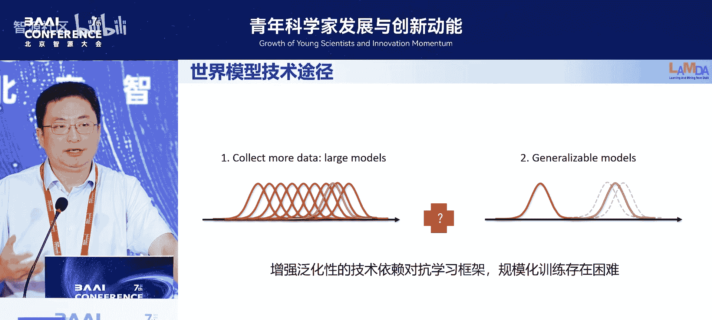
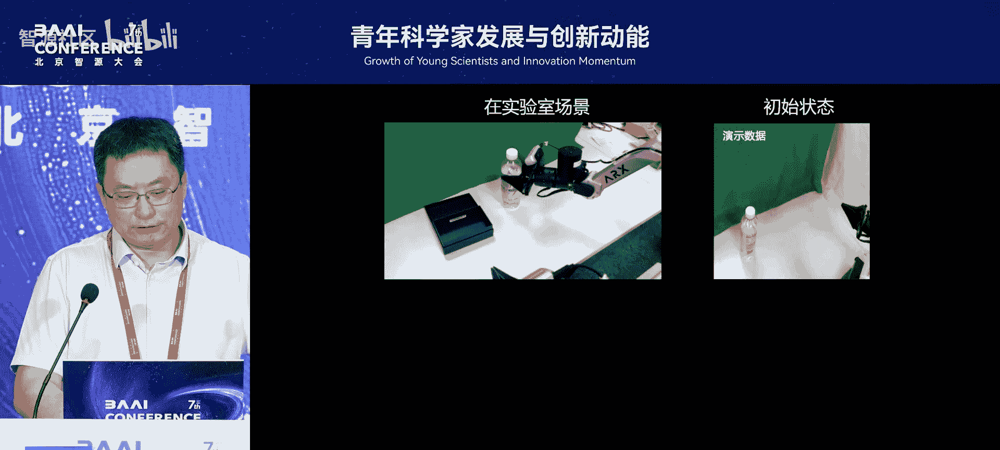
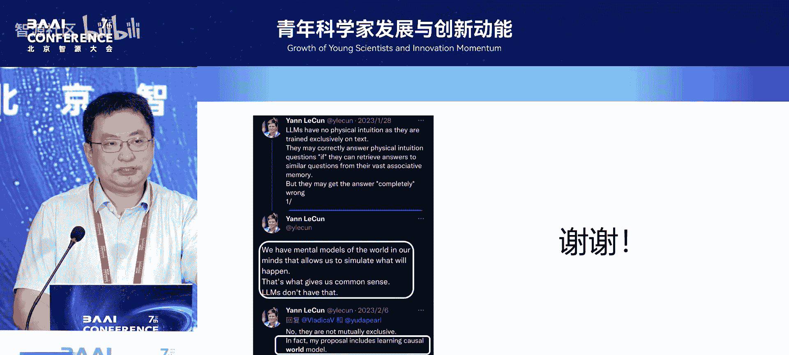

# 2025北京智源大会-青年科学家发展与创新动能论坛 p05 LLM中的强化学习：俞扬 -BV16JNxzPEAd_p5-

非常感谢我们主办方这个组织组的邀请啊。这个首先呢。呃，我自己感觉呢可能快要超出这个论坛的青年的这个范围了。啊，然后我作为这个做报告的讲者里面应该是年级最大的啊。然后呢，这个年纪大了以后，反应也比较迟钝。

啊后到昨天晚上看大家题目的时候，才发现这个好像不是做一个技术报告啊，好像是还讲自己的一些科研的经历啊，所以呢我这个PPT啊一个和可能和预告上面的不太一样。另外一个呢我的PPT也来不及改了啊。

所以我就主要是我自己来讲讲我自己的一些经历吧。啊，我这个上面呢其实讲的是呃世界模型呢实际上是一个强化学习里面的一个东西。那么强化学习呢，实际上是我。😊，博士毕业以后自己选择的方向。那么我在博士生期间呢。

其实做的叫做一个是更偏向于理论计算机的。我们做我做的是一些启发式优化算法的，它的计算复杂度和它的这个近似优化的这个能力。啊，为什么会做这样的方向呢？这个当然是啊我的导师给我安排的指定的一个方向。啊。

作为这个数学基础，在我的呃同同一被禁组，或者是说我们组里面历史上应该是数学最差的啊一位同学啊，但是呢我做的学最贴近于啊这个理论的这个方向。所以当时呢也是咬咬牙就啊反正导师说什么，我就往哪个方向做。

我想想应该没有错啊，所以就继续往下做。另外一方面呢，其实我自己的内心给自己的定位呢，是人工智能的这个方向。啊，这个是我觉得最早密的方向。其实前面的几位讲者已经讲到了。啊，这个追求自己最有兴趣的方向。

这个对于自己的科研是非常重要的一个事情。对于自己啊对于自己和自我的认可也是非常重要的。所以我觉得呢优化算法固然重要，但是呢优化算法可能并不是人工智能里面。

能够通向我们想象的那个未来的智能最核心的一个事情。啊，所以我毕业了以后呢，这个博士毕业了以后呢，就选择了啊自己选择了强化学习这个方向。啊，那么我的这个博士期间呢，其实。呃，我一直在反省我这这个研究工作。

为什么啊我的塞贴性会比较少？啊，那除了做理论以外呢，其实啊刚才这个董老师展示了一个磨刀石。啊，这个是包括我我我我经常给我现在的这个学生来讲。啊，他们就像我当年一样的，非常注重于去打造这个磨刀石。啊。

我自己的在博生期间呢最擅长的事情不是最擅长的事情，就最引以为豪的事情呢，就是制造了一个非常精妙的磨刀石。后来发现没有人用它来磨刀。啊，所以这个我们自己自己的啊也不断的反省啊，说这个。

是不是我们一定要追求技术上面的深度。而。忽略了这个技术，它的上下游的应用。所以这个也是我们在后面的这个啊，其实我做的这个在世界模型方向的研究呢还是有这样的味道啊，所以我现在这个正好年纪大了以后呢。

也想做点简单的事情啊。啊，那么我从毕业以后呢，已经开始转向的强化学习这个方向啊，和刚才东老师面对的问题可能是比较类似。当时呢2011年。啊，我的这个有一些学生，然后我说我们一起来做强化学习这个方向吧。

我们学生说有企业用吗？啊，我说好像没有任何一个企业在用啊，我们学生都说不要做这个方向。啊，我要做的是能找到工作的方向。所以当时呢呃我记得最早啊在做这个方向的呢，其实。啊。

是一个是一位我带了他的这个研究生啊，就硕士阶段。然后呢，到博士阶段以后，做了一半以后呢，就退学了，然后就到这个啊淘宝去工作去了。那么后来在2016年阿尔法过火了以后呢。啊。

他带领了阿阿里这个研究体系里面的很多不同的部门啊，一起出了一本书，就是强化学习在啊这个推荐啊，在阿里在淘宝里面的这个应用。啊，所以这个我们也看得到啊呃，当我们去选择一些自己喜欢的东西的时候。

我们觉得啊这样的东西早晚还是会有用的。啊，那么阿尔法勾呢是强化学习里面的第一个能让这个啊强化学习再次回归到大家视线里面的一个重要的视件。那么最近在大模型上面的强化学习的应用呢啊又使得这个强化学习啊这个。

更加受到大家的关注。呃，那么在强化学习里面呢，有一个领域叫做模仿学习。也就是说啊如果有专家来给我们很多数据以后啊，我们去直接按照这个专家的数据去做一些事情。这个方向呢我一直觉得好像没有什么可做的。啊。

因为他你你给我这个数据，我就直接从数据上学就完了。结果呢没有想到的是啊，今天呢其实我们大语言模型做的啊想去做决策的事情和我们今天的看到的机器人突然变得所有的操作都非常的丝滑啊。

所有的这些现象的背后呢其实就是模仿学习这件事情。啊，那么我在强化学习上面，可以说在上面的一个呃2020年的这个方向呢，主要也是在模仿学习这个方向上。呃，魔幻学习的好处呢就是来的很快。

我只要有很多专家给了数据以后。那么我们就可以马上的得到一个，比如说机机个机器人的一个很丝滑的一个动作啊，这好像看起来和过去很不一样啊，其实后面只是一个简单的技术的应用。啊，然后呢这个回到我自己的习惯啊。

就是老师会去想这个背后到底是啊数学理论是什么样子的。其实模仿学习呢就是一个专家把数据收集过来，收集过来以后，然后我把这个数据拆开，最简单的模仿学习，就是把这个数据拆开以后，专家说我看到这个状态。

我做这个动作啊，就比如说我们机器用摇操作啊，然后呢，后面我就把它做成一个监督学习的数据去这么学一下。我也在这个状态去做这个动作。那么这样的做法是不是有效呢？其实。

我们看到的是这个第一在2022年的时候啊，在2002年的时候，就已经有数学的证明出来。那么这样的一个做法呢，就会导致。前面拟合的还挺好。那么如果他操作到后面以后就会发散，这个是数学上面的证明。

这个发散的速度有多快呢？根据我们走的这个步长啊，我们走了多少步，它就会有平方级的啊一个系数存在单步的误差上面。啊，所以这个是这个领域里面啊最直接的一个认识啊，就当我做模仿学习的时候。

第一我一定比我模仿的对象要差。那么这个也是今天我们说这个大语言模型里面会面临的一个情况，就是他的所有知识都来源于人的话，那么他的表现其实是比专家的这个知识要差。第二呢会存在叫因果倒置啊。

这个东西呢是我们自己发现的。呃，所谓的因果倒置呢，就是我们在模仿的时候，其实并不知道为什么呃，我们的专家会做这样的动作，我们只是把它的动作啊刻板的把它记下来。其实专家有可能考虑一些因果关系以后。

做出这样的动作以后，我们从数据上单独去学的话啊，这个崔峰老师是这个方面的这个专家的。有可能啊不能够正确的理解他背后的因果，那么会导致学出一个错误的因果关系出来。啊，举一个例子啊，如果我洗澡的时候。

我觉得这个水烫了，那么我会把这个啊水的开关呢，冷水的开关把它啊把它变大以后，这个水就会啊就会变冷。但是如果从只从这个数据上啊来学的话呢，我们很有可能。啊，会学出来一个完全相反的一个。啊。

原因要看我们的数据是。我看到了这个水的温度啊高了，然后我把这个冷水开大。啊，然后呢它温度降下来以后呢，我就把这个啊我我调了这个幅度呢会越来越小。啊，所以如果我们从数据上学，它会得到一个完全不一样的结论。

就是当我的这个调的幅度越小的时候，那么它的温度会越接近于我想要的温度。啊，如果我想让他让他下降的更快会怎么办呢？那么我就啊把我的幅度变得更小啊，它的温度就会下降的更快。那这个有因果就完全错了。啊。

所以这一点呢是在模仿学习上面经常会出现的一个问题。啊，但是呢我们今天看到的是啊这个也是正如这个前面董老师讲的啊，今天的一个主要的技术呢是通过大量的就模式上面的变化。啊，通过大量的数据去做这件事情。

所以在。啊，包括集权领域呢，现在比较流行的一个是一一条道路呢叫VOA啊，就是Vin language action model。那么他做的事情是什么呢？其实就是沿用今天大大语言模型。

包括这个多模态模型的这个思路，把它放在了机器人身上啊，也就是说我看到了东西以后，我准备好数据，这个数据是有标记的数据。这个数据呢是关于机器人怎么去控制的这个数据。

然后我从这个数据上面呢去直接去啊收集大量的数据去学。那么根据我们前面的这个理论呢。我们得到的结果就是这样的做法，一定比提供数据的那个人做的要差。啊。

那么这个在包括定麦的前面做的啊简律师的agent也验证了这样的情况。他比给他的数据做的要差啊，但是比一些其他的情况可能会好一点。啊，所以这样的做法呢是会有面对一个天花板的。

那么对于啊又回到我自己的这个研究的习惯上面来说呢，就一旦碰到这种有天花板的事情以后呢，好像就不太愿意往这个方向再做下去。啊，我们希望看看有没有其他的途径啊，能够有更更高的天花板。

实际上包括语言模型也是啊，我们其实有越来最近有越来越多的文章呢在。啊，认为语言模型其实做的啊事情呢是在relicate人类的这个数据。也就是说他在模仿人类的数据，而并不知道真正的这个推理是如何做的。呃。

另外呢就是我们还看到这样的天花板为什么会比较低呢？因为我们在收集语言数据，包括图像数据的时候呢，还可以从互联网上有大量的数据。但是面对像之前这种做啊决策的场景的时候，基本上很难收集数据。

今天最大的一个数据集，这个X open这个这个啊embody的X这个数据集呢。啊，也只有。从量上来说呢，也只有很少的数机。那么。另外呢这个从原理上面来说。

这个是一个很老的一个文章上面的一个是一个一个图啊。就当我们去收集这个数据的时候，还有两种方法，一种叫做被动的收集数据，一种叫主动的收集数据。被动的呢，就是说我先不管我的学习模型学成什么样子啊。

我就去先去收集数据。那么今天大部分都是这么做的。主动的收集数据呢，就是我要看这个模型上是啊怎么做了。然后我根据模型的碰到的状态再来给标记。那么备用的收据数据呢，其实是。大到一定程度以后。

这个数据其实是无效的啊，对于任何一个啊专门的领域来说。其实只有主动的收集数据，这个数据才会真正的在弥补这个模型的啊不足啊，但是呢主动的收集数据这件事情非常的困难啊，非常的不现实啊。

所以啊大家现在只是说被动的收集数据，我现在数据越来越好。啊，我先不管那个模型学成什么样子。所以这样的数据里面有大量的是无效的啊这个数据在里面，真正想要的数据呢又很少。这个对于决策的领域。

我们今天想用语言模型去做agent这件事情来说更重要啊，因为决策的模领域更是啊这样的一个情况。所以这个对于要想做决策来说呢，第一我们看到的是模仿学习呢本身误差大误差大，你就要涉及更多的数据。

但是这更多数据又是一个被动的数据。所以它这个效果呢其实有效性很低啊，收集到了很多的其实效果也不大。并且呢这个数据数据本身很困难。我们知道现在。这个国内的有好几家创业公司呢。

这个居生智能的创业公司已经开始在建造大量的。啊，叫做数据收集的这个啊这个farm啊，在大量的去跑这个数据收集的场景。但是这样的大量的和我们在语言模型上用到这个几T几T的这种数据已经相比啊。

几乎可以忽略不计的这种这种量级。所以我们希望的是什么呢？希望的是天花板要高。也就是说我们可以提供一些人的数据，但是只能少量的。我们更希望的是他能够和环境进行交互。啊。

并并且呢能够自己去啊提升他自己的这个性能。啊，所以。从我们自身的这个角度上来说呢，我一直觉得。啊，从。啊，我们的要设计这么一个有智力的agent。我们如果参照生物的智力的话呢啊在生物上面其实。

至少是说所有的脊椎类的动物啊，它其实都会建立世界模型。也就是说我们闭上眼睛以后，我也能够想象出我周周围的世界是什么样子的。我也能够想象出我有些动作还没有做的时候，我未来去做它会有什么结果。

那么这种世界模型如果能够构建出来。啊，那么我们相信对于做决策，做具深智能，做无人驾驶啊，这一些方向呢都会有一些突破。啊，这个又回到我自己的习惯了，又开始做一些。啊。我们觉得天花板很高。

但是呢其实难度极极高的一些东西啊，就就世界模型。事界模型这个东西呢其实也不是一个新鲜的东西啊，这个词这个词是在2018年啊，这个这个工作里面呢提出来的。其其实呢他做的事情就是干嘛呢？

就是去啊预测一下我的环境在我做一个决策以后，我的环境会发生什么样的变化。就是这做这么一件事情。啊，而且这件事情呢有很多不同的名字。比如说啊有action model。比如说我做了一个东西以后。

它有什么变化？有dynamic model啊，更强调的是我如果是一个动力学系统啊，它如何进行变化。啊，我们经常用的叫environment model啊。

因为他的agent在environment里面去做事情。啊，很多时候呢讲就是啊叫做model。那么在这个里面呢，它更强调的是它是有这个啊视觉的输入。它所以他管它叫做这个啊word model。

其实做的都是同一件事情。啊就是想预测我下一个状态是什么。啊，这件事情呢在。哦，我们拿到数据以后呢，我们发现啊其实这件事情和模仿学习有非常紧密的一个关系。要模仿呢，我是根据专家的数据看到这个状态以后。

我就做下一个动作。那么世界模型呢是我看到这个状态和给我了一个决策以后，我想知道他下一个状态是什么。啊，所以这两者之间呢，如果简单的来看啊，都是在这个序列上去预测这个序列的下一步是什么啊。

这个又是一个实验是这个所谓的实现模型。啊，所以我们回到最最我能找到的一个比较原始的一个文献呢，就是re在90年的一个工作里面。啊。

那么他基于要做这个所谓的model based的 reinforcement能力啊，其实今天这个词非常难翻译啊。那么刚毕业的一个学生说这个model based的到底怎么翻写这个博士论文的题目。

叫等于是有基于模型的强化学习，听起来就。就。不符合今天这个啊有宣传效应的这个名字，然后叫有模型啊，好像今天的所有东机兴学习都是有模型啊，这个名称弄得我们现在很难翻译啊。

就model based这一块的时候呢啊他就在想这个概念，所以这个是个很老的概念。那么至于为什么要用word model呢？其实。呃，我自己也用这个方向。也是想了很久。呃，其实呢在我又回到理论上面啊。

我我们在理论上面呢看到的是，如果我们在表格的就是非常原始的强化学习的 settingting上面呢，就是做一些表格的状态和动作的表示。在那个上面呢，有没有模型得到了理论界是一样的。

也就是说这个有模型其实没有带来啊什么不同的地方。那么后面呢，我们可能觉得在理想的情况下是一样的，可能在连续的情况下不一样。啊，那么最近呢有一个又很。这个很漂亮，但是我又个人又觉得很遗憾的一个工作呢。啊。

就是刚出来的IML的一个工作。这个工作的左边是他的这个主要的一个啊想讲到的一件事情。做任何一个agent，只要他在有一些差异的任务上面呢，想要做的足够好，他就必须要学一个word model。

否则他就做不到这件事情。这是一个理论分析的文章。这个理论分析的为什么我说我个人很遗憾呢？就是因为这个理论分析非常的简单，这个工作居然不是我们做出来的。所以这个也是。

我们呃有一些做理论的啊这个学生在我们组里面呢。呃，也是和我们一样，就原来一直在想这个磨刀石能不能磨得更更精致一点。嗯，现在呢我们更想的是，那是不是能够产生一些别人能够用得着的一些东西啊。

能够对于更广泛的领域有启发意义的一个结论。啊，所以我们看到今天这个word model这个方向的进展呢，其实也是整个领域进展其实不大啊。这个23年的丁卖的。开始做这个工作的时候啊，我们也是很受振奋啊。

因为在他做wordl model之前，几乎。没有多少团队在做这件事情啊，终于看到Dman的作为这个领这个这个啊领导型的这个企业，终于开始在关注这件事情。啊，但是呢他关注这件事情呢，其实并没有。

新的方法出来。那么还是走大模型的途径，也就是说收集很多数据。啊，比如说他用的是游戏，这个是激励。那么后面呢又做了这个激历2。啊，这个都是在游戏的场景下面。游戏的场景下面可以收集大量的数据。

所以它可以demo这件事情啊，我们可以从大量的数据里面去学。啊。但是呢，他也指出。这个里面呢会面面临比我们要学一个更好的语言模型，更严重的事情。就是作为word model呢，它是。

我们在学语言模型的时候呢，我们经常会说我们要有好的语料。对于沃尔摩托来说呢，好的语料是不够的。那么他很可能还需要不好的预料。因为他要能够容忍我们去在word model里面去做出任何决策。

包括差的决策出来。如果我们没有见过差的数据的话呢，其实用这种途径我们是不知道的那个差的决策上面会做出什么结果出来。所以在这个工作里面，他有好几处反复的强调这件事情。啊。

所以呢这个又使得啊这个特别喜欢做磨刀石的呢，我们就开始来讨论这个事情。也就是说世界模型它面临什么挑战啊，它其实我们发现这个面临的挑战呢是整个机器学习面临的一个核心的挑战就是。他必须应对数据外的泛华。

那么整个机性学习呢，如果我们还是基于传统的统计的话啊，其实主要关注的是独立同分布的这样的技术。啊，就是说我们为什么要有大量的数据？就是因为我们要覆盖很多的场景。啊，那么基于统计的话，我们要覆盖很多场景。

必须要有很多数据。但世界模型是来干什么的？是来回答在英国上面呢是用来回答what if question的。在英国的la上面呢是最高层级。啊，也是最困难的成绩啊，这个一旦看到困难的事情呢。

我们就两眼发光啊。所以他一定会用来我用一个数据学了一个世界模型以后呢，他就一定会用来干些别的事情。这些事情我们可能从数据上从来没有见过。这就是我们想做的叫做反事实推理。啊，你说我从来没有见过的。

没有数据的情况，我能不能推理出来啊，这个是非常困难的一个事情。那么今天的途径呢，我们看到又是两个途径啊，第一个呢，左边大模型的途径收集大量的数据啊，这个前面已经讲过，右边呢。呃，比较有意思的是呢。

我们也发现这个右边呢就是怎么去提高他的泛化能力这件事情。嗯。我们在论文上面呢，似乎只发现我们主在做这个事情。我们做了好多这个不一样的。比如说啊这个。如果我们前面啊不是在礼盒单部，是在匹配分布的话呢。

我们可以把它的这个符合误差啊前面讲的中。平方级降成这个线性的啊，如果我们可以去用一些方法的话，我们可以得到一些非常具有泛化能力的啊东这个东西。啊，这些结果呢，我们发现。从这个本身这个结构上讲呢。

其实都没有什么问题啊，但是。好像都不是今天走大量的数据去训练的这条路子。而且呢如果我们想要用大量的数据去训练呢，会发现有困难啊，当然当然了，这些他在一个具体的任务下面是我们今天发现它有用的。啊。

这个非常。这个我自己非常感动的就是美团给我发了这个时间检验奖。啊，这个第一次用技术的效果来终于证明了这个技术是有用的。啊，虽然那个技术都很难被其他人用起来。啊。所以我们更关心的就是。

那么能不能既然有这个大模型的路子，那么再加上它的繁华能力，那是不是变得更好？但是呢我们过去做的这些所有有泛华性的能力都不太能够scalell up。因为它都是基于对抗性的。这里面呢非常的难训练。

所以我们最近呢终于想做一些简单的东西啊，比如说。这个我们关于关于这个泛华性的，过去都是对抗的。我们今天呢就想看是不是啊可以不用对抗来做。啊，终于我们想到了哈，这个还是还是理论的习惯。啊。

先从理论上看一看啊，能这个事情可不可行啊，然后呢，我发现其实还是可以的。啊，只不过呢我们在学习礼盒数据的时候，我得知道我礼盒的是谁的数据，什么策略的数据。啊，过去拟盒数据就是我去拟核数据。

那如果我告诉他这个这个轨迹啊是策略A的，下一个轨迹策略B的，那么它的泛化性从理论上说就会变得比较好啊，所以这个是其中一个技术啊，那么还有一个呢是他的不确定性的估计啊。

这个我们的同学呢都开始逐渐的虽然也相对于也比较复杂啊，但是比我们以前的工作要简单很多了。然后呢，就做了一个非常简单的事情，就是把这些技术呢合在一起，然后去在open X上面呢去训练了一下一个一个大模型。

得到什么结果呢？这个是。这个是我们实验场景的收集的数据的过程。

然后呢，我们现在的啊word model能做到，比如说。呃，反式是推理。比如说中间这个呢是比较接近于我们收集数据的。就是我想用钳子能够靠近这个。啊，靠近这个这个水杯。如果左边的如果靠近多了，会怎么样。

会碰到这个杯子。如果右边的靠近少了，会怎么样，会没有拿到这个杯子。啊，这个终于能够看得出来，他能够做一些反事实的推理。啊，那么有了反事实的推理。

我们就可以用这样的世界模型呢来让我们的决策变得更加的准确啊，所以这个是。终于用一些简单的技术。能够做出一些有用的效果出来。嗯，那么这个方向呢，我们觉得。对然，最近呀这个。在索出来的时候。

因为它号称自己是一个word simulator啊，又引起了一些关注。但是后来呢好像关注度又不够了。啊，可能还是发展起来比较困难啊，但是我们还是希望在困难的方向上面能做出一些简单有用的成果出来。好。

谢谢大家。

好，看看。在座的嘉宾有没有什么问题？哦，于老师有一个问题跟您请教一下，就是因为我现在也在做一些这样一个工业异常检测。这里面就工业缺陷里面它也很典型的就是它的缺陷的种类其实非常多。

但是它的出现的频率其实不高。但是比如我们去做这样一个训练的时候，就是或数据采集的时候，可能有的缺陷可能是条状的或者是花纹状的这样但是真实场景里面，它有可能会出来这种所谓的意外。

那么您在比如说在这个领域是不是您刚才提到的这样的一系列的呃强化学习或者让您的世界模型，它有可能有更好的这样一个效果，就是提高它的这样一个泛化性，就是不针对我们能够想到的这种异常或缺陷。

然后而在超出的范围之外的，跟您请教一下。😊，啊，好，谢谢你的问题啊。首先这是一个呃视觉检测这个问题呢，其实不是决策类的问题。啊，所以这个我在这个方面呢不是专家。

所以现在我我了解有一些小样本学习的一些技术。但是您提到的另外一个事情呢，就是我们现在特别关注的一个事情。昨天正好是在walls那边呢，就是有这个华为自驾的啊，非要拉到我们去。

那个去尝试一下他的那个车上面的那个智能。所以也聊到现在人工智能呢，我们觉得一个核心的东西呢，就不是说我这件事情本身解决的多好。比如说不管是机器人还是大语言模型，在任何问题上面，我们都可以demo出来。

它一些问题解决的很好。啊，但是想要能够真正的大规模运用起来的话，其实它的底线要足够的高。也就是说当他出现意外的时候怎么办？啊，所以我们今天的自动驾驶还是有很多这个过程里面是需要人介入的。

因为你超出了我们预设的这个范围啊，所以这个也是。作为我这个方向，我我们现在特别想解决的。呃，取得一些进展啊，又是看到一个很困难的事情，你就不知道该怎么办的事情，又想解决。找到一些进展。

就是当我们人工智能系统去完成一个任务。这个时候出现了完全超出于我们的设定的。啊，这个任务的时候出出现这些意外的时候啊，到底该怎么去兜底啊这件事情啊，我们觉得只有这件事情做好了以后。

那么在更多的我们叫做严肃场合的啊人工智能才能够很好的应用起来啊。好。哎，老师啊，那个刚才您讲的应该是强化学习方面的一些应用嘛。然后那强化学习那个训练的时候，不是用到什么DQN啊。

然后A to C啊DDP这些呃这些算法嘛，对吧？然后您这边用的是哪个算法。然后这个呃然后还有就是网络选型啊什么什么方面，具体可以讲一下嘛。然这样的，就是其实呢就感觉哪个是好一点啊，想知道啊。啊。

其实现在呃如果你想找一个好的强化学习算法的话，呃，在开源的呃主流的这个强化学习的这个这个repoitory里面都可以找得到。呃，其实我的理解呢大家都没有太大的差异啊，特别是因为强化学习的本质呢。

还是在做一个我们叫黑箱优化。因为我的reward model是个黑箱，所以它本质是黑箱优化，就会导致它的vience是不可避免的是很大的。啊，所以当8月是很大的时候。

你其实你评估的一个算法比另外一个算法要好，本身就很难评估。就比如说我这十次他比他好，我下次这边有可能另外一次比要好。所以我觉得更重要的是。这个如果我们能有一个啊word model能提供给这个强化学习。

有大量的数据让他去训练的话，它的效果会好很多。这个是。呃，所以我们没有专门在强化学习算法上面做一些工作，而是在它的环境上面。做一些工作，让他能够跑得更好起来啊，能够给他提供更多的数据出来啊，谢谢。好。

最后一个问题，请有请就人律师。那个于老师非常这个啊感谢你这个非常精彩的一个报告。呃，我是来自北京大学深圳研究生医院的周月贤老师哈。我去年参加了林巧手的这个国全国的林巧手的一个竞赛的的一个品委。

然后我看到我们整个国家的这个机器林巧手其实这个性能哈，且呃有点我个人感觉有点远差人意啊，感觉是有点有点差。而您自己很谦虚的说这个自己习惯理论。呃，我觉得在这工作解决的过程中。

您可能理论是非常重要的一个支撑。呃，我不知道那个于老师，你们现在有这么一套这个框架和这个工作，能不能够在现实的呃目前的就是机器人现在那个他的一个本体和他的一个实验场景已经在开放的这种条件下。

就就通过这个对他追问在plus里的这样一个框架，能够真正是能够变得让机器手变得丝滑，能够能够更加有一个在您能不能跟。😊，我们大家预测一下，比如这最近5年能不能有一个呃本质上面的提升哈，这是第一个问题。

第二个问题，我不知道就是说你们团队有没有开放数据啊，这个因为我们也看到我们的学生呃对于强化学习最近也非常的感兴趣啊，这个就是两个问题，谢谢于老师。😊，哎，谢谢提问啊。就第一是这个林巧手呢。

其实我们现在没做。我们现在比如说刚才我这个电位里面都是夹子。呃，但是我觉得这个事情不需要5年，可能这个明后年大家可能就能看得到林销手的一些比较好的一些进展啊。

就是因为基于模仿学习这样的技术是比较容易取得一些呃这个一定的效果的。呃，其实这个问题呢，我觉得总体来说，过去的机器人和人工智能其实是完全分离的在发展啊，所以他机器人更多的发展是。呃，一些呃。

这个我也不知道在不在录像啊。😊，这些的发展呢可能和人工智能接合都不大啊，所以就会导致呢就是它的这个智力的程度，就是说适应开放环境的这个这个程度呢其实不是非常的好。但是最近呢我们看到的就是呃。

不管是在国际上一些呢有了一些这个robo learning的一些会议啊，就是把专门把robo的和 learning放在一块啊，所以我觉得这个方向呃开始在做了以后，们没有去追求。

比如说它的一些稳定性啊啊那么这些方面的东西，而是更追求他在实际上用的效果以后应该会发展的比较快。我我没有这个方向答案啊，因为我没有在呃这个方向做出东西出来啊。

但是最近呢是这个我们省里面也开始在规划像这个计生智能的啊一些工程创新中心啊，这个是在规划，我们也打算参与一下啊，然后这个关于强化学习数据集呃，我们有呃我们有离线强化学习数据集，这个是之前开源的。

最近刚开源的一个是基于语言模型增强的离线强化学的这个ben mark啊，这个也欢迎关注。