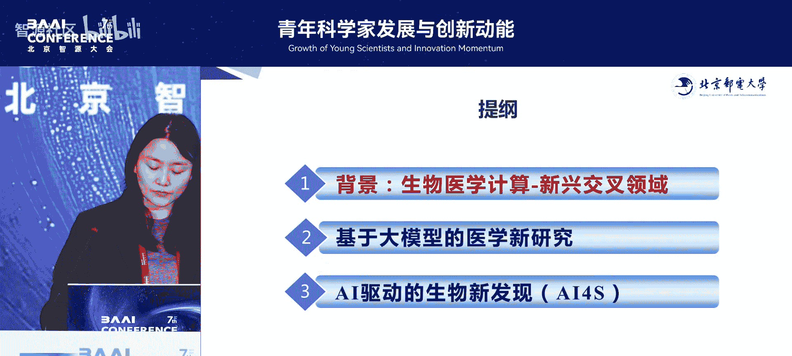
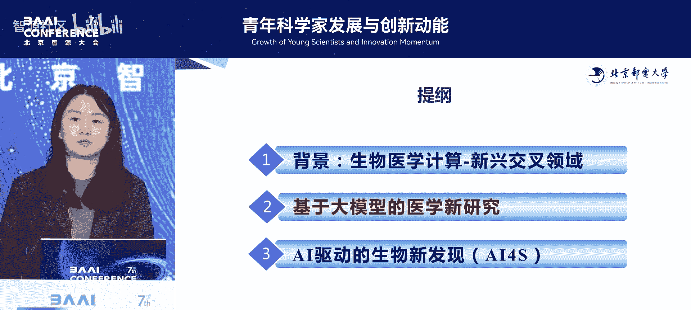
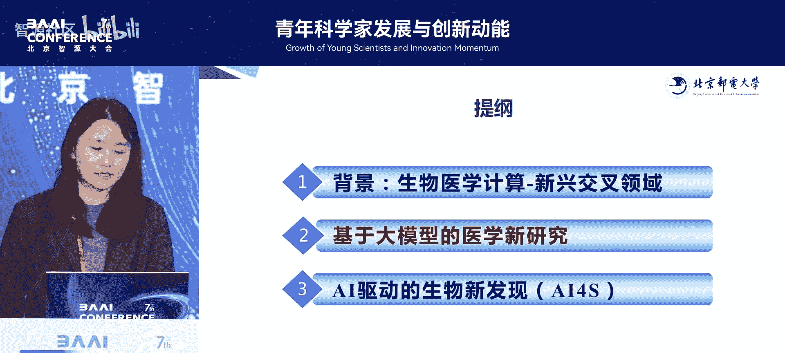
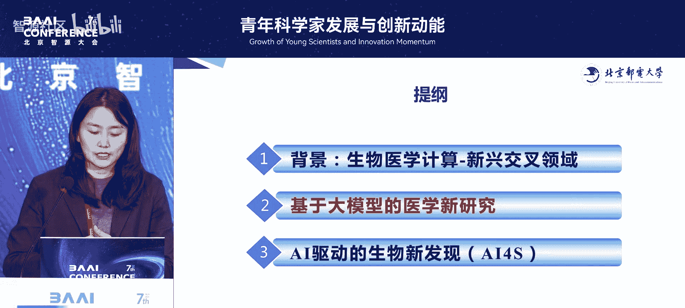
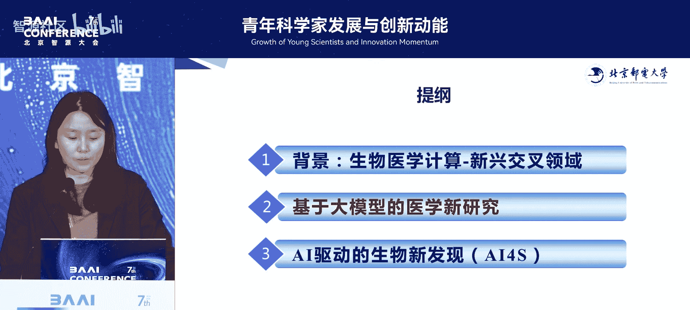
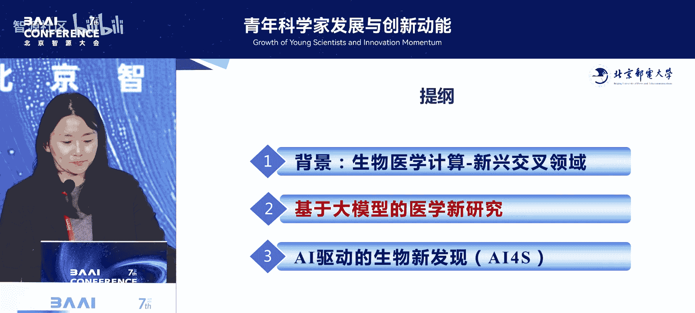
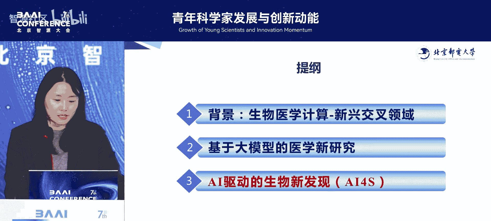
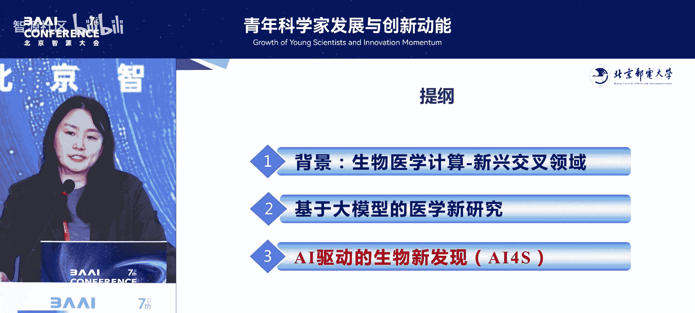
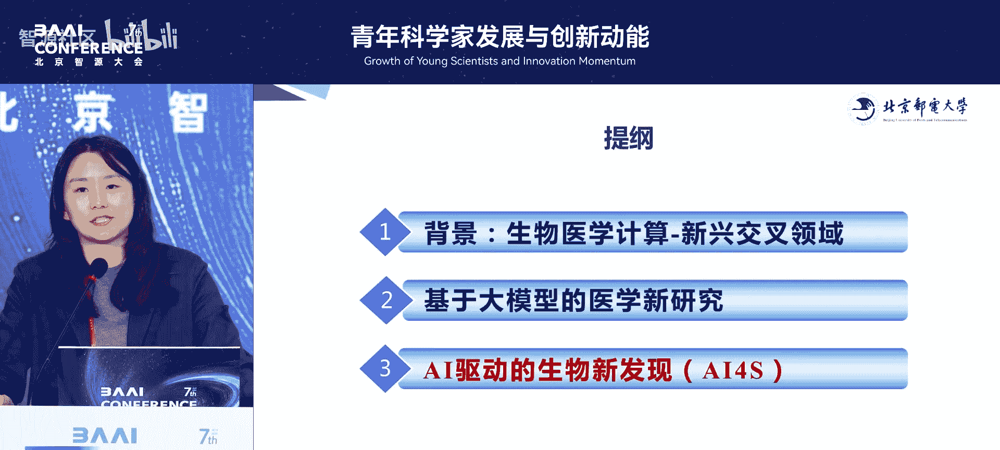

# 2025北京智源大会-青年科学家发展与创新动能论坛 p06 生物医学计算：信息驱动的前沿交叉研究：王光宇 -BV16JNxzPEAd_p6-

好，非常呃呃感谢这个呃我们这这样一个呃会议的邀请，也非常有幸能够参加我们这样一个呃青年学者的这样一个论坛。呃，那么我跟其他前面几位老师不太一样，我更多的呃是从一个学科交叉的角度啊。

来去讲我们做的一些工作和整个的一些探索的一些呃一些历程。呃，那么我今天我我我今天主要是汇报这个生物医学计算方面的一些工作。😊。

那么这个呢它也是一个呃比较前沿的一个方向。因为我们知道呃我们更呃做这个呃生物医学计算呢，我们更多的这个关注的或研究对象是我们的整个医学和生命科学。

但是我们的研究手段更多是一些信息智能的一些方呃这些这样的一些工具。呃，所以呢我们呃非常关心说呃整个呃整个生命和医学它的一个发展，实际上是非常呃依赖于整个工具的一个革新的。呃。

那么呃其实随随着现在整个我们呃这个呃我们呃各方面的这样的一些生物技术的发展。我们整个信息技术的发展，其实呃积累了大量的数据，还有这个领域的一些呃这样的一些前期的一些储备。实际上我们发展到现在。

我们认为是说呃做我们这个方向，通过智能和计算的手段是有可能是为我们提供一些这个呃新的一些工具的。呃，但反过来的话，我们也希望说在。这个过程中我们会做一些呃这样的一些开放世界或实际环境的一些问题。

那么反过来的话，也希望去呃解决呃做一些这样的一些方法的一些呃改进。呃，所以呢就是生命我们也可以认为它是一个复杂的这样一个呃信息系统。呃，那么我们就希望说通过我们智能的方法。

能够对我们这样的一些呃这个呃疾病啊等等这样或生命过程，进行一些这样的一些建模啊预测，或者说我们更好的进行一些干预调控等等。呃，所以我们更多是做这方面的工作。呃，那么围绕这个领域，呃。

因为要今天主题是分享这个自己做的一些这个青年的一些呃这个呃教师的一个发展过程。那么呃其实我我是呃大概5年前啊是到了北京邮电大学。呃，那么呃那么呃在这个因为北邮的话。

其实大家知道它还是这个信息网络为主的一个方向。那么做这样一个交叉学科的话，实际上还是有他自己的一定的挑战。因为呃那么呃就是我自己的一点经验的分享的话，是说呃还是说立足于自己这个平台的一个优势。

因为像我们的话呃整个这个网络与交换技术全国重点实验室，它更多的是一个信息方面的一个呃优势。包括我们做整个呃最近做语音通信呀，靠VAI一系列这方面的一些工作。那么到了北邮之后呢。

呃也是整整个团队的一个发展需要，就是说希望我们把整个这个方向能够去做一些这方面的一些推动。所以我们呃这样这5年来通过自己的一些呃摸索。也是说呃作为一个青年教师吧。

就是说如何去呃逐渐的在这样一个平台上去跟团队更好的融合，去利用团队的优势，逐渐形成自己的研究体系。这个实际上是一个非常呃重要的一个事情。呃，那么呃当然我们是呃基于这个的话，我们实际上是做了一系列的工作。

啊，这里也列了一些呃，从我们的整个网络层的话，包括整个数据安全方面，实际上北邮呃，它有它的优势。所以我们做了一些这种呃隐私计算呀平台啊等等这方面的一些工作。那么更多的是把它用到我们整个生物医学。

它的一些特定的我们这样的一些数据流通和协同建模上的一些问题。え？这个当然只是一些基座。呃，那么呃另外的话我们也做了一些计算的框架。呃，在这个基础上。

我实际上更关心的是说一些这个生微学一些新的计算的一些范式。呃，这个就呃这个就是我们在团队的就是跟团队这个整个呃一个基础更好的结合。我们其实针对这个呃生物医学本身要解决他的这个数据安全问题。

我们做了一系列这种呃可信的隐私计算的框架。呃，呃包包括我们呃比较有优势的一些呃这种多方式联邦学习啊等等一些这样的一些呃基础。我们更多的是希望解决本身这个过程中的这种临床科研的需求，呃，去更好的去支持它。

然后我们也做了这种呃这种呃针对生物医学这样一个融合分析的一个平台。因为本身生物医学计算的话，它就会涉及大量的这种呃多模态或异构的数据，以及如何进行一个动态的融合等等。

所以我们也在呃建立这样一个分析的一个方呃方法体系。呃，当然在这基础上，我们就是做了一系列的这方面的工作。从我们最呃这种影像诊断呀、用药呃各种疾病的这种建模，还有我们做各种用药的策略等等。

做了很多这方面的一些探索。呃，总之呢就是说呃因为呃就是作为呃青年老师的话，到一个新的平台上，还是说呃前期更多一定要跟团队的本身的这种需求去结合起来。然后去形成自己一些特色的研究方向。呃。

那么另外我想分享的一点呢，就是说呃在这个基础上，如果我们做一些探索，很多时候呃是一些特别卷的方向，那我们如何去呃解决它，或者是呃在从从这里边去形成自己的这样的一些呃能够有呃标志性的一些成果。

因为我们知道大模型这两年是非常卷的。刚才那个呃董老师啊等等。呃，他们其实在这个领域已经做的非常强了。那么其实我们在这个交叉学科领域的话，呃，也是有这样很多的这样的一些问题的需求的。

因为呃我们知道就是说其实呃大模型它更多的是一个基础的能力。它其实更多的是压缩了我们整个人类的知识。那么我们有没有可能去在整个生微学领域，我们前面做了很多工作之后，也是觉得它是一个小模型。

或者是呃这种呃特定任务的范式。那么呃如果我们真的有一个这样的一些基础的工具，可以一下解决我们所有通用的一些任务的话，其实它就是一个很重要的一个底层的一个基础设施。

所以我们可以看到近年来有很多这样大量的工作出来。包括在呃nature政刊呀一些子刊都在做这方面的一些呃国际前沿的一些工作。😊，呃，那么我们关心的是，如果我们做交叉学科的话。

我们怎么做这个呃特定领域的自己大模型。呃，包括我们自己的这个医学数据，它的模态相比呃自然场景的话是呃更加不同的。我们知道它是有呃它本身这个比如说病理图啊等等，相比较于某们些图它是这种呃分辨率特别高的。

大概10亿像素，对吧？那么等等这样一些在处理的这个呃预训练的方法上可能就会有一些差别。呃，包括我们呃更关心的是医学这个场景，它其实更加关注的是这个安全性和可靠性。

那么如何去解决刚才提到的一系列element等等一些问题，也是我们非常关心的。呃，那么这里介绍一下我们做的呃几篇工作。呃。

这个工作的话是我们呃构建了一个领域内的一个应该算目前来说吧呃比较大规模的一个呃大的基座模型。呃，这个的话呃当然这个呃其实我们做的呃这个会比较偏工程，就是我们呃大概是呃构建了这样一个基座之后。

我们希望去把我们所有开源的生物学语料的知识，能够压缩到我们这样一个模型里边。呃，当然我们在这里的话就在想说有了这样一个模型，我们怎么去验证，或者说提升它在一些特定任务上的能力。呃。

那么我们选了一个诊断任务来去做这个工作去提升它的。呃，所以就是我们大概做了这两个事情。呃，这个工呃，这个就是我们一个大概数据的一个构建的方式。呃，其实在在这里其实是花了呃比较大的。

我们很多同学在这里花了很多的一些投入。呃，包括在这个呃这种多机多卡训练上，其实趟了挺多坑的，然后去呃做一个领域内的一个增量的一个训练。呃，那么呃我们更关心是说，在一些特定任务上。

他能不能对齐人类的一些特定任务的需求，尤其是我们领域专家的这个需求。呃，那么当然思维链微调，大家可能比较熟悉，不再介绍。那么另外一块的话，就是说我们在做诊断的时候呢，我们这里其实是呃在做对齐的时候，呃。

我们会有一些考虑。因为我们会通过跟这种呃实际问题去出发的话，我们会看到说我们做很多诊断或这种呃它是一个判别式任务是一一系列这种细粒度的这种呃这种呃输出。那么分类任务。那么呃为了解决这个问题。

因为生成式模型，它在这里其实做的并不是特别好。所以我们其实就引入一些这种呃这种领域内的一些知识，就层次化这种呃诊断知识来去偏好来去引导它去生成这样的一些更精准呃更可靠的一些。诊断的结果。呃。

当然我们也做了一些测试，发现他在这种所有我们的常见科室或罕见病上，尤其是我们刚才讲到这种呃真实世界，它是这种常尾分布的这种情况下，其实都可以达到非常好的一系列的性能。呃，当然我也做了一系列这种临床分析。

呃，所以我们做交叉合作还是很有意思的。我们经常会做一些测试，跟临床医生或我们这方面领域的专家去去去做这个交流。我们呃这个就是实际拿到这个北京大学第三医院，我们呃请这边的医生去做这样一个case的分析。

我们可以看到通过其实大模型通他他这个呃可以强调呃他可以去呃发现一些更多医生忽视的一些这种异常的情况。那么可以更好的提升他的这样一个能力。对，所以我们呃也做了一系列这种人力评估的一些框架。

从我们领域的出发，去，如何去评估它这个有效推理能力等等。呃，OK那么呃我们另外一个工作呢也是做一个基础大模型。那么视觉领域就更卷了。那么就是大家经常就是很快的做这个呃发布很多这种很快的构建一个数据集。

然后发布出来或呃这个去做领域的内的一些这个呃微调可能就发布出来了。所以这个对我们做传统研究的话，其实呃这这个呃做一些深度的研究，实际上压力还是挺大的。尤其是要投稿的时候。

发现呃这个会会有一些这方面的一些影响。那么呃所以就是我们会那那么这样其实反过来的话，也会迫使我们去做更深入的一些探索，去发现说他可能这样的一些呃大家做做的很快的一些工作，它可能的一些问题。

呃比如说我们呃现在有很多这种医学影像的这种通过分割的大模型。但是呢我们可以看到就是说呃大家经常是把很多数据拿来一股脑的做。😊，各各种这个呃继续的呃做做微调等等。呃，但是实际上我们会自己做了一些测试。

会发现他在一些特定任务上就会是呃做一些就会存在一些负迁移的现象。所以为了解决这个问题，我们呃去构建了一个层次化，而且可以高度可扩展的这这样的一个数据集的形式。呃。

这个的话也是我们基于这个领域的一些词表和专家标注去构建的这样一个高质量的呃这个影像研码队。而且是呃基本上覆盖了我们所有开源的这样一个不同模态呀，不同器官部位，呃，还有一些疾病的这样一个数据集。呃。

那么呃在这个基础上的话，我们去呃怎么去消除一些负迁移的现象的话，我们其实呃引入了一些这种医学知识的一些先验表征网络。那么通过我们做一些表征知识呃先验的话。

可以去更好的聚合我们一些做任务里边一些语义相关的一些任务。那么呃可以更好的去消除它这个无关任务带来的一些负迁移的影响。当然我们还做了一些这个呃这个基于知识先验的一些这个MOE去动态激活不同的专家。

然后可以提供不同的专家策略去呃做这样一个工作。总之呢我们呃这个还呃这个是还在impress的一个工作。就是我们呃在很多任务上取得了很好的性能。呃，包括呃这个呃这个尤其是很多分布外的数据。呃。

那么我们可以看到呃就是右边这个图的话，就是呃基本上我们是呃跟我们呃也是这个。领域内的比较知名的这种通用分割大模型的话，我们可以看到我们基本上只需要5%或15%呃。

25%的一个微调数据就可以达到呃其他百分之百微调的这样一个性能。所以这个呃也是我们做的一些领呃交叉的一些探索。呃，当然我们另外还做了一些组学的工作。呃。

这个也是呃就是因为呃组学的话很多时候是用来比如说做这种呃液体活检。我们可以通过它去做这个呃早期筛查的标志物。呃，那么但是就是说呃通过这个的呃甲基化的话，比如说CFDNA的话，它其实有这己一些呃问题。

比如说早期的这个它的信号是非常微弱的。而且这种有一些特征高纬呃这个呃位点比较高纬度，特征筛选很困难。那么我们也是提出了这样一个呃这个表观遗传的阻学基础模型。呃，那么通过这个的话。

可以更好的学习它这个CPGV点之间的这个关联的知识。呃，同时的话我们也去呃去去做这样的一系列的这样一些工作。然后呃最终我们是呃通过一系列工作的话，我们可以实现一个这样的一个倒筛的能力。呃。

当然从方法上的话，我们也也做了是实际上更多的是一些呃围绕着我们本身这个问题，或者是数据特点出发，做一些方法的一些这样一些创新和改进。所以我们做一些交叉是很有意义的，也很有成就感。

就是说希望呃我们很多时候真正去解决背后的一些问题，而且实实在在的能够去呃对人类疾病啊，很多一些这样的去呃有这样的一些应用价值。所以我们在非常卷的大模型的时候，呃，也可以说在探逐渐探索自己的一些路径，呃。

去在领域内去做一些有价值的事情，呃，去实现我们做研究的这样一个价值。呃，另外一块是我们其实在除了医学本身之外，呃，这个是呃我们自己呃也是自己的一个研究的一个兴趣驱动的工作。就是呃因为AI我们做医学的话。

更多的是解决我们很多临床诊断辅助的辅助呃决策等等一些问题。那么我们更希望是说呃AI有没有可能去真正去加速我们一些新的发现，去呃触及人不太能做的好的工作。这样的话其实是我们更希望能够看到的。

所以我们呃这两年的话也也在做这方面科学智能方面的一些工作。呃，包括我们呃做这个蛋白质功能的预测。因为我们知道像阿发呃bo或者是呃day bakeker，他们其实呃前期在这个。

从序列到结构预测方面做了非常多开创性的工作。那么我们更关心的是说，呃，如果到呃去真正去解决生物问题的时候，它的这个功能是非常重要的。呃，那么呃那么针对这个的话。

我们其实就做了一系列这种呃蛋白质相互作用的一系列的工作。呃，这个工作的话是我们提出了一个叫呃通用的蛋白质交互呃分析框架unic band。呃。

也就是说我们呃首先是希望把蛋白质通过不同尺度去做图结构的表示。然后的话我们也设计了一系列的方法模块。呃来去提取这个蛋白交互过程中，他们的一些几何能量信息。

然后去呃多任务去做这种呃亲和改变量一系列的这样一些工作。呃，通过我们的工作的话，也是呃可以看到它呃是呃在计算上，它是有非常多自己的价值。比如说我们可以提前2到3个月就可以在新冠的时候。

我们就可以呃预测未来2到3个月。左边这个图就是在预测它的优势毒株。所以它是非常精准的能够预测它将来一些优势的这个呃这个计划的这个毒株是哪个，所以也可以为我们去前瞻性的设计一些呃药物。

是做一些它的一些呃一些这个工具的。然我们也希望让他做的更加普及和可极化。所以我们最近也在做1个uniPPI这样一个工具，呃，然后能够去动态集成，然后去整合不同尺度的我们这样的一些预训练模型。

实现一个呃更优的这样1个PPI预测的工具。呃，最近我们也会发布出来。呃，包括这个这个蛋白质和呃这个RA相互作用的预测。那么相比较于蛋白质和蛋白质这个预测的话，它有更多自己的一些挑战。呃。

因为比如说它本身数据相比相比较而言是更加稀确性的。呃，还有就是呃它在预测的时候，因为它整个结合模式更加的灵活。所以就会有更多的一个挑战。所以我们这里的话也是做了一些方法探索。呃。

那么呃构建了一个这样一个copper的工具。然后实际上是呃把我们通过这个三维复合物来引导做这样一个从呃这个蛋白呃蛋白语言模型和R语言模型呃去引导的这样一个呃多模态的一个生物训练语言模型来用于这个呃亲和力的一个预测的工作。

呃，当然的话，我们在这个过程中呃，其实也花了很多的精力呃和投入去构建了一个呃这个目前呃规模比较大的这样一个蛋白质RNA结合亲和力的一个数据集，也是希望能够推动这个领域大家的一些研究工作。对。

这个也我们也做了一系列的这样一个评估。呃，那么在这个基础上，我们就会更加走向一些应用。呃，我们现在更关心呃，比如说这种呃比如肿瘤免疫，它就会涉及到很多抗原肽和抗体的一些优化的工作。呃。

那么我们除了做工具之外，我们就要更加深度的走路这样一些问题里边去包括我们如何去做这种因知道呃肿瘤，它实际上就是这个呃这个HLV口袋和我们这个呃这个癌症的这个抗原肽和我们的这个呃TCR去结合的一个过程。

如果能够很好的去呃做这样的一个工作的话，实际上对这种个性化疫苗设计是非常有用的。对，总之我们在这里做了一些事情。然后呃希望呢就是说呃我们做我们的工作能够去真正解决我们重大的一些疾病的问题。

比如说我们刚才提到这种呃癌症疫苗的设计，是不是可以设计更强烈激发这个免疫反应的一些个性化的疫苗等等。然后真正去通通过我们这个计算的工作，和我们这样呃更多这种呃我们现在跟施实验的团队更多一些合作。

然后去提升呃这样的一些或者是加速我们整个医学的一个领域的发展？呃，最后呢也是这个一个这个呃结尾，就是呃因为我们是做交叉学科的话，呃，最终还是要找到自己比较独特或自己感兴趣的方向。呃。

那么呃最好就是说能够自己呃能够感兴趣。虽然是有可能这样的一些领域，他是少有人走的路，或者是呃不是那么确定。但是的话呃在这样的工作的话，有可能更有机会去获得我们科学发现的一些快感或者是成就感。好。

谢谢大家。😊，好，看看在座的嘉宾有没有什么问题。后面那位。呃，老师您好，我是西安交通大学的博士生华梦博。然后我对您做的所有研究就是首先就是感到非常的优秀。然后我也是做的方向跟您是比较接近的。呃。

我有一个问题，就是您在做这么多相关领域的这种基术大模型的时候，就是呃作为您一个高校的老师，就是我觉得我们就通过资源来讲，我会觉得在资源上，还有就是包括您做那种呃收集数据过程中。

就是这些资源上和这种数据数据上这种大量的重复性的工作。这种我们应该就是您是有什么经验或者说是怎么去克服这些的。哦，对，个这个其实刚才崔老师也提到了，尤其是大模型时代的话。

我们高校相比较工业界就是有自己这样一些困难。因为我们可能相比较于这个工业界的话，我们很多时候呃缺乏一些比如说数据构建和我们做训练这样一些更好的一些支撑和基础。呃，那么从我的经验来看的话，就是说呃。

一还是做一些我们呃我我肯定不做这种通用领域训练的工作。那我肯定是做解决我特定领域的问题。呃，最终还是要解决我们问题，而且真正能够去呃就是呃去去有一些推动吧，而不是一窝蜂的去卷这个大模型。

因为我们做大模型更多的也是认识也认为他可以解决问题呃，而是呃有它的价值。呃，那么当然计算资源，这些应该我们跟高校老师一样，就是到处化缘合作吧。呃，当然你做出一点工作之后，大家可能会更乐于合作。对。

玉博老师好，之前也多次听过您的讲座哈。刚才你有张片子就讲那个生物医学计算平台。我看您现在做了几个基础的平台，一个是那个就是医学的一个通用医学的大模型，还有一个影像的大模型。

我第一个问题就是说你那个通用医学大模型做的时候是基本上基于现在的开源数据吗？还是。呃，基于了一些比如说专病专科上面的一些数据训的，就是结没结合一些临床的数据，这是第一个问题。

第二个问题就是说现在我们也比较关注多模态，现在之前听的多模态，比如VIV啊，这些可能都是面向一些剧身智能呀这样一些场景。那在医学场景下，比如说我们大语言模型，结合这个比如说病理的呀，或者影像的。

现在融合的方向，呃，是有哪些技术的趋势，还是说现在还是两个方向影像，还是原来那个传统的影像模型来做大语言模型还是大语言模型来做，这两方面怎么样，技术上有个融合的趋势。你看看有有没有什么这个简解。呃。

谢谢这位老师的提问啊，我也是非常好的问题。呃，首先是这个我们呃关于我们做的这个影像大模型的话，我们实际上是呃呃主要是开源为主。呃，但是我们更多的是采用了一些呃这种呃。领域知识层次化组织的一些方式。

这样的话我们来了数据之后，我可以更好的扩展。呃，然后呃可以动态的扩展。而且就是说我可以去不断的呃提升我这个任务。在呃呃模型在一些呃更更深层任务的能力。呃，刚才也提到了。

比如说我们基于这种呃专家领域专家知识的这种呃呃这个表征学习和知识嵌入，对吧？然后我们做这种动态去激活不同的专家网络。所以我们大概这样的话，它实际上跟我们数据构建是相关的。

就是因为它是依赖于这样一个数据构建方式组织方式才去做这样一个训练的一个这样一个模型，所以这是第一个问题。呃，那第二个问题的话，确实现在做的多么太大模型的呃老师或团队也非常的多。呃。

那么我还是要呃就是说我们更关心的我们整个领域做的工作的话，可以看到呃无论是过去机器学习时候，大家做这种呃这种多模太融合。呃，还是说我们现在做大模型。

做VRM这种呃在呃在医学领域更多的是呃把一些嗯工作拿来用一下，或者做做微调或者之类的。呃，那么我们现在在做的其实是希望我呃就是能不能做一些更原生的这样一个领域内的这种基基基作模型，呃。

因为本身这个我刚才提到他的这个数据特点会不一样。比如说他输入的这个尺度更高，或者是他的这个有一些自己国泰一些特点。呃，包括他对呃这个呃一些推理要求能力更高等等。所以我们呃这里也在做一些方法的探索吧。啊。

对。好，谢谢啊。😊，こ size。是没有。前提的一个。这个算法。那个数据就你们因为不同的是你们都开源吗？哦，我们都开源的对。啊，后面那位女士啊。呃，老师好，我是北京大学物理学院的直播生。呃。

我我也是做AFS。然后我对您嗯就是提到的关于就是组学基础模型那部分很感兴趣。啊，我想知道就是这部分怎么就是这个机模怎么和具体的检测，它是呃结合起来的。

就是比如说在具体的一个呃疾病筛查过程中是怎么去用到这个模型，以及呃怎么去呃可以完成辅助这个模型的迭代的。还有包括像这种组学模型的话，现在主要遇到的推进的难点在什么地方呢？比如说在一些呃分子层面的一些。

还是说在一些样本或者数据上面的？谢谢老师。😊，嗯，好的，我尝试回答一下哈。就是呃那个呃首首先第一个问题的话，呃，因为因为基座模型我们更多是把呃所有比如说那个是把假计化的一些数据嘛，都收集起来。

我们训练一个基础的一个模型。那么到了比如说乳腺癌这个EOC这个呃早筛的话，我们实际上就是做其实就是做一些微调，但是它相比较数据量会更少。呃，大概是这样。因为因为它有一个更好的基座的一个能力了嘛。

可以这么理解。呃，那么。😊，呃，但是现在的这个挑战的话，我觉得两个都有。就是说你一方面刚才还是说的，就是说呃医学的数据可能更好获取。其实像我们组学的数据或分子的数据，还有一系列这方面的。

包括我们刚才说蛋白的数据，这些都很相对更难获取。因为它这种实验室的数据嘛。呃，那么我们怎么去，所以我们现在尝试跟这种生物实验室在合作，做这种干湿闭合闭环这种主动学习，然后去采集数据去优化这样的一个过程。

所以这个一定程度应该可以解决我们做生物学研究这方面的一些数据嗯不可及的一些问题。但是现在生成式模型也是一个呃一个一个一个另外一个角度，我们也在围绕这个做一些探索嗯。呃。

但但就是说方法上这个他可能不同问题，我们要具体看怎么设计方法吧，这个可能得具体看。比如说就医学大模型和生物大模型也是不太一样。对啊。

