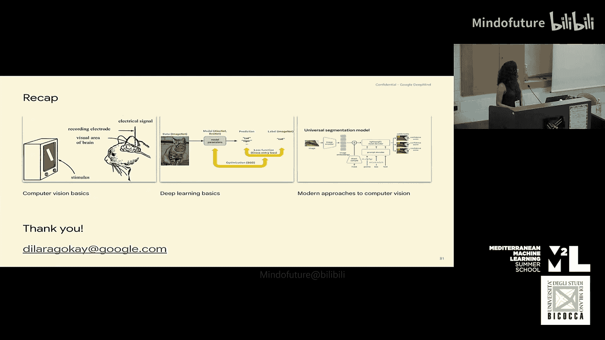
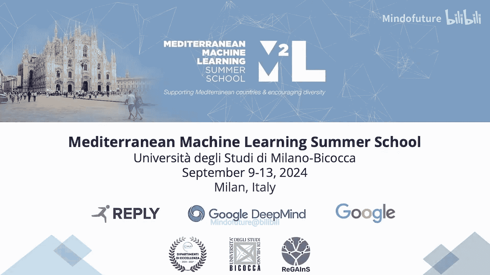

# 001：课程概述与基础

在本节课中，我们将学习计算机视觉和深度学习的基础知识。课程将从计算机视觉的定义和历史开始，逐步深入到深度学习的核心组件，包括数据、模型、损失函数和优化器，最后介绍一些现代计算机视觉任务和前沿模型。

## 什么是计算机视觉？👁️

计算机视觉是从视觉数据中提取有意义信息的过程。视觉数据的形式多样，可以是图像、视频、3D点云或网格，甚至包括医学影像（如MRI扫描）等。

## 计算机视觉的应用领域 🌍

以下是计算机视觉技术被广泛应用的一些领域：

*   **人脸识别**：用于智能手机身份验证等场景。
*   **自动驾驶**：用于检测车辆、行人、车道线等。
*   **零售**：例如亚马逊无人收银商店，通过视觉算法追踪顾客选取的商品。
*   **医疗健康**：辅助进行医学影像（如脑部MRI）的分割与诊断。
*   **制造业与农业**：在工厂中进行物体定位，或在农业中检测病虫害或植物营养状况。

## 计算机视觉简史 📜

计算机视觉的发展历程中有几个关键节点：

*   **第一台数码相机**：柯达公司推出的商用数码相机，使得图像能够被计算机处理。
*   **20世纪60年代的神经科学实验**：Hubel和Wiesel对猫视觉皮层的研究，揭示了视觉处理的基本原理。
*   **“夏季视觉项目”**：1966年MIT的项目，被视为计算机视觉作为一个科学领域的开端。
*   **经典算法**：1986年Canny边缘检测算法，2001年Viola-Jones人脸检测算法。
*   **数据集挑战赛**：2005年PASCAL VOC挑战赛和2010年ImageNet大规模视觉识别挑战赛推动了领域发展。
*   **深度学习的兴起**：2012年AlexNet在ImageNet竞赛中取得突破性成绩，标志着深度学习在计算机视觉中占据主导地位。

如今，几乎所有的计算机视觉方法都与深度学习紧密相连，例如卷积神经网络、自编码器、Transformer和扩散模型。从学术论文数量到工业应用（如Google的Astra项目），深度学习的影响力无处不在。

## 计算机视觉的典型任务 🎯

上一节我们回顾了计算机视觉的发展，本节中我们来看看它具体能解决哪些问题。给定一张图像，计算机视觉可以完成多种任务：

*   **图像分类**：判断图像的整体类别（如“胡狼”）。
*   **目标检测与定位**：找出图像中有哪些物体（如“胡狼”和“汽车”）并用边界框标出位置。
*   **视觉问答**：根据图像内容回答问题（如“这是户外场景吗？”）。
*   **行为识别**：识别图像中发生的活动（如“行走”）。
*   **姿态估计**：检测图像中人体或动物的关键关节位置。
*   **图像描述**：用一句话描述图像内容（如“一只胡狼正在穿过乡村的柏油路”）。
*   **语义分割**：为图像中的每一个像素分配一个类别标签（如“道路”、“胡狼”、“植被”），这是一种密集预测任务。
*   **深度估计**：预测图像中每个像素距离相机的远近，同样是密集预测任务。
*   **3D形状估计**：从2D图像中估计物体的三维形状。
*   **视觉定位**：给定一张图像和一张环境地图，确定图像在地图中的对应位置。

## 从传统方法到深度学习 🤖

传统计算机视觉方法（如基于边缘检测的分类）需要手工设计特征。而在深度学习时代，我们采用数据驱动的方法。其核心流程是：输入数据通过一个由参数定义的模型，得到预测结果。训练的目标是找到一组最优的模型参数，使预测结果与真实标签尽可能接近。这需要通过损失函数来衡量预测与标签的差异，并利用该差异来优化模型参数。接下来，我们将逐一剖析这个流程中的关键组成部分。

## 数据：模型的燃料 🗃️

在计算机视觉中，输入通常是图像、视频或其他视觉数据。图像在计算机中通常表示为一个整数张量，其形状为 `[高度, 宽度, 通道数]`。彩色图像有红、绿、蓝三个通道，而灰度图像则只有一个通道。

对于监督学习而言，大规模、带标注的数据集至关重要。ImageNet就是一个被广泛使用的大型标注数据集。

## 模型：从全连接层到卷积神经网络 🧠

模型通常由多个层堆叠而成。一个“层”本质上可以是一个矩阵乘法运算。以下是几种常见的网络层：

*   **全连接层**：由简单的矩阵乘法和偏置项构成。公式为 `H = W * X + b`。其中 `W` 是权重矩阵，`X` 是输入向量，`b` 是偏置向量。该层将输入的所有元素与所有权重相连。
*   **卷积层**：专为处理图像等网格数据设计。它使用一个小的卷积核在输入图像上滑动，进行逐元素相乘后求和的操作。这能有效捕捉图像的局部空间特征。
*   **池化层（如最大池化）**：对局部区域进行下采样，例如取2x2区域内的最大值。池化层没有可学习的参数，主要用于降低特征图的空间尺寸并增加一定程度的平移不变性。
*   **非线性激活函数**：如果只堆叠线性层，网络只能表示线性函数。加入非线性激活函数（如ReLU、Sigmoid、Tanh）能使神经网络逼近任意复杂度的连续函数，这是“通用近似定理”的基础。
*   **Softmax函数**：在分类任务中，将网络最后一层的输出转换为各类别的概率分布。
*   **正则化：Dropout**：为了防止模型在训练集上过拟合，Dropout在训练时随机“丢弃”（即置零）一部分神经元的输出，从而降低模型容量，鼓励学习更鲁棒的特征。在测试时则不使用Dropout。

## 经典网络架构：AlexNet 与 ResNet 🏗️

结合上述层，可以构建强大的卷积神经网络。AlexNet是2012年ImageNet竞赛的冠军，其结构依次为：输入图像 -> 大卷积层(11x11) -> ReLU -> 池化层 -> 后续卷积与池化 -> 展平 -> 全连接层 -> 输出（1000类）。

AlexNet的成功引发了增加网络深度的趋势。然而，简单地堆叠更多层会导致训练误差和测试误差不降反升，这并非过拟合，而是优化困难。ResNet通过引入“残差连接”解决了这一问题。在一个残差块中，输入 `x` 会直接跳接到几层之后的输出 `F(x)` 上，最终输出为 `F(x) + x`。这种结构使得网络更容易学习恒等映射，让极深的网络（如152层的ResNet）得以成功训练，并在多项任务上取得突破性成果。残差连接也有助于缓解深度网络中的“梯度消失”问题。

## 损失函数与优化器 ⚖️🔧

对于图像分类任务，我们需要一个损失函数来衡量模型预测的概率分布与真实标签分布的差距。**交叉熵损失**是常用的分类损失函数。其公式为：
`Loss = -Σ (y_true * log(y_pred))`
其中 `y_true` 是真实标签的one-hot编码，`y_pred` 是模型预测的各类别概率。

得到损失后，我们需要优化器来更新模型参数以最小化损失。**随机梯度下降**及其变种是常用的优化方法：
*   **批量梯度下降**：使用全部数据计算梯度，稳定但计算成本高。
*   **随机梯度下降**：每次只用一个样本计算梯度，计算快但噪声大。
*   **小批量随机梯度下降**：折中方案，每次使用一小批（mini-batch）数据，在实践中最常用。
此外，**带动量的SGD** 或 **Adam** 等更高级的优化器也广泛使用，它们能加速收敛并提高稳定性。

## 现代计算机视觉方法掠影 🚀

深度学习的基础已经奠定，现在让我们快速浏览一些解决特定视觉任务的现代方法。

*   **语义分割：Segment Anything Model**：这是一个强大的分割模型。它包含一个**图像编码器**（如基于MAE预训练的ViT）、一个**提示编码器**（处理用户点击、框选等提示信息）和一个**掩码解码器**（融合信息并输出分割结果）。它实现了灵活的交互式分割。
*   **视觉问答：PaLI**：该模型同时处理图像和文本问题。图像通过**视觉Transformer**编码，文本通过**大型预训练语言模型**编码，两者进行交叉注意力计算后，由解码器生成答案。
*   **深度估计：Depth Anything**：利用大量无标签数据提升深度估计性能。它使用**教师模型**为无标签图像生成伪标签，然后让**学生模型**去学习，并结合有标签数据共同训练。其编码器常基于DINOv2等自监督方法预训练的ViT。
*   **图像生成：unCLIP**：属于文生图模型。首先，**CLIP模型**学习图像和文本的联合嵌入空间。然后，一个**先验网络**根据文本描述生成图像嵌入。最后，一个**扩散模型解码器**根据图像嵌入生成高质量图片。
*   **目标跟踪：SiamFC**：处理视频中的目标跟踪。它是一个**孪生网络**，包含两个结构相同的子网络，分别提取模板图像和搜索区域的特征，然后计算其相似度来确定目标位置。
*   **点跟踪：Bootstrapped Trajectory Prediction**：这是一种更精细的视频跟踪，预测视频中特定点在所有帧中的轨迹。方法结合了**监督学习**（在合成数据上训练）和**自监督学习**（在无标签真实视频上，通过学生-教师模型框架进行一致性训练），从而利用大量真实世界数据提升性能。

## 总结 📝

本节课我们一起学习了计算机视觉与深度学习的基础知识。我们从计算机视觉的定义、历史和广泛应用开始，介绍了其核心任务。然后，我们深入探讨了深度学习 pipeline 的关键要素：数据表示、模型层（全连接层、卷积层、池化层、激活函数）、经典网络架构（AlexNet, ResNet）、损失函数（交叉熵）以及优化器（SGD）。最后，我们概览了多个现代计算机视觉前沿方向及其代表性模型，包括分割、视觉问答、深度估计、图像生成和目标跟踪等。希望这为你进一步探索机器学习与计算机视觉领域奠定了坚实的基础。