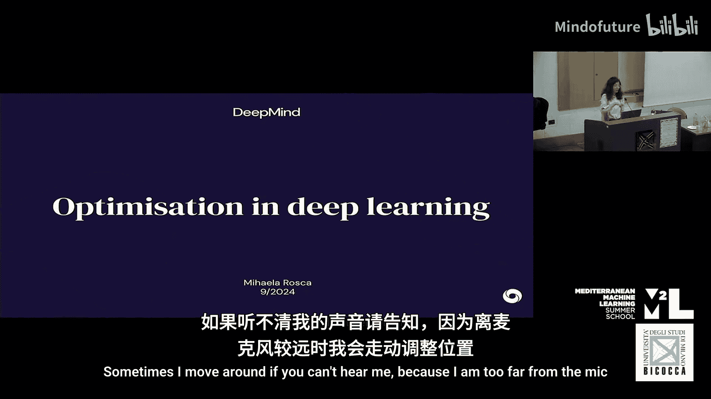
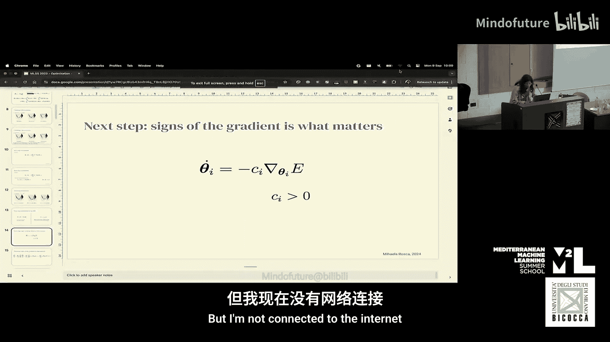
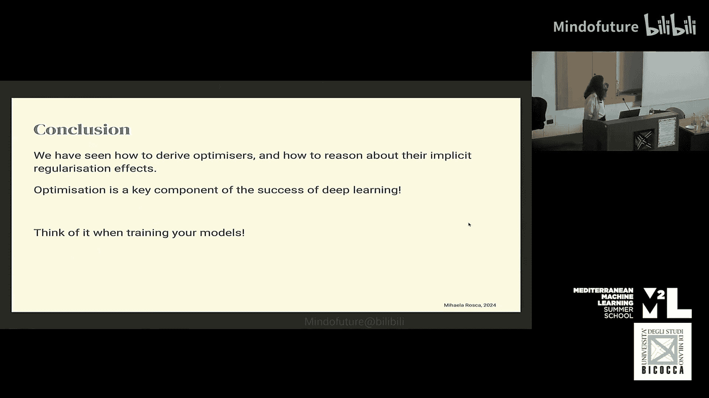

# 002：深度学习中的优化 🧠

在本节课中，我们将要学习深度学习优化的核心概念。我们将从最基础的梯度下降法开始，探讨其背后的数学原理，并逐步理解动量、Adam等现代优化器的设计思想。我们还将深入分析深度学习优化中一些独特的现象，如隐式正则化、边缘稳定性以及它们如何影响模型的泛化能力。

## 从连续时间到梯度下降法 📉

上一节我们介绍了优化问题的基本目标：最小化一个关于参数θ的函数E(θ)。本节中我们来看看如何从连续时间的视角推导出梯度下降法。

在连续时间中，如果我们让参数沿着负梯度的方向以无穷小的步长移动，可以保证损失函数单调下降。这个过程可以用一个常微分方程（ODE）来描述：
`dθ/dt = -∇E(θ)`
对这个方程应用链式法则，可以证明 `dE/dt ≤ 0`，即损失函数随时间递减。

然而，计算机无法处理连续时间，我们必须进行离散化。通过欧拉积分法对上述ODE进行近似，我们得到了梯度下降法的更新公式：
`θ_{t+1} = θ_t - η * ∇E(θ_t)`
其中η是学习率。这个推导基于一个关键假设：在一个微小的时间间隔内，梯度是近似恒定的。当这个假设不成立（例如学习率过大）时，离散化误差会导致优化轨迹偏离理想的梯度流，甚至可能发散。

## 动量与自适应优化器 ⚡

上一节我们介绍了基础的梯度下降法，本节中我们来看看如何通过引入历史梯度信息来加速和稳定优化过程。

动量的核心思想是创建一个梯度的移动平均，让参数更新方向不仅取决于当前梯度，也受到过去梯度的影响。这有助于在梯度方向一致的区域加速，并平滑掉一些噪声。其更新规则通常写为：
`v_{t+1} = β * v_t + (1-β) * ∇E(θ_t)`
`θ_{t+1} = θ_t - η * v_{t+1}`
其中β是动量系数，控制历史信息的衰减速度。

从梯度的符号重要性出发，我们可以进一步推导出自适应优化器。一个关键的洞察是：对于参数更新，梯度的方向（符号）比其大小更重要。基于此，我们可以用梯度的符号代替其原始值，这引出了符号梯度下降法。

结合动量的思想（使用移动平均来平滑）和符号的重要性，我们可以自然地推导出RMSProp和Adam优化器。Adam同时维护了梯度的一阶矩（均值，类似动量）和二阶矩（未中心化的方差，用于自适应调整学习率），其更新步骤如下：

以下是Adam优化器的核心更新步骤：
1.  计算当前梯度 `g_t`。
2.  更新一阶矩估计：`m_t = β1 * m_{t-1} + (1-β1) * g_t`
3.  更新二阶矩估计：`v_t = β2 * v_{t-1} + (1-β2) * g_t^2`
4.  对一阶和二阶矩进行偏差校正：`m̂_t = m_t / (1-β1^t)`, `v̂_t = v_t / (1-β2^t)`
5.  更新参数：`θ_t = θ_{t-1} - η * m̂_t / (√v̂_t + ε)`

其中，`ε`是一个为了数值稳定性而添加的小常数，但它对优化轨迹有不可忽视的影响。

## 深度学习优化的独特现象 🔬

前面我们讨论的优化器是通用的。本节中我们来看看当这些优化器应用于训练深度神经网络时，会产生哪些独特且有趣的现象。

深度学习优化面临高维、非凸、数据量大等挑战，但其表现往往比理论预期更好。我们关注三个核心问题：
1.  **为什么鞍点不是大问题？** 在高维空间中，严格的局部极小点很少，鞍点则很多。理论表明，随机梯度下降（SGD）中的噪声有助于逃离鞍点。
2.  **为什么优化得到的局部极小值能泛化？** 优化目标是降低训练损失，但最终我们关心的是测试性能。实验发现，SGD倾向于收敛到“平坦”的极小值，而这些平坦区域通常与更好的泛化能力相关。
3.  **什么是平坦性？** 平坦性描述了损失函数在最小值附近的形状。虽然存在重参数化问题（即同一个函数可以对应尖锐或平坦的损失曲面），但优化过程本身可能隐式地偏向于寻找某些类型的解。

## 隐式正则化与边缘稳定性 🛡️

上一节我们提出了深度学习优化中的几个谜题，本节中我们利用数学工具来深入分析其中一个关键概念：隐式正则化。

我们可以通过“反向误差分析”来建模梯度下降法的离散化误差。分析发现，梯度下降不仅在最小化原始损失函数`E(θ)`，还在隐式地最小化一个修改后的损失函数：
`L_mod(θ) = E(θ) + (η/4) * ||∇E(θ)||^2`
这个额外的项`(η/4) * ||∇E(θ)||^2`就是**隐式梯度正则化**项。它惩罚了梯度范数大的区域，从而倾向于将优化过程推向梯度更小（更平坦）的区域。学习率η越大，这种正则化效应就越强。

对于随机梯度下降（SGD），其隐式正则化效应更强，它倾向于最小化每个小批量上的梯度范数，而不仅仅是全批量上的。实验表明，将SGD的这种隐式正则化项显式地添加到全批量梯度下降的目标函数中，可以显著提升其泛化性能，从而弥合与SGD之间的差距。

另一个重要现象是**边缘稳定性**。实验观察到，在使用全批量梯度下降训练神经网络时，损失海森矩阵的最大特征值`λ_max`会增长并振荡在`2/η`附近。当`λ_max > 2/η`时，在二次函数中会导致发散，但在神经网络中由于高阶项（非二次项）的隐式正则化作用，优化并未发散，而是出现了损失振荡。这揭示了神经网络损失函数的局部二次近似不足以完全描述其优化动态。

## 优化在生成模型中的关键作用 🎨

我们学习的优化理论并非纸上谈兵。本节中我们来看看优化技术的进步如何直接推动了生成式人工智能的发展。

在生成对抗网络（GAN）的训练中，优化挑战尤为突出，例如模式崩溃和训练不稳定。以下是一些通过改进优化来提升GAN性能的关键技巧：

以下是提升GAN训练稳定性的优化相关技巧：
*   **增大批次大小**：有助于模型在训练中看到数据分布的更多模式，缓解模式崩溃。
*   **使用Adam优化器**：相比SGD with Momentum，Adam通常能带来更稳定的训练。
*   **调整Adam超参数**：在GAN的双人博弈场景中，使用较低的动量（β1）通常更有效。
*   **谱归一化**：虽然看似是架构改动（约束权重矩阵的谱范数），但其本质是改变了优化问题的景观，使训练对超参数更不敏感。

对于扩散模型，其优化目标（预测噪声）比GAN的对抗性目标更简单、更平滑，这本身就是一个巨大的优化优势。当前许多关于扩散模型的研究也聚焦于对其连续时间动力学进行离散化时产生的误差分析。

在大语言模型（LLM）的训练中，稳定性是巨大挑战。例如，注意力层可能发生“崩溃”。使用Adam通常是稳定训练的必要条件。此外，由于模型规模巨大，超参数调优成本高昂。采用“最大更新参数化”等初始化策略，可以使最优学习率等超参数在不同模型宽度下保持相对稳定，从而实现从小规模实验到大规模训练的更好迁移。

## 总结 📝

本节课中我们一起学习了深度学习优化的核心脉络。我们从梯度下降法的连续时间推导开始，理解了其离散化本质和局限。随后，我们探讨了动量、RMSProp和Adam等自适应优化器的设计直觉与推导。我们深入分析了深度学习优化中的特殊现象，如隐式正则化如何引导优化器找到平坦的极小值并促进泛化，以及边缘稳定性现象所揭示的损失函数特性。最后，我们看到了优化技术的进步在GAN、扩散模型和大语言模型等生成式模型发展中所起到的决定性作用。优化不仅是理论工具，更是推动人工智能前沿发展的实践引擎。