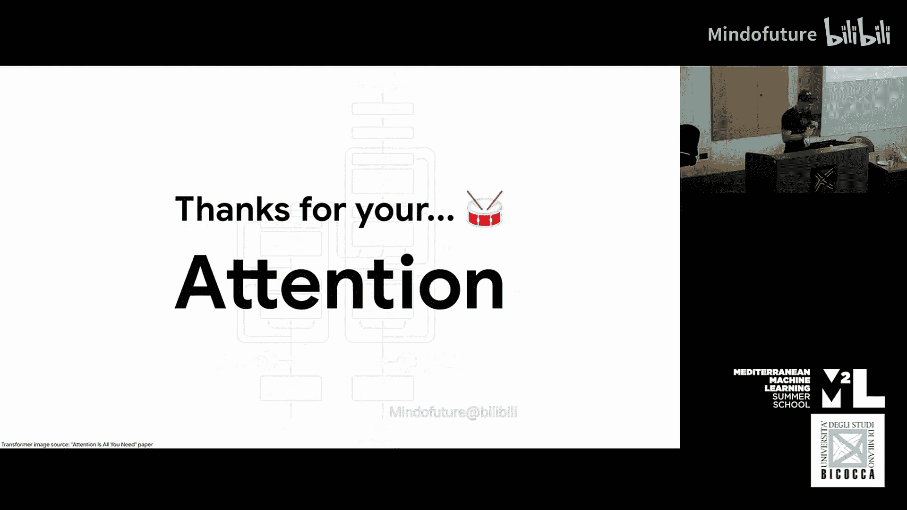

# 003：Transformer模型 🧠


在本节课中，我们将深入学习Transformer架构。我们将从最基础的细节开始，逐步剖析其核心组件和工作原理，并了解它如何从最初的语言翻译任务扩展到计算机视觉、语音识别乃至强化学习等多个领域。课程最后，我们还将探讨其效率问题及变体模型。

---

## 输入与向量化

上一节我们介绍了Transformer的概览，本节中我们来看看模型如何处理输入数据。对于语言任务，输入是文本字符串，但模型内部处理的是向量。

首先，文本需要被转换为模型可处理的向量序列。这个过程分为几个步骤：

以下是文本向量化的主要步骤：
1.  **分词**：将输入句子（如 “the detective investigated”）分割成更小的单元，称为“词元”。词元可以是字符、单词，或介于两者之间的子词单元。例如，“investigated” 可能被分割为 “invest”、“igat”、“ed” 三个词元。
2.  **词汇表映射**：模型有一个预定义的词汇表，通常包含32,000到256,000个词元。每个词元被映射到词汇表中的索引（一个整数）。常见词通常排在前面。
3.  **词嵌入**：模型包含一个可学习的词嵌入矩阵，其维度为 `(词汇表大小, 模型维度)`。模型维度（如768）是预先设定的。通过这个矩阵，每个词元索引被转换为一个对应的向量。

然而，注意力机制本身不考虑顺序，但语言对顺序敏感。因此，我们需要向词向量中添加位置信息。

**位置编码** 为序列中每个位置的词向量添加一个独特的向量。一个简化的理解是：它为第一个词的所有向量加上一个固定值（如10），为第二个词加上另一个值（如20），依此类推。这样，模型不仅能通过向量在“空间”中的绝对位置知道它是哪个词，还能通过其相对于该位置“中心”的偏移知道它是哪个具体的词元。实际使用的位置编码比简单的加常数更复杂，但核心思想相同。

至此，我们得到了一个包含语义和位置信息的向量序列，可以输入模型进行处理。

---

## 编码器：理解输入

现在我们已经将输入转化为向量，接下来进入编码器部分。编码器的任务是深度理解和处理输入信息。

编码器由多个相同的层堆叠而成，每层包含两个核心子层：多头自注意力和前馈神经网络。

### 多头自注意力机制

这是Transformer的核心。在这一步，序列中的每个词元（向量）都会“查看”序列中的所有其他词元（包括自己），并根据相关性整合信息。

注意力机制可以看作一种“软”字典查询：
*   **查询**、**键**、**值**：每个输入向量通过不同的可学习线性变换，生成对应的查询向量、键向量和值向量。
*   **计算注意力权重**：计算每个查询向量与所有键向量的点积，得到相似度分数。分数经过缩放和Softmax归一化，得到一组和为1的注意力权重。
*   **加权求和**：将注意力权重作为系数，对所有的值向量进行加权求和，得到该查询位置新的输出向量。

**公式表示如下：**
`注意力(Q, K, V) = softmax(QK^T / sqrt(d_k)) V`

其中，`Q`是查询矩阵，`K`是键矩阵，`V`是值矩阵，`d_k`是键向量的维度，`sqrt(d_k)`是用于稳定训练的缩放因子。

**多头注意力** 是将上述过程并行执行多次（例如16次），每次使用不同的线性变换投影到较低的维度。最后将所有头的输出拼接起来，再经过一次线性变换。这允许模型同时关注来自不同表示子空间的信息。

### 前馈神经网络

自注意力层之后是一个前馈神经网络。它是一个简单的两层全连接网络，通常中间层的维度是输入维度的4倍，并包含一个非线性激活函数（如ReLU）。

**代码描述其结构如下：**
```python
FFN(x) = max(0, x * W1 + b1) * W2 + b2
# 其中 W1 的维度为 (模型维度, 4*模型维度)， W2 的维度为 (4*模型维度, 模型维度)
```
每个词元独立地通过这个网络。你可以将其理解为每个词元在收集了上下文信息后，进行“独立思考”和深度处理的地方。研究表明，模型的大部分知识（如事实信息）和参数都存储在这个部分。

### 残差连接与层归一化

为了确保深度网络能够有效训练，每个子层（自注意力和前馈网络）都包裹着残差连接和层归一化。
*   **残差连接**：将子层的输入直接加到其输出上。这极大地改善了梯度流动，使得训练非常深的网络成为可能。一种更直观的理解是：模型维护一个“残差流”，每个子层只是查看这个流并建议一个更新（`输出 = 输入 + 子层(输入)`）。
*   **层归一化**：对激活值进行标准化（例如，减去均值，除以标准差），使训练过程更加稳定。关于将其放在残差连接之前（Pre-Norm）还是之后（Post-Norm）存在不同方案，两者在实践中都有应用。

编码器会重复堆叠这种“自注意力 + 前馈网络”的层结构（例如6、12甚至上百次）。最终，编码器输出一个经过深度处理、充分理解了输入信息的向量序列。

---

## 解码器：生成输出

上一节我们介绍了编码器如何理解输入，本节中我们来看看解码器如何基于此理解生成输出序列，例如翻译后的句子。

解码器的目标是建模输出序列的概率分布。我们利用概率的链式法则将其分解为一系列条件概率的乘积：
`P(输出句子 | 输入) = P(词1 | 输入) * P(词2 | 词1, 输入) * ... * P(词N | 词1...词N-1, 输入)`

这样，我们可以通过自回归的方式逐个生成词元：先根据输入预测第一个词，然后将预测出的词作为输入的一部分，再预测第二个词，以此类推。

### 掩码多头自注意力

解码器的第一层也是自注意力，但它是“掩码”的。因为在生成第`t`个词时，模型只能看到前面`t-1`个已经生成的词。训练时，为了效率，我们会一次性输入完整的目标序列，但通过一个掩码矩阵，阻止每个位置关注其后面的位置。

**掩码实现**：在计算注意力分数矩阵后，将未来位置的分数设置为一个极大的负数（如 `-1e9`），这样在Softmax之后，这些位置的权重就接近于0。

### 键值缓存

在推理（生成）时，由于是逐词生成的，每次前向传播似乎都需要为所有已生成的词重新计算键和值向量，这非常低效。**键值缓存** 是关键优化：在生成第`t`个词时，将前`t-1`个词在所有层中计算好的键和值向量缓存起来。生成第`t`个词时，只需计算当前词的键和值，并与缓存拼接使用。这避免了大量重复计算，但缓存本身会占用大量内存。

### 交叉注意力

这是连接编码器和解码器的桥梁。在这一层，查询向量来自解码器（当前要预测的词），而键和值向量来自**编码器的最终输出**。这样，解码器在生成每个词时，都能有选择地聚焦于输入序列中最相关的部分，实现“对齐”。

### 输出层

解码器同样由多个层堆叠而成（包含掩码自注意力、交叉注意力和前馈网络）。最终，解码器最后一个词元对应的输出向量，通过一个线性层投影到词汇表大小，再经过Softmax，就得到了下一个词的概率分布。

---

## 超越文本：Transformer的多模态应用

我们已经详细了解了Transformer在机器翻译中的应用。其成功秘诀在于，它本质上是一个强大的序列建模器。只要能将任何模态的数据转化为向量序列，就能用几乎相同的Transformer架构进行处理。

以下是不同领域的应用方式：
*   **自然语言处理**：除了翻译，还演变为三种主要范式：
    *   **仅编码器**：如BERT，通过掩码语言建模预训练，适用于需要理解文本的任务（如分类、问答）。
    *   **仅解码器**：如GPT系列，通过自回归语言建模预训练，擅长文本生成。
    *   **编码器-解码器**：如T5，将多种任务（翻译、摘要、分类）统一为“文本到文本”格式进行训练。
*   **计算机视觉**：Vision Transformer将图像切割成固定大小的图像块（如16x16像素），将每个块展平并线性投影为向量，然后加上位置编码，输入标准的Transformer编码器。它在图像分类等任务上取得了超越卷积网络的性能。
*   **语音识别**：将音频波形转换为频谱图（一种时间-频率图像），然后像处理图像一样切割成片段并向量化，输入Transformer（通常是编码器-解码器结构）来生成文本。
*   **强化学习**：可以将智能体的交互轨迹（观察、回报、动作、奖励）视为一个“句子”。用仅解码器Transformer建模这个序列。在部署时，给定当前观察和一个期望的高回报，模型就能生成像高水平玩家会采取的动作。

**混合模态**：最强大的应用之一是混合不同模态。可以将图像、文本、音频等任何数据都转化为词元，混合成一个序列，交给一个统一的Transformer模型进行训练和学习。这为实现真正的多模态理解与生成打开了大门。

---

## 效率与总结

Transformer常被认为计算昂贵，但原始论文显示，在取得更好效果的同时，其训练成本比之前的序列模型低1-2个数量级。现在的“昂贵”印象源于我们将模型和数据规模推到了前所未有的级别。

关于效率，曾出现许多旨在降低Transformer计算复杂度（尤其是注意力机制的O(n²)成本）的变体模型（如Linformer, Performer）。然而，系统的基准测试表明，在需要长距离建模的任务上，这些“高效”变体在速度提升的同时，性能往往有所下降。原始Transformer架构在效果上仍然难以被纯粹的高效设计所超越。

**本节课中我们一起学习了**：
1.  Transformer如何将文本等输入转化为向量序列。
2.  编码器通过多头自注意力和前馈网络深度理解输入。
3.  解码器如何以自回归方式，结合编码器信息，生成输出序列。
4.  Transformer如何通过改变输入表示，成功应用于视觉、语音、强化学习等多个领域，成为通用的序列建模骨干网络。
5.  其核心的注意力机制、残差连接、层归一化等设计，以及训练和推理中的关键技巧（如掩码注意力、键值缓存）。



Transformer的统一架构打破了不同AI子领域的壁垒，促进了跨领域的知识迁移和技术融合，是当前人工智能发展的基石之一。