# 004：量子机器学习基础与算法

在本节课中，我们将要学习量子机器学习的基础知识。课程将从量子计算的基本概念讲起，介绍量子比特、叠加态、纠缠等核心概念，然后探讨量子计算如何应用于机器学习领域，包括具有可证明运行时间的算法和变分量子算法。

## 量子计算简介

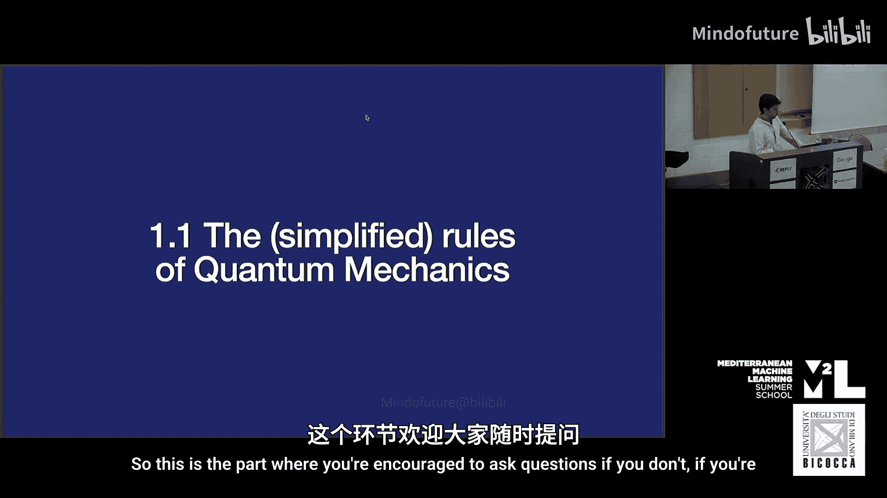

量子力学已有近百年历史，其理论框架在1927年的索尔维会议上基本确立。然而，直到20世纪80年代，人们才开始思考利用量子力学系统进行计算。核心思想在于，自然系统能够快速演化量子态，因此我们可以利用它们来模拟其他量子力学对象。

量子计算领域在1995年左右取得了重要进展，出现了两个著名算法：**格罗弗算法**和**肖尔算法**。格罗弗算法能够以平方根级别的优势加速非结构化搜索。肖尔算法则展示了如何高效进行因式分解和求解离散对数问题，这对许多经典加密原语构成了挑战。

## 量子力学简化规则

在深入量子机器学习之前，我们需要建立一些基本术语和直觉。

### 量子比特与叠加态

经典计算的基本单位是比特，其值为0或1。量子计算的基本单位是**量子比特**。与经典比特不同，一个量子比特可以同时处于0和1的**叠加态**。

从数学上看，一个量子比特是一个二维复向量空间中的向量。我们选择计算基矢，通常表示为 |0⟩ 和 |1⟩。一个通用量子比特的状态可以表示为这两个基矢的线性组合：

**|ψ⟩ = α|0⟩ + β|1⟩**

其中 α 和 β 是复数，称为振幅。由于测量概率与振幅的平方相关，因此状态向量必须具有单位范数：**|α|² + |β|² = 1**。

当我们测量一个量子比特时，我们只会得到0或1，其概率分别为 |α|² 和 |β|²。测量行为会“坍缩”量子态，使其变为所测得的基态。

### 多量子比特系统与纠缠

对于n个量子比特的系统，其状态存在于2ⁿ维的希尔伯特空间中。基态是单个量子比特基态的张量积，例如 |00⟩， |01⟩， |10⟩， |11⟩。通用量子态是这些基态的线性组合。

**纠缠**是量子系统的一种特殊关联。当一个多量子比特系统的状态不能表示为各个量子比特状态的张量积时，我们就说这些量子比特是纠缠的。例如，状态 **(|00⟩ + |11⟩)/√2** 就是纠缠态。测量其中一个量子比特会立即决定另一个量子比特的状态，无论它们相距多远。

### 量子演化与测量

量子态通过**酉操作**进行演化。酉矩阵是保持向量范数的矩阵，可以看作是复向量空间中的旋转。量子算法本质上就是一系列酉操作。

测量是获取量子系统信息的唯一方式，但它具有破坏性且信息不完整。你无法通过单次测量获知完整的量子态振幅。

## 量子计算的能力与局限

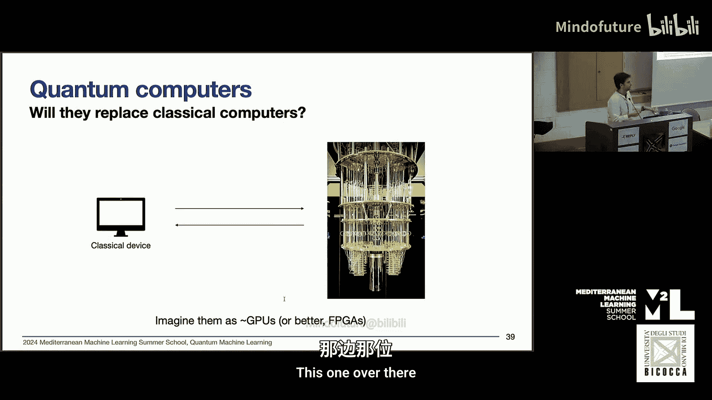

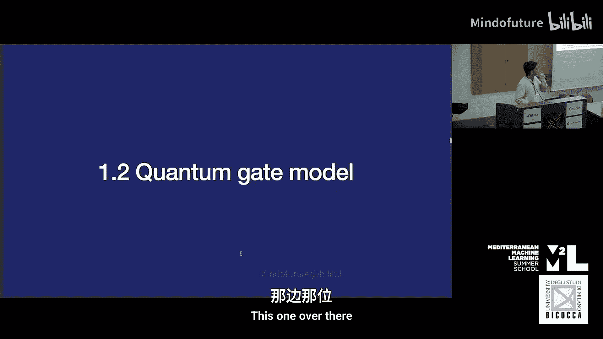

一个常见的误解是量子计算机强大是因为它可以“同时探索所有路径”。虽然量子态确实可以处于所有可能基态的叠加中，但问题在于信息提取。

考虑在一个无序数据库中搜索特定项（“大海捞针”问题）。经典计算机在最坏情况下需要检查所有N个条目。量子计算机可以制备一个包含所有可能输入的均匀叠加态，并通过一次查询将解标记出来。然而，直接测量得到解的概率极低（1/N）。**格罗弗算法**通过巧妙地应用酉操作，能够将成功概率放大，从而仅需大约 **√N** 次查询即可找到解，实现了二次加速。

这表明，尽管量子并行性存在，但由于测量的限制，我们无法总是获得指数级加速。此外，量子态不可克隆，每次测量后都需要重新准备状态。

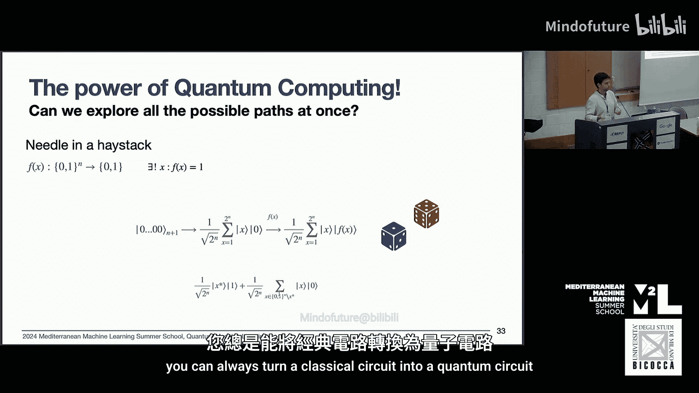

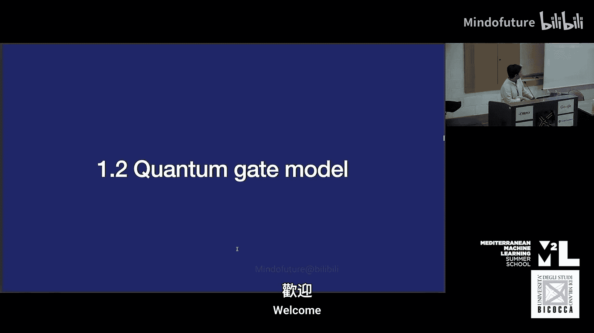

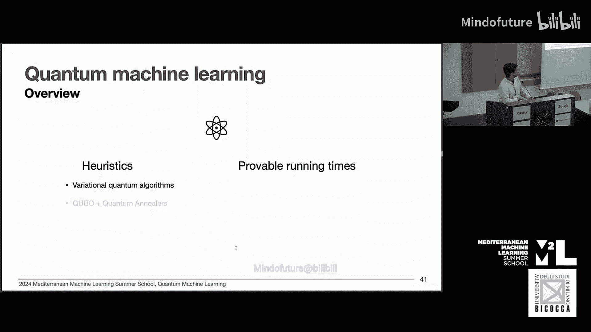

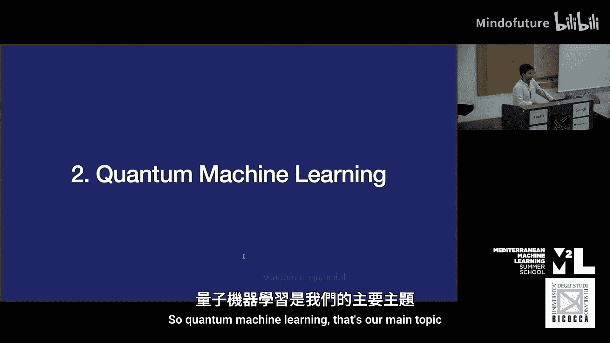

## 量子计算模型与复杂度

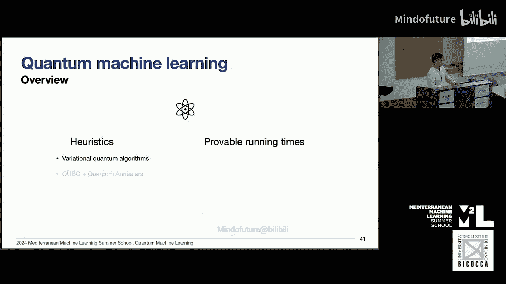

对于计算机科学家而言，我们需要知道如何用物理操作实现这些数学概念。**量子门电路模型**提供了这样的框架。

以下是量子计算中的基本门：
*   **单量子比特门**：如泡利-X门（量子非门）、哈达玛门（H门，用于创建叠加态）。
*   **多量子比特门**：如受控非门（CNOT门，用于创建纠缠）。

通过组合一组通用的量子门，我们可以近似实现任何酉操作。量子算法的复杂度通常通过所需**量子门的数量**或**电路的深度**来衡量。另一种抽象度量是**查询复杂度**，即调用某个黑盒函数的次数。

量子计算机能取代经典计算机吗？答案是否定的。量子计算机可以模拟任何经典计算机，但并非所有任务都更快。量子操作本身可能更慢，且量子比特容易受到噪声干扰而退相干，需要复杂的纠错机制。量子优势体现在针对特定问题（如因式分解、某些线性代数问题）的渐进性加速上。

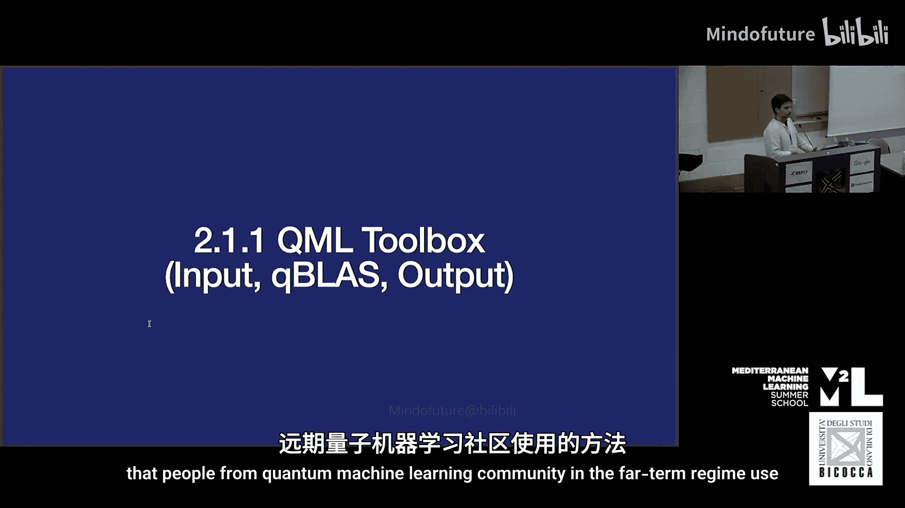

## 量子机器学习算法概览

量子机器学习算法主要分为两大类：

1.  **具有可证明运行时间的算法**：从算法角度出发，旨在为机器学习任务提供理论上的渐进性加速保证。这类算法通常基于量子线性代数。
2.  **变分量子算法**：一种启发式方法，类似于经典深度学习，使用参数化的量子电路，通过经典优化器调整参数以最小化损失函数。理论保证较少，但更适合近期有噪声的量子设备。

## 量子机器学习工具箱

要构建量子机器学习算法，我们需要一系列基础模块。

### 数据编码

将经典数据加载到量子态中是第一步。主要有三种方式：
*   **基态编码**：直接将n位经典比特串编码到n个量子比特的基态上。例如，比特串“101”编码为 |101⟩。
*   **振幅编码**：将一个长度为N的经典向量 **v** 的各个分量编码为一个 **log₂(N)** 个量子比特的态的振幅中：**|ψ⟩ = Σᵢ vᵢ |i⟩**。这实现了数据的指数压缩。
*   **块编码**：将一个矩阵 **A** 嵌入到一个更大的酉矩阵 **U** 的左上角块中：**U = [[A, ·], [·, ·]]**。这允许我们通过调用 **U** 来间接对 **A** 进行操作。

### 量子存储

理想的工具是**量子随机存取存储器**。QRAM允许以叠加态查询地址，并返回相应数据的纠缠态。其查询深度可以是对数级的，但初始化的成本通常与数据大小成线性关系。QRAM是实现上述编码方式的关键。

### 量子线性代数例程

基于HHL算法求解线性系统的思想，发展出了一套量子线性代数工具包，包括：
*   矩阵求逆。
*   矩阵向量乘法。
*   奇异值变换：一种强大的框架，可以对嵌入矩阵的奇异值施加任意函数变换（如求逆、阈值化等）。

### 信息提取

最终我们需要从量子态中读出经典信息。常用技术包括：
*   **振幅估计**：以优于经典蒙特卡洛方法的速度估计某个量子振幅的大小（即概率）。
*   **取样**：从量子态对应的概率分布中抽取样本。

## 算法示例：量子特征脸

让我们通过一个简化例子——量子版本的特征脸算法，来感受量子机器学习算法的构造思路。该算法用于人脸识别。

经典算法步骤包括：数据中心化、提取前K个主成分、将数据投影到主成分空间得到权重向量，最后通过比较权重向量的距离进行分类。

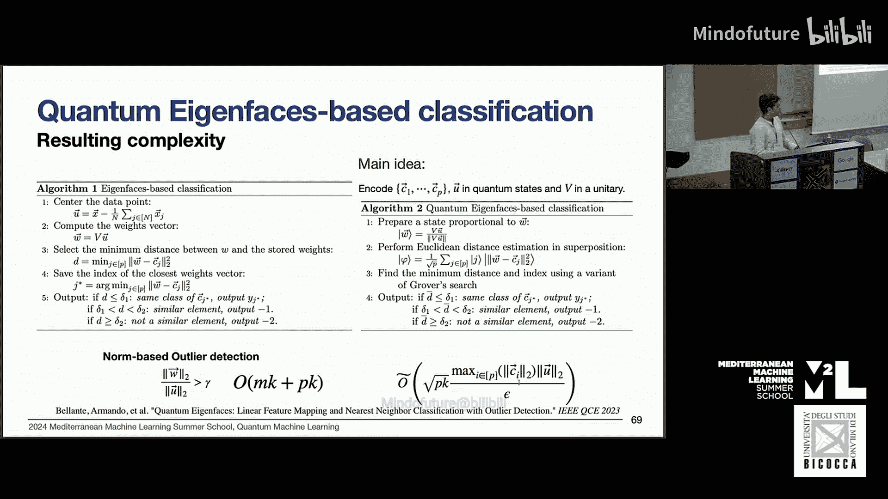

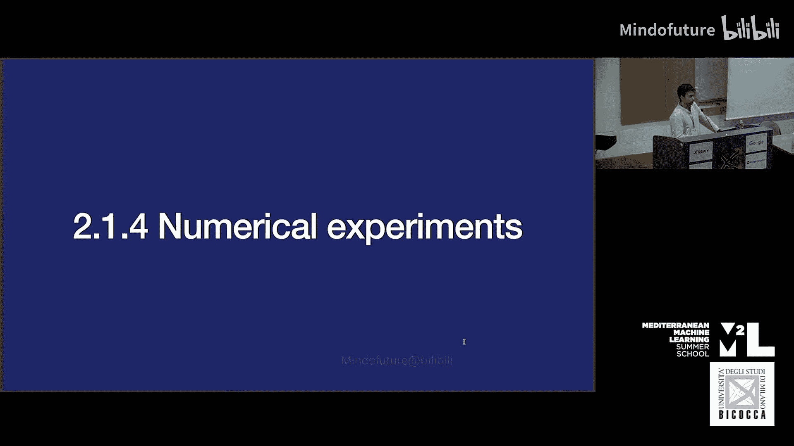

量子算法假设数据已通过QRAM以振幅编码形式存储。其核心思想是：
1.  利用**块编码**将主成分矩阵嵌入酉算子。
2.  设计量子电路，使得测量某个辅助量子比特得到“0”的概率，正比于待测数据投影到主成分子空间后的范数（用于异常检测）。
3.  设计另一个量子电路，使得测量概率正比于待测数据与训练集数据权重向量的内积（用于距离计算）。
4.  使用**振幅估计**来高效估计这些概率。
5.  最后，使用**格罗弗搜索**的变体，在训练集中快速找到距离最小的样本。

通过这一系列操作，量子算法可以在某些参数上（如训练集大小P）获得多项式甚至二次加速。然而，实际加速效果需要仔细分析误差容忍度、条件数等参数，并通过数值实验来验证。

## 变分量子算法

变分量子算法是为当前有噪声的中尺度量子设备设计的。其核心是**参数化量子电路**，也称为**拟设**。

工作流程是混合式的：
1.  经典优化器选择一组参数。
2.  将这些参数发送到量子计算机，运行对应的参数化电路。
3.  量子计算机通过多次测量，计算出某个期望值（如能量、分类得分）。
4.  该期望值作为损失函数值返回给经典优化器。
5.  经典优化器更新参数，重复过程直至收敛。

这种方法类似于训练神经网络，但面临着独特挑战：
*   **贫瘠高原**：随着系统规模增大，损失函数的梯度可能指数级减小，使得训练变得困难。
*   **局部极小值**：优化景观复杂，容易陷入局部最优。
*   **噪声影响**：硬件噪声会扭曲损失函数景观。

研究前沿包括设计具有**几何先验**（如平移对称性、置换等变性）的拟设，这被称为几何量子机器学习。这类结构可以抑制贫瘠高原，更快地达到过参数化状态，并可能带来更好的归纳偏置。

## 总结

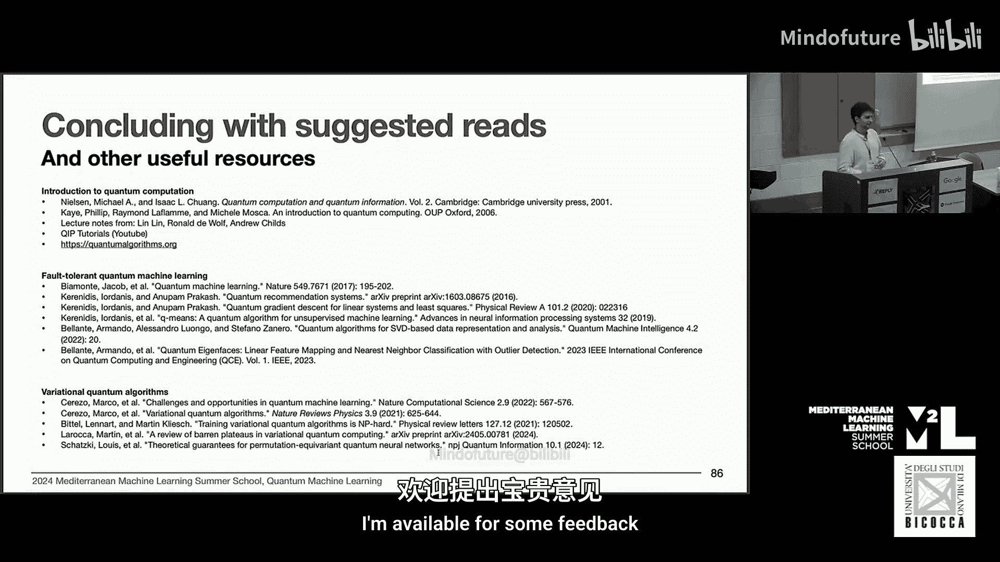

本节课我们一起学习了量子机器学习的基础。我们从量子比特、叠加、纠缠和测量等核心概念出发，理解了量子计算的基本原理和能力边界。接着，我们探讨了量子机器学习的两大路径：一是基于量子线性代数、具有可证明加速的算法，二是适用于近期设备的变分量子算法。我们还了解了数据编码、量子存储等关键模块，并通过一个案例浅析了量子算法的构造逻辑。最后，我们指出了变分算法面临的挑战和当前的研究方向。量子机器学习是一个充满潜力但尚在发展的领域，其实际优势的实现依赖于量子硬件的进步和算法的持续创新。