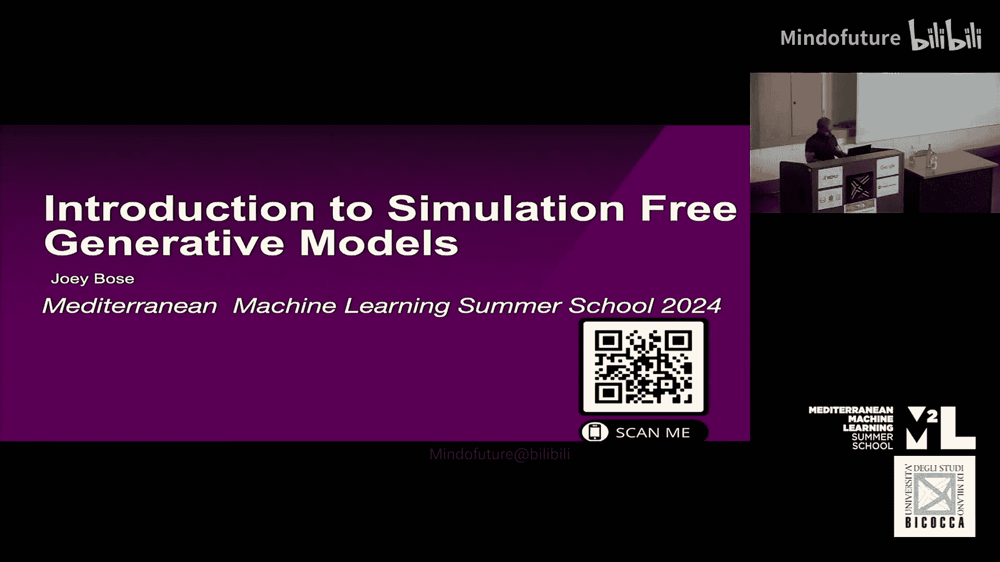

# 007：无仿真生成模型入门




在本节课中，我们将学习现代生成模型的基础知识，特别是被称为“无仿真生成模型”的类别，这包括了扩散模型、流匹配模型等。这些模型是当前许多先进生成式AI的核心框架。我们将从离散扩散模型开始，逐步深入到连续时间模型，并探讨它们在科学领域的应用。

## 生成模型概览 🧠

当我们谈论生成模型时，可以将其分解为三个核心组成部分：**模型本身**、**学习方法**以及结合两者的**算法**。这就像一个“生成模型汤”，不同的配料会带来不同的风味。

例如，模型类别包括你可能听说过的**GAN**、**VAE**和**扩散模型**。过去，这些模型常常面临“生成模型三难困境”，需要在不同特性间权衡。但近年来，扩散模型因其在大规模应用中的出色表现，使得这种困境变得不那么突出。

我们讨论的通用设置是：生成模型处理数据，有时数据带有噪声。我们希望在欧几里得空间 **R^N** 中表示这些数据，并建模其经验数据分布。这个数据分布就是我们的训练集。

## 模型类别与学习原则 📚

有多种模型类别可供选择。最明显的一类是**完全观测模型**，例如自回归模型。它们直接对数据的联合分布进行建模，其优势在于允许因式分解，从而可以计算显式的对数似然。然而，其缺点是生成时需要顺序采样，速度可能较慢。

另一类是**隐变量模型**，它假设存在未知的隐变量 **Z** 来生成观测数据 **X**。这类模型的优势在于可以快速采样，且没有顺序依赖性。但学习过程通常更困难，并且不总是能获得显式的似然。

在学习原则方面，过去人们探索了许多方法，如最大似然估计、期望最大化、变分方法等。如今，**最大似然估计** 因其良好的可扩展性而成为主流驱动方法。

最大似然估计的目标是最大化观测到数据集的概率，并拟合模型参数 **θ**。对于自回归模型，这对应着像LLM这样的模型。当我们将模型与学习原则结合时，就得到了具体的算法。例如，隐式生成模型加上双样本检验就得到了GAN；自回归模型加上最大似然就得到了语言模型。

## 去噪扩散概率模型 🌀

上一节我们介绍了生成模型的基本框架，本节中我们来看看**去噪扩散概率模型**。你可能已经使用过这类模型，但可能不了解其数学细节。

扩散模型概览包含两个过程：**前向过程**将数据通过逐步添加噪声进行破坏，直到最终只剩下无结构的噪声；以及与之严格对应的**反向过程**，它将噪声带回到原始数据分布。

生成建模或学习扩散模型的目标，就是在给定一个预设的前向过程下，学习这个反向过程。扩散模型与其他模型的一个关键区别在于，前向过程是**不可学习的**，这没有问题，因为我们只需要学习反向过程。

### 前向过程

在 **R^N** 或图像的情况下，前向过程是逐步添加高斯噪声。我们添加足够多的噪声，经过有限的时间步 **T** 后，最终得到一个标准正态分布 **N(0, I)**。

这个过程由**转移核**驱动，它将时间步 **t-1** 的噪声图像带到时间步 **t** 的更嘈杂图像。我们通过分布 **q(x_t | x_{t-1})** 来形式化这个转移核，它由以下正态分布给出：

```
q(x_t | x_{t-1}) = N(x_t; √(1-β_t) * x_{t-1}, β_t * I)
```

其中，均值以先前时间步 **x_{t-1}** 为中心，**β_t** 是一个随时间递增的方差或噪声调度表。为简化起见，我们假设 **β_t** 是用户指定的，目前不是一个有趣的参数。

关键约束是：在时间 **t=0**，我们必须从试图建模的原始数据分布开始；在时间 **t=1**，我们从标准正态分布采样。对于离散时间版本的扩散模型，我们假设时间被离散化为有限步数 **T**。

### 无仿真采样

问题是，如果给我一个干净的数据点 **x_0**，如何生成噪声样本 **x_t**？朴素的方法是顺序添加一点高斯噪声，但这很浪费。本课程的核心“无仿真生成建模”探讨的是如何在不实际模拟扩散过程的情况下得到噪声样本。

由于我们使用高斯转移核，可以反向展开这个过程。定义 **α_t = 1 - β_t**，以及 **\bar{α}_t = ∏_{s=1}^{t} α_s**。通过展开，可以将 **x_t** 重新表达为仅关于原始干净样本 **x_0** 的函数：

```
x_t = √(\bar{α}_t) * x_0 + √(1 - \bar{α}_t) * ε, 其中 ε ~ N(0, I)
```

这意味着我们可以直接从分布 **q(x_t | x_0)** 中采样，而无需采样中间步骤。这非常重要，因为它避免了昂贵的前向过程仿真。

### 学习反向过程

扩散模型的主要目标是学习与前向过程相关的反向过程。为了反向进行，我们需要定义反向转移核 **q(x_{t-1} | x_t)**。根据贝叶斯规则，可以将其表达为后验分布。但问题在于分母中的边际项 **q(x_t)** 难以计算，因为我们的数据是经验采样，而非真实的密度分布。

然而，如果我们能访问这个转移核，就可以反向模拟随机微分方程来生成图像。视觉上，这就是从一些噪声开始，逐步反向模拟时间，最终得到一个干净样本 **x_0**。

由于边际项难以处理，我们采用另一种方法：假设前向过程中的方差 **β_t** 足够小，那么反向转移 **q(x_{t-1} | x_t)** 可以很好地用另一个高斯分布来近似。这样，我们就可以用另一个参数化模型 **p_θ** 来拟合这个高斯分布。

我们将其参数化为一个高斯分布，并简单地对均值进行参数化。因此，扩散模型试图学习的就是这个反向转移的均值。反向过程也定义为一个过程，它从标准正态分布 **p(x_T) = N(0, I)** 开始，在每个中间步骤，我们尝试学习一系列高斯分布，其均值由一个参数网络给出，该网络接收噪声样本 **x_t** 和时间索引 **t** 作为输入。时间索引很重要，因为它允许我们在所有时间上“分摊”这个过程。

### 训练目标

如果我们检查反向过程，并假设从一个特定样本 **x_0** 开始，我们可以写出以 **x_0** 为条件的反向后验 **q(x_{t-1} | x_t, x_0)**。这个条件至关重要，因为它告诉我们是从这个样本开始的。

可以证明，这个后验也是一个高斯分布。扩散模型的目标是匹配这个后验分布的均值 **\tilde{μ}_t**。由于 **q** 和 **p_θ** 都是高斯分布，最小化它们之间的KL散度简化为均值之间的回归目标：

```
L = E[|| \tilde{μ}_t(x_t, x_0) - μ_θ(x_t, t) ||^2 ]
```

这是一个**每时间步的损失**，意味着我们可以独立采样一个特定的时间步，计算噪声样本 **x_t**，然后尝试学习这个高斯分布的均值。忽略与梯度计算无关的常数，这就是扩散模型所做的一切：一个回归目标，在每个时间步独立回归，并按方差平方或其他加权常数进行缩放。

因此，这提供了一种非常自然的扩展方式，因为在学习的任何时候都不需要实际模拟前向或反向过程。我们可以独立地采样时间。

### 噪声预测参数化

因为我们试图匹配高斯分布的均值，也可以考虑其他有趣的参数化方式。例如，我们可以参数化神经网络为**噪声预测网络**。可以将高斯均值重新表达为 **α_t** 的函数，并引入一个新的网络 **ε_θ**，它试图预测添加了多少噪声。损失函数可以重写为去噪的形式：

```
L_simple = E[|| ε - ε_θ(√(\bar{α}_t) * x_0 + √(1-\bar{α}_t) * ε, t) ||^2 ]
```

现在你预测添加了多少噪声。所有改变的是损失函数前出现了一个新的缩放常数。这个缩放常数控制着你优化的是哪些特征。对于图像，恰好可以去掉缩放常数，设为1，结果在生成高质量图像方面表现很好。这在文献中被称为**简化扩散目标**。

### 训练与采样算法

以下是训练算法的步骤：
1.  从数据分布 **q(x_0)** 中采样一个数据点 **x_0**。
2.  在 **0** 到 **T** 之间均匀采样时间 **t**。
3.  采样噪声 **ε ~ N(0, I)**，用于构建噪声样本 **x_t = √(\bar{α}_t) * x_0 + √(1-\bar{α}_t) * ε**。
4.  将 **x_t** 和 **t** 输入网络 **ε_θ**，计算损失 **L = || ε - ε_θ(x_t, t) ||^2**，并计算梯度。

这极其简单。如果你长时间足够多次地执行此操作，就会学会一个扩散模型。

生成样本时，不幸的是，必须通过模拟进行。这是因为你需要从标准正态分布 **x_T** 开始，然后逐步去噪。这是扩散模型的一个缺点：在推理时，你需要模拟这个反向轨迹。不过，最近的研究已经致力于通过学习更快的求解器来加速推理。

### 网络参数化

在实践中，最基本的参数化是使用一个U-Net，你输入噪声样本 **x_t**，同时也输入时间概念，时间通常通过正弦嵌入进行编码，并馈送到U-Net的每一层。本质上，U-Net预测 **ε** 或充当去噪器。这是一个非常简单的参数化。

## 基于分数的生成模型 🎯

上一节我们深入探讨了扩散模型，现在让我们完全切换视角，讨论一种非常相关的生成模型——**基于分数的生成模型**，稍后我们会将两者统一起来。

基于分数的生成模型与扩散模型有相同的设置：试图在欧几里得空间 **R^N** 中对一些数据进行建模，并拥有N个样本的数据集。

基于分数模型的一个关键区别在于，你可以访问一个**能量函数**，或者选择将模型参数化为这个能量函数。这个能量函数接收数据点并输出一个标量值。关键点在于，这个能量函数诱导出一个**玻尔兹曼分布**：

```
p_θ(x) = exp(-E_θ(x)) / Z
```

其中 **Z** 是归一化常数。这是一个有效的概率分布。如果你查看其对数似然或所谓的**斯坦分数**，分数就是关于数据的梯度：

```
∇_x log p_θ(x) = -∇_x E_θ(x)
```

这非常有趣，因为它减少了对模型参数化的约束。例如，模型在这里不必是可逆的。

### 几何动机与学习

问题是，如何从这个分数构建生成模型？想法是：如果你能在空间的每一点匹配分数，那么从几何上看，分数告诉你在概率空间中上升的方向，以便达到分布的一个模式。因此，如果你能在空间的每一点掌握数据分数，就可以沿着这个向量场前进，直到得到一个样本。

然而，这个形式化存在一个问题：在实践中，我们无法访问这个数据分数。原因与扩散模型相同：我们无法计算 **p(x)**，因为 **x** 来自训练集的经验分布，没有确切的密度。

因此，我们将从扩散模型中汲取灵感，学习一个**去噪分数**。在介绍如何学习之前，我们先快速了解一下数据分数的几何动机：空间中的每个点都可以附加一个小向量，它告诉你想要遵循的方向，直到达到分布的一个模式。

### 去噪分数匹配

一个关键的创新是**去噪分数匹配**的想法。我们将用有限噪声尺度的高斯核来扰动干净数据，并为每个噪声尺度学习这个去噪分数。为此，我们必须构建数据的边际分布。这个边际分布就是你从数据分布中采样，然后向其添加高斯噪声。

如果你这样做，结果证明你能在空间中获得最优覆盖。因为由于高斯扰动，密度会扩散开来。如果你估计这些点中每一点的分数，就总有一个向量场可以遵循。

在实践中，我们取这个去噪核的分数，并尝试匹配它。之所以可能这样做，是因为当你添加高斯噪声时，对这个分数有一个非常好的闭式表达式。梯度 **∇_x log q_σ(x̃ | x)** 简单地是 **-(x̃ - x) / σ^2**。

与传统的分数匹配情况不同，去噪分数恒等式在这里给了你明确的分数访问权限，并为你提供了一个可行的回归目标。

因此，这里的步骤是：采样一个数据点 **x**，向其添加一些噪声，然后尝试在每个噪声级别拟合分数估计或分数网络。如果你这样做并拥有一个完全训练的分数网络，实际上就可以沿着向量场反向进行。

### 采样过程

采样过程是：遵循这种随机微分方程，我们迭代地遵循对数数据密度的梯度，并添加一点噪声以保证一定的随机性。如果你运行这个过程足够长时间，保证会从数据分布中命中一个样本。当然，我们无法访问这个实际的分数函数，所以我们将用我们学习的分数函数（神经网络）来替换它。

在实践中，采样看起来就是：取你的分数网络，遵循它一小段时间，添加一点噪声。这就是基于分数的生成模型进行采样的全部。视觉上，粒子慢慢收敛到实际的模式。

## 统一视角：连续时间扩散模型 ⚙️

现在，我想再次切换视角，向你展示离散时间扩散模型和基于分数的生成模型实际上是同一回事。我们可以通过将扩散模型视为**随机微分方程**来理解这一点。

之前我们说，在扩散模型中，我们会取离散数量的时间步。如果你让时间趋于无穷，时间离散化变得无限精细，那么扩散模型实际上就是随机微分方程。

具体来说，一个SDE有两项：漂移系数 **μ** 和扩散系数 **σ**。漂移系数对应于轨迹的均值，扩散系数告诉你围绕该均值添加了多少噪声。**B_t** 是布朗运动，可以简单地认为是该点的时间相关高斯噪声。

这个SDE视角为我们提供了什么？它为什么与常微分方程不同？区别在于，ODE的求解方式是通过迭代解进行，而SDE也有一个迭代解，但你还必须添加噪声项。


如果我们将扩散模型带到这个噪声时间极限，它们看起来像什么？这里显示的随机过程正在破坏图像，这是前向过程。我们试图在结束时再次达到一个模式，即标准正态分布 **N(0, I)**。在结束时，我们注意到它几乎没有结构。

就像在离散时间DDPM中一样，我们想要学习对应于这个随机过程的反向扩散过程。幸运的是，因为我们有一个非常好的SDE形式，早在1982年Anderson就证明，你只需要**分数函数**。这正是我早先展示的基于分数的生成模型中的相同分数函数。

这两个SDE是联系在一起的。对于上述形式的每个前向SDE，都有一个对应的、唯一的反向扩散SDE，它具体取决于这个数据分数和另一个时间反转的布朗运动项。这意味着，如果你学习了连续时间的分数函数，实际上就拥有了一个连续时间扩散模型。

那么如何学习分数函数呢？正如提到的，可以通过去噪分数匹配或其他方式。但与之前的关键区别在于，我们首先均匀采样时间，然后添加转移，然后在每个时间尺度匹配它。还有一个加权项 **λ**，但就像扩散模型一样，**λ** 控制你想赋予各种特征的权重。

从某种意义上说，大多数连续扩散模型只是在做这件事。如果你学习了分数，反向扩散过程与前向过程有非常相似的特点：我们从无结构噪声开始，最终得到不同的干净图像。你可以看到轨迹的均值慢慢收敛到分布的模式，但布朗运动增加了许多随机性，这允许你采样许多不同的多样化事物。

## 流匹配模型 🌊

我想再次切换视角，介绍或许是我最近最喜欢的生成模型类别——**流匹配**或**基于流的生成模型**。它们与扩散模型非常相似，因为它们也是无仿真的，但要让它们无仿真，我们需要做一点工作。

像之前的所有幻灯片一样，我想做一点设置。但这次设置略有不同：我们拥有通常的数据 **x ∈ R^N**，但也有一些隐变量 **Z**。我们想学习这个**双射函数**，即从 **R^N** 到 **R^N** 的可逆函数。

如果你学习这个双射函数，可以问它如何对分布进行操作。如果你取一个随机变量 **Z** 并对其样本应用函数 **f**，输出分布或相应的分布是什么？事实证明，因为函数是可逆的，输出分布通过概率密度的**变量变换公式**与 **Z** 上的初始分布相关联。

这个变量变换公式表达非常简单。我可以在代数上解释它在做什么，但我更愿意在几何上解释。假设你的初始数据分布是这个正方形，你的函数 **f** 将其映射到这里的矩形。因为我说这些小的矩形或正方形是概率，它们必须加起来为一。如果你选择一个特定的 **f**，矩形的形状就会受到限制。

在这个例子中，你的 **x** 是均匀分布 **U(0,1)**，将你映射到 **y** 的函数是一个简单的函数 **2x + 1**。如果你采用这个构造，最终会得到这种平行四边形。这个平行四边形本质上将你从一个空间带到另一个空间，这是由于你的函数 **f** 造成的扭曲空间。行列式项只是告诉你空间扭曲了多少，以便你可以通过拥有有效的概率密度来纠正它。

### 标准化流与连续标准化流

这就是**标准化流**。之所以称为标准化流，是因为它标准化为一个有效的概率，而“流”是因为你从一个概率分布“流”到另一个。如果你有一系列这些函数 **f**，你可以从一个易于采样的 **z_0** 开始，通过一堆 **f** 传递它，得到一个更复杂的样本 **z_k**。它们都通过变量变换公式相互关联，但每个函数应用一次。

在流匹配之前，构建这种标准化流的关键设计考虑是如何明智地选择你的函数 **f**，以便最终的对数行列式项易于计算。

就像在扩散模型中一样，如果你将离散时间或离散函数数量带到连续函数数量，会发生什么？事实证明，你会得到一个所谓的**连续标准化流**。连续标准化流本质上是一个常微分方程。你的时间步 **z_t** 的样本是你的 **z_0**，但现在你通过遵循这个函数 **h** 从时间 **t_0** 积分到 **t_1**。

因为它是常微分方程，根据构造它是可逆的。有一个对应的时间反向动力学，只是你之前积分的负值。它们都相互关联，因为你可以将其表述为这个ODE：**dz_t / dt** 就是一个ODE。因此，如果你有一个学习的函数 **h**，生成样本的方式就是沿着这个ODE正向（或更确切地说，反向）积分时间。

作为一个考虑，记住我们有作为SDE的扩散模型。连续标准化流只是一个ODE。它完全一样，你只需去掉 **G** 项并按不同的常数归一化，它本质上在做同样的事情。但流提供的一个关键好处是扩散模型无法提供的：你可以显式计算对数似然。扩散模型本身不能给你对数似然。

那么为什么扩散模型可能比连续标准化流更受欢迎呢？原因是它们**训练时是无仿真的**。你不需要模拟整个过程来训练扩散模型。而我展示的流的当前公式，实际的对数似然项是必须发生的变量变换，而这个变量变换必须有这个积分。如果你必须在每个损失时间步都做这个积分，那将非常昂贵。这就是为什么CNF很难扩展的原因。然而，ODE通常有更容易的推理，因为你不必担心噪声，所以在数值上模拟ODE比SDE更容易。

### 流匹配：实现无仿真训练

一个自然的问题是：我们如何让CF变得无仿真？这就是整个**流匹配**思想的用武之地。

我们如何以无仿真的方式训练CNF？我们采用与扩散模型相同的原则。我们说，我们将前向ODE定义为一个概率路径，它从先验开始，将遵循一个ODE，该ODE也慢慢向数据添加噪声，直到你达到非结构化先验或完全噪声。学习的目标将是逆转这个过程。

就像扩散模型一样，这个前向过程或前向ODE将是不可学习的。它将被规定、固定。我们将只寻求学习反向生成过程。

为了给这个加上符号和术语，**概率路径**是时间相关的概率测度。**流**是一个函数 **φ_t**，它将你从数据空间带到另一个数据空间，并且是这个常微分方程的解。我希望你关注这个常微分方程中的关键思想或对象是右边的项，即这个**时间相关的向量场** **u_t**。另一个方面是你还必须满足初始条件。

关键问题是，我们如何学习定义这个ODE的向量场？人们可能会天真地认为，我们可以用一个学习到的模型直接回归到这个向量场。我们参数化一个模型 **v_θ**，称之为向量场网络，并希望直接回归到 **u_t**。不幸的是，就像扩散模型一样，我们不能天真地计算这个。原因完全相同：首先，可能不止一个边际向量场 **u_t**；其次，因为我们只有数据样本，我们实际上无法为此构建显式形式。

因此，我们将做的是构建**条件流匹配目标**。这个想法非常直观。我们选择一个点 **x_1**，选择一个点 **x_0**，然后说我们将定义 **x_0** 和 **x_1** 之间的最短路径。然后我们问，当我们以线性速度沿着这条路径行进时，向量场是什么？如果我在这条路径上选择一个随机点 **x_t**，并且说，如果 **x_t** 是一个以线性速度从 **x_1** 行进到 **x_0** 的粒子，对应的向量场是什么？

从几何上讲，这意味着 **x_t** 在时间 **t** 必须行进更多的时间，它必须行进的方向是 **x_t - x_0**。如果你将这个量除以时间，它对应于一个有效的向量场。如果你知道物理，位置的时间导数将给你速度。所以这里是一样的想法。你选择两个点 **x_1** 和 **x_0**，定义一条最短路径。因为你先验地选择了这些点，你知道如何构建最短路径。然后你对你的向量场有一个闭式解。这将是一个回归目标。

因此，之前的不可处理目标，如果你做条件流匹配，现在可以变得可处理，其中 **z** 本质上是条件于你路径的两个端点。奇迹般地，事实证明这两个目标具有相同的梯度。所以当你做这个条件流匹配的想法时，你一点也不会失去一般性。但很酷的是，第一个目标不可计算，第二个可以，并且它给你一个有效的学习目标。而且，如果你愿意，你总是可以通过边际化恢复目标无条件路径或目标无条件向量场。

### 流匹配的变体

在图片中，流匹配在做什么？流匹配有多种变体。第一个最明显的是由Aaron Lipman等人提出的。想法是，我们只条件于一个端点，然后希望有足够的时间能到达另一个端点。条件于两个端点的条件流匹配想法显示在中间图中。正如你所见，路径在性质上略有不同。因为你正在构建路径，它们保证能到达每个端点。

最后，因为你选择了路径并构建了路径，你可以控制路径是如何形成的。从某种意义上说，你可以做的是，你可以将路径优化为预处理步骤，以便它们在全局上是最短的。这意味着，与其选择两点之间的最短路径，你可以优化这个目标，使得在整个数据集上，你学习的所有路径在全局上是最短的。这恰好是流匹配的最优传输版本。

你可能想这样做的原因是，因为如果你有全局更短的路径，你的损失可能会有更低的方差。这就是流匹配的思想。它和扩散模型完全一样。一旦你学会了这个向量场，生成样本的方式就是反向模拟这个ODE。与扩散模型不同，你不必担心添加布朗运动或布朗噪声。

## 实际应用案例 🚀

以上是讲座第一部分的内容。现在我想谈谈，人们在实践中实际上用这些模型做什么？我们已经看到了图像、疯狂的视频生成、文本条件模型。但这个框架的通用性远不止于此，其美妙之处在于它适用于你可能想到的更多数据类型。

例如，我个人感兴趣的问题之一是**生成蛋白质**的想法。这里有一个学习蛋白质扩散模型的例子。右边是一个学习蛋白质流匹配模型的性质不同的例子。你会注意到你学习的轨迹类型在性质上是不同的，但模型本质上是相同的。在某种意义上，两者都具有同等的可扩展性。

类似地，流匹配的一个优点是，因为你选择了端点，你对起始分布有更多的灵活性。它不一定总是正态分布 **N(0, I)**，也可以是一个经验数据集。所以你可以直接进行条件图像插值。在这个例子中，我们模拟从狗到猫的转换，这是在某个稳定扩散模型的潜在空间中进行的。想法是，你想选择那些紧密反映真实情况的奇特轨迹。两列是在各种约束下的流匹配模型的两个不同实例。

你也可以处理点云或更几何的数据。你可以有直接穿过数据流形的路径，或者围绕数据流形的路径。流匹配框架的美妙之处在于，因为你控制路径，你可以告诉路径你的数据中的约束是什么，这样你就可以向数据添加约束，以便围绕已知结构进行变形。

类似地，这里有一个例子，说明如何更好地尊重数据流形。这是一个单细胞RNA的例子，本质上是一个时间演化过程，一个生物过程，是破坏性的。目标是，当你在时间上缺少快照时，学习这些轨迹。每种颜色代表不同天的观察结果。在实践中，你只有部分观察结果，缺少一些天数。生成建模的目标是重建这个缺失的轨迹。这确实是路径构造如何真正有用的一个例子，因为你可以选择更好地拥抱数据流形的路径。

最后，我想以我个人最喜欢的、即将到来的应用结束：扩散模型和流匹配模型也可以推广到**离散数据**。我不会给出如何做的例子，但我会留给你一个笑脸。本质上，它是在概率单纯形中生成这个笑脸，概率单纯形的每个角对应一个独热标记或某个词汇表，比如语言模型或某些离散值数据空间或分类分布。

## 总结 📝

在本节课中，我们一起学习了现代无仿真生成模型的基础知识。我们从离散扩散模型及其训练、采样算法开始，理解了其核心是通过回归目标学习反向去噪过程。接着，我们探讨了基于分数的生成模型，看到了如何通过去噪分数匹配来学习数据分布的梯度场，并用于采样。

然后，我们通过连续时间随机微分方程的视角，统一了扩散模型和分数模型，认识到它们本质上是相通的，都依赖于对数据分数（梯度场）的学习。最后，我们介绍了流匹配模型，它通过构建和匹配条件向量场，实现了在标准化流框架下的无仿真训练，并提供了更灵活的路径控制和可能性。


我们还看到了这些强大框架在蛋白质设计、图像插值、点云生成和生物时间序列建模等科学领域的激动人心的应用。这些模型的核心思想——学习一个将噪声转化为数据，或将数据从一个分布转化为另一个分布的（随机）动力学过程——为处理各种类型的数据提供了统一而强大的范式。