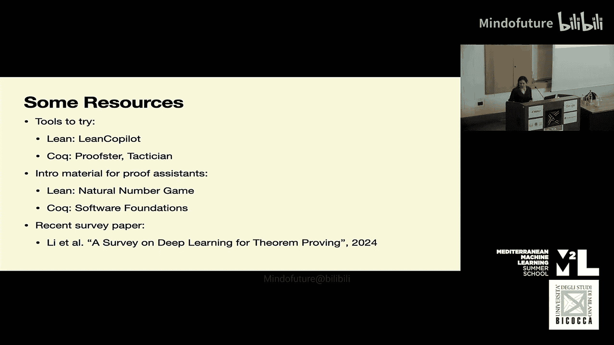

# 011：定理证明的机器学习

在本节课中，我们将要学习机器学习如何应用于定理证明。我们将从定理证明的基础概念开始，探讨其重要性，然后深入讲解如何利用机器学习技术来自动化证明过程，并分析该领域的最新进展与未来方向。

## 定理证明基础 🧮

定理证明，顾名思义，就是陈述一个定理并尝试证明它。我们在过去的数学课程中经常这样做。例如，一个定理可以是“加法满足结合律”。

我们可以更明确地写出结合律的含义：`∀ a b c, a + (b + c) = (a + b) + c`。

看到这个，我们可能立刻会想，根据基本代数，这显然是成立的，无需写出证明。但有时，我们可能被要求用归纳法写下证明，这感觉像是为正确性提供了严谨的论证。

然而，这仍然是我们认为的**非形式化定理证明**。要以形式化的方式进行，我们可以通过编程来实现：归纳地定义自然数和加法，陈述定理，并编写程序化的证明。

你可以在**证明助手**中完成所有这些，例如 Coq、Isabelle 或 Lean。这些工具允许用户进行交互式定理证明：他们陈述定理、证明它，并且证明会经过机器检查以确保正确性。

那么，这些证明助手是如何工作的呢？它们通常基于某种逻辑或类型论基础。在它们中证明一个定理，相当于应用形式化系统的规则，将目标（初始状态就是定理本身）逐步转化，直到它变得平凡。

虽然可以直接在证明助手的逻辑中证明定理，但这会非常困难且苛刻。因此，这些证明助手提供了高级的**策略**，如归纳法（`induction`）和自反性（`reflexivity`），来帮助引导证明过程。

## 为何使用证明助手？🔍

证明加法结合律是相当基础的内容，并不特别有趣。那么，为什么有人想使用证明助手呢？两个流行的应用包括**形式化数学**和**形式化验证软件**。

为了用证明助手形式化验证软件，程序员可以编写他们的软件，指定一个关于其软件属性的定理，并尝试证明他们的代码符合该定理。例如，他们可以定义一个列表数据结构，并编写像反转（`reverse`）这样的列表函数。

然后，他们可以尝试证明关于 `reverse` 函数行为的属性，例如：反转两个列表的连接等于第二个列表的反转与第一个列表的反转的连接。或者，甚至是一个属性：列表的反转的反转是原列表本身。

接下来，我将通过例子来说明形式化数学和形式化软件验证的力量，以激发你使用它们的动机。

## 形式化数学与软件验证的力量 💪

近年来，形式化数学在数学家中获得了一些流行，因为它可以帮助数学提供更严格的论证。证明可以被轻松检查，这对人类独自完成来说是极其困难的。有些人甚至设想未来提交给数学期刊的每个证明都附带一个形式化证明。

这个领域最近的一个成功案例是“液态张量实验”，其中 Schultz 在线提出了一个挑战，要求形式化一个关于凝聚实向量空间的定理。Kamein 和他的团队接受了挑战。许多本科数学内容已经在 Lean 证明助手中被形式化，存储在名为 **Mathlib** 的库中。这个形式化基础使得对这个关于复杂对象的复杂定理的形式化成为可能。

另一方面，使用证明助手进行形式化验证已被证明在实际生产更高质量软件方面是有效的。我们都认同软件中的错误是糟糕的。

例如，在 2011 年，一个名为 C Smith 的项目测试了三个 C 编译器：经过 Coq 验证的 C 编译器 CompCert 和两个行业标准编译器 GCC 和 LLVM。该项目发现，CompCert 是唯一一个 C Smith 无法找到任何错误代码错误的编译器。这是一个相当酷的结果。

虽然形式化验证不能保证完全没有错误，但深入思考代码、规范和证明的过程，相比于仅仅编写一些测试用例，能够产生更少错误的代码。

## 自动化证明的必要性 🤖

然而，可以预见的是，即使有交互式定理证明器的帮助，编写证明所需的努力对于软件验证来说往往是令人望而却步的。验证代码需要大量时间，并且证明的规模通常远大于代码本身。

例如，对于经过验证的 C 编译器 CompCert，其证明规模是编译器代码本身的八倍多，并且花费了三人年的工作量。同样，为了在 Isabelle 中验证一个 OS 微内核，编写证明脚本花费了 11 人年。

因此，由于验证的巨大开销，如今公司发布的所有软件几乎都是未经验证的。液态张量实验的成功也花费了两年时间，并且因为直接证明定理太困难，其工作被分成了两部分。

那么，作为程序员，我们通常如何处理困难的任务呢？我们会尝试自动化它们。在软件开发流程中，许多方面都可以通过自动化得到帮助，形式化数学也是如此。

但就本次讲座而言，我们将主要关注如何自动化证明的编写。目前在大规模基准测试上的评估，通常假设你已经完美地完成了大部分（如果不是全部）前期过程。这并不总是一个好的假设。

因此，我将首先介绍在没有自动化技术的情况下，在定理证明环境中编写证明是怎样的体验。然后，我将讨论已集成到证明环境中的自动化技术。最后，我们将探讨如何使用机器学习来模拟人类与证明系统的交互。

## 交互式证明环境体验 👨💻

想象一个程序员选择使用 Coq 证明助手，并希望编写一个证明脚本来证明某个定理（这里称为 `spec`），甚至可能是关于某个软件的属性。使用 Lean 或 Isabelle 证明助手将是类似的体验，只是策略名称可能不同。

在指定定理之后，他们以 `Proof.` 策略开始。Coq 会提供反馈，即当前的证明状态。这是一个为了示例而简化的视图。在这种情况下，有一个子目标，即定理本身，尚未被证明。

程序员可以检查证明状态，批判性地思考它，然后应用更多的证明策略来引导 Coq 解决目标。例如，我们看到目标中存在 `∀ n`。因此，程序员可以假设存在某个任意的 `n`，并应用 `intro` 策略来消除全称量词。

现在，我们看到自然数 `n` 在假设的局部上下文中。假设程序员想使用归纳法（`induction`）。这将使他们有两个目标需要解决：基础情况和归纳情况。

程序员可以继续应用策略来解决目标，直到最终没有更多目标剩下，然后他们可以应用 `Qed`，从而完成定理的证明。

这种来回交互有助于引导程序员找到证明。但你可以想象，对于非常复杂的证明，这可能相当耗费精力。

## 现有的自动化工具：Hammers 🔨

因此，有一些工具可以集成到这些证明助手中，也有完全使用基于约束求解的证明自动化的其他语言。事实上，我们稍后会看到，被称为 **Hammers** 的工具可以与机器学习方法互补，甚至成为其组成部分。

Hammers 在尝试“敲定”证明时，会调用 SMT 求解器。它们尝试在自己的逻辑中构建证明，如果成功，则将其翻译回证明助手的逻辑中。然而，它们无法推理诸如归纳法这样的证明方法，并且难以处理高阶逻辑。

因此，虽然它们有时很强大（例如，大约四分之一的 Coq 基准定理仅通过调用 Hammer 就能解决），但它们的能力受到很大限制。所以，基于机器学习的工具对于定理证明很重要，因为它们让我们能够超越这些一阶求解器，继续推动证明书写自动化方面的可能性。

基于机器学习的工具可以证明超过三分之一的 Coq 基准定理。因此，虽然改进有时看起来是渐进的，但它可能节省大量的努力。

## 定理证明对 AI 发展的重要性 🧠

如果所有这些还不够有说服力，那么还有一点需要注意：定理证明对于推进人工智能也很重要。

正如你之前听到的，我们正处于大语言模型的热潮中，它们已经在广泛的任务上展示了相当惊人的能力。具体来说，LLMs 已经证明它们能够处理非常困难的问题，例如生成代码，并展示了数学推理能力，特别是那些经过训练以解决定量推理问题的专业数学 LLM。

但是，虽然 LLMs 能产生好的答案，但挑战在于它们也会产生格式良好、令人信服的错误答案。例如，你可以尝试测试 LLM 生成的代码，但通过测试仍然可能不代表正确性。这使得在大多数领域难以可靠地使用 LLMs，也难以信任它们的输出。

然而，证明助手可能为这一挑战提供解决方案。记住，它们充当机器检查证明的“预言机”。如果 LLMs 生成了看起来令人信服但错误的答案，而你有一种方法可以形式化该输出并编写证明，那么定理证明器可以识别并标记那些错误的答案。同样，当生成许多候选证明时，它只会接受有效的证明。

这使得定理证明成为 LLM 使用的一个非常强大的领域，并且也许可以作为我们整体评估 LLM 推理能力的一个领域。

## 机器学习自动化定理证明概述 📋

本次讲座的其余部分将致力于讲解如何使用机器学习来自动化定理证明。

以下是接下来内容的概要。首先，我将介绍机器学习用于定理证明的基础知识，并展示一个将这些基础知识结合起来的例子。然后，我将探讨人们思考如何超越这些基础的一些方法，思考是否存在最佳方式，以及我之前展示的流程中的其他部分如何融入，特别是人类在其中扮演什么角色。毕竟，他们才是需要证明定理的人。

那么，让我们开始吧。

## 机器学习定理证明基础 🏗️

现有的工作已经构建了执行**下一策略预测**甚至**完整证明预测**以合成证明的模型。

通常，这些模型将**定理**、**当前证明状态**和一些**上下文信息**作为输入，并预测证明的下一步可能步骤。通常，你可以对前 K 个（例如三个）策略进行采样，然后使用证明助手来检查应用这些策略后产生的候选证明。

证明系统以更新后的证明状态形式提供反馈，并显示是否存在任何错误。因此，这再次体现了完整的交互性质。对于那些没有导致错误或重复证明状态的候选，如果状态显示没有更多目标需要证明，那么我们就成功地证明了定理；否则，我们继续将它们作为输入提供给模型以生成后续步骤。

为了提供一个不同的视角，这里是我们搜索树的起点，其中节点是应用策略后产生的状态，箭头是策略。在所谓的**元启发式搜索**中，模型使搜索偏向于可能的下一步。它可以是深度优先搜索、广度优先搜索等。我们继续搜索，直到我们的某个候选证明脚本没有更多目标需要证明，并且我们可以预测 `Qed`。

因此，这种方法在很大程度上取决于模型本身的好坏，因为是它在引导搜索。

## 获取高质量训练数据 📊

因此，尝试获得一个好模型的一种方法是获取高质量的训练数据。这些训练数据可以来自其他人证明定理的经验。对于我之前提到的三个证明助手 Isabelle、Coq 和 Lean，都有公开可用的数据，范围在 10 万到 30 万条定理之间，并且每个证明助手都有相关的人工编写的证明。

然而，不同的定理证明器有不同的社区支持，这导致了每个证明器可用的数据类型不同。例如，Lean 在数学社区中备受关注，并且有著名数学家的积极参与，因此那里有很多形式化的数学。而 Coq 则是软件验证的热门选择。

因此，研究人员决定为哪个证明器训练模型，有时会限制与先前工作的比较，因为他们基本上只能使用该证明环境的数据。不过，最近有一些努力旨在创建跨不同语言的基准测试，以允许进行更多此类比较。

一旦你选择了一个证明助手，你通常希望生成示例，以便以监督学习的方式训练你的机器学习模型。例如，查看 Lean 的 Mathlib4 库，假设这是一个定理及其人工编写的证明。那么对应的训练示例可以只是将定理作为输入，整个证明作为目标。

然而，这样做可能会错过可以从中学习的中间状态。因此，研究人员通常通过逐步运行人工编写的证明，并对齐当前状态和人类应用的下一个策略来提取数据。因此，由于大多数证明通常不止一步，如果你对 Mathlib 库进行数据提取，训练样本的数量会超过定理数量的两倍。

## 前提检索与模型输入 🔍

回到示例创建，我们知道证明环境中还有其他可能有用的信息可用于建模。例如，在目标序列中，你可以看到 `add_assoc` 和 `add_comm` 这样的引理。如果不将它们作为输入提供，模型将不得不“幻觉”出它们的存在。

因此，已经证明的引理和逻辑事实（有时称为**前提**）很有用，应该包含在输入中。我们可以在训练时使用真实的正例前提，但在测试时，我们需要一种方法来检索有用的前提。

前提检索可以使用稀疏或密集段落检索技术来完成。由于检索将在今天稍后的讲座中介绍，我不会花太多时间在这上面，只提供一些直觉。在证明环境中，仅仅通过导入不同的库，就可能存在成千上万的前提可用。因此，对于给定的证明状态，你希望检索对该证明状态最有用的前提。你可以训练一个编码器来处理正例和负例前提，编码所有前提，并编码证明状态，然后选择那些与证明状态具有最大余弦相似度的前提作为模型的输入。

其他工作还探索了训练所谓的**重排序模型**，因为优先考虑哪些前提能进入输入也很重要，因为有时输入空间有限。

## 模型架构的选择 🏛️

另一个有助于构建好模型的因素是合适的架构，以表示证明环境的不同方面，主要是证明状态、前提，甚至可能包括你当前正在处理的证明过程。

早期的工作始于 RNNs。其他工作使用了证明状态的底层抽象语法树表示，因此使用树状 LSTM 来表示它。最近的工作甚至使用了 GNNs，因为不同定义和引理之间的关系可以用图来表示（还记得之前那个大的依赖图吗？）。但最明显且最近被探索的是**Transformer**，特别是基于 Transformer 的预训练大语言模型。这再次证明了定理证明是 LLM 应用的一个好领域，并且正变得越来越流行。

## 搜索策略：最佳优先搜索 🔎

一旦我们有了一个模型，我们如何使用它在可能的证明空间中搜索呢？回想一下我们的搜索树，它可能很快变得难以管理。因此，朴素的广度优先搜索难以找到深度证明，需要一些优先级标准来平衡树的广度和深度。

因此，**最佳优先搜索**方法对于优先扩展树的哪些节点很有用。我们希望选择最有希望的未探索状态进行扩展。例如，这里是未探索的节点。在一个简单的最佳优先搜索实现中，我们可以使用从策略生成器沿路径累积的分数。对于每个预测，我们可以从模型中获得一个对数似然分数，然后使用沿路径的总和作为该特定节点的分数。

这些是一些基础知识。现在我将展示一个以这种方式实现了这些基础知识的工具。

## 工具演示：Lean Copilot 🛠️

这里是一个编辑器，它导入了 **Lean Copilot** 工具。右边显示的是证明状态。如果你从这里的一个定理中删除一个策略，并要求 Lean Copilot 建议一些策略，它会在右边给出一些建议，比如“试试这个”。我们看到，很好，这个策略确实有效，并且那个证明中没有更多目标了。

或者，你可以删除整个证明，并要求它搜索证明。哦，很好，它找到了一个。不过，有时当你尝试搜索时，它会给出一个错误，无法找到完整的证明。所以，也许你想提供一些你认为好的策略，比如你知道你想提供证明的某个前缀，然后要求它搜索其余部分。哦，它做到了，它能够完成。

为了了解每一步发生了什么，你还可以查找对该证明状态有用的前提。所以，右边是证明状态，底部是一些被模型认为与该证明状态相关的前提。是的，Lean Copilot 可以在线使用，我认为它是一个非常酷的工具。

## 超越逐步生成：完整证明与修复 🔄

那么，这是唯一的方式吗？我们能否超越这种方式？我们甚至可以问：我们真的需要搜索吗？

最近的工作表明，如果我们微调一个大语言模型来一次性预测整个证明（而不是逐步进行），并用证明助手检查这些证明，我们仍然可以做得很好。如果我们微调一个大语言模型来**修复**错误的预测，利用证明器输出的错误信息尝试生成新的证明，我们甚至可以做得更好。

这里的修复并不是你通常认为的修复（比如编辑某一行）。相反，它被视为一次完整的重新生成。因此，现在的生成过程以前一次失败的尝试和错误信息为条件。

## 利用非形式化推理与自动形式化 📝

我们甚至需要微调步骤吗？这些模型在推理方面似乎非常出色，以至于在某些任务中，**上下文学习**就足够了。此外，通过不同的提示框架，如**思维链**，我们经常尝试从 LLMs 中引出非形式化推理，以提升它们在许多任务中的性能。非形式化推理数据是它们训练数据的主要部分。它们可能在预训练中看到一些 Coq 和 Lean 证明的例子，但与非形式化推理和自然语言相比，这非常少。

就网上可用的数学数据而言，非形式化数学数据构成了可用数学数据的绝大部分。那么，为什么不利用这一点呢？对于一个非形式化陈述，生成一个非形式化证明对 LLM 来说似乎不是一个巨大的飞跃。而直接从非形式化一步到位生成形式化证明，似乎可能会在翻译过程中丢失很多信息。

通常，这种从非形式化到形式化的翻译被称为**自动形式化**。因此，最近的工作提出了一个中间步骤，称为**形式化证明草图**，其中有一些需要填补的“空洞”，这些空洞对应着非形式化推理往往含糊其辞的明确证明步骤。我们可以通过策划少量示例来生成这些证明草图。

让我们看看这个方法的实际应用。这里我们有 Draft, Sketch, Prove 方法，它实现了这种技术。它从一个 LLM 开始，通过少量提示非形式化地证明一个陈述。然后，通过少量提示之后生成形式化证明草图，将证明分解为不同的子目标。值得注意的是，这项工作是在 Isabelle 中完成的，它支持更具声明性的证明风格，因此往往更具人类可读性，无需运行证明并查看证明状态，实际上证明状态在 Isabelle 证明中是明确显示的。

这样，你所使用的证明助手语言实际上可能适合这种自动形式化技术。也许这种技术在不同的证明助手中不会那么有效，因为形式化和非形式化之间的对齐可能没有那么好。

最后，为了填补草图中的空洞，可以使用现成的证明器，比如我之前提到的 Hammer，或者其他基于机器学习的下一步预测工具。这例证了不同技术如何可以结合在一起，发挥各自的优势。

## 集成学习与在线学习 🤝

因此，这里展示了进行定理证明的多种不同方式，当然并非全部。这是一个快速发展的领域。有时很难判断哪种方式是最好的，特别是如果它们都在不同的基准上进行评估。

那么，我们如何确定哪种是最好的呢？实际上，在某种程度上，是否存在最好的方式甚至重要吗？我在这里要说，也许不重要。因为只要这些方法能证明不同的东西，你实际上可以把它们全部一起使用。

例如，假设你有多个不同的定理证明模型，每个模型都对给定定理进行自己的证明搜索。当你检查输出时，即使只有一个证明是正确的，证明助手每次都会挑出那个证明。所以，你的模型可以以不同的方式、在不同的数据上、使用不同的特征或超参数值、不同的搜索程序等进行训练，你可以从每个模型中获益最多。因此，定理证明也是**集成学习**的完美应用。

但是，与其广泛撒网并使用从他人证明中学习到的模型，定理证明中的另一种技术是使用**在线学习**来适应你的特定项目。

一个名为 **Tactician** 的 Coq 工具研究了不同的流行在线机器学习技术，例如用于在线近似 KNN 的局部敏感哈希森林和在线随机森林。这是为了更好地为特定项目合成证明。它通过选择已在项目中其他证明中使用过的策略来重用，从而实现这一目标。为了使这有效，你实际上已经需要编写一些证明。但也许它可以帮助你填补其余的证明。

## 自动化流程的其他方面：猜想与自改进循环 🔄

我主要关注的是证明生成这个狭窄的部分。但请记住，在你到达那一步之前，有一整套流程必须发生。关于这个流程，还有其他方面可以使用机器学习进行自动化，这些方面探索较少，但正在开始，这是令人鼓舞的，即**猜想**。

猜想的意思是，从你文件中的定义出发，你可以使用一个模型来猜想可能成立的定理，然后通过尝试证明它们或寻找反例来检查它们。有一些技术，如基于属性的测试，可以让你为给定定理找出反例，这样你就不会在证明上浪费时间。你甚至可以尝试猜想有用的辅助引理，这些引理可能有助于解开当前的证明。

大多数时候，直到你处于证明过程中，你甚至意识不到你需要一个辅助引理。因此，当前仅仅检索辅助引理的工具并没有考虑到在某些情况下这可能有多不现实。你可能直到那一刻才知道你需要一个辅助引理。因此，与其检索，你实际上必须合成。

猜想也可以作为在定理证明中训练更好模型的一种手段，因为你不需要依赖人工编写的训练示例。在一个名为 **Minimo** 的工具中，他们使用一个随机初始化的 Transformer 同时执行猜想和证明搜索。

对于猜想，他们使用类型导向的合成和约束解码，以确保猜想的定理在构造上是有效的。当找到一个证明时（证明搜索是通过蒙特卡洛树搜索完成的），它会生成数据来改进策略和价值函数（这是一种强化学习方法）。它还提供数据来改进猜想，因为它随后知道问题的难度。他们利用这一点在猜想和证明改进之间交替进行，形成一个自改进的循环。

## 游戏智能体方法：AlphaProof 🎮

探索游戏智能体方法的另一个例子是 Google DeepMind 的 **AlphaProof**。它将一个预训练的语言模型与 AlphaZero 强化学习算法相结合，该算法之前曾用于自学掌握国际象棋和围棋等游戏。

在这里我们看到，当他们尝试形式化非形式化数学问题时，一个求解器网络会搜索这些问题的证明甚至反证，并通过 AlphaZero 算法逐步训练自己解决更具挑战性的问题。这与猜想有相似之处，但这里你是在进行自动形式化：你有一些非形式化的东西，也许通过形式化过程，它可能变得不成立，因为你没有正确地形式化它，但你可以多次尝试，也许其中一些会成立。

结合他们的 AlphaGeometry 工具，它实际上在今年国际数学奥林匹克竞赛中获得了银牌级别的成绩，解决了六道题中的四道，这是自动化定理证明的一项相当令人印象深刻的成就。

## 人类在流程中的角色与工具设计 👥

回想一下，定理也可以类比于软件规范。最终，只有人类才能最终决定程序的期望规范是什么。不过，机器学习工具可能有助于从程序中推断规范，这对人类在检查那是否是期望的行为时可能有用。

说到人类，他们如何融入这一切呢？当你想到这个执行类似软件工程任务的人类证明工程师时，你可能会想，他们真的这么有纪律，按照这个顺序遵循开发步骤吗？因为我肯定不是这样写代码的。知道证明工程师也和我们一样，可能让你感到安慰：他们也不总是这样写代码。

一项案例研究发现，证明工程师在编写代码和证明时，会不断地完善和重构规范，并进行重复的修复。因为一个曾经有效的证明可能会因为规范演变甚至依赖项更新而失效。事实上，他们甚至可能从编写代码开始，然后才考虑生成定理。

因此，由于这种严格的顺序可能并不总是适用，那么开发能够很好地集成到从业者工作流程中的、基于机器学习的工具就至关重要，需要考虑他们如何在各个流程之间移动。这只有通过与证明工程师持续对话才能实现。我们不能孤立地进行研究，我们需要与他们一起进行研究。

因此，未来在这一领域取得有意义的研究进展，可能不仅仅取决于你的工具能证明给定基准中已经证明的定理的多少。而是你的工具如何作为协作者帮助人类形式化数学或验证他们的代码。

## 改进工具反馈：Proofster 示例 💡

说到协作者，我们提到了 Lean Copilot 工具，以及当它无法自动找到证明时，它并没有提供任何反馈来帮助用户，这有点令人失望。它只是说“做不到，抱歉”。

一个尝试思考其他类型反馈会有用的工具例子叫做 **Proofster**。它为证明搜索工具提供了一个前端 Web 界面。目前，它为名为 **Proverbot 9001** 的工具（一个用于 Coq 的基于机器学习的证明搜索工具，使用 RNNs，而不是花哨的 LLMs）提供了前端界面。

我将向你展示它的功能，以及它如何帮助调试这些失败的证明搜索。

这里，有人想证明关于列表的某个属性，但省略了证明本身。然后 Proofster 可以尝试完成它。当我们要求 Proofster 证明这个定理时，它也说“抱歉，我做不到”，但它不会让你空手而归。它提供了一个交互式搜索树。所以你可以看到在它的证明搜索中尝试了哪些策略。

这是树的起点，你可以点击蓝色的小节点来展开它们。查看这棵树，我注意到证明搜索尝试了对不同变量进行归纳，但它没有对正确的东西进行归纳。这是这些机器学习模型非常常见的失败模式。

所以我回去，给了一个提示，以我们之前看到的那种前缀形式，提示我们应该尝试对什么进行归纳，仍然将证明的其余部分留给 Proofster 完成。这一次，Proofster 能够正确地合成一个证明。主要的启示是：证明搜索树的交互式可视化可以帮助程序员理解搜索失败的原因。

因此，未来进一步研究机器学习方法的可视化以及对失败案例的分析可能会非常富有成果。

## 总结与要点 📝

本次讲座的主要要点是：
*   定理证明对于形式化数学和软件验证非常重要。
*   反过来，机器学习和人工智能对于定理证明也很重要，反之亦然。
*   在证明生成方面仍有许多改进空间。我在这里省略了很多结果，因为就目前的能力而言，它们并不十分令人印象深刻，这为进入该领域的新人可能取得的成就留下了很大空间。
*   关于整个流程，仍有许多方面需要考虑改进。
*   存在许多开放性问题，因此在这个领域工作有很多机会。

以下是一些资源，如果有人认为这是一个有趣的空间可以进入，可以查看：
*   **工具**：Lean Copilot, Proofster。
*   **入门材料**：学习如何实际使用证明助手，因为这对于为它们开发机器学习工具是必要的。
*   **综述论文**：现在有一篇关于深度学习用于定理证明的最新综述论文，并且由于新事物不断涌现，它已经很快变得有些过时了。

好了，如果有人有任何问题，我很乐意回答。谢谢。

