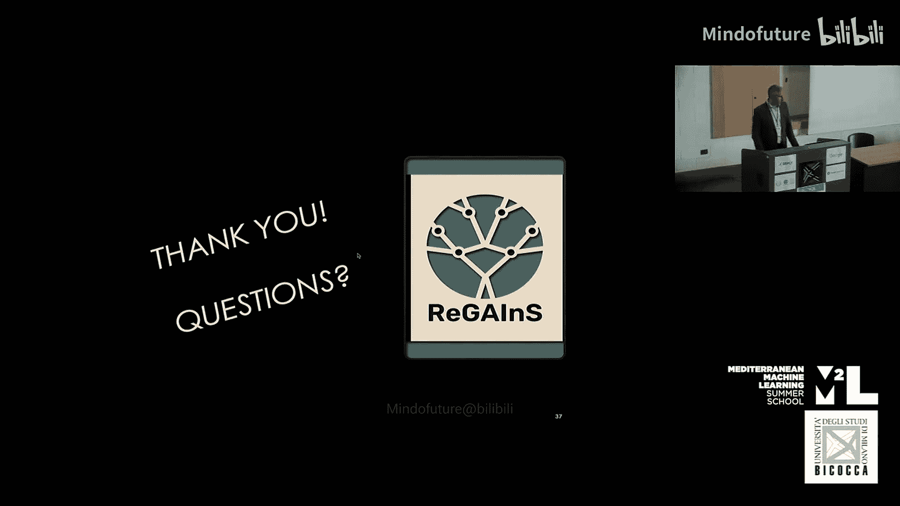

# 016：现状、应用与挑战

在本节课中，我们将探讨生成式人工智能（AI）如何深刻影响软件工程领域。我们将了解生成式AI在软件开发全生命周期中的潜在应用，并通过近期研究数据，分析当前技术在实际应用中的效果、面临的挑战以及未来的发展方向。

---

## 软件工程中的生成式任务无处不在

首先，我们需要理解为什么生成式AI与软件工程如此契合。在标准的软件开发流程中，充满了各种生成式任务。

以下是软件开发中常见的生成式活动：
*   **编写需求**：从与利益相关者的沟通中生成正式的需求文档。
*   **生成设计**：根据需求生成设计模型和文档。
*   **编写代码**：依据需求和设计模型生成可执行代码。
*   **撰写文档**：为代码、API或系统生成说明文档。
*   **生成测试**：基于代码或需求文档生成测试用例。

这些任务不仅单向进行，还可以在不同阶段之间跳跃和组合。例如，可以从代码反向生成设计模型，或者根据测试用例生成文档。正是由于软件工程中充斥着这类生成式任务，生成式AI才显得特别有吸引力，为我们带来了大量的应用机会和研究挑战。

## 生成式AI的承诺：自动化与增效

生成式AI的核心承诺在于，它有可能自动化或半自动化许多目前由人工完成的、复杂、耗时甚至重复的软件工程任务。

这适用于贯穿软件全生命周期的各种活动：
*   **需求工程**：AI可以基于已有需求，辅助生成或建议新的需求，提升需求获取的效率和完备性。它还能帮助评估需求文档的质量、识别问题，并分析需求变更带来的影响。
*   **代码生成**：这是当前最受关注的应用之一。AI可以根据自然语言描述、注释、测试用例等输入，自动生成或补全代码，协助开发人员提高编码效率。
*   **软件测试与质量**：AI可以用于自动生成测试用例。在发现软件缺陷（Failure）后，AI还能协助定位导致缺陷的故障（Fault）并自动修复程序。

总而言之，我们正在迈向一个愿景：软件工程师将定期与AI交互，以更高效、更有效的方式完成任务。这正是当前软件工程领域研究的焦点。

## 现状审视：从实际研究中看效果与挑战

既然这是未来的愿景，那么基于当前可用的技术，我们实际能做到什么程度呢？本节我们将通过一些已发表的研究，揭示生成式AI在软件工程任务中的实际效果和面临的挑战。

### 开发者实际如何使用AI工具

一项基于GitHub上约2000条提及使用ChatGPT的提交、拉取请求或议题的分析显示，开发者已在多种任务中使用AI工具。

以下是开发者使用AI工具完成的主要任务类型：
*   **实现功能**：辅助编写特定功能的代码。
*   **改进开发流程**：优化现有的开发过程。
*   **学习解决问题**：帮助理解未知技术或解决难题。
*   **操纵数据或环境**：处理数据或配置软件环境。
*   **生成测试**：自动创建测试用例。
*   **生成文档**：编写代码注释、提交描述等文档。

然而，反馈并非全是积极的。报告揭示了成功案例与现存问题。

**报告的成功案例包括：**
*   **语言翻译**：在完成跨编程语言翻译任务时非常有效。
*   **生成文档**：在生成代码注释和拉取请求描述等方面被广泛使用，提升了效率。

**同时，也暴露了诸多问题和挑战：**
*   **代码所有权模糊**：开发者可能在不完全理解AI生成代码的情况下将其提交，丧失了对代码的“所有权”和辩护能力。
*   **学习新知识效果有限**：当问题涉及较新的框架或库时，由于训练数据滞后，AI往往无法提供正确建议。
*   **推荐过时API**：生成的代码可能包含已弃用的API，因为模型是基于包含这些API的历史数据训练的。
*   **产生幻觉（Hallucination）**：AI可能推荐根本不存在的函数或代码，这需要开发者额外花费精力去甄别和修正。
*   **安全风险**：更严重的是，关于不存在软件包的幻觉可能被恶意利用。攻击者可以据此创建包含恶意代码的软件包，一旦该软件包被AI推荐，就可能造成安全威胁。

这些发现引出了第一个重大挑战：**如何让AI模型跟上快速发展的技术步伐，并有效应对幻觉带来的安全风险。**

### AI工具的可用性挑战

另一项针对400多名GitHub贡献者的调查，揭示了AI工具在可用性方面的具体挑战。

以下是当前AI工具在可用性上面临的主要问题：
*   **难以控制**：开发者不清楚AI具体参考了项目的哪些部分来生成建议，也难以通过提示词精确控制输出结果（如代码长度、风格），常常需要多次迭代。
*   **交互方式受限**：开发者期望更丰富的对话式交互，以更好地控制和调整输出。同时，处理AI生成的多个备选建议也缺乏有效的方法论。
*   **结果难以评估**：判断AI生成的推荐是否正确、是否最优非常困难。这导致许多开发者认为，有时自己动手完成任务的成本效益比求助于AI更高。
*   **隐私与版权担忧**：开发者担心提示词内容被不当使用，也不确定生成的代码是否涉及版权问题。
*   **缺乏个性化学习**：当前工具普遍缺乏根据开发者个人编码风格和工作习惯进行自适应学习的能力。

### 生成结果的正确性如何？

除了可用性，生成结果的正确性至关重要。然而，研究表明，当前技术在这方面的表现仍不理想。

**1. 代码生成任务**
在一项针对Java方法生成的研究中，研究者从GitHub选取方法，移除实现部分后让AI（如GitHub Copilot、Bard）补全。结果发现，**只有不到一半的生成代码是正确的**，且需要开发者投入大量精力检查和修复。对于依赖外部方法（需要更多上下文）的代码，生成效果尤其差。不同AI工具各有优劣，没有哪个工具能完全超越其他。

在另一项更大型的研究中，使用了来自GitHub和LeetCode的共200个方法，并系统测试了不同提示词特征（如是否包含示例、边界情况说明、方法摘要）的影响。结果显示，提示词方式对结果影响很小，仅有“提供摘要”和“提供示例”有轻微统计学意义的影响。更重要的是，**代码生成的正确率很低**（LeetCode方法约12%，GitHub方法约17%），且这仅是通过了现有测试用例的“正确”，尚未考虑安全性、性能等未测试的问题。

**2. 测试生成任务**
在单元测试生成方面，有研究训练Transformer模型来根据给定方法生成测试用例。虽然其生成的测试用例**可读性更好**，更像人工编写，有利于后续维护，但其在**代码覆盖率等方面的有效性**尚无法与传统的非AI测试生成工具相媲美。一个潜在的思路是结合传统工具生成测试骨架，再用AI提升其可读性。

**3. 测试预言（Test Oracle）问题**
测试生成中的一个核心难题是“测试预言问题”，即如何为生成的测试用例**自动预测预期结果**（即断言语句）。生成式AI为解决这一问题带来了希望。已有研究尝试用AI预测断言语句，但**正确率不高**（一项研究约31%，在更新数据集上甚至降至约10%）。这再次印证了技术快速迭代给AI模型带来的挑战。

---

## 总结与未来展望

本节课我们一起学习了生成式人工智能在软件工程领域的应用与挑战。

**总结来说，生成式AI确实正在成为软件工程领域的“游戏规则改变者”**。它提供了自动化众多复杂任务的潜力，这在学术界和工业界都引发了广泛的研究和应用热潮。

**然而，我们也面临着严峻的挑战：**
1.  **技术迭代速度**：AI模型的训练速度难以跟上软件技术、框架和库的快速更新。
2.  **幻觉与安全**：模型可能生成不准确或不存在的内容，带来潜在的安全风险。
3.  **可控性与可用性**：如何让开发者有效控制AI的输入、行为和输出，并设计出高效的人机交互模式，仍是未解之谜。
4.  **隐私与版权**：需要妥善处理提示词隐私和生成内容的版权问题。
5.  **个性化适应**：工具需要能够学习并适应不同开发者的风格和偏好。
6.  **实际有效性**：当前模型在代码生成、测试生成等任务上的正确率和可靠性尚未达到可完全信赖并交付生产的水平。

展望未来，我们很可能需要设计新型的人机协同模式，让开发者和AI进行有效的多轮对话与合作。更进一步，未来的开发团队可能由人类开发者和具备不同能力的AI智能体混合组成，他们如何高效协作，将是一个激动人心的研究方向。