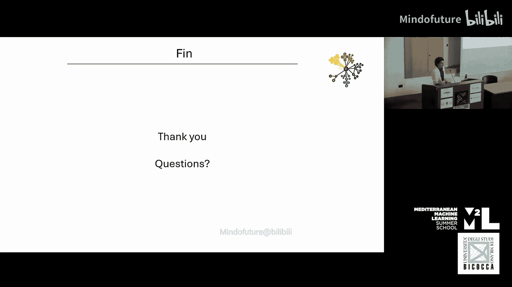

# 017：图神经网络

## 概述

在本节课中，我们将要学习图神经网络。我们将从理解图的基本概念开始，探讨为什么图结构在机器学习中非常重要，然后深入讲解图神经网络的核心原理、不同类型以及它们在实际中的应用和挑战。

## 为什么需要关注图？

在开始之前，我们先要明确讨论的对象。我们讨论的不是图表或曲线图，而是由节点和边构成的网络图。理解图结构之所以重要，是因为现实世界中的许多系统，从社交网络到分子结构，都可以自然地表示为图。图为我们提供了一种强大的方式来建模实体之间的复杂关系和交互。

上一节我们介绍了图的基本概念，本节中我们来看看如何用数学语言描述一个图。

## 图的表示方法

一个图由两个基本部分组成：节点和边。节点代表系统中的实体，边代表实体之间的连接。

*   **节点特征矩阵**：我们可以为每个节点分配一个特征向量来描述其属性。所有节点的特征可以组合成一个特征矩阵 **X**，其中每一行对应一个节点的特征。
*   **邻接矩阵**：图的结构通常用一个方阵 **A** 来表示，称为邻接矩阵。如果节点 *i* 和节点 *j* 之间存在一条边，则 **A**[*i*, *j*] = 1，否则为 0。

根据边的属性，图可以分为几种主要类型：
*   **无向图**：边没有方向，邻接矩阵是对称的。
*   **有向图**：边有方向，邻接矩阵通常不对称。
*   **加权图**：边带有权重，邻接矩阵中的值表示连接强度。

除了这些基本类型，图还有许多其他分类，例如连通图、完全图、二分图、树、环图等。图的一个关键特性在于它为数据引入了结构，并定义了我们可以提问和求解的问题域。

## 几何深度学习与对称性

在深入图神经网络之前，我们需要理解一个更广泛的框架：几何深度学习。其核心思想是，神经网络是一个高度参数化的函数，它将定义在某个域上的输入信号映射到输出。

以识别图片中的数字“3”为例：
*   **域**：是像素组成的规则网格。
*   **信号**：是网格上显示的“3”这个图案。
*   **目标**：是让神经网络函数输出标签“3”。

关键在于，我们可以利用域中存在的**对称性**来帮助模型做出更好的预测。例如，无论数字“3”在图片中如何平移，我们都希望模型能正确识别它。这引出了两类重要的函数：

*   **不变函数**：当输入经历某种变换（如平移）时，函数的输出保持不变。图像分类任务需要这种函数。
*   **等变函数**：当输入经历变换时，输出也以可预测的方式发生相应变化。例如，目标检测任务中，目标位置的变化会导致检测框位置发生相应变化。

对于图像（网格域），关键的对称群是平移。而对于图，其关键的对称群是**节点排列**。图神经网络正是为处理这种排列对称性而设计的架构。

## 图同构与WL测试

理解排列对称性，需要探讨图同构问题：我们如何判断两个图在结构上是否相同（即仅通过重标节点就能使它们完全一致）？

判断图同构的一个经典方法是**Weisfeiler-Lehman测试**。以下是WL测试的步骤：
1.  为每个节点初始化一个标签（例如，基于其度数）。
2.  对于每个节点，收集其所有邻居的标签，排序后与自身标签结合，生成一个新的聚合标签（通常使用哈希函数）。
3.  重复步骤2，直到节点的标签划分不再变化。
4.  比较两个图的最终标签分布。如果分布不同，则两个图一定不同构；如果分布相同，则它们可能同构（WL测试无法做出绝对判断）。

WL测试的重要性在于，它从理论上界定了一般图神经网络的表达能力上限。

## 图神经网络的核心：消息传递

图神经网络的基本构建模块是**消息传递**。每一层消息传递都包含三个步骤，用于更新节点的表示（嵌入）：

以下是消息传递的步骤：
1.  **生成消息**：对于每条边（连接的两个节点），根据源节点和目标节点的当前特征生成一条消息。
    *   消息函数可以是任何函数，它定义了不同GNN架构的特性。
2.  **聚合消息**：对于每个节点，将其从所有邻居节点收到的消息聚合起来。
    *   聚合函数必须是**排列不变**的，即不依赖于邻居节点的顺序。常用操作包括求和、求平均或取最大值。
3.  **更新节点**：结合节点自身的特征和聚合后的邻居消息，更新该节点的特征表示。

通过堆叠多层消息传递层，节点可以聚合来自越来越远邻居的信息。这使模型能够捕获图的全局结构。

## 经典图神经网络模型

基于消息传递框架，可以衍生出多种具体的图神经网络模型。以下是几种经典模型：

*   **图卷积网络**：一种早期的GNN模型。其消息传递步骤可以简化为一个矩阵运算：**H' = σ(Â H W)**，其中 **Â** 是添加了自连接的归一化邻接矩阵，**H** 是节点特征矩阵，**W** 是可学习的权重矩阵。
*   **GraphSAGE**：引入了**归纳学习**能力，意味着它可以在一个图上训练，然后泛化到未知的新图上。其核心是**采样和聚合**：对于每个节点，先采样固定数量的邻居，然后学习一个聚合函数来整合这些邻居的信息。
*   **图注意力网络**：在聚合步骤中引入了注意力机制。每个节点可以学习为其不同的邻居分配不同的重要性权重，从而进行更有针对性的信息聚合。这通常通过多头注意力来实现，以稳定学习过程并捕获不同方面的信息。

除了上述模型，还有许多其他变体，如专门研究图同构表达能力的**图同构网络**，处理高阶结构的**单纯复形GNN**，以及用于异质图（包含多种节点和边类型）的**异质图神经网络**。

## 图神经网络的挑战

在实际应用中，图神经网络面临一些主要挑战：

*   **过度平滑**：当堆叠层数过多时，所有节点的特征会变得过于相似，丢失了区分性。这是因为消息传递过多导致节点特征“平均化”。
    *   **解决方案**：使用更浅的网络、添加残差连接、进行边丢弃、或使用特定的归一化技术（如PairNorm）。
*   **过度挤压**：当图中存在信息瓶颈（如连接两个稠密子图的少数节点）时，远距离节点间的信息难以有效传递，因为需要压缩通过瓶颈的信息过多。
    *   **解决方案**：使用更宽的聚合函数（如多头注意力）、修改图结构（添加远程连接）、或使用扩展图传播（如K阶图）来改善远程信息流。

## 图神经网络的应用

图神经网络具有极其广泛的应用前景，因为任何能建模为实体和关系的系统都可以用图来表示。以下是一些典型应用领域：
*   **分子性质预测**：用于药物发现，预测分子的化学、物理或毒性属性。
*   **知识图谱补全**：推断大型知识图谱中缺失的事实或关系。
*   **社交网络分析**：进行社区发现、影响力预测或异常检测。
*   **推荐系统**：利用用户-物品二分图进行个性化推荐。
*   **3D形状识别**：将点云或网格数据视为图进行处理。
*   **交通网络预测**：预测道路网络中的流量或拥堵情况。

## 总结

本节课中我们一起学习了图神经网络。我们从图的基本表示和重要性出发，探讨了几何深度学习中对称性的核心概念，并深入讲解了图神经网络的基础——消息传递框架。我们介绍了几种经典的GNN模型（如GCN、GraphSAGE、GAT），分析了它们面临的主要挑战（过度平滑和过度挤压），并列举了GNN在多个领域的强大应用。图神经网络为我们提供了一种强大的工具，用于理解和预测具有复杂关系结构的数据。