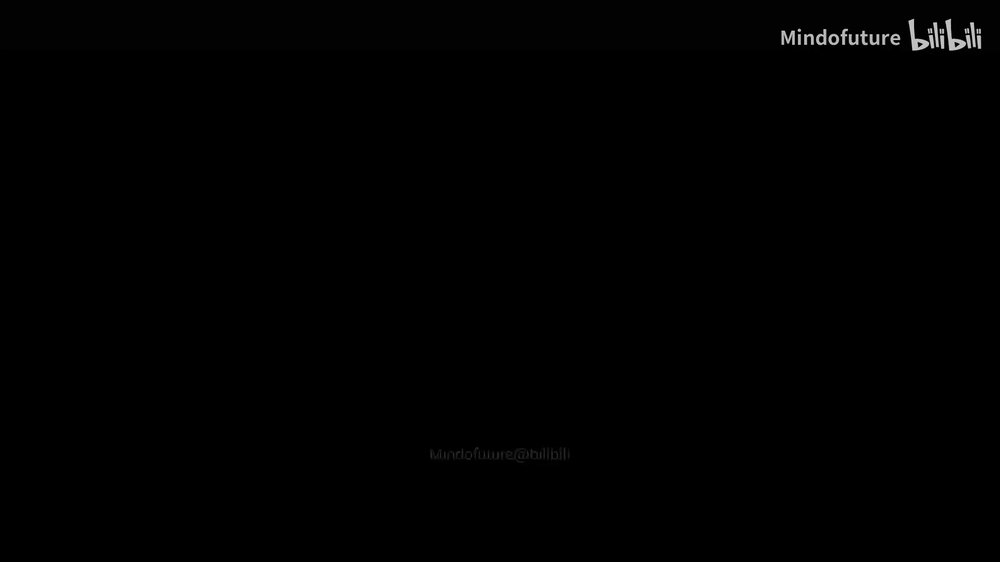
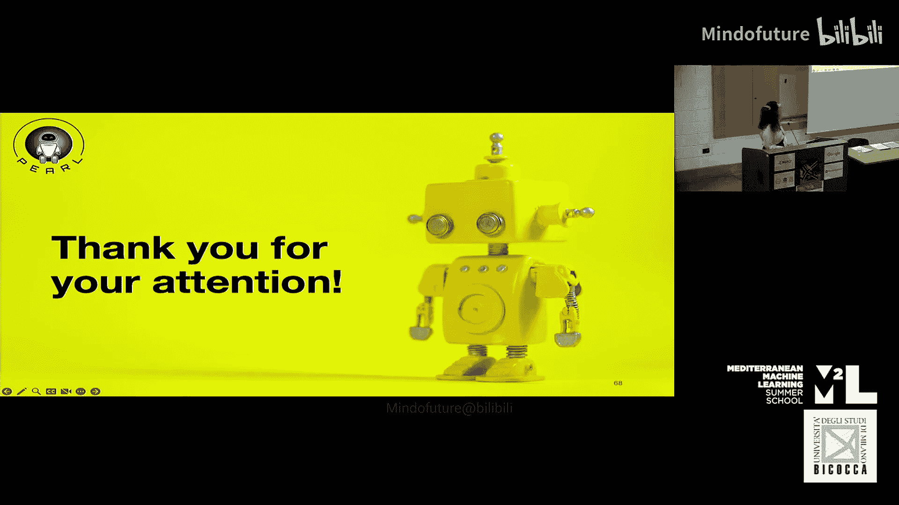

# 018：模仿学习与强化学习

在本节课中，我们将要学习机器人学习中的两大核心范式：模仿学习与强化学习。我们将探讨它们的基本概念、面临的挑战、常用算法以及如何在实际机器人系统中应用。

## 概述

获取通用智能需要为世界建模，这非常困难。环境和任务可能变化，现实世界中的环境通常是非平稳的。策略结构可能受限，我们使用的优化求解器可能出错或陷入局部最优。我们的假设可能不成立，或仅在非常特定的领域成立。在机器人学中，我们通常试图解决感知、规划与控制（或称感知、思考、行动）这三元问题，传统基于模型的方法将它们分开处理。但要实现智能，我们需要一个能够真正将这些部分整合在一起的系统和算法，以实现反应性、鲁棒性和自适应性。这就是机器人学习希望达成的目标。

上一节我们介绍了机器人学习的总体目标，本节中我们来看看具体的学习方法及其数学基础。

## 符号与基础概念

首先，我们来看一些后续将用到的符号和概念。

你现在已经知道什么是马尔可夫决策过程（MDP）。我们有一个状态空间 **S**，一个动作空间 **A**，可能还有一个观测空间 **O**（尤其是在我们无法访问环境真实状态的情况下）。我们有一个状态转移概率矩阵 **P(s'|s, a)**，可能有一个观测模型 **O(o|s)** 和一个奖励函数 **R(s, a)**。在严格的马尔可夫决策过程中，我们只有状态、动作、转移和奖励这个元组，当然还有初始分布等。我们的目标是学习一个策略或控制器，使其在给定状态下给出最优动作。

但在机器人学中，我们通常处理的是部分可观测马尔可夫决策过程（POMDP）。这时观测和观测模型就会出现，因为我们只能观测到环境的一部分，需要推断出真实状态。有不同的技术可以处理这个问题，例如使用粒子滤波等滤波技术来获得对状态的信念，或者简单地将历史信息输入神经网络策略，让网络理解过去发生了什么，以便推断未来，进而推断策略中的动作。

但整个思想基于马尔可夫假设，即给定当前状态，未来与过去独立。简单来说，马尔可夫假设认为当前状态是充分统计量，因此你不需要历史信息。不过，如前所述，在处理部分可观测环境时，我们可能会使用历史信息作为技巧，将POMDP问题转化为MDP问题，并用我们已有的算法（例如强化学习算法）来解决。

## 模仿学习

接下来，我们将重点讨论模仿学习。在模仿学习中，我们面临一些问题，因为马尔可夫性在那里并不真正成立。

模仿学习的主要思想是模仿专家数据。因此，你首先需要收集这些专家数据，它们可能是观测值或状态（取决于你的环境）以及一些动作对。然后，你需要训练一个函数，将这些观测值或状态映射到你收集到的那些动作上。

以下是模仿学习的一个核心方法列表：

*   **行为克隆**：这是最基本的方法，试图显式地将观测或状态映射到专家给出的动作。
*   **逆强化学习**：试图基于演示学习人类的成本函数或奖励函数，然后提取策略。
*   **生成对抗模仿学习**：使用生成对抗网络框架，让生成器（策略）生成轨迹，判别器区分轨迹来自专家还是生成器，两者相互竞争优化。

### 行为克隆及其挑战

行为克隆的核心是使用监督学习来匹配专家的动作。例如，在自动驾驶中，我们收集来自传感器的数据（如摄像头图像）和来自方向盘等执行器的驾驶动作，然后训练神经网络进行映射。

然而，行为克隆并非标准的监督学习。在标准的监督学习（如分类）中，我们假设数据是独立同分布的（IID）。理论告诉我们，当数据和目标来自某个分布且是IID时，训练误差越低，测试性能越好。

但在行为克隆中，数据并非IID。我们所看到的和我们所做的之间通常存在因果关系，这影响了一切。我们还有其他问题，例如专家数据只包含良好行为，我们从未见过不良行为，因此不知道如何应对它们。因此，测试期间的任何小错误都会导致策略偏离专家分布，产生级联故障。在行为克隆中，低训练误差并不一定能转化为良好的测试性能，因为最初的小数值误差会不断累积，导致你偏离并出现分布偏移。

在顺序决策中，分布偏移问题比分类等问题更严重，因为它可能是致命的，并且是动态的。问题在于，策略只训练在专家的最佳数据上，专家几乎看不到坏状态，因为他们是专家。当我们进行行为克隆时，我们通常希望克隆好的行为，而不是坏的行为。一般来说，模仿学习就像在悬崖边行走，一旦你偏离好的轨迹一小步，就可能跌落悬崖。一旦犯错，你就超出了训练分布，出现了分布外偏移。

### 改进行为克隆的方法

为了让模仿学习和行为克隆发挥作用，我们需要不同类型的数据。例如，我们也需要包含更多错误或尝试纠正错误的数据。

以下是两种主要的改进方法：

1.  **数据增强**：第一种方法是故意在轨迹中添加错误并添加对这些错误的纠正。第二种方法是使用合成或伪造的数据来增强数据，以说明纠正措施。
2.  **DAgger算法**：数据聚合算法的主要思想是，为了纠正训练过程中发生的错误，你需要更多数据，而最好的数据提供者就是人类专家。因此，DAgger本质上是一个人在环的学习过程。

尽管DAgger是一个已有13年历史的算法，但它仍然被使用。我们仍然基本上依赖人类来收集更高质量的数据，尤其是在进行模仿学习时。这是许多大型科技公司的基本策略，他们试图构建大规模的行为克隆模型，让人在分布外时明确提供新数据，不断训练直到获得非常好的行为。

### 深度模仿学习与生成模型

显然，当神经网络出现后，我们的生活变得更美好了，因为它们有能力建模更复杂的函数和交互。

目前，我们进行模仿学习的方式是使用生成模型。我们尝试用机器学习中当前流行的每一种生成模型来进行模仿学习。生成模型试图学习一个分布 **p_θ(x)** 以匹配数据的分布。一旦学习了这个生成模型，你就可以从中采样，潜在地获得数据集中未明确见过的新数据。这非常强大，也是我们喜欢它相比于更监督式的策略学习方式的原因。

我们使用了各种类型的生成模型：生成对抗网络、变分自编码器、扩散模型以及归一化流。

一个重要的生成模型模仿学习算法是生成对抗模仿学习方法。在这个方法中，你从学生策略中采样轨迹，然后有一个判别器。生成器模型生成样本，判别器试图区分这些样本是来自专家数据还是伪造的，它们相互竞争，因为生成器试图让判别器相信数据是真实的。

然而，GAN的一个问题是它通常无法捕捉多模态行为，答案是否定的，因为它通常会坍缩到特定的模式。变分自编码器也存在同样的问题。

目前，模仿学习乃至更广领域的巨大热潮是使用扩散模型进行模仿学习。扩散模型有一个前向加噪过程，然后我们进行反向扩散以去除这些噪声。这正是我们试图学习的函数——去噪函数。

扩散策略论文研究了使用扩散模型来学习直接应用于机器人的动作。与原始扩散模型的不同之处在于，现在输入不仅只有图像，还有动作。然后你运行推理K次，这取决于你想要扩散多少步。

## 从模仿学习到强化学习

然而，模仿学习是不够的。特别是对于机器人学来说，它是不够的，因为世界是巨大的。你需要专家、人类来收集这些数据，这非常非常困难。即使你需要通过强化学习来创建专家，也需要知道如何为每种可能的情况创建环境、奖励函数等的人。现实世界是非常不确定的、非平稳的，并且让人一直在环中以进行判断和提供新数据是相当昂贵的。这些数据对于超级智能来说是不够的。

理想情况下，我们希望这些具身AI系统能够自主学习。强化学习的目标是最大化累积折扣奖励（我们称之为回报），并从中提取最优策略以及如何行动。

### 深度Q学习

深度Q学习尝试使用深度神经网络作为函数逼近器来学习如何行动。DQN于大约11年前由DeepMind提出，并在Atari游戏中展示了超人的性能。

与表格Q学习相比，深度Q网络的输入通常是图像（例如四帧），输出是离散动作。网络接收四帧图像，通过一些卷积层处理这些图像，然后通过一些全连接层解码出每个可能动作的Q值。你选择具有最大Q值的动作。

在机器人学中，Q学习可以应用于“桌面”环境，即只有一个顶部摄像头，你创建动作价值图。你假设机器人会改变图像中的像素状态。例如，如果机器人移动一个盒子，盒子会移动，图像中的像素就会改变。这被认为是一个动作。另一个广泛使用Q学习的用例是抓取。如果你将其框定在图像空间内，当你选择具有最大抓取价值的东西时，你会改变图像，改变图像的状态，因为你会移除某些东西。这是一个离散化的空间，因为你的图像有特定的大小，每个像素都是一个可能的动作。

### 演员-评论家方法与连续控制

但在高自由度机器人中，我们需要进行连续控制。这时我们就需要使用演员-评论家方法，它允许我们训练连续动作的策略，并真正控制可以取连续值的机器人关节。

演员-评论家方法中，我们既估计Q函数，也学习一个策略，并尝试使用学习的Q函数持续改进这个策略。

一个对机器人学产生重大影响的算法是软演员-评论家算法。它是演员-评论家框架，演员是策略网络，评论家是评估动作好坏的Q函数。SAC的重要之处在于它有一个软目标，允许该算法以最大熵进行探索。它试图在过程开始时做许多随机动作，以尽可能探索环境，然后尝试更新策略，但它总是通过这个软目标进行正则化，以平衡探索与利用。它给你一个随机策略，这在某些情况下很好，例如当你想逃离局部极小值时。

另一个重要算法是近端策略优化。它基于优势函数训练策略。优势是价值函数与Q函数之间的差值。PPO试图通过不改变太多相对于先前策略的方式来更新策略，它引入了一些裁剪方法，以防止在更新策略参数时做出太大的更新，并非常有效地权衡探索与利用。PPO仍然与机器人学非常相关，特别是在Isaac Gym等强大模拟器的支持下，它能够并行训练数千个机器人。

## 总结

本节课中我们一起学习了机器人学习的两大支柱：模仿学习与强化学习。

我们首先探讨了模仿学习，特别是行为克隆，它通过监督学习模仿专家数据，但面临分布偏移和误差累积的挑战。改进方法包括数据增强和DAgger等人机交互算法。随后，我们介绍了使用生成模型（如GAN、VAE和扩散模型）的现代模仿学习方法，它们能更好地处理多模态行为并生成新数据。

接着，我们转向强化学习，它让智能体通过试错与环境交互来学习最优策略。我们介绍了深度Q学习用于离散动作空间，以及演员-评论家方法（如SAC和PPO）用于机器人中更常见的连续控制问题。这些算法结合了值函数估计和策略梯度，能在复杂模拟环境中有效训练机器人技能。

最后，我们看到了当前的前沿方向，例如结合强化学习与扩散模型来学习丰富的行为模式。机器人学习的未来在于结合模仿学习的效率与强化学习的自主探索能力，并利用越来越逼真的模拟器来加速训练和实现向现实世界的迁移。