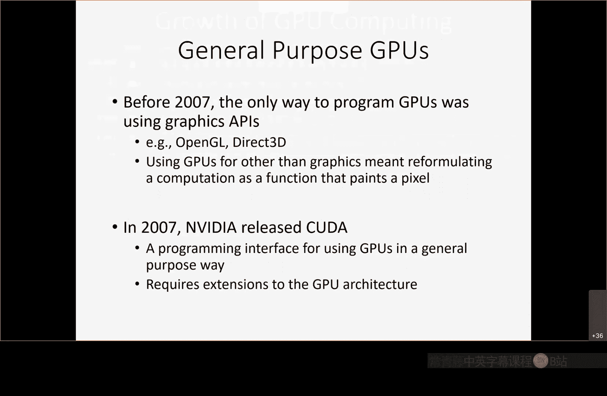
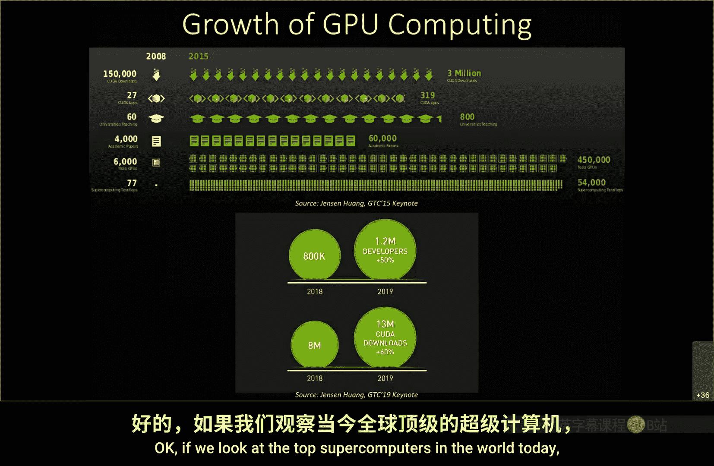
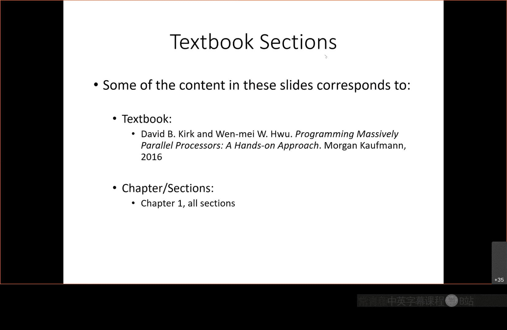

# GPU计算：P1：引言 🚀

在本节课中，我们将要学习GPU计算的基本概念，了解其诞生的历史背景和设计哲学。我们将从计算机技术的发展趋势讲起，探讨为何并行计算成为主流，并深入对比CPU与GPU这两种不同设计取向的处理器。

## 摩尔定律的兴衰 💡

上一节我们介绍了课程主题，本节中我们来看看推动计算技术发展的核心动力——摩尔定律。

摩尔定律并非物理定律，而是英特尔联合创始人戈登·摩尔提出的一个预测。他预测单位面积上的晶体管数量每18到24个月会翻一番。这个预测在过去的半个世纪里基本成立，成为了半导体行业发展的目标。

然而，这一趋势正在走向终结。晶体管尺寸已缩小到物理极限，难以继续微缩。更重要的是，在2005年左右，处理器频率的提升也停滞了。这是因为更快的开关速度意味着更高的功耗，而功耗会产生热量。当热量超过冷却技术的处理能力时，处理器就无法在更高频率下稳定运行。

在2005年之前，如果你购买一台新电脑，即使运行相同的程序，速度也会因为频率提升而自动变快。2005年之后，这种“免费的性能午餐”结束了。单线程性能虽然仍在提升（得益于编译器优化和更复杂的硬件技术，如分支预测、乱序执行），但提升幅度已大不如前。

## 并行计算成为主流 ⚙️

由于单线程性能提升放缓，但晶体管数量仍在增长，硬件设计者开始将这些额外的晶体管用于增加处理器核心数量。这就是并行计算成为主流的转折点。

硬件的变化驱动了软件的变革。为了获得更好的性能，软件开发人员必须重写程序，使其能够并行运行。免费的午餐结束了，性能提升必须通过并行编程来实现。

## 两种设计哲学：延迟导向 vs. 吞吐量导向 🏎️🚌

在深入处理器细节前，我们先了解两种通用的系统设计思路：延迟导向设计和吞吐量导向设计。

延迟导向设计旨在最小化完成单个任务所需的时间。一个典型的例子是小汽车，它追求以最快速度将一个人从A点送到B点。

吞吐量导向设计则旨在最大化在给定时间内完成的任务数量。一个典型的例子是公交车，它虽然运送每个乘客的时间更长，但一次可以运送很多人。

以下是这两种设计思路的对比：
*   **延迟导向**：优化单个任务的速度。
*   **吞吐量导向**：优化单位时间内完成的任务总数。

这两种设计哲学同样适用于处理器设计。

## CPU与GPU的架构对比 🖥️🎮

上一节我们介绍了两种设计哲学，本节中我们来看看它们如何具体体现在CPU和GPU的架构差异上。

CPU是延迟导向设计的典范，而GPU则是吞吐量导向设计的代表。这种根本差异影响了它们各个组件的设计。

以下是CPU与GPU在几个关键组件上的设计差异：

**1. 算术逻辑单元**
*   **CPU**：拥有少量但非常强大的ALU。这些ALU占用大量芯片面积，经过高度优化，旨在将一次算术运算的延迟降到最低。
*   **GPU**：拥有大量小型、简单的ALU。每个ALU执行一次运算的延迟较长，但通过大规模并行和流水线技术，可以获得极高的总体算术吞吐量。

**2. 缓存**
*   **CPU**：配备大容量缓存。目的是将访问慢速DRAM内存的高延迟操作，转化为访问快速缓存的低延迟操作，从而降低平均内存访问时间。
*   **GPU**：缓存容量较小。这意味着缓存命中率较低，更多需要访问高延迟的内存。但节省下来的芯片面积可以用于放置更多的ALU来计算。

**3. 控制逻辑**
*   **CPU**：采用复杂技术（如分支预测、数据前递、乱序执行）来减少控制冒险和数据冒险，优化单线程的执行延迟。这些技术需要额外的硬件支持。
*   **GPU**：控制逻辑相对简单。为了容纳更多计算单元，GPU需要容忍更长的分支延迟和数据冒险。

**4. 多线程与延迟隐藏**
*   **CPU**：由于操作延迟相对较低，只需要适度的多线程（如每个核心2个线程，即超线程技术）来填充流水线中的空闲周期，隐藏短延迟。
*   **GPU**：由于ALU、内存访问和控制决策的延迟都很高，为了隐藏这些长延迟、避免流水线停滞，GPU采用了大规模的多线程技术。单个GPU核心上可以同时驻留并调度数十个线程，确保在任何周期都有可执行的指令。

**5. 时钟频率**
*   **CPU**：通常具有较高的时钟频率。
*   **GPU**：通常运行在较低的时钟频率下。这是因为GPU已经集成了大量计算单元，功耗很高，降低频率有助于控制总功耗和散热。

## GPU的起源与发展 📈

GPU最初是为图形处理而设计的，这也是其名称（图形处理器）的由来。图形工作负载（如渲染数百万像素）天生具有大规模并行性，且像素间通常相互独立，这正好契合吞吐量导向的设计理念。

2007年是一个关键转折点。英伟达发布了CUDA平台，它提供了一套编程接口，让开发者能够直接编写通用目的程序在GPU上运行，而无需再将计算任务“伪装”成图形渲染任务。这标志着GPU计算时代的开始，GPU开始被广泛用于科学计算、深度学习等非图形领域。

数据显示，自CUDA发布以来，GPU在通用计算领域的应用呈爆炸式增长，包括开发者数量、学术论文、高校课程以及高性能计算系统的采用率。如今，世界排名前十的超级计算机中，有多台都采用了GPU作为加速器。

## 为何是GPU取得成功？🎯

并行处理器有多种实现方式，为何GPU能脱颖而出？核心原因在于市场规模和成本摊销。

芯片设计制造成本极高，需要巨大的销量来分摊成本。当通用并行计算需求兴起时，GPU已经拥有了一个庞大而稳定的市场——游戏产业。这使得GPU厂商能够基于现有规模，相对容易地改造架构以适应通用计算，而无需像一家新公司那样，从零开始为某个细分市场（如科学计算）设计专用芯片，并面临市场狭小、成本难以回收的风险。

值得注意的是，游戏仍是GPU最大的营收来源。因此，GPU架构的任何改进都必须权衡对所有主要市场（尤其是游戏）的影响。一项能大幅提升科学计算性能但可能损害游戏性能的改进，很可能不会被采纳。

在本课程中，我们将聚焦于如何使用GPU进行通用目的编程，重点学习如何为科学计算等数据中心负载编写高效的GPU程序。

## 总结 📚

本节课我们一起学习了：
1.  **摩尔定律的终结**是推动计算架构向多核并行转变的根本原因。
2.  **延迟导向设计**（如CPU）追求最快完成单个任务，而**吞吐量导向设计**（如GPU）追求单位时间内完成最多任务。
3.  CPU与GPU在**ALU、缓存、控制逻辑、多线程程度和时钟频率**上存在显著差异，这些差异源于其不同的设计目标。
4.  GPU起源于**图形处理**，因其与生俱来的并行性而采用吞吐量导向设计。**CUDA的发布**使其能够方便地用于通用计算，从而开启了GPU计算时代。
5.  GPU的成功得益于其早已建立的**巨大市场规模**（主要是游戏），这使得其在向通用计算领域扩展时具有成本优势。

---
*对应教材章节：请参考课程指定教材《Programming Massively Parallel Processors: A Hands-on Approach》的相关引言和背景章节。*