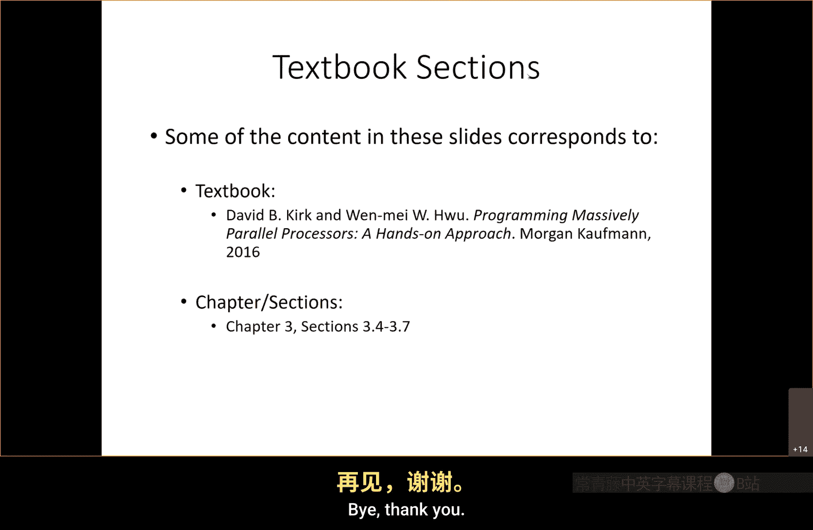

# GPU计算：04：GPU架构

## 概述

在本节课中，我们将暂时告别代码编写，深入探讨GPU的硬件架构。我们将了解GPU如何组织其计算单元（流式多处理器SM），线程块和线程如何被调度到这些硬件上执行，以及SIMD（单指令多数据）执行模型如何影响程序性能。理解这些底层原理对于编写高效的CUDA程序至关重要。

## 回顾：多维数组与数据并行

上一节我们学习了如何创建多维网格，存储和访问多维数据，并编写了三个处理二维数据的并行程序示例。

以下是上一节的核心内容总结：
*   **RGB转灰度图像**：我们为输出图像的每个像素分配一个线程。这展示了如何创建二维网格（包含x和y维度的块），以及块本身也可以是二维的线程数组。我们使用了`blockIdx`、`threadIdx`和`blockDim`的x、y分量。
*   **数据布局**：在C语言中动态分配多维数组时，需要将其线性化为**行优先**的一维数组进行存储。
*   **边界检查**：处理多维网格时，需要在多个维度上进行边界检查。
*   **图像模糊**：此例的边界检查更为复杂，因为输入和输出的边界条件不同。
*   **矩阵乘法**：我们为输出矩阵的每个元素分配一个线程，该线程顺序遍历矩阵A的对应行和矩阵B的对应列进行计算。

## GPU架构基础

现在，让我们开始了解GPU的硬件架构。

GPU由多个**流式多处理器**组成，我们简称其为**SM**。每个SM包含多个**核心**，这些核心是执行算术运算的单元。同一个SM内的核心共享控制逻辑（用于取指、译码等）和一些内存资源。此外，所有的SM都能访问同一块**全局内存**，也就是我们在第一讲中从CPU复制数据到GPU时所用的内存。

以本课程使用的**Volta V100 GPU**为例，它拥有80个SM，每个SM有64个核心，总计5120个核心。

## 线程块到SM的映射

我们编写的CUDA内核配置了包含线程块和线程的网格。那么，这些线程块和线程是如何在GPU上运行的呢？

其工作方式是，线程以**块**为粒度被分配到SM上。这意味着：
*   同一个线程块内的所有线程将被分配到**同一个SM**上执行。
*   一个SM可以同时容纳**多个**线程块。
*   但一个线程块**不能**被拆分到多个SM上。

线程在执行时需要资源，例如寄存器和一些线程特定的控制数据。由于SM的硬件资源是有限的，因此它能同时支持的线程和线程块数量也是有限的。这在一定程度上解释了为什么线程块中的线程数量存在上限（例如1024）。如果一个网格启动的线程块数量超过了GPU能同时执行的数量，多余的线程块将排队等待，直到有SM上的资源被释放。

## 线程块内的协作与同步

由于同一个线程块内的线程被分配到同一个SM上，它们能够以不同线程块间无法实现的方式进行协作。这也是我们将网格划分为线程块的重要原因之一。

以下是线程块内协作的主要方式：
*   **屏障同步**：线程可以调用`__syncthreads()`函数。这会使得块内的所有线程在代码中的某个点相互等待，直到所有线程都到达该屏障后，才能继续执行。这有助于协调线程间的工作。
*   **共享内存**：每个SM上都有一块**共享内存**，同一线程块内的线程可以快速访问和共享数据，而不同块间的线程则不能。这是一种高效的协作方式。

将同一线程块的线程分配到同一个SM上，使得上述协作（如同步）能够更高效地实现，因为它们无需跨SM进行通信。

一个重要的原则是：线程块必须**整体**地分配到SM上。也就是说，SM必须有足够的资源容纳块内的**所有**线程，才能开始执行该块。这是为了避免死锁。例如，如果只分配了部分线程，而这些线程在屏障处等待尚未分配的其他线程，就会导致程序无法继续执行。

## 线程块间的独立性与可扩展性

与线程块内的紧密协作相反，**不同线程块之间不应进行同步或直接协作**。CUDA编程模型刻意不允许块间同步（没有内置的跨块同步原语）。

这种设计带来了一个关键优势：**线程块之间是相互独立的**。这意味着：
*   线程块可以以**任意顺序**执行。
*   它们可以**并行**执行，也可以**顺序**执行。

这种独立性实现了**透明可扩展性**。同一段CUDA代码可以在拥有不同数量SM（即不同硬件并行度）的设备上运行。在SM较少的设备上，线程块可能顺序执行；在SM较多的设备上，更多的线程块则可以并行执行，从而自动利用更多的硬件资源，而无需修改代码。

程序员**不应**编写试图让不同线程块同步的代码（例如通过全局内存进行自旋锁等），因为这破坏了块间的独立性假设。如果尝试同步的线程块并未被同时调度（例如一些在排队），就极有可能导致**死锁**。

## Warp：SM上的调度单元

线程块被分配到SM后，还会被进一步划分为更小的单元，称为**Warp**。Warp是SM上进行调度的基本单位。

关于Warp需要了解的是：
*   Warp的大小是设备特定的，但至今一直是**32个线程**。
*   一个包含1024个线程的块会被分成32个Warp（32线程/个）。
*   一个包含64个线程的块会被分成2个Warp。

## SIMD执行与Warp

Warp的特殊之处在于，其内部的线程按照**SIMD**模型一起被调度执行。

**SIMD**代表**单指令，多数据**。这意味着：
*   一个Warp中的所有线程在同一个时钟周期内**执行相同的指令**。
*   但每个线程操作的是**不同的数据**。

这种模式的**优势**在于**摊销控制开销**。只需要一套取指、译码和分发逻辑，就可以驱动32个核心同时工作，极大地节省了硬件资源，使得我们可以将更多的晶体管用于增加计算核心，而非控制单元。

下图展示了Volta V100 GPU中一个SM的详细架构。可以看到，64个FP32核心被组织成4个处理块，每个处理块有16个核心，并共享一个指令分发单元和一个寄存器文件。一个Warp（32线程）会在这样一个处理块上执行。

## 控制流分歧

SIMD模型也带来了一个显著的**劣势**：**控制流分歧**。

当Warp中的线程遇到条件分支（如`if`语句）时，如果部分线程走`then`路径，另一部分走`else`路径，就会发生分歧。由于Warp必须执行相同的指令，硬件会如何处理呢？

硬件会**串行化**所有不同的执行路径：
1.  首先，所有线程一起执行`then`路径，但只有条件为真的线程是**活跃**的，条件为假的线程被**禁用**（核心闲置）。
2.  然后，所有线程再一起执行`else`路径，此时之前活跃的线程被禁用，之前禁用的线程变为活跃。
3.  最后，所有线程在分支后重新汇合，继续同步执行。

这导致了**SIMD效率**的降低，即部分计算核心在某个时刻处于闲置状态。分歧越严重，效率损失越大。

另一个例子是循环次数不同的线程。所有线程必须执行完循环次数最多的那个线程所需的迭代后，才能一起退出循环，这也会造成大量闲置。

程序员可以通过**重构算法或数据布局**（例如，预先对数据进行排序，让具有相似执行路径的线程聚集在同一个Warp内）来减轻控制流分歧的影响。

## 延迟隐藏与多线程

GPU核心可能会遇到长延迟操作，例如未命中缓存的内存访问或复杂的多周期算术运算。为了避免核心流水线停滞，GPU SM采用了**基于Warp的多线程**技术。

其工作原理如下：
1.  当正在执行的Warp遇到长延迟操作时，它会被**换出**核心。
2.  调度器立即从已分配到该SM的、就绪的Warp中挑选一个**换入**核心执行。
3.  当第一个Warp的延迟操作完成（如数据从内存返回），它重新变为就绪状态，等待被调度执行。

通过这种方式，SM的流水线始终保持忙碌，从而隐藏了操作延迟，提高了整体吞吐量。

## 占用率

为了有效隐藏延迟，我们希望在每个SM上同时驻留**尽可能多**的线程（即多个Warp）。**占用率**衡量了SM上实际活跃的Warp（或线程）数量与硬件支持的最大数量之比。

通常，**更高的占用率有助于更好地隐藏延迟**。然而，占用率可能受到以下因素限制：
*   **线程块大小**：如果线程块大小设置不当，可能无法充分利用SM的线程容量。
*   **每个SM的线程块数量上限**：SM能同时容纳的块数量有限。
*   **寄存器使用量**：每个线程使用的寄存器数量。如果线程使用过多寄存器，SM的寄存器文件可能无法支持最大数量的线程。
*   **共享内存使用量**：每个线程块使用的共享内存量。

例如，在V100上（最大2048线程/SM，最大32块/SM）：
*   选择**256线程/块**：需要8个块即可达到2048线程，且未超过32块上限，可实现高占用率。
*   选择**32线程/块**：需要64个块才能达到2048线程，但受限于32块上限，最多只能有1024线程，占用率仅为50%。
*   选择**768线程/块**：2048无法被768整除，只能容纳2个块（1536线程），剩余线程槽位浪费，占用率也非最优。

因此，选择线程块大小时需要考虑目标GPU的硬件限制，以优化占用率。CUDA提供了`cudaGetDeviceProperties` API，用于查询设备的这些属性。

## 总结

本节课我们一起深入学习了GPU的架构。我们了解了GPU由多个SM组成，线程块如何映射到SM上执行，以及Warp作为基本调度单元遵循SIMD模型所带来的优势（控制开销摊销）和挑战（控制流分歧）。我们还探讨了如何通过基于Warp的多线程来隐藏操作延迟，以及占用率的概念及其对性能的影响。理解这些硬件特性是后续进行CUDA程序性能分析和优化的基础。