# GPU计算：P7：性能剖析 🚀


在本节课中，我们将学习如何剖析CUDA应用程序，以了解其性能表现并识别瓶颈所在。

## 概述

上一节我们介绍了DRAM存储体、内存合并与分散、线程束合并等概念，并探讨了不同优化策略（如资源调优、内存访问模式、共享内存分块、线程合并）之间的权衡关系。为了在这些相互竞争的优化中找到最佳平衡点，关键在于识别应用程序的性能瓶颈。本节我们将学习如何使用NVIDIA提供的剖析工具来诊断瓶颈。

## 性能瓶颈与优化权衡

一个**瓶颈**是指限制应用程序性能的约束条件。不同的应用程序消耗不同的硬件资源（如计算单元、内存带宽、线程槽位、共享内存等），当其中一种资源先于其他资源耗尽时，便形成了瓶颈。瓶颈取决于具体的应用程序和硬件设备。

我们之前学到的优化策略，通常是以一种资源换取另一种资源。例如：
*   **共享内存分块**：使用更多共享内存，以减少全局内存带宽的使用。
*   **线程合并**：减少冗余工作（如数据加载、计算或同步开销），但可能增加每个线程所需的资源，从而限制占用率。

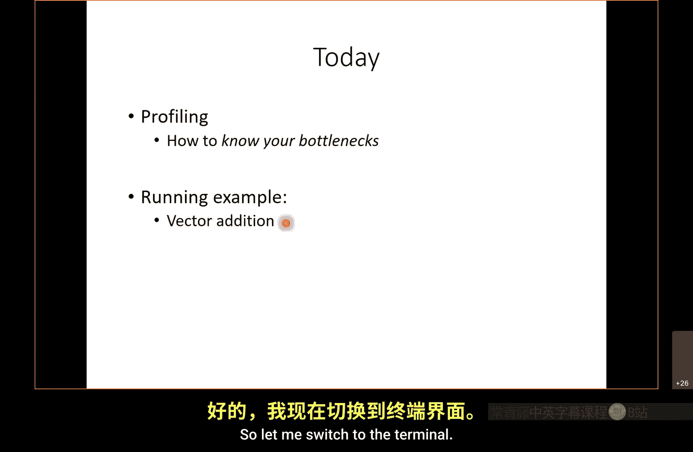

因此，在应用优化之前，必须准确诊断当前的瓶颈。如果应用程序的瓶颈是共享内存限制导致的低占用率，那么增加共享内存使用量的优化（如更大的分块）反而会进一步降低性能。正确的做法可能是减少共享内存的使用。

## 使用 `nvprof` 进行基础剖析

`nvprof` 是CUDA SDK中自带的命令行剖析工具。最简单的使用方式是运行 `nvprof [你的可执行文件]`。

以下是一个向量加法示例的剖析步骤：

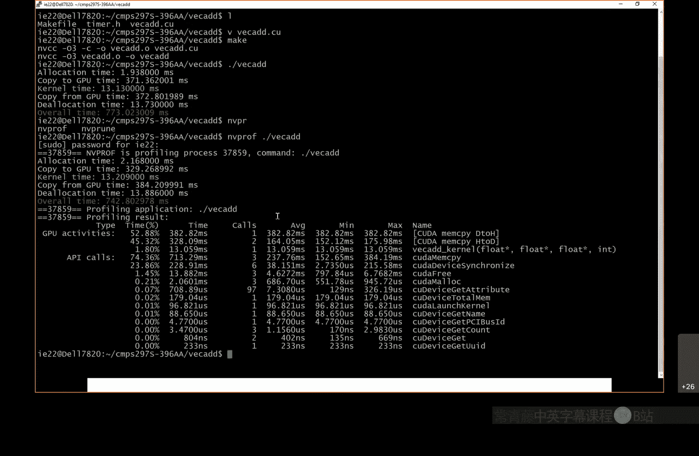

1.  **编译程序**：确保代码中包含了 `cudaProfilerStop()` 调用，以便在程序退出前保存所有剖析信息。
    ```bash
    nvcc -o vector_add vector_add.cu
    ```
2.  **运行 `nvprof`**：
    ```bash
    nvprof ./vector_add
    ```
    该命令会输出一个表格，显示应用程序中各个活动（如内核执行、内存拷贝、API调用）所花费的时间、调用次数、占总时间的百分比等信息。这比在代码中手动插入计时器更方便。

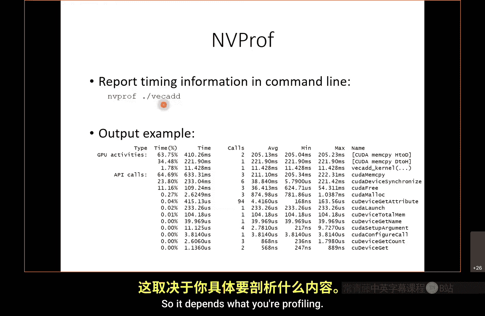

## 生成剖析文件以供深入分析

`nvprof` 可以将详细的剖析数据导出到文件，以便用可视化工具进行深入分析。

以下是生成不同类型剖析文件的命令：

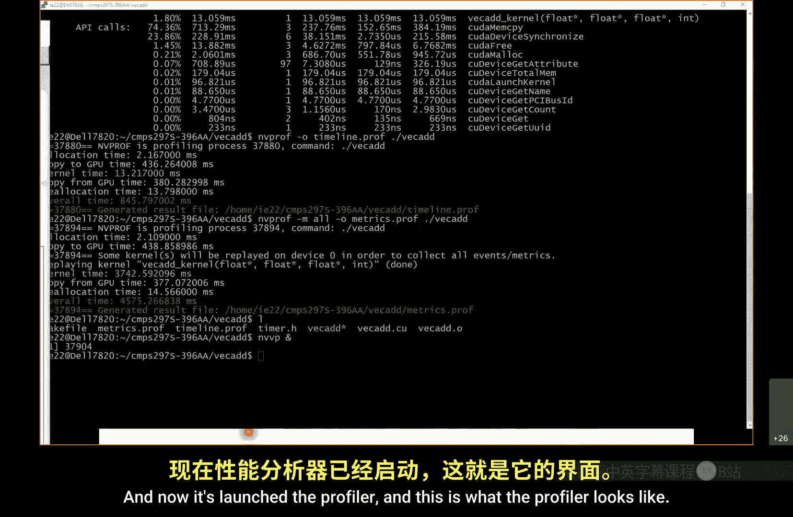

*   **生成时间线文件**：记录各活动的执行时间线。
    ```bash
    nvprof -o timeline.prof ./vector_add
    ```
*   **生成性能指标文件**：收集诸如占用率、缓存命中率、内存带宽等硬件计数器数据。使用 `--metrics all` 收集所有可用指标（注意：这会运行内核多次，以收集不同组的指标，因此总执行时间会变长）。
    ```bash
    nvprof --metrics all -o metrics.prof ./vector_add
    ```


## 使用 NVIDIA Visual Profiler (nvvp) 进行可视化分析

`nvvp` 是一个图形化剖析工具，可以更直观地分析 `nvprof` 生成的 `.prof` 文件。

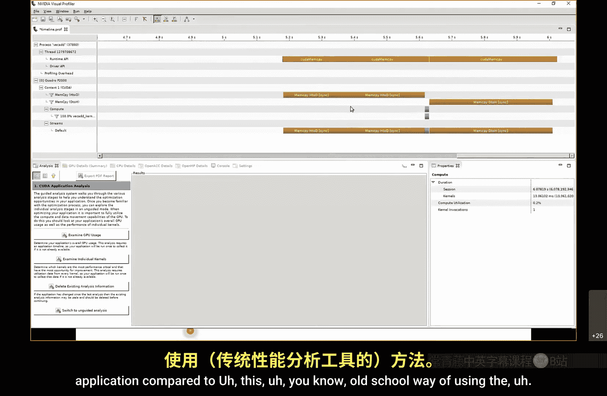

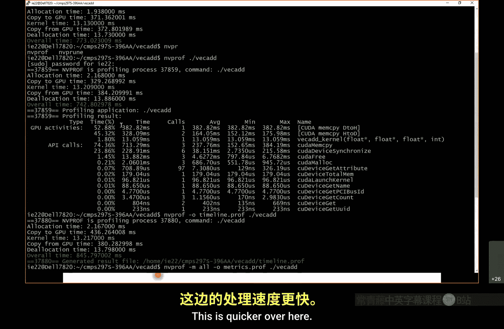

1.  **启动 nvvp**：
    ```bash
    nvvp &
    ```
2.  **导入剖析文件**：在nvvp中创建新会话，选择“导入”由 `nvprof` 生成的数据。分别指定时间线文件（如 `timeline.prof`）和指标文件（如 `metrics.prof`）。

### 分析时间线

时间线视图直观展示了GPU上各种活动（如内存拷贝、内核执行）的起止时间和重叠情况。这有助于理解应用程序的整体执行流程和时间分布。

### 分析内核性能

在nvvp中，可以针对特定的内核进行深入分析。

*   **检查GPU使用情况**：工具会给出高层次建议，例如指出内存拷贝效率低、内核并发性不足等。
*   **执行内核分析**：
    *   **利用率分析**：显示计算单元和内存系统的利用率。例如，在向量加法中，内存系统利用率很高（>80%），而计算单元利用率很低（~10%），这清楚地表明该内核是**内存带宽受限型**。
    *   **指令构成**：显示内核执行中算术指令、控制流指令和内存指令的比例，这与代码逻辑相符（向量加法包含较多加载/存储指令和少量算术、分支指令）。

### 针对性瓶颈分析

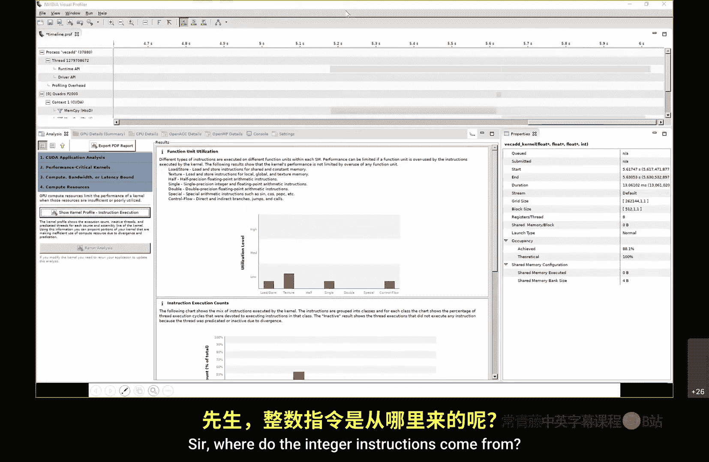

根据初步分析，nvvp会推荐进行更具体的分析：

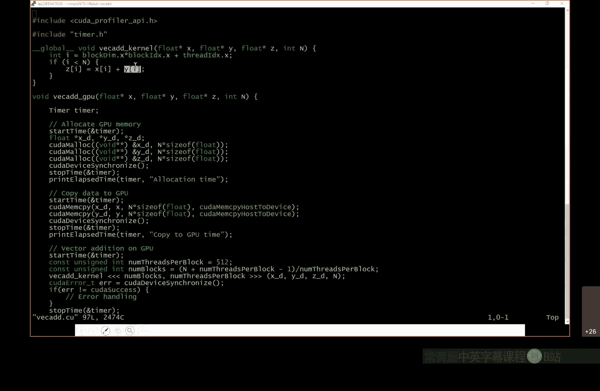

*   **内存带宽分析**：展示各级内存（共享内存、L2缓存、全局内存等）的利用率。对于内存带宽受限的内核，你会看到设备内存（全局内存）利用率接近饱和，而缓存利用率很低。
*   **计算分析**：展示各功能单元（如加载存储单元、单精度浮点单元）的利用率以及各类指令的执行计数。对于计算受限的内核，这里会显示计算单元的高利用率。
*   **延迟分析**：重点分析占用率。工具会显示当前占用率、理论最大占用率以及限制占用率的资源（如线程块大小、共享内存用量）。它还提供了交互式图表，可以预测更改线程块大小或共享内存使用量对占用率的影响。
*   **PC采样**（如果设备支持）：可以揭示线程束停顿的主要原因（例如，等待内存依赖、执行依赖、同步等）。这对于理解底层延迟来源非常有帮助。

## 案例分析：改变线程块大小的影响

让我们通过一个实验来验证占用率对性能的影响。将向量加法的线程块大小从512改为32。

1.  **修改并编译代码**：将 `blockSize` 设置为32。
2.  **重新剖析**：
    ```bash
    nvprof -o timeline_smallblock.prof ./vector_add_smallblock
    nvprof --metrics all -o metrics_smallblock.prof ./vector_add_smallblock
    ```
3.  **在nvvp中分析**：导入新的剖析文件。你会发现：
    *   内核执行时间显著增加（性能下降）。
    *   占用率分析显示，理论最大占用率降至50%（受限于每个SM的最大线程块数量），实际占用率约为35%。
    *   延迟分析会明确指出“GPU利用率可能受限于线程块大小”，并高亮显示 `Threads Per Block` 是限制因素。

这个案例表明，不恰当的线程块配置会导致GPU硬件资源未被充分利用，从而成为性能瓶颈。

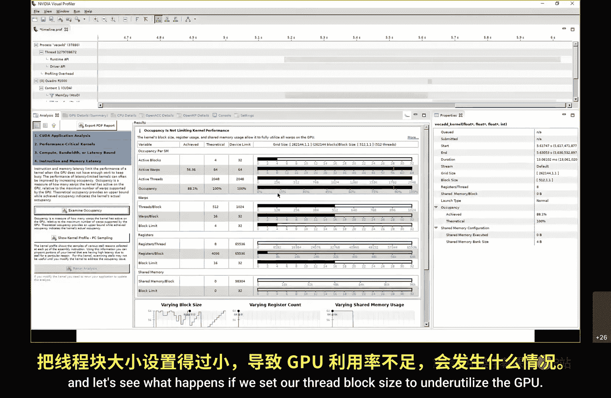

## 总结

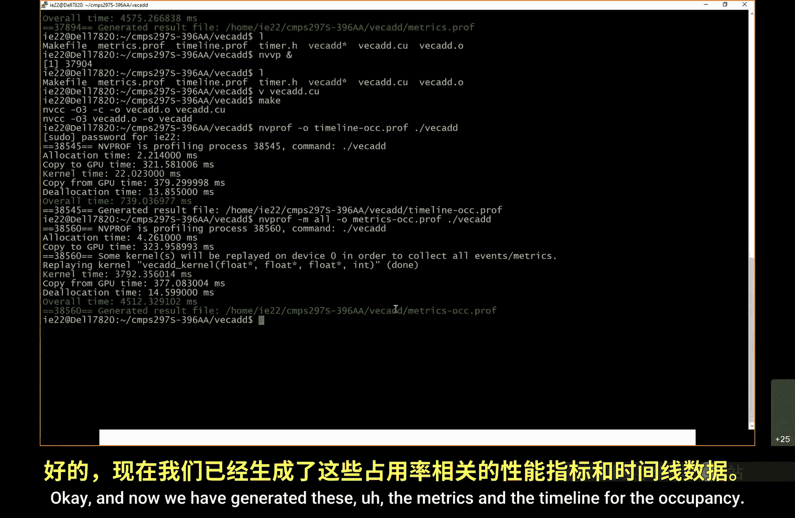

本节课我们一起学习了GPU性能剖析的核心方法。我们了解到识别性能瓶颈对于实施有效优化至关重要。通过使用 `nvprof` 命令行工具和 `nvvp` 可视化剖析器，我们可以：
1.  量化应用程序中各个部分的时间消耗。
2.  判断内核是受限于内存带宽、计算能力还是其他资源。
3.  分析占用率，并确定限制占用率的因素（如寄存器用量、共享内存、线程块大小）。
4.  通过PC采样理解线程束停顿的原因。

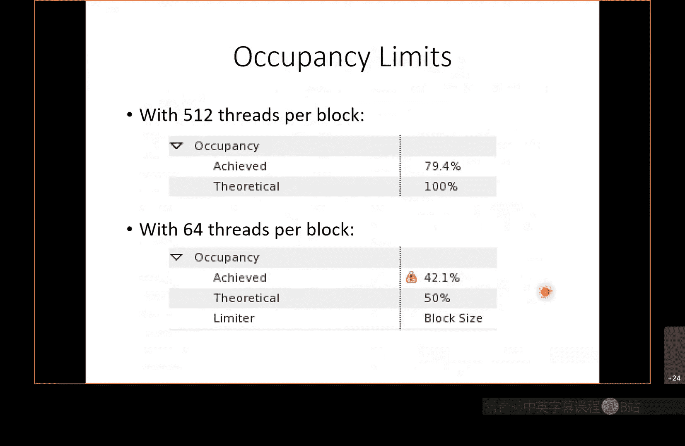


掌握这些剖析技能，能够帮助你在优化CUDA程序时做出数据驱动的决策，避免盲目应用可能适得其反的优化策略，从而更高效地提升程序性能。