# GPU计算：第13讲：直方图 📊

## 概述
在本节课中，我们将学习一个新的并行模式——直方图。我们将介绍硬件提供的一个新特性：原子操作，并探讨一种新的优化类别：私有化。我们将从直方图的基本概念开始，逐步深入到其并行实现、遇到的问题以及相应的优化策略。

---

## 回顾：扫描操作
上一节我们介绍了扫描操作，特别是用于并行扫描的Brent-Kung方法，以及应用于扫描的线程粗化技术及其优势。

我们看到了实现Brent-Kung并行包含性扫描的模式。该模式的第一部分涉及归约步骤，第二部分涉及后归约步骤，该步骤会回溯并更新那些不正确的值，从而得到一个完全扫描的数组。

比较Kogge-Stone和Brent-Kung方法，我们发现Kogge-Stone方法在更少的步骤内完成，而Brent-Kung方法需要更多步骤。然而，Brent-Kung方法在第一步和总体上执行的操作更少，这使其具有更高的工作效率。

总的来说，Kogge-Stone方法在 `log n` 步内完成，需要 `O(n log n)` 次操作，而Brent-Kung方法需要 `2 log n - 1` 步，但只执行 `O(n)` 次操作，因此比Kogge-Stone方法更高效。这里的工作效率指的是并行算法相对于顺序实现所执行的操作数量。

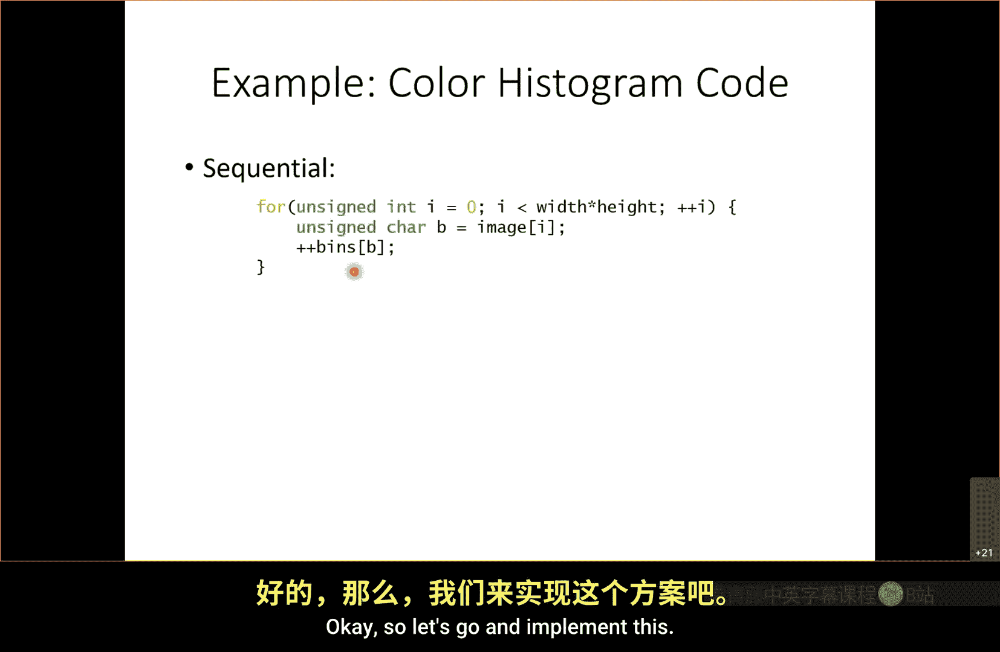

我们还对扫描应用了各种优化，包括使用共享内存。共享内存除了数据重用外，另一个优势是它实现了合并访问，因为我们在扫描中的访问原本不是合并的。通过以合并的方式加载到共享内存，然后在共享内存中工作，我们避免了内存合并的问题。

我们不需要双缓冲，因为在扫描树的工作方式中，同一迭代中没有元素被不同线程读写。我们还研究了如何通过在每个迭代中重新索引线程，而不是在整个执行过程中为线程分配固定元素，来最小化控制流分歧。此外，我们还探讨了如何使用Brent-Kung方法进行独占扫描。第一种方法是简单地将其表述为独占扫描，就像我们在Kogge-Stone方法中所做的那样。第二种方法是使用不同的后归约步骤，该步骤在归约后保存所有元素的总和，将其替换为零，然后通过另一种结构最终将零传播到开头，计算并更新值，从而得到独占扫描的数组。

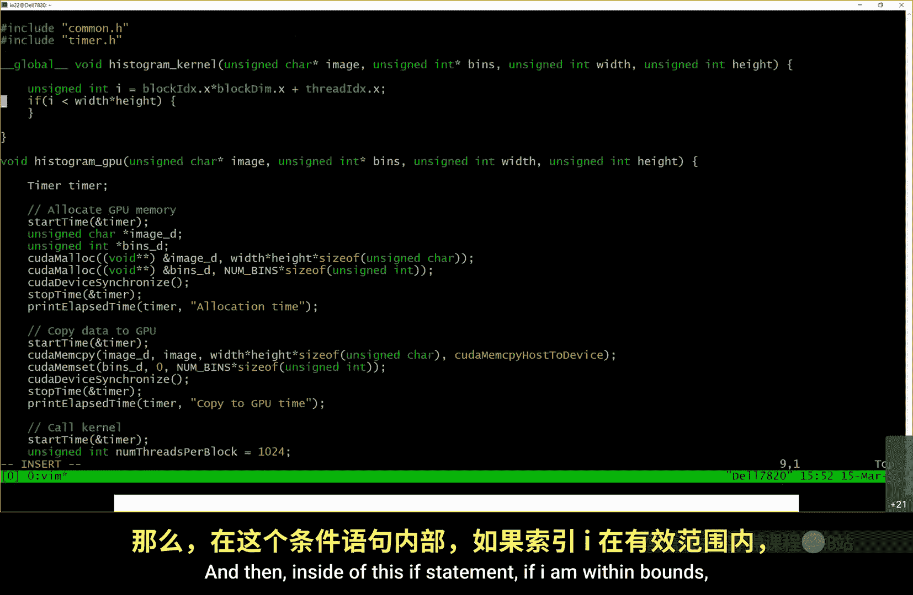

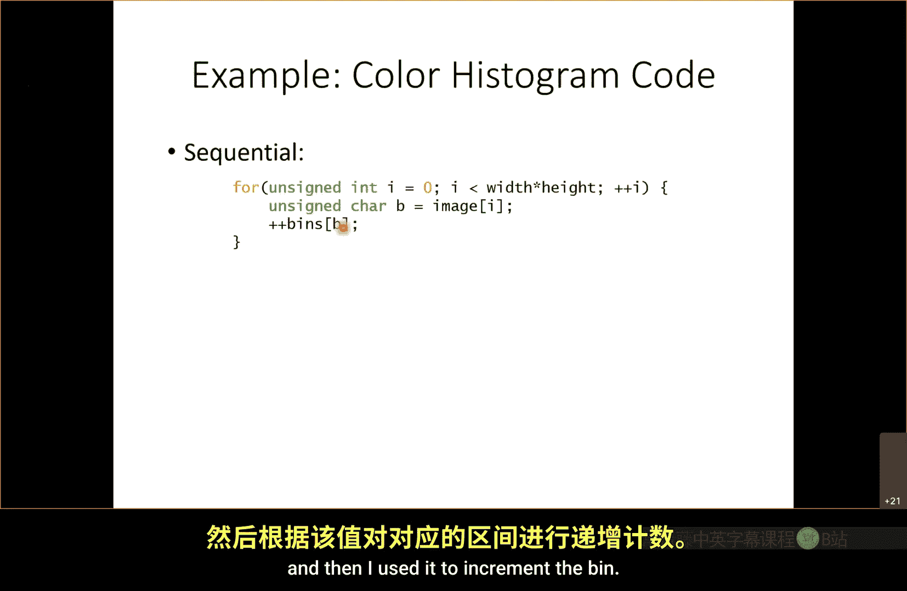

我们没有为这个方法编写代码，因为你们应该在相关的作业中实现它。

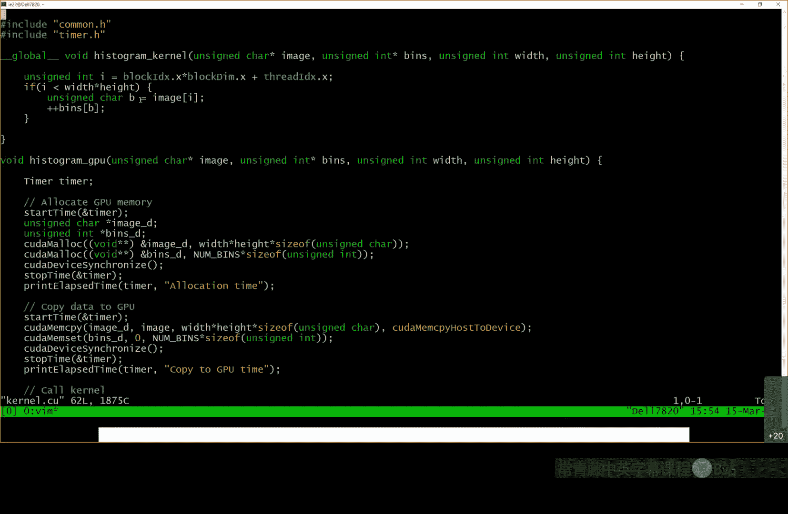

最后，我们讨论了工作效率，并指出尽管Brent-Kung方法具有更高的理论工作效率，但在实践中，考虑到非活动线程时，其实际资源消耗更接近 `O(n log n)`。实际上，Brent-Kung方法虽然更高效，但在我们的特定实现中表现相似甚至更差。

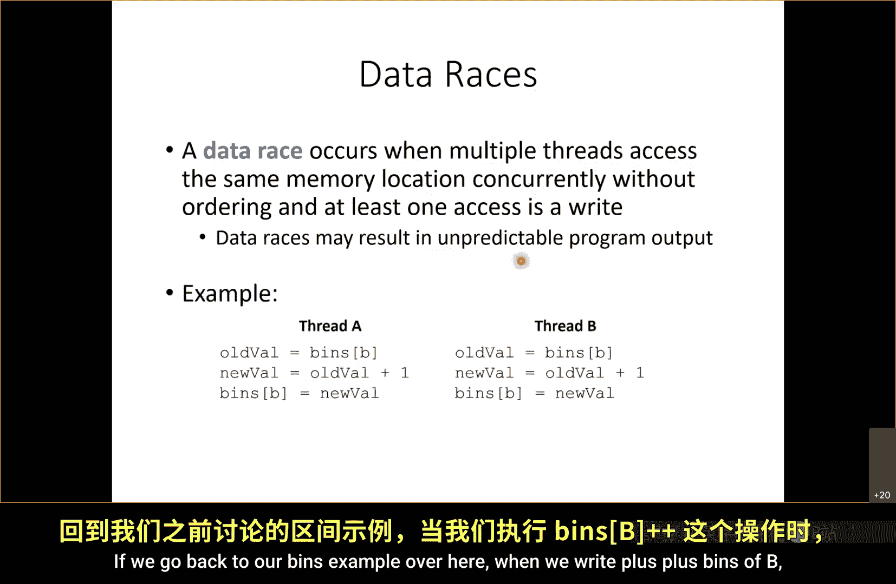

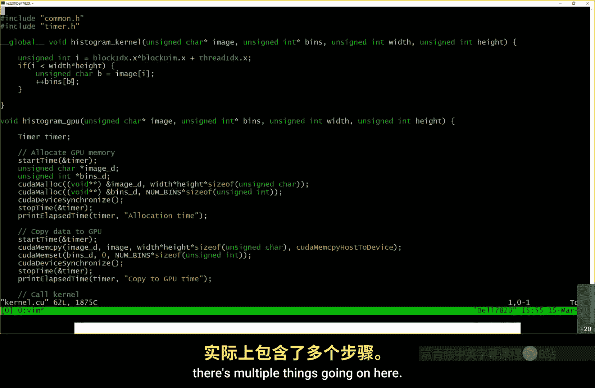

我们还讨论了扫描的线程粗化。当我们并行化扫描时，如果工作确实并行运行，我们会牺牲工作效率，但这是值得付出的代价。然而，如果硬件最终将我们的线程块串行化，那么为了并行化而付出的低效率代价就不值得了。因此，我们可以应用线程粗化，让一些线程对其自己的段执行顺序扫描，然后对部分和进行并行扫描，最后将它们重新分配到每个线程拥有的段中。通过这样做，我们提高了算法的工作效率，因为每个线程执行的顺序扫描通常比并行扫描更高效。

这是对上节课内容的快速回顾。

---

## 直方图简介
本节我们将讨论一个新的并行模式：直方图。通过直方图，我们将引入硬件提供的一个新特性：原子操作，并探讨一种新的优化类别：私有化。

### 什么是直方图？
直方图近似表示数据集的分布。其方法是将输入数据集中值可能出现的范围划分为多个区间（有时也称为桶），并计算落在每个区间内的值的数量。

直方图的一个常见应用（当然不是唯一的地方）是颜色直方图。例如，如果有一幅图像，图像由像素组成，这些像素可能有一个取值范围（例如，使用8位整数表示每个像素值，因此像素值可以从0到255）。颜色直方图可以计算落在每个值范围内的像素数量，从而为我们提供图像中颜色分布、亮度或暗度以及明暗变化程度的某种摘要。

### 顺序实现直方图
顺序实现直方图的方法如下：我们可以简单地使用一个循环，从0遍历到图像的像素数（宽度乘以高度）。对于图像中的每个像素，我们读取像素值。假设图像存储为一维数组 `image`，其大小为 `width * height`。对于每个像素，我们读取其值，然后递增 `bins` 数组中对应索引的值。例如，如果像素值为0，则递增 `bins[0]`；如果像素值为10，则递增 `bins[10]`；如果像素值为128，则递增 `bins[128]`；如果像素值为255（8位整数的最大值），则递增 `bins[255]`。最终，`bins` 数组中将包含每个值对应的像素数量。

以下是顺序实现的伪代码：
```c
unsigned char* image; // 输入图像数组
int num_pixels = width * height;
int bins[256] = {0}; // 初始化所有区间计数为0

for (int i = 0; i < num_pixels; i++) {
    unsigned char pixel_value = image[i];
    bins[pixel_value]++; // 递增对应区间的计数
}
```

### 并行实现直方图
如何并行执行直方图操作？一种可能的方法是：将图像分配给多个线程，每个线程负责更新自己的区间计数，然后合并这些计数。

本着透明可扩展性的精神，我们可以从尽可能细的粒度开始，为图像中的每个输入像素分配一个线程。然后，每个线程将找到对应的区间并更新它。

以下是实现此方法的初始GPU内核代码框架：
```c
__global__ void histogram_kernel(unsigned char* image, int* bins, int num_pixels) {
    int i = blockIdx.x * blockDim.x + threadIdx.x; // 计算线程负责的像素索引
    if (i < num_pixels) { // 边界检查
        unsigned char b = image[i]; // 读取像素值
        bins[b]++; // 递增对应区间的计数
    }
}
```

然而，这个实现存在一个问题：多个线程可能同时访问并尝试更新 `bins` 数组中的同一个内存位置，导致数据竞争。

---

## 数据竞争与原子操作

### 数据竞争问题
当多个线程在没有协调的情况下并发访问同一内存位置，并且至少有一个访问是写操作时，就会发生数据竞争。数据竞争可能导致不可预测的程序输出。

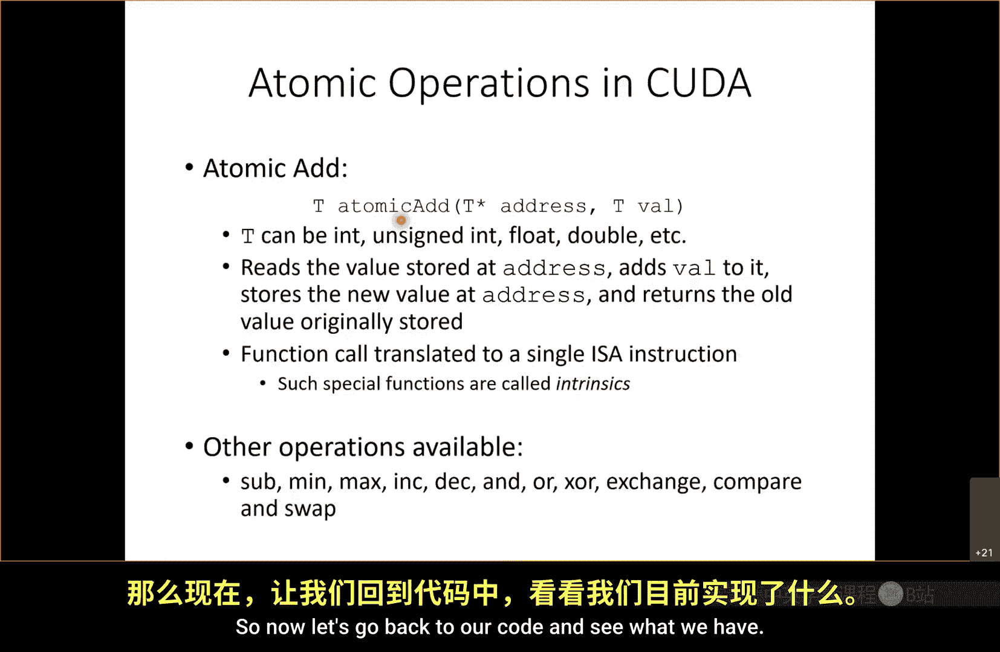

在我们的例子中，`bins[b]++` 这个操作不是单一的原子操作。它由多个指令组成：加载 `bins[b]` 的旧值，将该值加1，然后存储新值。当多个线程同时执行这个操作序列时，指令的交错执行会影响最终结果的正确性。

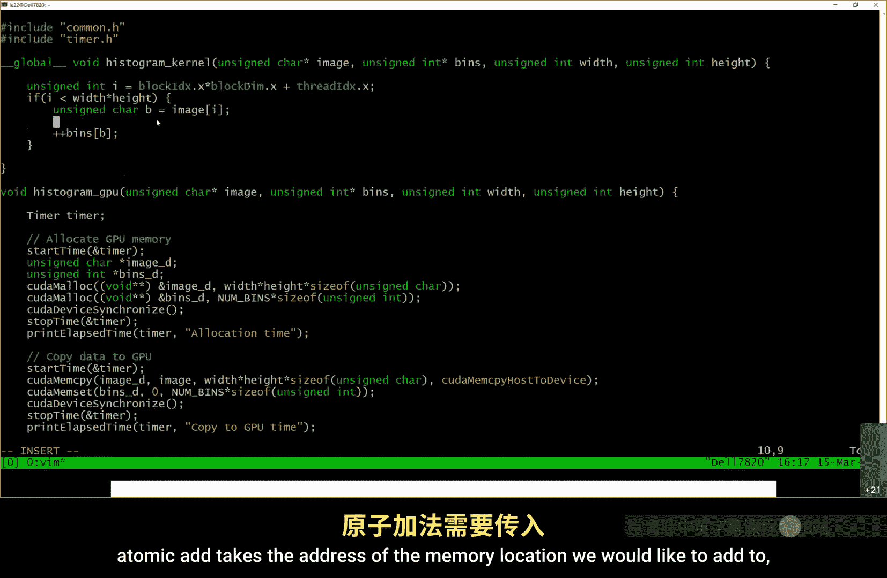

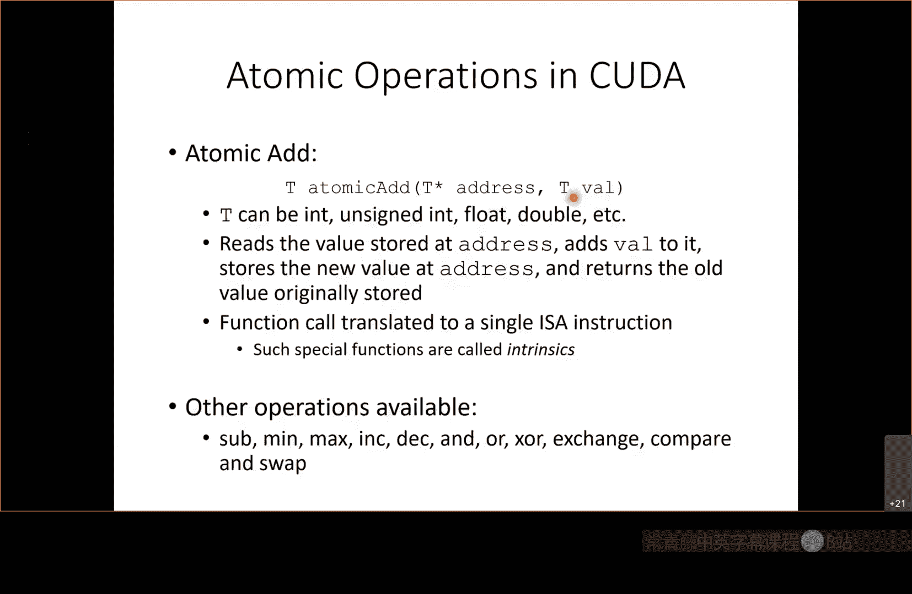

例如，假设 `bins[b]` 初始为0，两个线程A和B都试图递增它。如果线程A完全在线程B之前运行，或者线程B完全在线程A之前运行，最终 `bins[b]` 会变为2，这是正确的结果。然而，如果线程A加载了旧值0，计算新值为1，但在存储之前，线程B也加载了旧值0（此时仍为0），然后线程A存储了1，线程B计算新值为1并存储1，那么最终 `bins[b]` 只变为1，而不是2。这就是数据竞争导致的问题。

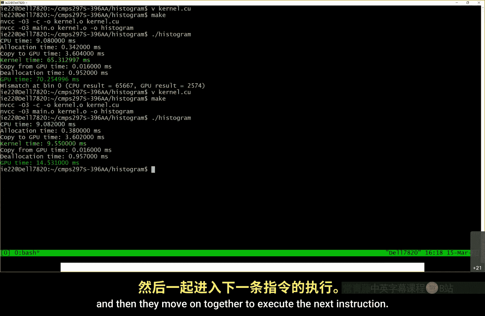

### 解决方案：原子操作
为了避免数据竞争，对同一内存位置的并发读-修改-写操作需要以互斥的方式进行排序。

在CPU上，一种常见的方法是使用互斥锁（mutex）。然而，在GPU上使用锁可能导致死锁，特别是在同一warp内的线程尝试获取同一个锁时，因为warp遵循SIMD模型，线程必须一起执行指令。

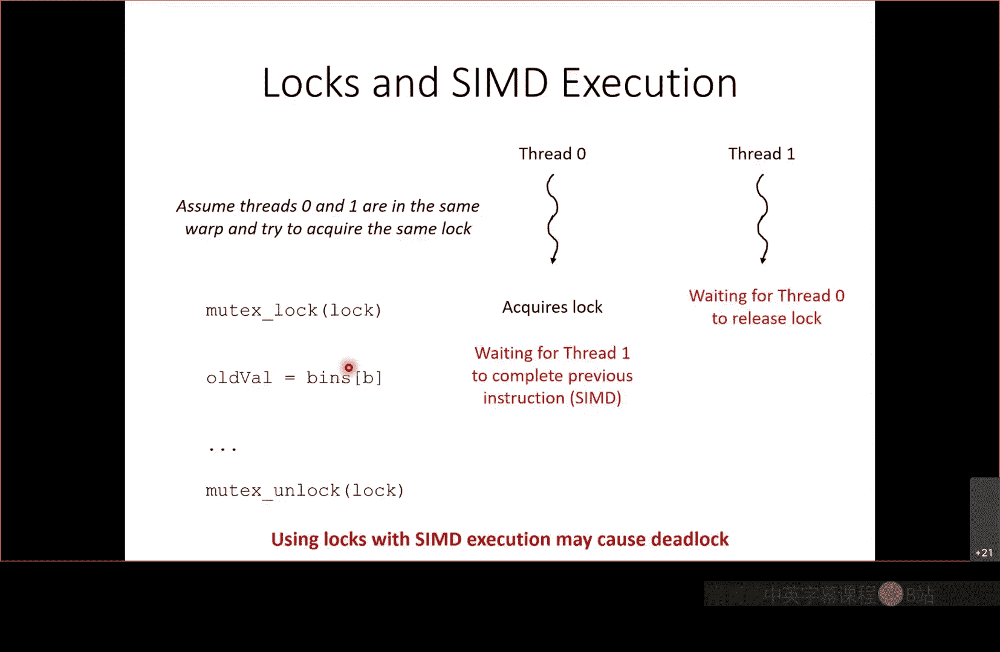

GPU提供了更好的解决方案：原子操作。原子操作是在GPU上执行读-修改-写操作的单个ISA指令。硬件保证在此操作完成之前，没有其他线程可以访问该内存位置。如果对同一内存位置有并发的原子操作，硬件会将这些操作序列化。

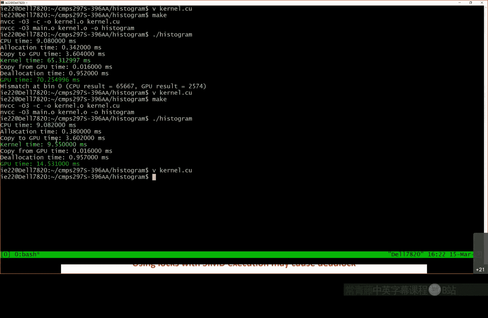

CUDA提供了多种原子操作，例如 `atomicAdd`、`atomicSub`、`atomicMin`、`atomicMax` 等。对于直方图，我们使用 `atomicAdd`。

`atomicAdd` 函数的原型如下：
```c
int atomicAdd(int* address, int val);
unsigned int atomicAdd(unsigned int* address, unsigned int val);
unsigned long long int atomicAdd(unsigned long long int* address, unsigned long long int val);
float atomicAdd(float* address, float val);
double atomicAdd(double* address, double val);
```
它接受一个指向内存位置的指针和一个要加的值，将该值加到内存位置的值上，并返回旧值。

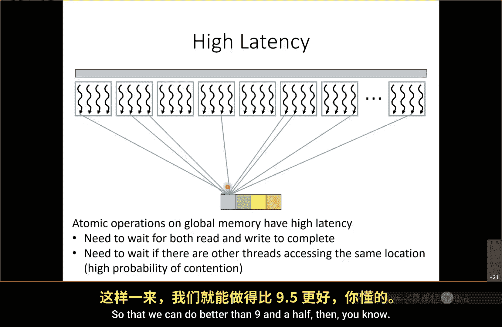

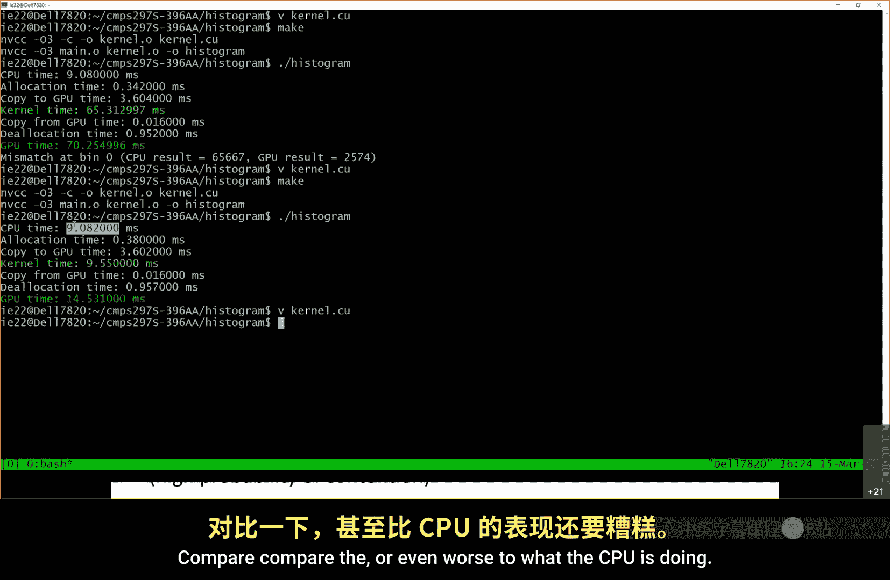

我们可以将之前的 `bins[b]++` 替换为原子操作：
```c
__global__ void histogram_kernel(unsigned char* image, int* bins, int num_pixels) {
    int i = blockIdx.x * blockDim.x + threadIdx.x;
    if (i < num_pixels) {
        unsigned char b = image[i];
        atomicAdd(&bins[b], 1); // 使用原子操作安全地递增
    }
}
```
这样，即使多个线程同时更新同一个区间，也能保证计数的正确性。

原子操作可以在全局内存和共享内存上执行。

---

## 性能优化：私有化

### 私有化的概念
尽管原子操作解决了正确性问题，但性能可能并不理想。全局内存的原子操作延迟很高，特别是当多个线程频繁竞争更新同一内存位置时。

私有化是一种优化技术，用于减少对共享输出的竞争。其核心思想是：不为所有线程维护一个全局的直方图副本，而是为每个线程块创建一个私有的直方图副本。线程块内的线程更新自己的私有副本，从而将竞争限制在块内。当线程块完成计算后，再将私有副本的结果合并到全局副本中。

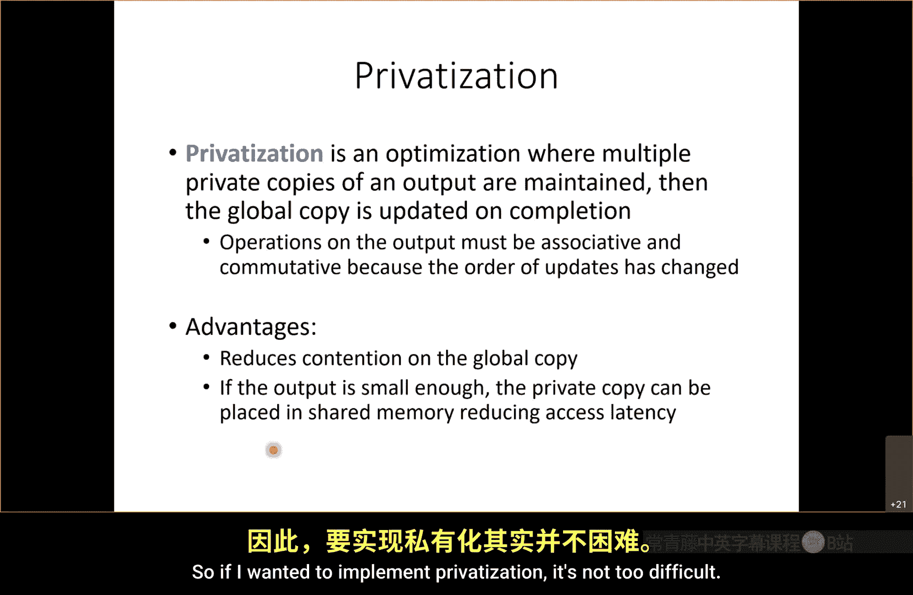

这样做的好处是：
1.  **减少全局竞争**：线程块内的竞争发生在私有副本上，减少了全局内存原子操作的次数和序列化开销。
2.  **利用更快的内存**：如果私有副本足够小，可以将其放入共享内存中。共享内存的访问速度远快于全局内存，原子操作在共享内存上的开销也更低。

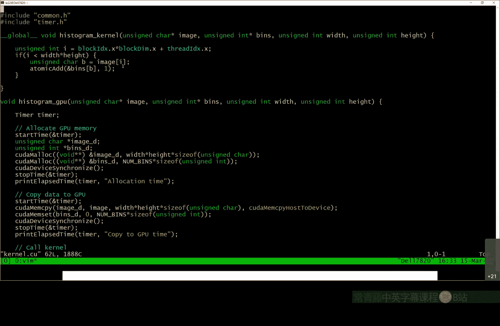

### 私有化的实现步骤
以下是实现私有化的基本步骤：
1.  在共享内存中声明一个私有直方图数组。
2.  初始化共享内存中的直方图为零。
3.  每个线程读取其负责的像素，并使用原子操作更新共享内存中的私有直方图。
4.  使用同步（如 `__syncthreads()`）确保所有线程完成更新。
5.  最后，由线程块内的线程合作，将私有直方图中的非零值通过原子操作添加到全局直方图中。

伪代码框架如下：
```c
__global__ void histogram_privatized_kernel(unsigned char* image, int* global_bins, int num_pixels) {
    __shared__ int shared_bins[256]; // 在共享内存中声明私有直方图
    // 初始化共享内存直方图为零
    for (int i = threadIdx.x; i < 256; i += blockDim.x) {
        shared_bins[i] = 0;
    }
    __syncthreads();

    // 每个线程处理多个像素（线程粗化）
    int tid = blockIdx.x * blockDim.x + threadIdx.x;
    int stride = blockDim.x * gridDim.x;
    for (int i = tid; i < num_pixels; i += stride) {
        unsigned char b = image[i];
        atomicAdd(&shared_bins[b], 1); // 更新共享内存中的私有副本
    }
    __syncthreads();

    // 将私有副本合并到全局内存
    for (int i = threadIdx.x; i < 256; i += blockDim.x) {
        if (shared_bins[i] != 0) {
            atomicAdd(&global_bins[i], shared_bins[i]);
        }
    }
}
```

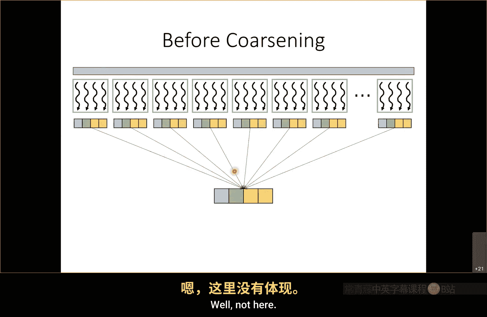

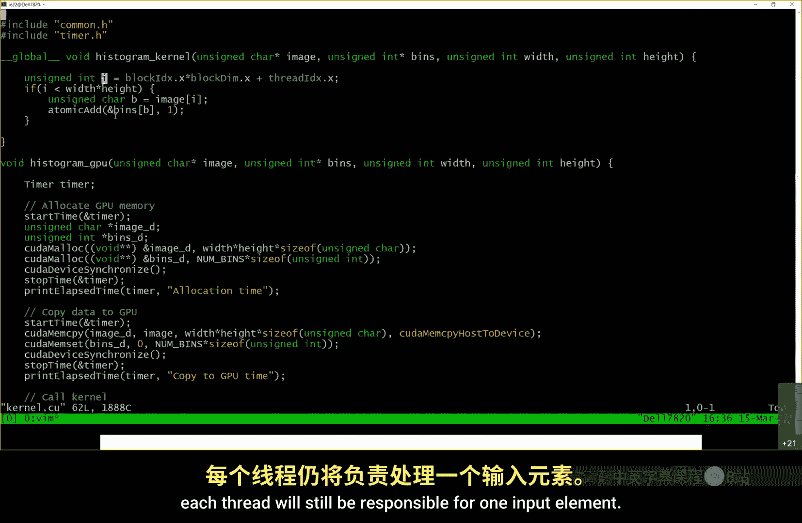

### 结合线程粗化
我们可以进一步结合线程粗化来优化。线程粗化是指减少线程块的数量，让每个线程处理更多的输入元素。

这样做的好处是：
*   **减少私有副本数量**：更少的线程块意味着更少的私有直方图副本，从而减少了最终合并到全局直方图所需的原子操作次数。
*   **提高资源利用率**：当硬件资源有限，线程块可能被串行执行时，减少线程块数量可以降低并行化开销，提高工作效率。

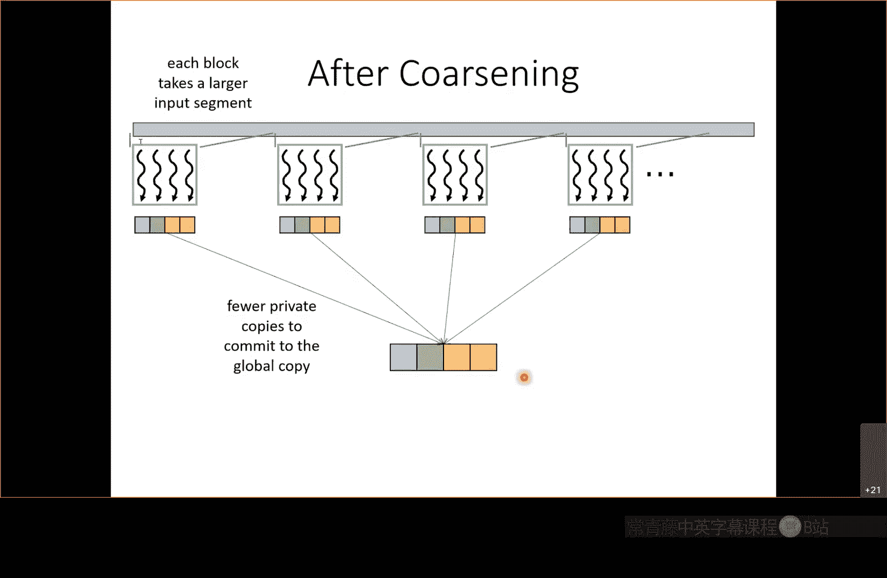

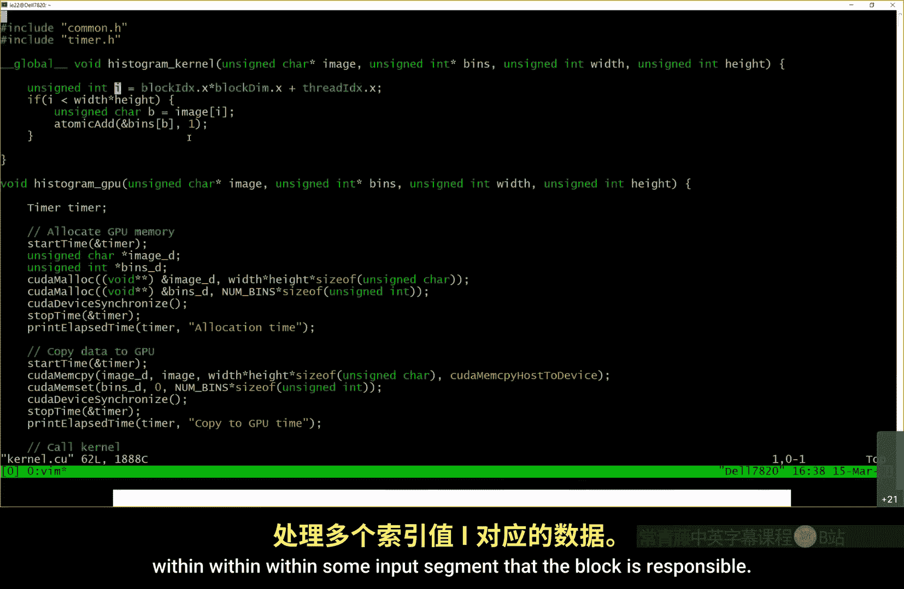

在实现时，需要确保线程以合并访问的方式加载输入数据，以保持内存访问效率。

---

## 总结
本节课我们一起学习了直方图这一并行模式。我们从直方图的基本概念和顺序实现开始，探讨了其并行化方案。

我们遇到了并行化中的关键挑战：数据竞争。为了解决这个问题，我们引入了GPU的原子操作，它能够以硬件保证的互斥方式安全地更新共享内存位置。

为了提高性能，我们深入探讨了私有化这一优化技术。通过为每个线程块创建私有直方图副本，我们显著减少了对全局内存的竞争。结合共享内存存储私有副本，可以进一步降低访问延迟。此外，线程粗化技术可以与私有化结合，通过减少线程块数量来降低全局合并的开销，从而在特定硬件条件下提升整体效率。

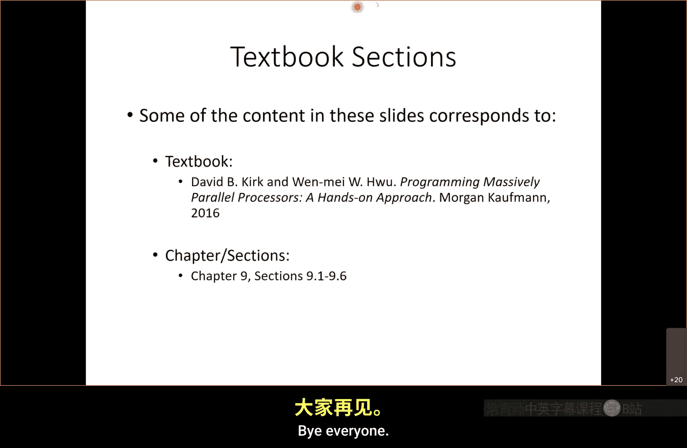

这些概念和优化策略是构建高效GPU程序的重要组成部分。