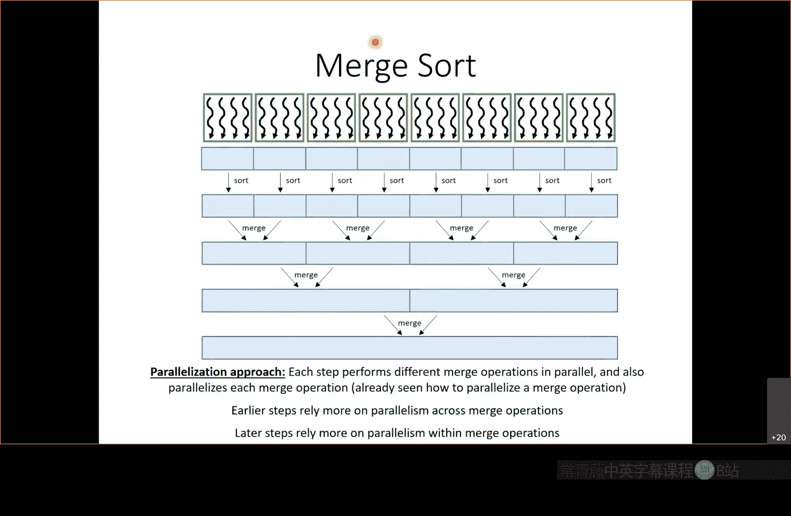

# GPU计算：15：排序

在本节课中，我们将学习两种重要的并行排序算法：基数排序和归并排序。我们将重点探讨基数排序的原理、并行化方法及其优化策略，并简要介绍如何将之前学习的并行归并模式应用于归并排序。

## 概述：从归并到排序

上一节我们介绍了并行归并模式。我们提到，有序归并是将两个有序列表合并成一个有序列表的操作。为了并行化此操作，一种方法是将要生成的输出列表划分为相等的段，并为每个线程分配其中一段。然后，每个线程需要在两个输入数组A和B中找到对应的输入段，并顺序合并这两个输入段。并行归并的关键挑战在于每个线程如何在A和B中找到对应的输入段。

为了解决这个问题，我们引入了协同秩的概念。给定一个指向输出数组C中元素（或段起始点）的索引K，关键挑战是找到指向A和B中对应元素的索引I和J。我们称I为K在A中的协同秩，J为K在B中的协同秩。我们观察到J就是K减去I，因此真正的挑战在于找到I。我们通过为I设定边界，然后在此边界内进行二分搜索来确定I。判断猜测正确、过高或过低的条件基于一个观察：A中I之前的元素应小于B中J之后的元素；同样，B中J之前的元素应小于A中I之后的元素。

每个负责一个输出段的线程都会进行二分搜索来确定I，然后相应地找到J，最后将两个输入段顺序合并到输出段中。此操作的内存访问不是合并的，因为二分搜索涉及对数组的随机访问，并且在顺序合并阶段，每个线程合并的是输入数组中的不同段，访问模式也不连续。

为了优化，我们让块中的一个线程确定整个块对应的输入段（I_block和J_block），然后块内的线程协作将这些段以合并访问的方式加载到共享内存中。接着，所有线程在共享内存中进行各自的二分搜索和顺序合并。最后，我们将合并后的结果从共享内存以合并访问的方式写回全局内存。这样，我们通过合并访问加载到共享内存，在共享内存中进行非合并访问的操作，再以合并访问写回全局内存，从而优化了内存访问。

我们还讨论了线程粗化的代价。并行化归并的代价是每个线程都需要进行自己的二分搜索。线程越多，二分搜索操作就越多。通过为每个线程分配多个输出元素（即一个输出段），我们已经应用了线程粗化，从而分摊了二分搜索的成本。

本节中，我们将开始讨论排序算法，主要关注基数排序，并简要介绍归并排序。

## 基数排序原理 🔢

基数排序是一种排序算法，其工作原理是基于基数（或进制）将待排序的键值分配到桶中。如果输入键值在某种位置记数系统中以某个基数为表示，那么我们就使用该基数，并迭代键值的每一位数字。每次迭代，我们都根据当前处理的数字将键值分配到对应的桶中。

对键值的每一位数字重复此分配过程。一个重要点是，每次迭代时，每个桶内应保持前一次迭代产生的顺序。这很关键，我们稍后会解释原因。在计算机中实现基数排序时，我们通常喜欢使用2的幂作为基数，因为这简化了对二进制数的处理。每次迭代处理键值中一个固定的比特位切片。

为了简单和便于说明，我们将从基数为2（即1比特）的情况开始。然后在本节后续部分再扩展到更大的基数。

### 单比特基数排序演示

假设我们有一个数组需要排序。我们需要将数组的键值按比特位划分，并每次迭代处理一个比特位（因为我们使用的是1比特基数）。每次迭代，我们将根据当前处理的比特位将输入分配到桶中。

首先，我们查看每个数字的最低有效位。有些是0，有些是1。我们将根据这个比特位将键值分离到两个桶中：将所有比特位为0的放在一起，将所有比特位为1的放在后面。完成这一步后，数组仅按最低有效位排序。

接着，我们重复这个过程，但每次查看不同的比特位，从低有效位向高有效位进行。在下一次迭代中，我们查看第二个比特位，并根据该比特位是0还是1来分离键值。这里的关键是，在分离时，我们在每个桶内保持了原始顺序。这样做的原因是，如果我们打乱顺序，就会破坏前一次迭代得到的结果。前一次迭代已按第一个比特位排序，第二次迭代在按第二个比特位排序的同时，保持了第一次迭代的顺序。这确保了键值现在按较低的两位比特排序。

然后我们对第三个比特位重复此过程，依此类推，直到处理完所有比特位。最终，我们得到一个完全排序的数组。

基数排序是一种非比较排序算法。它通常要求键值具有固定大小，以便可以划分为数字位。如果键值不满足此条件，则需要使用基于比较的排序算法，如我们稍后将看到的归并排序。

## 并行化基数排序的关键步骤 ⚙️

现在，我们讨论如何并行化基数排序。核心问题在于：如何根据一个特定的比特位分离键值，同时保持顺序？换句话说，如何获取一个数组，将所有当前比特位为0的元素放在左边，为1的元素放在右边，并保持它们原有的相对顺序？

关键在于为每个元素找到其在输出（排序后）数组中的目标索引。

### 计算目标索引

让我们分析如何计算目标索引。

*   **对于比特位为0的元素**：其目标索引等于它左边0的个数。左边0的个数又等于该元素左边的总元素数减去左边1的个数。而左边的总元素数就是该元素的索引位置。因此，**目标索引(0) = 元素索引 - 左边1的个数**。
*   **对于比特位为1的元素**：其目标索引等于数组中0的总数加上该元素左边1的个数。0的总数等于数组总大小减去1的总数。因此，**目标索引(1) = 数组大小 - 1的总数 + 左边1的个数**。

由此可见，无论是0还是1，计算目标索引都需要知道**每个元素左边1的个数**。此外，对于比特位为1的元素，还需要知道整个数组中**1的总数**。

### 使用扫描模式

那么，如何找到每个元素左边1的个数呢？这正是**独占扫描**模式可以解决的问题。

因此，并行化基数排序（单次迭代，处理一个比特位）的逻辑步骤如下：
1.  **提取比特位**：每个线程负责一个输入元素，提取出当前要处理的比特位（0或1），形成一个比特位数组。
2.  **执行独占扫描**：线程协作对这个比特位数组执行独占扫描操作。结果数组的每个位置就存储了对应输入元素左边1的个数。同时，扫描过程也能得到整个数组中1的总数。
3.  **计算目标索引**：每个线程根据其元素的比特位是0还是1，应用上述公式，利用元素索引、左边1的个数、数组大小和1的总数来计算目标索引。
4.  **分散写入**：每个线程将其负责的输入元素写入到输出数组的对应目标索引处。

## 优化：改善合并访问 🚀

上述基本并行方法存在效率问题。在最后一步“分散写入”中，每个线程写入全局内存的位置是分散的，导致内存访问不是合并的，这会严重影响性能。

为了优化合并访问，我们可以利用共享内存。思路是：先在线程块内部进行排序和分离，然后再以合并访问的方式将整个桶写入全局内存。

以下是优化步骤：
1.  **局部排序**：每个线程块将其负责的输入元素加载到共享内存中。块内线程协作，执行上述的扫描和分离步骤，但这次是在共享内存中局部进行。这样，每个线程块在共享内存中将其元素分离到0桶和1桶中。
2.  **计算全局桶地址**：每个线程块需要知道它的0桶和1桶应该写入全局输出数组的哪个起始位置。为此，每个块将其局部0的个数和1的个数写入一个全局数组。然后，对这个全局数组执行一次独占扫描。扫描结果告诉每个块，在它之前所有块的0的总数（即其0桶的起始地址），以及全局0的总数加上在它之前所有块的1的总数（即其1桶的起始地址）。
3.  **合并写入**：每个线程块将其共享内存中的0桶和1桶分别整体地、连续地写入到全局内存中计算好的起始地址处。由于块内线程写入的是连续的内存区域，因此访问是合并的。

这种优化将非合并的分散写入，转变为先进行局部（共享内存）非合并操作，再进行全局合并写入，从而显著提高了内存访问效率。

## 基数选择与线程粗化 ⚖️

之前我们一直使用1比特基数。对于一个32位的键，需要32次迭代。为了减少迭代次数，我们可以使用更大的基数，例如2比特、4比特等。更大的基数意味着更少的迭代，但同时也意味着更多的桶（例如2比特有4个桶，3比特有8个桶）。

更多的桶会恶化我们刚才优化的合并写入效果，因为一个线程块可能需要将数据写入全局内存中更多个不连续的位置。

因此，基数的选择需要在**迭代次数**和**合并访问行为**之间取得平衡。我们希望基数足够大以减少迭代，但又不能太大以免严重损害合并访问性能。

另一种优化合并访问的策略是**线程粗化**。之前我们让每个线程处理一个元素。线程粗化是指让每个线程处理多个元素。这样，每个线程块处理的总元素数增加，意味着每个局部桶的大小也增加。当块将大桶写入全局内存时，合并访问的效果会更好，因为连续写入的数据块更长。

线程粗化通过让每个线程承担更多工作，分摊了扫描等操作的代价，并提高了内存访问的局部性。

## 归并排序简介 🤝

基数排序并非适用于所有类型的数据（例如可变长度键）。我们还需要一种适用于并行化的基于比较的排序算法，其中一种流行的方法是归并排序。

归并排序是一种分治算法：
1.  **分解**：将列表递归地分成两半，直到子列表足够小（例如，只有一个元素）。
2.  **解决**：排序这些子列表（对于很小的列表，排序很简单）。
3.  **合并**：将已排序的子列表两两合并，形成更大的有序列表，直到最终合并成完整的有序列表。

### 并行化归并排序

我们可以利用之前学过的并行归并模式来并行化归并排序：
*   在底层，可以使用简单的排序方法（甚至可以在线程块内部使用基数排序）对小数组进行排序。
*   在合并阶段，可以将不同的合并任务分配给不同的线程块并行执行。例如，在第一次合并阶段，多个线程块可以同时合并不同的相邻有序子数组对。
*   每个合并操作本身也可以并行化，正如我们在并行归并模式中学到的那样：将输出段分配给不同的线程块，每个块通过协同秩计算找到对应的输入段并进行合并。

随着合并的进行，需要合并的有序段越来越大，但段的数量越来越少。因此，并行性从“跨多个合并操作”逐渐转向“在单个大型合并操作内部”。在后期阶段，我们使用更多的线程块来并行化单个大型合并操作。

## 总结 📚

本节课我们一起学习了两种重要的并行排序算法。

我们深入探讨了**基数排序**，它是一种非比较排序算法。我们解释了其按比特位迭代分配的原理，并详细分析了如何并行化其核心步骤——根据特定比特位分离键值并保持顺序。关键点在于使用**独占扫描**来计算每个元素的目标索引。我们还讨论了如何通过**共享内存局部排序**和**全局桶地址计算**来优化全局内存的合并访问。此外，我们探讨了**基数大小选择**的权衡以及**线程粗化**对性能的积极影响。

最后，我们简要介绍了**归并排序**，说明了如何利用之前学习的并行归并模式，通过分治和并行合并来实现高效的并行排序。

理解这些排序算法的并行化策略及其优化，对于在GPU上高效处理大规模数据至关重要。