# GPU计算：21：固定内存与流

在本节课中，我们将要学习两个重要的CUDA概念：固定内存（Pinned Memory）和流（Streams）。我们将探讨如何通过使用固定内存来加速主机与设备之间的数据传输，以及如何利用流来实现数据传输与内核执行的并行化，从而更高效地利用GPU硬件资源。

## 回顾：线程束内同步

上一节我们介绍了线程束（Warp）内同步。我们提到，可以利用同一线程束内线程之间的特殊关系进行快速同步，CUDA为此提供了内置函数。线程束同步原语主要有两大类：

以下是两类主要的线程束同步原语：
*   **洗牌指令**：允许同一线程束内的线程共享数据，它们可以直接共享彼此的寄存器值，而无需通过共享内存。
*   **投票指令**：线程可以对某个条件进行“投票”，这对于检查哪些线程的谓词评估为真，或者检查线程束中哪些线程在某个分支上处于活动状态非常有用。

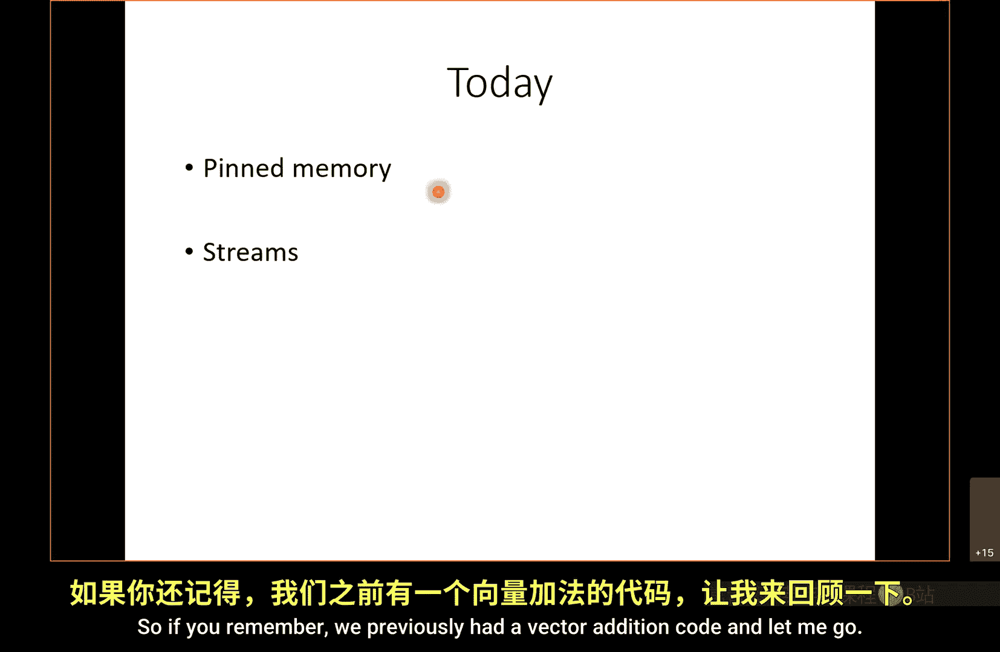

我们首先研究了洗牌指令。洗牌指令有多种类型，例如直接从一个线程获取数据，或者向上/向下洗牌。还有一种“异或洗牌”在某些情况下也很有用。

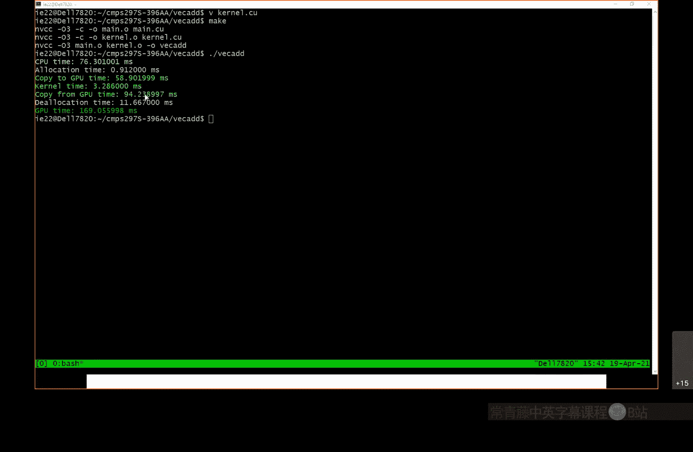

我们将洗牌指令应用于归约操作。在之前的实现中，当归约进行到一个线程束时，我们仍然通过共享内存并使用`__syncthreads()`进行同步。但我们意识到，实际上可以仅使用洗牌指令在线程束内完成归约树，而无需经过共享内存，也无需调用`__syncthreads()`。

接着，我们研究了线程束投票指令。投票指令有不同变体，例如检查所有线程是否满足某个谓词，或者是否有任一线程满足谓词。`ballot`指令可以检查哪些线程的谓词评估为真，哪些为假，并返回一个掩码。`activemask`指令则告诉我们哪些线程在特定分支上是活动的。

线程束投票函数的一个应用场景是，当需要线程束内的线程进行通信，并让一个线程代表其他线程执行操作时。例如，如果我们要向队列中添加元素并递增计数器，与其让每个线程都去原子递增计数器，不如让线程束中的一个“领导者”线程代表所有线程执行原子递增操作。然后，每个线程可以根据领导者线程分配的结果，计算出自己在队列中应占用的位置。

我们看到了实现此过程的步骤：首先分配一个领导者线程，然后计算需要向队列中添加多少元素，接着领导者线程执行原子操作，最后将结果广播给其他线程，每个活动线程再据此确定存储自己结果的位置。

我们使用了`activemask`来找出哪些线程是活动的，并使用`__ffs`（查找首个置位位）内部函数在活动掩码中找到第一个置位位，从而确定领导者线程。我们通过对活动掩码进行`__popc`（人口计数）来计算需要分配多少队列空间。`__ffs`和`__popc`本身并非线程束同步原语，它们是每个线程可以独立调用的内部函数，但在使用线程束内部函数时非常有用，因为我们可以将它们应用于活动掩码来完成各种有趣的操作。

在确定了要添加到队列的元素数量后，我们让领导者线程执行原子操作，然后使用`__shfl_sync`让线程束中的每个线程从领导者线程获取值，以确定其应存储结果的位置。最后，我们使用一些位操作技巧，让每个活动线程计算出自己在队列中的具体位置。

这就是我们上一节讨论的内容。在开始今天的新内容之前，关于线程束内部函数还有什么问题吗？

## 固定内存

今天我们将转向一个新主题：固定内存。我们还将讨论流。这是两个相关的主题，我们将从固定内存开始。

首先，什么是固定内存？回想一下我们之前的向量加法代码。我们分配了向量内存，复制源向量，调用加法内核，然后复制回结果向量，最后释放内存。

当我们编译并运行这段代码时，可以看到执行时间的分配情况。CPU执行耗时76毫秒，而GPU总耗时169毫秒。但请注意，GPU内核执行时间实际上只有3.2毫秒。GPU总时间主要由什么主导？是复制时间。将两个向量复制到GPU花了58毫秒，将结果复制回来花了94毫秒。

显然，当向量已经在GPU上时，在GPU上执行加法要快得多。但如果向量在CPU上，从GPU获得的加速可能无法抵消复制数据的开销。我们今天要问的问题是：能否优化这种复制？能否减少每次向GPU复制数据以及从GPU复制数据回来的时间？

### 直接内存访问

为了讨论如何优化复制，我们首先需要了解调用`cudaMemcpy`时发生了什么。这个过程涉及**直接内存访问**。

**直接内存访问**允许硬件单元在不涉及CPU的情况下访问内存。当我们在CPU和GPU之间复制数据时，实际上使用了DMA。这意味着，当数据从主内存复制到GPU时，CPU并不参与实际的复制过程。CPU不会从主内存加载数据然后存储到GPU内存。实际情况是，存在一个DMA引擎。当CPU调用`cudaMemcpy`时，它只是发起调用，然后可以继续执行其他任务，而DMA引擎负责从CPU的主内存读取数据并将其放入GPU内存。

使用DMA相对于让CPU参与复制有什么优势？DMA是专用硬件，可能复制得更快。此外，CPU可以在内存复制进行的同时去处理其他有用的工作，从而更好地利用资源。

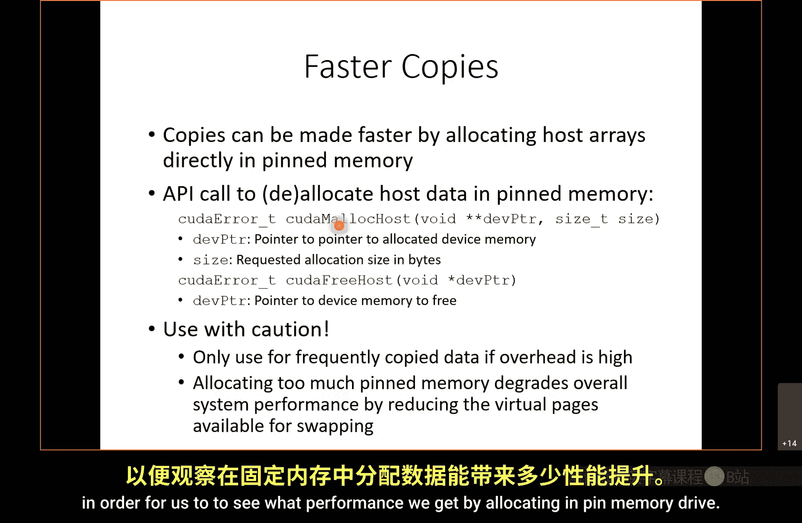

那么使用DMA有什么缺点呢？当CPU访问主内存时，它使用虚拟地址并进行地址转换。而DMA引擎没有进行地址转换的能力，它使用物理地址来读取主内存并写入GPU内存。

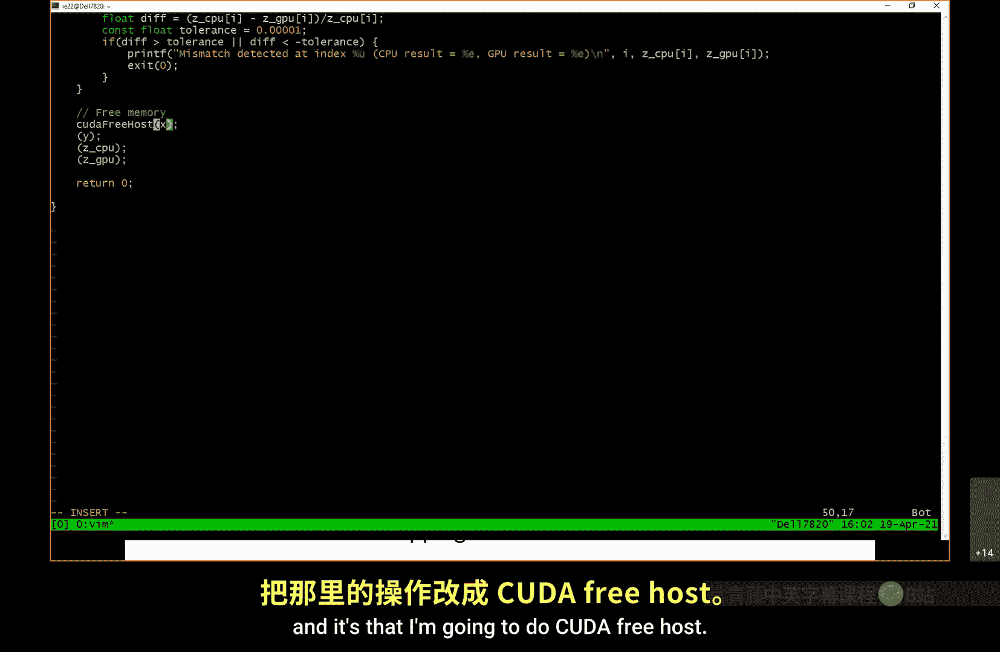

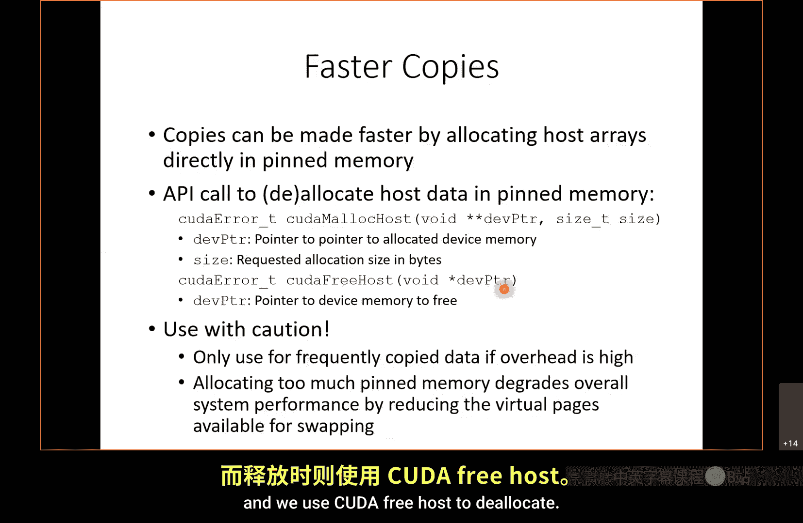

DMA引擎使用物理地址的缺点是什么？如果DMA正在读取的内存被操作系统换出，DMA无法检测到这一点。CPU可以检测到，因为如果某个页面被换出，在进行地址转换时会发生页面错误，然后操作系统会将其换入。但对于DMA，当它从某个物理页面读取时，如果该物理页面被操作系统交换出去，DMA引擎无法知晓，它会继续读取同一个物理页面，而此时该页面可能已经包含了新的数据。这显然是我们不希望发生的。

因此，为了避免数据损坏，操作系统必须确保任何被DMA访问的页面都不会被交换出去。我们需要锁定这些页面，防止操作系统交换它们。换句话说，这些页面需要被“固定”。这就是**固定内存**。任何被DMA访问的页面都需要被页面锁定，或者说，需要被固定。我们必须将其分配为固定内存，这样它就不会被换出。

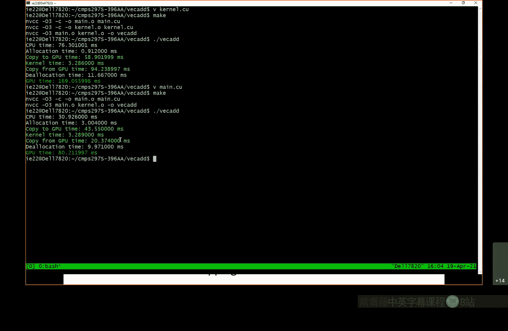

### CUDA内存复制的工作原理

现在我们知道`cudaMemcpy`使用DMA，而DMA要求页面被固定。那么`cudaMemcpy`是如何工作的呢？当我们使用`malloc`分配数据时，并没有做任何特殊处理来锁定它，因此我们假设这些数据可以被换出。

实际上，`cudaMemcpy`的工作方式如下：当从主机复制到设备时，CUDA运行时会使用一个预先分配的固定内存缓冲区。CPU首先将我们想要复制的数据从普通缓冲区复制到这个固定内存缓冲区。然后，DMA引擎从固定内存缓冲区将数据复制到GPU。当从设备复制回主机时，过程类似：DMA从设备内存复制数据到一个固定内存缓冲区，然后CPU再从这个固定内存缓冲区复制数据到由`malloc`分配的CPU缓冲区。

由此可见，每次调用`cudaMemcpy`时，我们并不是只执行一次复制，而是执行了两次复制：一次在普通CPU缓冲区和固定内存缓冲区之间，另一次在固定内存缓冲区和设备内存之间。这显然带来了额外的开销。

### 优化复制：使用固定内存

那么，如何优化复制，使其更快呢？如果我们不想进行两次复制，而只想进行一次复制，我们可以对我们的缓冲区做什么？我们可以直接固定它们。我们可以在CPU上拥有一个包含原始数据的固定内存缓冲区，然后直接从该缓冲区进行DMA复制，而不是先从一个非固定缓冲区复制到固定内存缓冲区，再由DMA从固定内存缓冲区复制。

CUDA提供了相应的API来直接分配和释放固定内存中的主机数据：
*   `cudaMallocHost`：类似于`cudaMalloc`，但在固定内存中分配主机数据。
*   `cudaFreeHost`：释放之前用`cudaMallocHost`分配的固定内存数据。

既然`cudaMallocHost`能让复制快这么多，我们是否应该将所有数据都分配在固定内存中？这是一个好主意吗？当我们固定一个页面时，我们是在告诉操作系统不能换出这个页面。如果我们分配了过多的固定内存，就会限制操作系统在交换页面时的灵活性，从而可能降低整体系统性能。因此，固定内存应谨慎使用，只应用于那些需要频繁在CPU和GPU之间传输的数据。

在现代拥有大量内存的系统中，如果你的GPU显存较小（例如4GB），而主机内存很大（例如128GB），那么使用较多的固定内存可能问题不大，因为你需要固定的内存量相对于主机总内存来说并不大。但总的来说，需要小心，不要将所有东西都分配在固定内存中，只应在复制开销确实很重要的地方使用。

### 性能对比

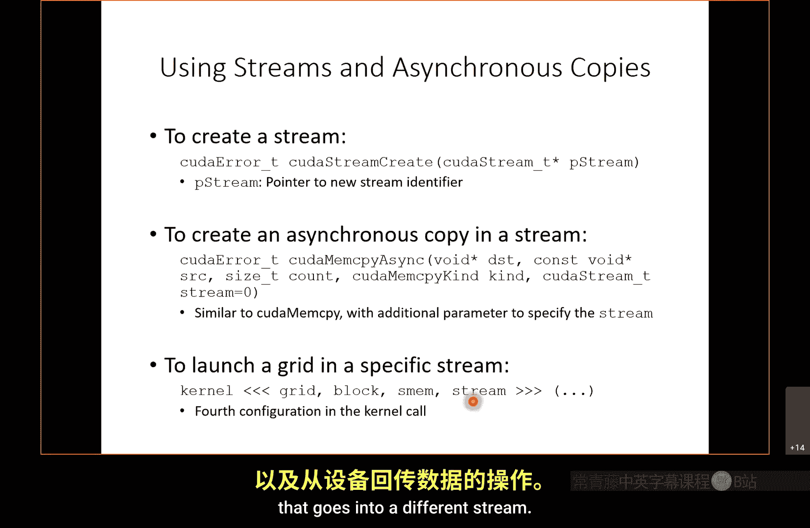

让我们修改代码，使用`cudaMallocHost`和`cudaFreeHost`来分配固定内存，看看性能提升。

修改后运行代码，可以看到GPU时间从169毫秒大幅改善到80毫秒。原因是复制时间减少了：从58毫秒降至43毫秒，从94毫秒降至20毫秒。有趣的是，CPU时间也改善了。这是因为现在CPU页面也被固定了，这意味着在CPU上进行计算时，不会发生页面错误，所有页面都驻留在内存中。

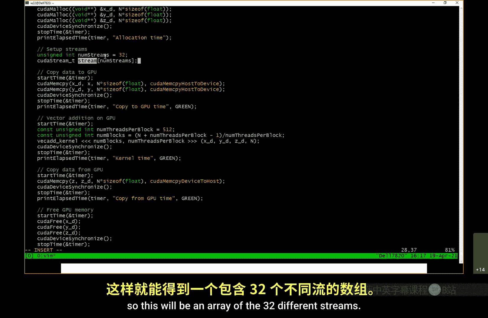

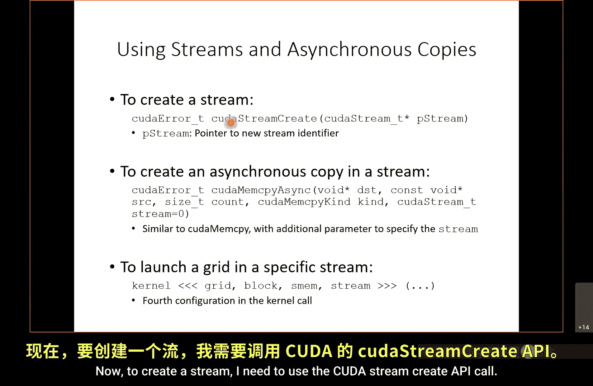

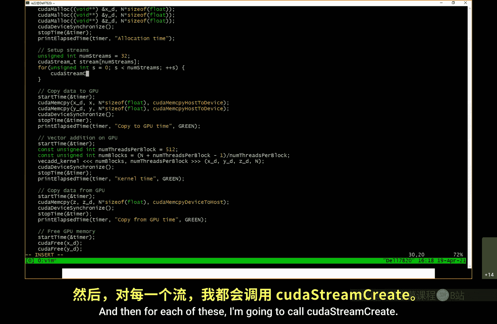

关于固定内存还有什么问题吗？

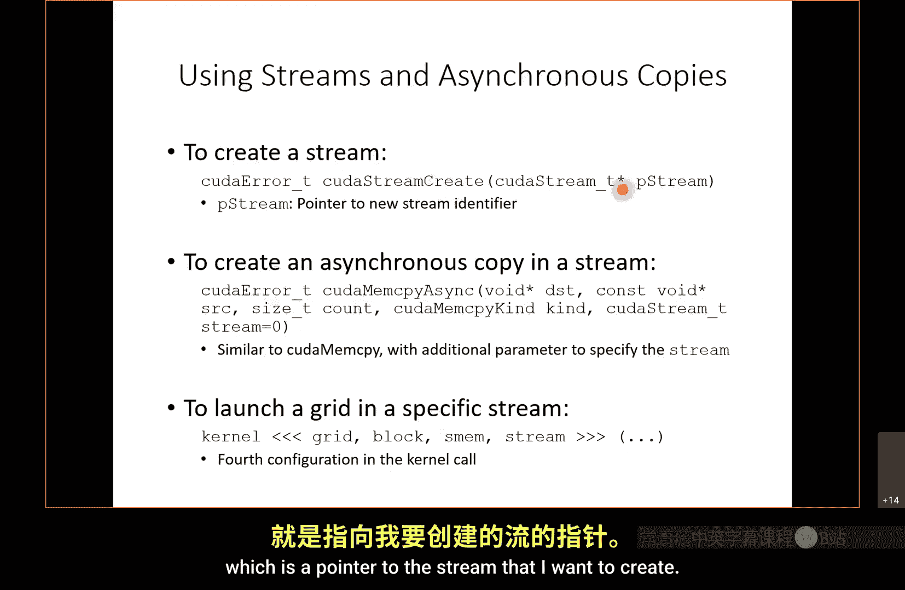

## 流

接下来，我们将讨论**流**。在此之前，我想谈谈系统架构层面的并行性。我们已经讨论了很多关于数据并行性的内容，即让不同线程处理不同数据。今天我想讨论的是任务并行性，更具体地说，是一种流水线并行。

在一个典型的系统中，我们有CPU和GPU。CPU有主内存，GPU有设备内存。通常，我们先将数据复制到GPU，然后在GPU上计算，最后将结果复制回来。但实际上，系统能够同时执行以下操作：在GPU上执行内核、从主机向设备复制数据、从设备向主机复制数据。执行GPU计算的硬件、从主内存复制到GPU内存的硬件、以及从GPU内存复制回主内存的硬件，这是三种不同的硬件资源。

我们可以同时使用这三种资源。但到目前为止，我们的做法是顺序执行：复制到GPU、在GPU上运行、复制回来。每次只使用其中一种资源，没有充分利用所有三种资源。我们的目标是尝试同时利用它们，以尽可能充分地利用硬件。

以向量加法为例，我们之前是：复制A和B到设备，执行网格计算A+B并存到C，然后复制C回主机。在水平时间轴上，当复制A和B到设备时，运行GPU的部分和从设备复制回主机的资源是空闲的。当在GPU上执行时，负责在主机和设备之间复制的硬件是空闲的。当从GPU复制回CPU时，GPU本身和负责从主机复制到设备的硬件是空闲的。

我们如何能更好地利用这些硬件资源呢？我们可以采用流水线技术。与其复制所有的A和B，然后计算，再复制所有的C回来，不如将A、B和C分成若干段。我们可以复制第一段A和B到设备，当第一段在设备上就绪后，执行网格计算A1+B1，同时，我们可以开始复制第二段A2和B2到设备。然后，当计算完成且第二段复制也完成时，我们可以将A1+B1的结果从设备复制回C1，同时，可以执行网格计算A2+B2，并开始复制第三段A3和B3到设备，如此继续。

这样，我们将数组分成段，每一步都在并行地进行：复制一个段、计算另一个段、复制回第三个段。我们正在重叠不同段的复制和计算。

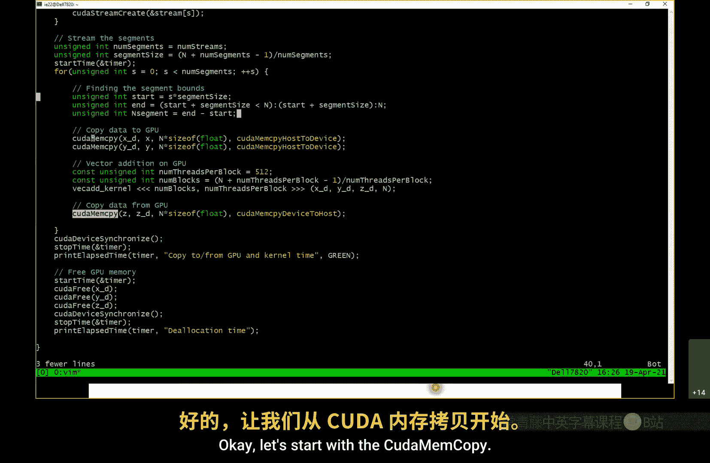

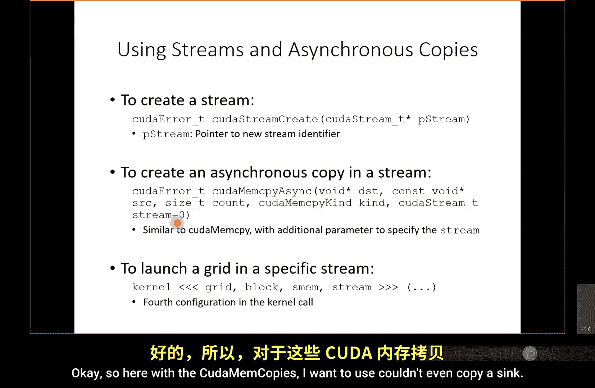

### 流的引入

为了实现这种流水线，我们需要能够进行异步内存复制。我们需要能够启动一个复制操作，然后无需等待它完成，就可以继续执行其他操作，比如启动内核或另一个复制操作。这就引入了**流**的概念。

在CUDA中，**流**是操作序列。放入同一个流中的任务按顺序执行。而放入不同流中的任务可以并行执行。默认情况下，如果不指定流，所有操作都会进入默认流并被序列化。

如果我们希望不同的内存复制和内核执行能够并行，就需要将它们放入不同的流中。此外，我们还需要使用异步内存复制，以便主机在发起复制后可以继续执行，而不必等待复制完成。

### 使用流的API

以下是相关的API调用：
*   `cudaStreamCreate`：创建一个流，并提供一个指向`cudaStream_t`类型对象的指针来存储流句柄。
*   `cudaMemcpyAsync`：异步内存复制API，与`cudaMemcpy`类似，但多了一个参数用于指定流。
*   内核启动配置：在内核启动配置中，可以在网格维度和块维度之后，可选地指定动态共享内存大小（默认为0），以及第四个可选参数——流。

### 代码实现：使用流的向量加法

我们希望将输入分成若干段，然后为每个段在不同的流中执行异步复制到设备、内核启动和复制回主机操作。

首先，我们创建多个流（例如32个）。然后，计算段的大小，并循环遍历每个段。对于每个段，我们确定其起始和结束位置。接着，我们使用`cudaMemcpyAsync`将数据复制到设备，使用修改后的内核启动（指定流和段参数）执行计算，再使用`cudaMemcpyAsync`将结果复制回主机。所有这些操作都指定了同一个流，因此对于同一个段，这些操作是顺序的。但不同段之间的操作，由于在不同的流中，可以并行执行。

在启动所有异步操作后，我们调用`cudaDeviceSynchronize`等待所有流中的操作完成。由于操作是异步和并行的，我们无法再单独测量每次复制或内核的时间，只能测量整个流水线的总时间。

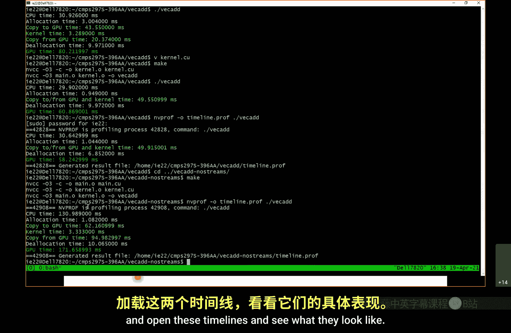

### 性能分析与可视化

运行修改后的代码，GPU总时间从80毫秒进一步降低到60毫秒。整个复制加内核的时间为49毫秒，这非常接近单独的复制到设备时间（43毫秒），表明我们成功地将内核执行和复制回的时间隐藏在了复制到设备的时间之后。

为了更直观地理解，我们可以使用性能分析器（如`nvprof`）来生成时间线。在不使用流的版本中，时间线显示所有操作（复制到设备、内核执行、复制回主机）都在默认流中顺序执行。而在使用流的版本中，时间线显示这些操作被分割成许多小块，并且复制到设备、内核执行和复制回主机的操作在不同的流中相互重叠，形成了流水线。这清楚地展示了我们如何通过重叠操作来隐藏延迟。

## 总结

本节课中，我们一起学习了两个关键的CUDA优化技术。

首先，我们探讨了**固定内存**。通过使用`cudaMallocHost`直接在固定内存中分配主机数据，可以避免`cudaMemcpy`内部的额外复制步骤，从而显著减少主机与设备之间的数据传输时间。但需注意，过度使用固定内存可能会限制操作系统的虚拟内存管理，应谨慎用于频繁传输的数据。

其次，我们学习了**流**。通过创建多个流并将计算任务分段，我们可以利用`cudaMemcpyAsync`和指定流的内核启动，实现数据传输与内核执行的流水线并行。这允许我们同时利用系统的复制和计算硬件资源，将内核执行和一部分数据传输时间隐藏在主要的数据传输时间之后，从而进一步提升整体性能。

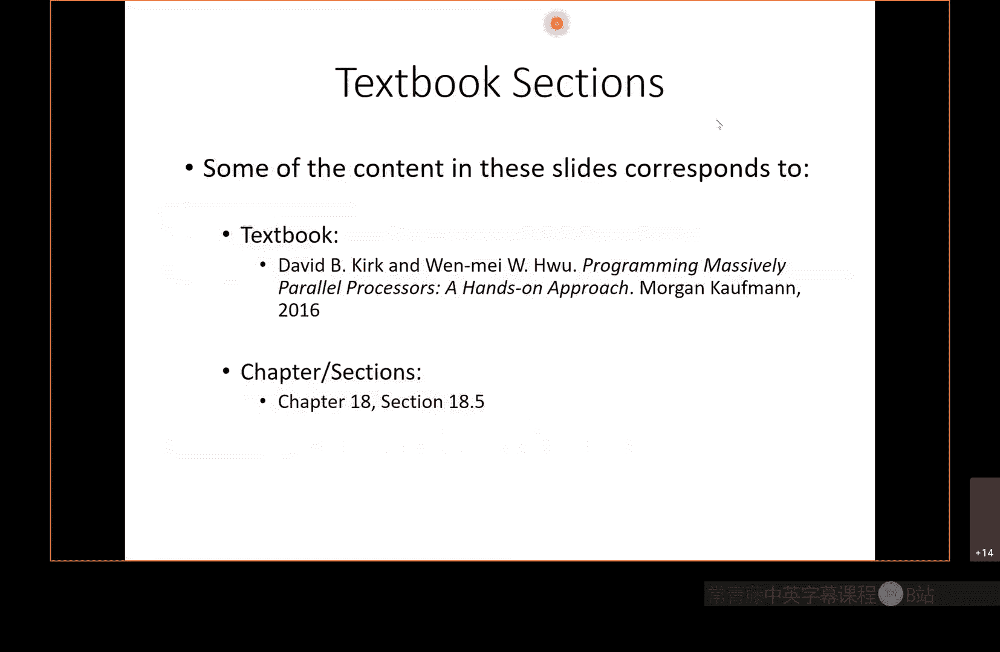

通过结合使用固定内存和流，我们可以更高效地管理GPU计算任务，尤其是在数据量较大、需要在主机和设备之间频繁移动数据的应用中。