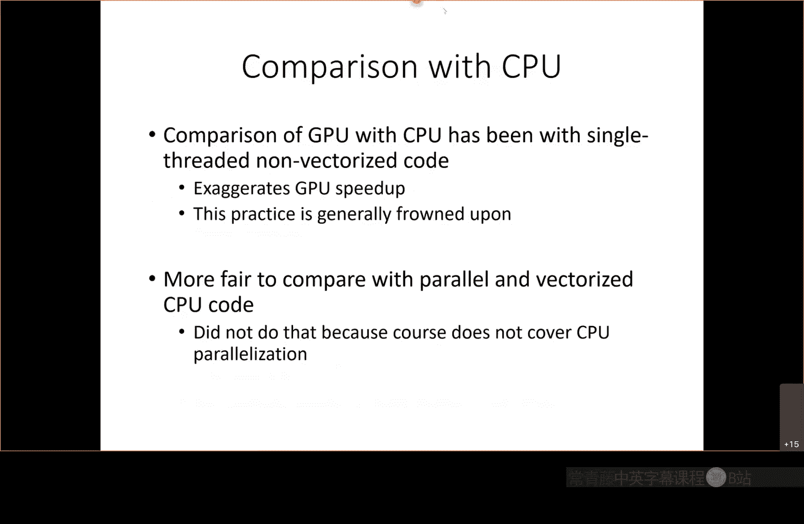

# GPU计算：第23讲：综合专题与课程总结 🎓


在本节课中，我们将快速浏览课程中未深入探讨的剩余主题，包括多GPU编程、互连技术、统一虚拟寻址、零拷贝内存、事件、张量核心、常用库、其他编程接口、其他GPU硬件，以及关于CPU与GPU性能对比的说明。本节课将作为课程的总结。

---

## 多GPU编程

上一节我们介绍了单GPU编程模型。本节中我们来看看当系统拥有多个GPU时，如何协调它们的工作。

多GPU编程主要有两种场景：
1.  **单节点多GPU**：一个CPU连接多个GPU。
2.  **多节点多GPU**：多个CPU（可能各自连接多个GPU）通过网络互联。

对于单节点多GPU，可以使用CUDA API进行管理。
*   `cudaGetDeviceCount()`：获取节点上的GPU数量。
*   `cudaSetDevice(int device)`：选择要操作的特定GPU。

通常，我们会结合使用多CPU线程（如OpenMP）来管理多GPU，每个CPU线程负责操作一个GPU。

对于多节点多GPU，通常使用**MPI**（消息传递接口）库来协调跨网络的不同CPU进程。每个MPI进程（或称为rank）可以控制一个或多个GPU。

跨GPU（尤其是跨网络节点）的数据共享是一个关键挑战。数据需要在GPU内存、CPU内存和网络之间移动，这可能导致高昂的通信开销。一个常见的优化策略是**重叠计算与通信**。例如，在进行模板计算时，可以在计算内部区域的同时，通过网络交换边界（halo）数据。

---

## 互连技术

GPU与CPU之间通过互连技术进行通信。了解不同的互连方式对性能有重要影响。

以下是两种主要的互连技术：
*   **PCIe**：一种通用、广泛支持的互连标准，用于连接CPU、GPU、FPGA等多种设备。
*   **NVLink**：NVIDIA推出的专用高速互连技术，带宽高于PCIe，但通常只支持特定代的NVIDIA GPU和部分CPU。

选择互连技术时，需要在通用性（PCIe）和性能（NVLink）之间做出权衡。

---

## 统一虚拟寻址

之前我们假设CPU内存和GPU内存拥有各自独立的虚拟地址空间。现代GPU系统支持**统一虚拟寻址**。

在UVA系统中，CPU和GPU共享一个统一的虚拟地址空间，但物理内存仍然是分开的。关键特性是：CPU和GPU的地址范围是互斥的。通过查看指针的值，运行时系统就能判断它指向的是主机内存还是设备内存。

这带来的主要好处是简化了编程。例如，在执行内存拷贝时，不再需要显式指定方向（如`cudaMemcpyHostToDevice`），可以使用`cudaMemcpyDefault`，运行时系统会根据指针值自动判断。

```c
// 非UVA时需要指定方向
cudaMemcpy(dev_ptr, host_ptr, size, cudaMemcpyHostToDevice);
// UVA时可以使用Default
cudaMemcpy(dev_ptr, host_ptr, size, cudaMemcpyDefault);
```

---

## 零拷贝内存

传统上，GPU线程无法直接访问CPU内存，需要显式拷贝。**零拷贝内存**允许GPU线程直接访问**固定的**主机内存。

当GPU线程访问零拷贝内存时，数据会在需要时**按需**从CPU内存拷贝到GPU内存，而不是由程序员预先进行批量拷贝。

要使用零拷贝内存，必须使用`cudaHostAlloc()`分配**固定内存**。在不支持UVA的系统上，还需要使用`cudaHostGetDevicePointer()`获取一个GPU可用的指针。在支持UVA的系统上，可以直接将主机指针传递给GPU内核。

零拷贝内存的优势包括：
*   **简化编程**：无需管理显式的数据拷贝。
*   **潜在的性能收益**：如果只访问大数据集的一小部分，可以避免不必要的批量拷贝；同时，按需拷贝可以与计算重叠，实现某种自动的流水线操作。

然而，其性能并不总是优于精心手动管理的批量拷贝，因为按需拷贝可能无法充分分摊每次数据传输的固定开销。是否使用需根据具体应用场景（如数据访问模式、计算通信比）进行测试。

---

## 事件

为了测量性能，我们之前常在每次内核启动或内存拷贝后使用`cudaDeviceSynchronize()`进行同步。但这会阻碍异步执行和并发。**CUDA事件**提供了更精细的计时和同步机制。

事件可以插入到CUDA流中，用于记录特定时间点，而无需阻塞整个设备。

以下是使用事件的核心操作：
*   `cudaEventCreate()`: 创建事件对象。
*   `cudaEventRecord(cudaEvent_t event, cudaStream_t stream = 0)`: 在指定流中记录事件。
*   `cudaEventSynchronize(cudaEvent_t event)`: 主机等待特定事件完成（而不是等待流中所有操作）。
*   `cudaEventElapsedTime(float* ms, cudaEvent_t start, cudaEvent_t end)`: 计算两个事件间的时间间隔。
*   `cudaEventDestroy()`: 销毁事件。

使用事件可以在不干扰异步操作的情况下，精确测量内核或内存拷贝的执行时间。

---

## 张量核心

从Volta架构（如V100）开始，NVIDIA GPU引入了**张量核心**。它们是专门用于加速矩阵乘累加运算的硬件单元。

每个张量核心能在单个指令中完成一个小型矩阵（如4x4）的 `D = A * B + D` 运算。这在深度学习等以矩阵运算为核心的工作负载中能带来巨大的性能提升。使用张量核心通常需要通过特定的API或库（如cuBLAS）进行调用。

---

## CUDA库

在课程中，我们手动实现了许多并行原语（如归约、扫描、矩阵乘法）以理解其原理。但在实际开发中，应优先使用高度优化的CUDA库。

以下是一些重要的CUDA库：
*   **Thrust / CUB**: 提供并行原语，如归约、扫描、排序、筛选等。
*   **cuBLAS**: 提供高度优化的密集线性代数运算，如向量加法、矩阵-向量乘法、矩阵-矩阵乘法等。
*   **cuSPARSE**: 提供稀疏线性代数运算，支持多种稀疏矩阵存储格式。
*   **cuDNN**: 深度神经网络库，被TensorFlow、PyTorch等主流框架用于GPU加速。
*   **其他**: 还有用于图形处理的**nvGRAPH**，用于快速傅里叶变换的**cuFFT**，用于信号/图像处理的**NPP**等。

使用这些库可以大幅提高开发效率和应用程序性能。

---

## 其他编程接口

CUDA并非编程GPU的唯一方式。根据可移植性和易用性需求，还有其他选择。

以下是几种其他编程接口：
*   **OpenCL**: 开放标准，支持跨厂商GPU（如AMD、Intel）、CPU甚至FPGA，可移植性更强，但代码可能比CUDA更复杂。
*   **OpenACC**: 指令制导编程模型。通过向C/C++/Fortran代码中添加编译指令（类似OpenMP），编译器会自动将代码并行化并移植到GPU上，简化了编程。
*   **C++ AMP**: 一种C++库和语言扩展，允许使用C++语法（如lambda表达式）编写GPU代码。

---

## 其他GPU硬件

本课程主要关注NVIDIA的独立GPU。但GPU市场还有其他参与者。

主要的GPU硬件包括：
*   **NVIDIA GPU**: 课程重点，广泛用于高性能计算和深度学习。
*   **AMD GPU**: 如Radeon系列，同样用于游戏和高性能计算。
*   **Intel GPU**: 常见于集成显卡，近年来也推出了独立GPU产品。
*   **Arm Mali GPU**: 常见于移动和嵌入式设备。
*   **集成GPU**: CPU和GPU集成在同一芯片上，共享物理内存，消除了PCIe数据传输开销。

---

## 关于CPU-GPU对比的说明

在课程中，为了突出GPU的并行能力，我们通常将优化的GPU代码与**单线程、未向量化**的CPU代码进行对比。这**夸大了**GPU的加速比。

为了进行公平的性能比较，应该将GPU代码与**充分并行化且向量化**的CPU代码进行对比。现代CPU同样拥有多核、多线程以及SIMD向量单元。本课程未深入探讨CPU并行化，是为了专注于GPU编程原理，但大家在评估性能时应意识到这一点。

---

## 总结

本节课中我们一起快速回顾了GPU计算课程的剩余主题。我们简要介绍了多GPU编程的挑战、互连技术、统一虚拟寻址和零拷贝内存如何简化编程、使用事件进行精细计时、专用于矩阵运算的张量核心、一系列可提高开发效率的CUDA库、除CUDA外的其他编程接口、以及不同的GPU硬件生态。



希望本课程为你打下了坚实的GPU并行编程基础。理解这些核心概念和优化原则，将有助于你开发高效的应用或进一步探索更高级的主题。感谢大家参与本课程！