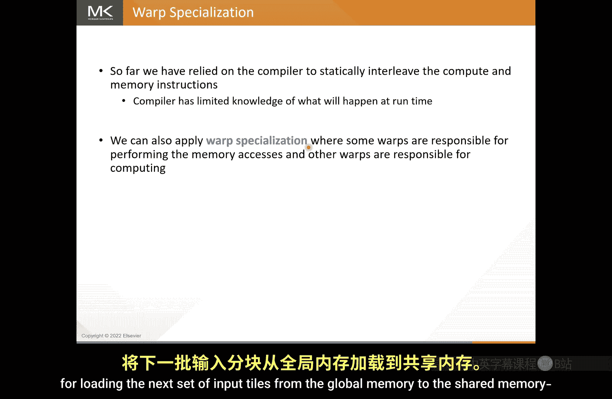
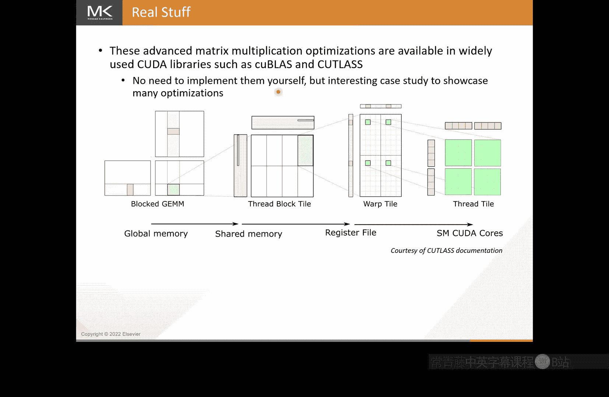

# GPU计算：P24：矩阵乘法的高级优化 🚀


在本节课中，我们将学习如何对GPU上的矩阵乘法运算进行高级优化。我们将从分析基础实现的性能瓶颈开始，逐步探讨如何通过共享内存分块、寄存器分块、向量化访存、软件流水线等一系列技术，将矩阵乘法从内存带宽受限的计算转变为计算资源受限的计算，从而最大化GPU的利用率。

---

## 算术强度分析

上一节我们介绍了矩阵乘法的基本并行方法。本节中，我们来看看如何分析其性能潜力。

矩阵乘法的核心操作是计算输出矩阵 **C** 的每个元素，它是输入矩阵 **A** 的一行和矩阵 **B** 的一列的点积。一个简单的并行策略是为每个输出元素分配一个线程。

**基础实现的算术强度分析：**
每个线程需要从全局内存加载两个单精度浮点数（共8字节），执行一次乘法和一次加法（共2次浮点运算）。因此，算术强度为：
`算术强度 = 浮点运算次数 / 访存字节数 = 2 / 8 = 0.25 次浮点运算/字节`
这个值远低于现代GPU（如H100）达到计算资源饱和所需的约20次浮点运算/字节，因此该实现是**内存带宽受限**的。

然而，矩阵乘法本质上具有成为**计算密集型**运算的潜力。对于一个完美的实现（每个输入值仅加载一次），计算一个 `N x N` 矩阵乘法的算术强度为：
`完美算术强度 = (2 * N^3) / (12 * N^2) = N/6 次浮点运算/字节`
当 `N=1024` 时，强度可达约171次浮点运算/字节，远高于计算饱和阈值。因此，我们的优化目标就是尽可能接近这个理想强度。

---

## 共享内存分块

为了提升算术强度，我们首先引入共享内存分块技术。

其核心思想是：将一个线程块负责计算的输出矩阵**分块**，并将计算该输出块所需的输入矩阵也相应**分块**。线程块先将一对输入块从全局内存加载到**共享内存**中，然后所有线程再利用共享内存中的数据计算各自负责的输出元素。

**共享内存分块的算术强度分析：**
假设我们使用 `BM x BN` 大小的输出块，以及 `BM x BK` 和 `BK x BN` 大小的输入块。
*   **访存量**：加载两个输入块，共 `2 * BM * BK * 4` 字节。
*   **计算量**：输出块包含 `BM * BN` 个点积，每个点积涉及 `BK` 次乘加（2次浮点运算），总计算量为 `2 * BM * BN * BK` 次浮点运算。
*   **算术强度**：`(2 * BM * BN * BK) / (8 * BM * BK) = BN / 4` 次浮点运算/字节。

分析表明，算术强度与输出块的宽度 `BN` 成正比，而与输入块的宽度 `BK` 无关。这意味着：
1.  增大输出块尺寸（`BM` 和 `BN`）能直接提升算术强度。
2.  我们可以保持较小的 `BK` 以节省共享内存，从而将共享内存资源用于增大输出块。

典型的配置如：`BM = BN = 128`, `BK = 8`。此时算术强度为 `128 / 4 = 32` 次浮点运算/字节，足以使计算在高端GPU上达到计算资源饱和。

然而，增大输出块意味着每个线程需要负责更多输出元素，这些累加器需要存储在**寄存器**中。同时，输入块存储在**共享内存**中。GPU上这两种资源都是有限的，因此我们需要在资源约束下进行优化。

---

## 内核实现框架

在深入优化细节之前，我们先看一下高级优化内核的代码框架。

以下是实现上述分块策略的伪代码框架：
```cpp
// 每个线程块负责一个 BM x BN 的输出块
// 每个线程负责一个 TM x TN 的输出子块（存储在寄存器中）
// 循环遍历所有输入块对 (BK x BK)
for (int k = 0; k < K; k += BK) {
    // 1. 协作加载：将全局内存中的 A 块和 B 块加载到共享内存中
    load_tile_from_global_to_shared(A_global, A_shared, ...);
    load_tile_from_global_to_shared(B_global, B_shared, ...);
    __syncthreads();

    // 2. 计算贡献：每个线程从共享内存读取数据，计算对其 TM x TN 输出子块的贡献
    //    结果累加到线程的寄存器数组中
    matrix_multiply_accumulate(A_shared, B_shared, reg_C, ...);
    __syncthreads();
}
// 3. 写回结果：每个线程将其寄存器中的 TM x TN 结果写回全局内存
write_tile_from_registers_to_global(reg_C, C_global, ...);
```
接下来，我们将分解这个框架中的关键部分。

---

## 关键组件实现

以下是实现上述框架所需的关键辅助函数及其要点。

### 声明与初始化寄存器中的输出块

我们希望每个线程的 `TM x TN` 输出块完全存储在寄存器中，以获得最快的访问速度。在CUDA中，编译器可以将小的、索引恒定的局部数组提升到寄存器。

**实现方法：**
```cpp
// 在函数内声明一个固定大小的数组
float reg_C[TM][TN];
// 通过完全展开循环来初始化和访问它，确保索引是编译期常量
#pragma unroll
for (int i = 0; i < TM; ++i) {
    #pragma unroll
    for (int j = 0; j < TN; ++j) {
        reg_C[i][j] = 0.0f;
    }
}
```
循环展开后，所有数组访问都变成了对固定寄存器的直接访问，避免了局部内存的开销。

### 从全局内存加载数据块到共享内存

加载函数需要将一个大块（例如128x8）的数据从全局内存高效、合并地转移到共享内存。由于线程块中的线程数（如256）可能少于块中的元素数（如1024），每个线程需要加载多个元素。

**初始实现思路：**
将输入块划分为多个子块，每个线程依次加载每个子块中的一个元素。这能保证合并访问，但每个线程需要发出多条加载指令。

### 计算贡献：矩阵乘法核心

当输入数据已在共享内存中后，每个线程需要计算其负责的输出子块。这通过一个三层嵌套循环实现，遍历输出子块的行、列以及共享内存中当前输入块的深度维度（`BK`）。

### 将结果从寄存器写回全局内存

计算完成后，每个线程需要将其寄存器中的 `TM x TN` 结果写回全局内存中的对应位置。类似加载过程，需要处理边界并尽可能实现合并写入。

---

## 核心优化技术

我们已经有了一个利用共享内存和寄存器的基础框架。本节中，我们来看看一系列能进一步提升性能的核心优化技术。

### 向量化加载与存储

现代GPU支持向量化内存事务，允许单个线程单条指令加载或存储多个连续的数据元素（如4个单精度浮点数，共16字节）。

**向量化加载的优势：**
在加载输入块到共享内存时，使用向量化加载可以让每个线程用更少的指令加载更多数据。这提高了向内存系统发出请求的速率，对于后续要讨论的**低占用率**情况尤为重要。

**向量化存储的优势：**
在将寄存器中的结果写回全局内存时，向量化存储有两个好处：
1.  **减少指令数**：将多个标量存储合并为一条向量存储指令。
2.  **改善合并访问**：线程写入连续的内存地址，提高了内存事务的效率。例如，每个线程存储其4x4子块中的一行（4个连续元素），同一线程束（Warp）内相邻线程存储的行是连续的，从而实现了良好的合并。

### 寄存器分块

在基础实现中，线程在计算输出子块时，会反复从共享内存中读取相同的输入值。共享内存虽然比全局内存快，但在计算核心全力工作时，它仍可能成为瓶颈。

**寄存器分块思想：**
将计算过程进一步分块。每个线程不是一次性计算整个 `TM x TN` 输出子块，而是分“条”进行：
1.  从共享内存中加载一个 `TM x 1` 的A条和一个 `1 x TN` 的B条到**寄存器**中。
2.  执行这两个向量的外积，更新整个 `TM x TN` 输出子块（所有数据都在寄存器中）。
3.  重复步骤1和2，遍历完共享内存块的所有“条”。

这种方法将共享内存访问次数降到最低，计算完全在寄存器中进行，形成了密集的乘加指令流，极大地提升了计算单元的利用率。

### 优化存储的合并访问

即使使用向量化存储，如果线程负责的输出子块在内存中不连续，写入仍可能无法完全合并。

**解决方案：重组线程块的工作分配。**
我们不直接让一个线程负责一个大的、连续的输出子块（如8x8），而是让一个**线程束（Warp）** 共同负责一个较大的输出区域（如64x32）。然后，将这个Warp输出区域划分为多个象限，每个线程负责每个象限中的一个**小块（如4x4）**。

这样，当线程束内的所有线程写入同一个象限时，它们写入的4x4小块在内存中是连续排列的，从而实现了完美的合并存储。

### 消除共享内存体冲突

共享内存被组织成多个体（Bank）。当线程束中的多个线程同时访问同一个体的不同地址时，会发生体冲突，导致串行访问，降低性能。

**问题来源：**
在从共享内存加载数据条到寄存器时，如果数据在内存中的布局导致线程束内不同线程访问的地址间隔是体数量的整数倍（如32），就会发生体冲突。

**解决方案：共享内存填充。**
在声明共享内存数组时，人为地增加每一行的宽度（例如，实际宽度为8，但声明为9）。这种填充改变了数据在体中的映射关系，将原本可能冲突的访问分散到不同的体上。

---

## 处理低占用率

由于大量使用寄存器（用于输出子块、输入条以及循环展开产生的临时变量），高级矩阵乘法内核的寄存器使用量非常高，接近每个线程255个寄存器的上限。这严重限制了每个流多处理器（SM）上可同时驻留的线程数（占用率），可能低至12.5%。

低占用率带来两个问题：
1.  **隐藏计算延迟能力差**：硬件调度器可选择的就绪线程束少。
2.  **隐藏内存延迟能力差**：同时发出的内存请求少，难以饱和内存带宽。

为了应对低占用率，我们采用了以下策略：
*   **激进的循环展开**：增加指令级并行，减少线程束停顿。
*   **向量化加载/存储**：让有限的线程能以更高的速率发出内存请求。
*   **软件流水线**和**线程束专业化**：专门用于重叠计算和内存操作。

### 软件流水线

在基础循环中，加载下一对输入块的操作，必须等待当前输入块的计算完成（因为共享内存缓冲区被复用）。这是一种“假依赖”。

**解决方案：双缓冲。**
为输入块分配两个共享内存缓冲区。当使用缓冲区0中的数据进行计算时，可以异步地将下一对输入块加载到缓冲区1中。这消除了“计算完成”和“开始下一次加载”之间的依赖，使得加载和计算可以重叠。

**软件流水线实现：**
重构循环，使得在迭代 `i` 中，同时进行：
*   使用缓冲区 `i%2` 中的数据进行计算。
*   将下一对输入块加载到缓冲区 `(i+1)%2` 中。
这样，计算和内存传输指令在同一个迭代中交错，编译器可以更好地调度它们以隐藏延迟。

### 线程束专业化

软件流水线依赖编译器静态地交错指令。为了更动态地利用硬件调度器，我们可以使用**线程束专业化**。

**思想：**
将线程块中的线程束分为两组：
*   **计算线程束**：专门负责执行矩阵乘法的计算部分。
*   **加载/存储线程束**：专门负责在全局内存和共享内存之间传输数据。
硬件调度器会自动在这些不同任务的线程束之间进行切换，从而实现计算和内存传输的动态重叠，更有效地隐藏延迟。

---

## 利用专用硬件单元

现代GPU提供了专用于加速特定操作的硬件单元。

### 张量内存加速器

这是一种专用的数据搬移引擎，可以异步地将大块数据在全局内存和共享内存之间传输。

**优势：**
1.  **释放计算核心**：计算核心不再需要执行加载/存储指令来进行数据搬移，可以专注于计算。
2.  **节省寄存器**：数据搬移不再经过计算核心的寄存器文件，腾出了更多寄存器用于计算。
3.  **更好的重叠**：专有引擎与计算核心并行工作，能更彻底地隐藏内存访问延迟。

### 张量核心




张量核心是执行小型矩阵乘加运算的专用硬件单元（例如，计算 `D = A * B + C`，其中A、B、C、D是小矩阵）。它们比通用的FP32核心快得多，并且功耗更低。

像cuBLAS、cuDNN和CUTLASS这样的高性能库，在内部已经集成了所有这些优化，并自动利用张量核心。因此，在实际应用中，应优先使用这些库，而不是自己实现。

---

## 总结与课程回顾

本节课中我们一起学习了GPU上矩阵乘法的高级优化技术。

我们从分析基础实现的算术强度出发，认识到其内存带宽受限的本质。为了将其转化为计算密集型任务，我们引入了**共享内存分块**来重用数据，并推导出增大输出块尺寸是提升性能的关键。

为了实现大尺寸输出块，我们采用了**寄存器分块**技术，将计算核心转移到更快的寄存器中进行。为了高效处理数据，我们使用了**向量化加载/存储**来提升内存吞吐，并重组了线程工作分配以实现**合并访问**。我们还通过**共享内存填充**消除了**体冲突**。

面对因高寄存器使用导致的**低占用率**挑战，我们采用了**软件流水线**和**双缓冲**来重叠计算与内存操作，并介绍了**线程束专业化**的概念以动态调度任务。最后，我们了解了如何利用**张量内存加速器**和**张量核心**这类专用硬件单元来获得终极性能。



虽然在实际开发中应直接使用优化库（如cuBLAS、CUTLASS），但理解这些底层优化原理至关重要。它们不仅是矩阵乘法的核心优化手段，其思想（如分块提升数据重用、平衡资源使用、重叠计算与访存）也适用于优化其他复杂的GPU计算任务。