# GPU计算：13：直方图与原子操作

在本节课中，我们将学习一个新的并行模式——直方图。我们将探讨其基本概念、并行实现时遇到的挑战，以及如何使用原子操作来解决数据竞争问题。最后，我们将介绍两种关键的优化技术：私有化和线程粗化，以提升直方图计算的性能。

---

## 回顾：扫描操作

上一节我们介绍了并行扫描操作，特别是Brent-Kung方法。本节中，我们来看看直方图。

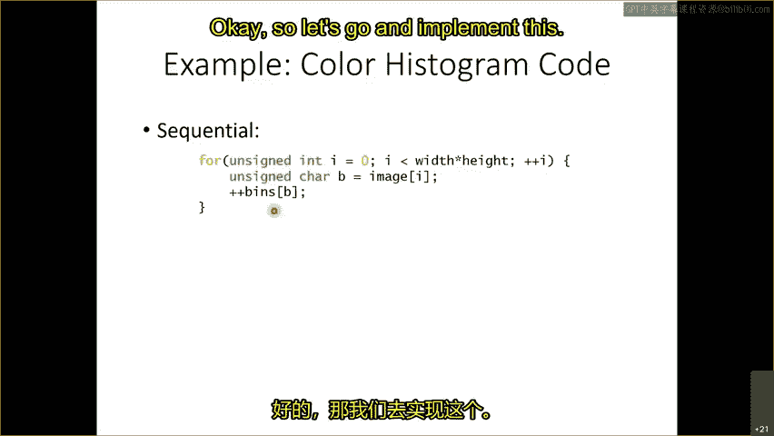

我们讨论了两种并行扫描方法：Kogge-Stone和Brent-Kung。
*   Kogge-Stone方法需要 **log n** 步完成，总操作数为 **O(n log n)**。
*   Brent-Kung方法需要 **2 log n - 1** 步，但只执行 **O(n)** 次操作，因此具有更高的工作效率。

我们还对扫描操作应用了多种优化，包括使用共享内存（这同时实现了访存合并）以及通过重新索引线程来最小化控制流分化。最后，我们探讨了线程粗化如何通过让每个线程顺序处理一段数据，再并行扫描部分和，来提升算法的工作效率。

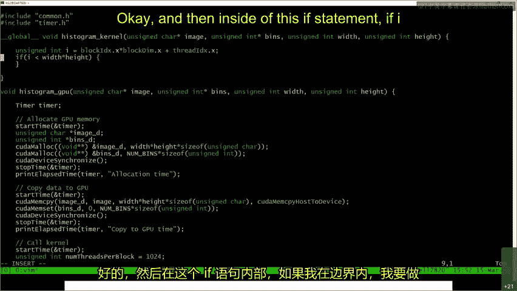

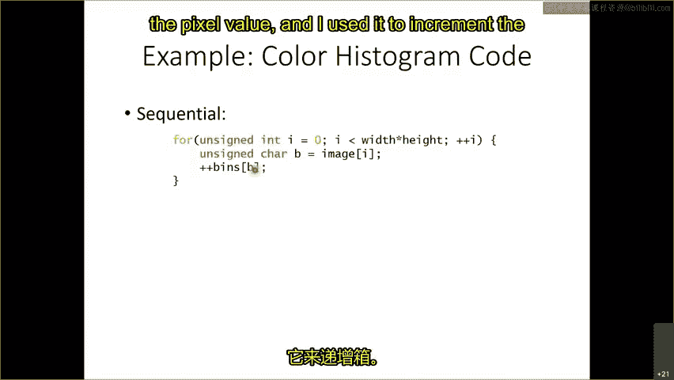

---

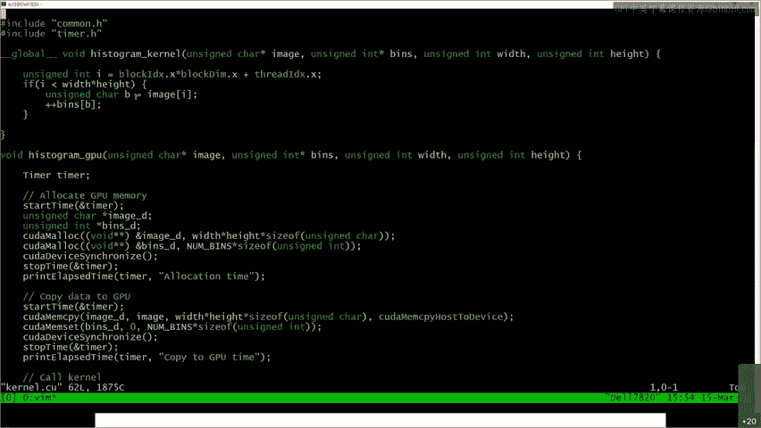

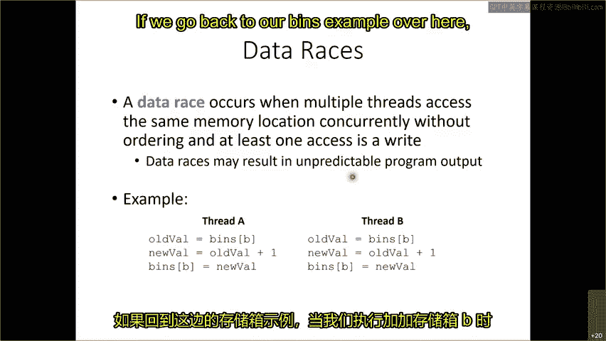

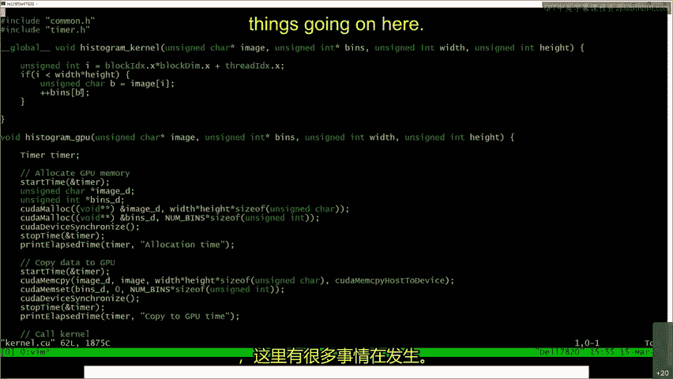

## 什么是直方图？

直方图用于近似表示数据集的分布。其工作原理是将输入数据集中可能出现的值范围划分为若干个“区间”（或称为“桶”），然后统计落入每个区间的数据数量。

一个常见的应用是颜色直方图。例如，一张图像的像素值通常用8位整数表示，范围是0到255。颜色直方图可以统计每个像素值出现的次数，从而概括图像的色彩分布、明暗程度等信息。

一个顺序实现的直方图伪代码如下：
```c
for (int i = 0; i < num_pixels; i++) {
    unsigned char pixel_value = image[i];
    bins[pixel_value]++; // 递增对应区间的计数
}
```

---

## 并行直方图的挑战

如何并行化直方图操作？一个直观的想法是将图像数据分配给多个线程，每个线程负责更新自己对应的区间计数。我们可以为每个像素分配一个线程。

以下是初步的CUDA内核代码框架：
```c
__global__ void histogram_kernel(unsigned char* image, int* bins, int num_pixels) {
    int i = blockIdx.x * blockDim.x + threadIdx.x;
    if (i < num_pixels) {
        unsigned char pixel_value = image[i];
        bins[pixel_value]++; // 存在数据竞争！
    }
}
```

然而，这个实现存在严重问题。当多个线程同时读取、修改并写入同一个内存位置（例如`bins[10]`）时，会发生**数据竞争**。因为`bins[pixel_value]++`并非原子操作，它包含加载、加一、存储多个步骤，这些步骤的交错执行可能导致最终计数错误。

---

## 原子操作：解决数据竞争

为了避免数据竞争，对同一内存位置的并发“读-改-写”操作必须是**互斥**的。在CPU上，我们通常使用锁（如互斥锁）来实现互斥。但在GPU上，使用锁可能导致死锁（例如，同一线程束中的线程相互等待）。

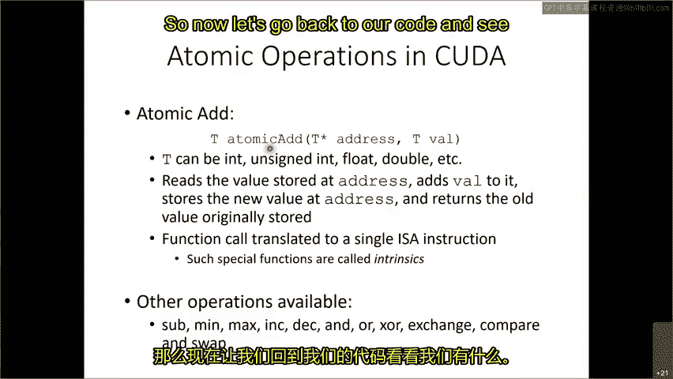

GPU提供了更优的解决方案：**原子操作**。原子操作能保证“读-改-写”作为一个不可分割的单一硬件指令执行。在此期间，硬件会确保没有其他线程能访问该内存位置。

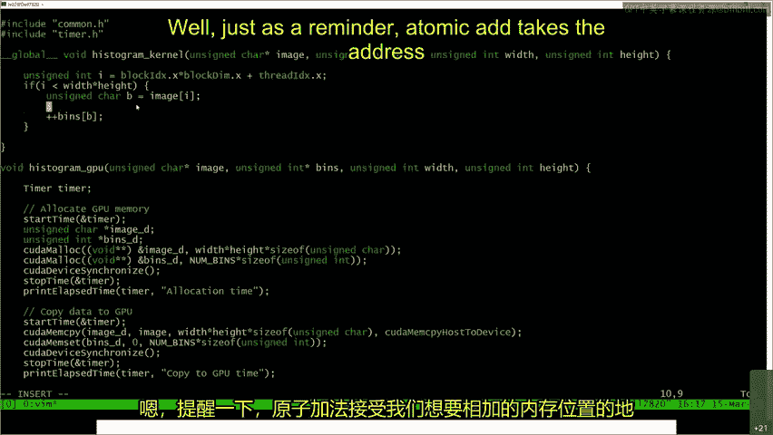

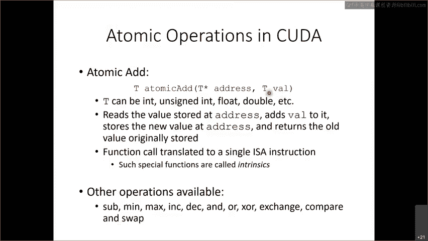

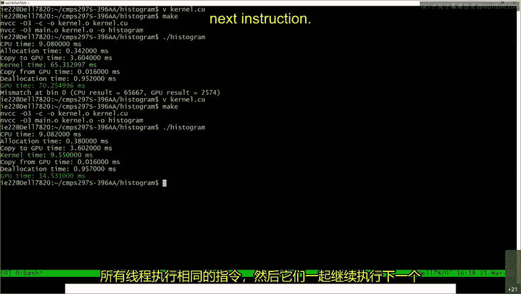

CUDA提供了多种原子操作，对于直方图，我们使用`atomicAdd`：
```c
int atomicAdd(int* address, int val); // 将val加到address指向的值，返回旧值
```

修改我们的内核，使用原子操作：
```c
__global__ void histogram_kernel_atomic(unsigned char* image, int* bins, int num_pixels) {
    int i = blockIdx.x * blockDim.x + threadIdx.x;
    if (i < num_pixels) {
        unsigned char pixel_value = image[i];
        atomicAdd(&bins[pixel_value], 1); // 使用原子加操作
    }
}
```
现在，代码能正确运行并得到准确结果。

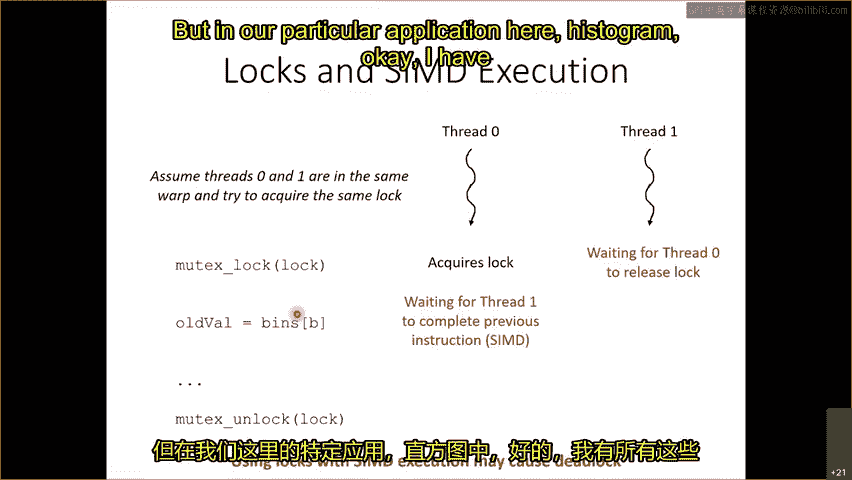

---

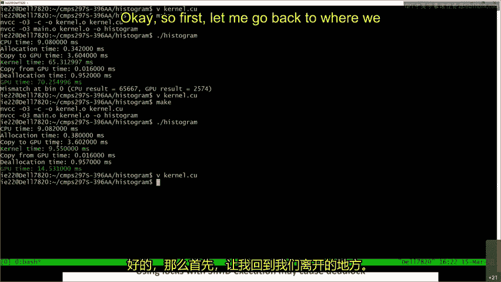

## 优化一：私有化

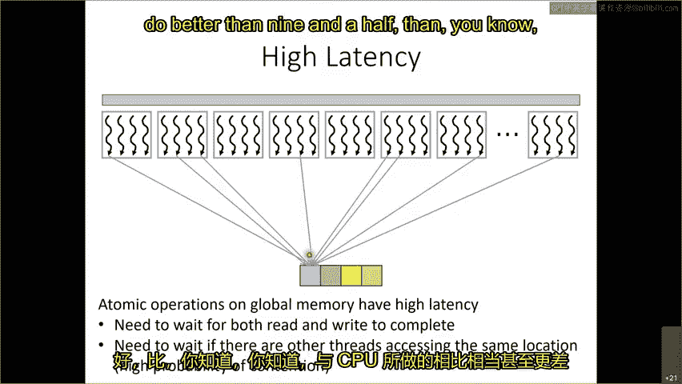

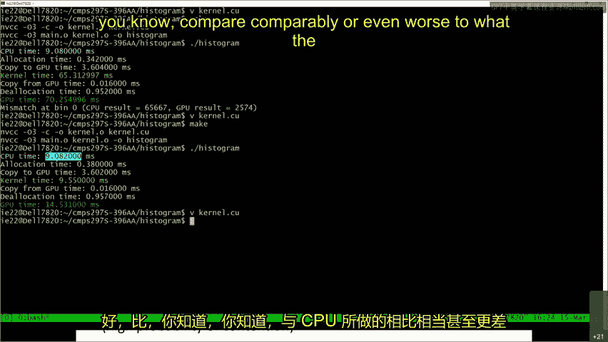

虽然原子操作解决了正确性问题，但性能可能不佳。全局内存的原子操作延迟很高，且当大量线程更新同一个区间时，会发生严重竞争，导致序列化执行。

**私有化**是一种优化技术。其核心思想是：不让所有线程块直接更新全局直方图，而是让每个线程块维护一个**私有的直方图副本**。

1.  每个线程块在共享内存中分配一个私有直方图数组，并初始化为0。
2.  线程块内的线程更新这个私有副本（可以使用更快的共享内存原子操作）。
3.  当线程块处理完所有分配的数据后，将私有副本中的非零值累加到全局直方图中（此时仍需使用全局原子操作，但次数大大减少）。

这种方法将线程块间的竞争转移到了线程块内部，而共享内存的原子操作比全局内存快得多，从而显著提升了性能。

---

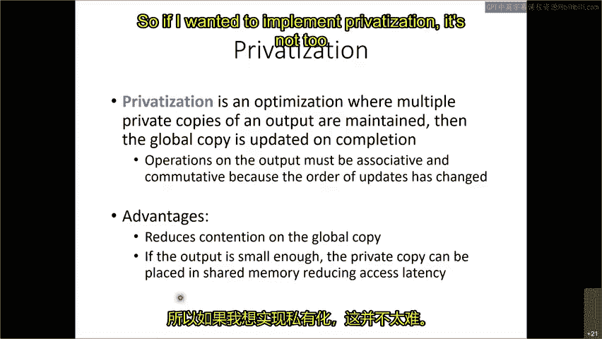

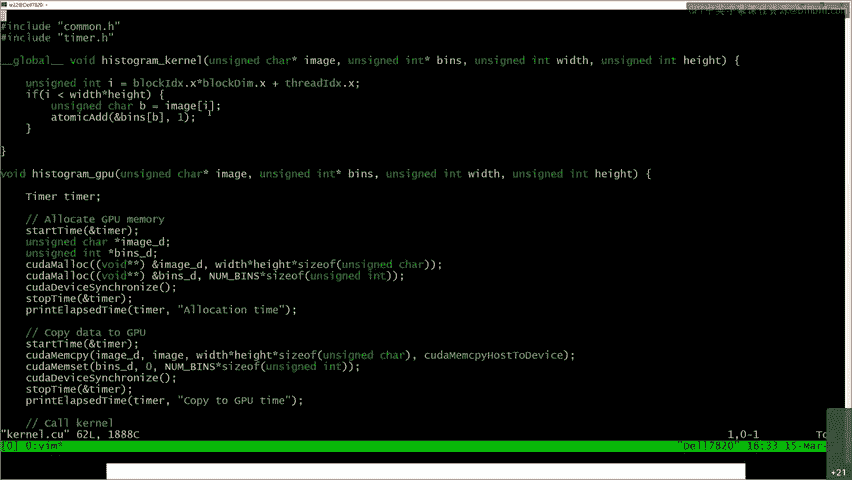

## 优化二：线程粗化

**线程粗化**是另一种优化手段。在最初的实现中，我们为每个像素分配一个线程，这会产生大量线程块和私有副本，导致最终向全局内存提交的次数较多。

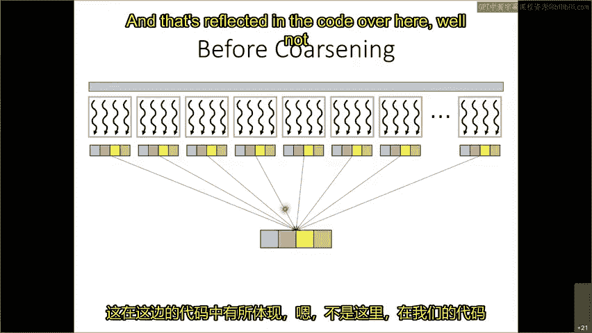

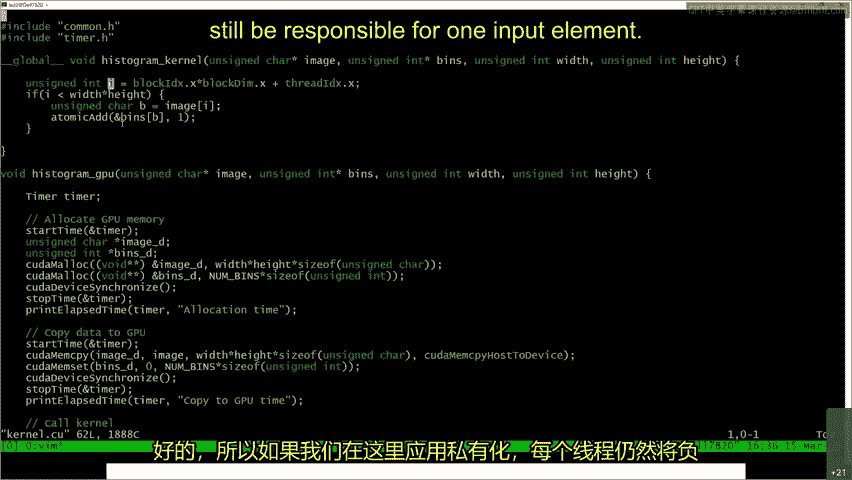

通过线程粗化，我们减少线程块数量，让每个线程处理多个输入元素。
*   每个线程块负责更大的一段输入数据。
*   每个线程循环处理该段数据中的多个像素，并更新其所在线程块的私有直方图。
*   确保以合并访问的方式加载输入数据以保持内存访问效率。

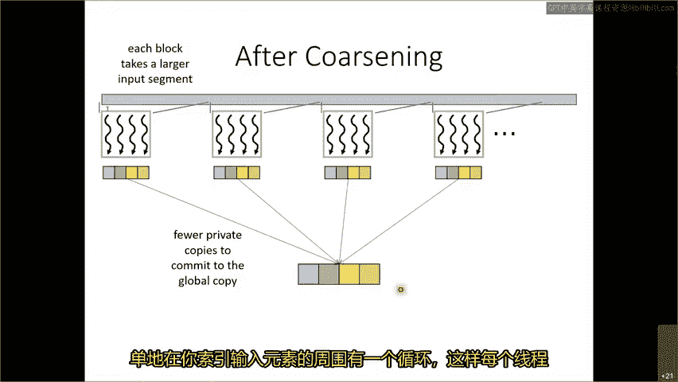

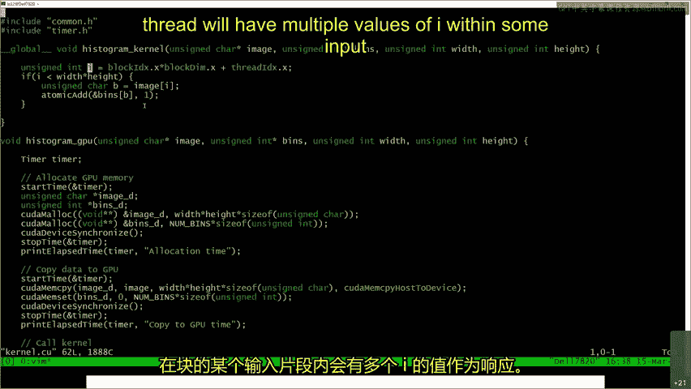

这样做的好处是：
1.  减少了线程块数量，从而减少了需要创建和提交的私有副本数量。
2.  进一步降低了全局原子操作的总次数。
3.  更多的更新发生在快速的共享内存私有副本中。

结合私有化和线程粗化，可以最大限度地减少昂贵的全局内存原子操作，从而大幅提升直方图计算的并行性能。

---

## 总结

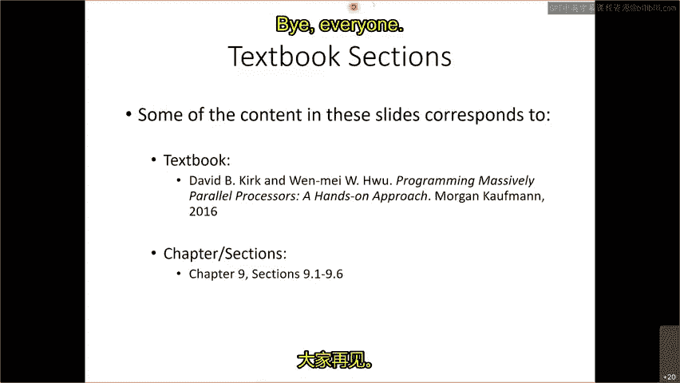

本节课我们一起学习了直方图这一并行模式。我们首先了解了直方图的基本概念和顺序实现。然后，我们尝试并行化时遇到了数据竞争问题，并引入了GPU的原子操作作为解决方案。接着，为了提升原子操作带来的性能瓶颈，我们探讨了两种关键优化：**私有化**（通过创建本地副本来减少全局竞争）和**线程粗化**（通过让每个线程处理更多工作来减少私有副本数量）。这些技术不仅适用于直方图，也是优化许多存在输出竞争的并行算法的通用策略。