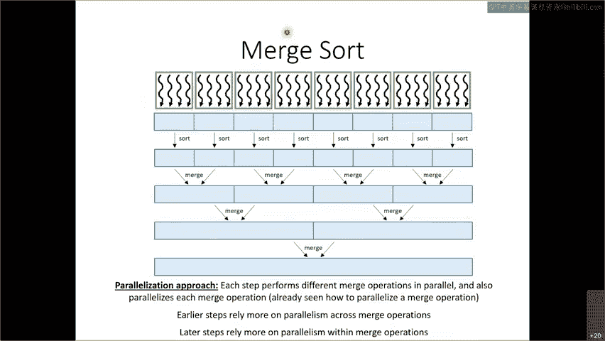

# GPU计算｜CMPS 297S396AA：15：排序算法

在本节课中，我们将学习两种重要的并行排序算法：基数排序和归并排序。我们将重点探讨基数排序的原理、并行化策略及其优化方法，并简要介绍如何将之前学习的并行归并模式应用于归并排序。

## 概述

上一节课我们介绍了并行归并模式。我们提到，有序归并是将两个有序列表合并成一个有序列表的操作。为了并行化这个操作，一种方法是将要生成的输出列表划分为相等的段，每个线程负责一段。每个线程需要在两个输入数组A和B中找到对应的输入段，然后顺序合并这两个段。并行归并的关键挑战在于每个线程如何找到其在A和B中对应的输入段。

我们定义了“协同秩”的概念：对于输出数组C中的索引K，其在数组A中的协同秩I，以及在数组B中的协同秩J。我们发现J = K - I，因此核心任务是找到I。我们通过设定I的边界并进行二分搜索来确定I，判断条件基于一个观察：A中I之前的元素应小于B中J之后的元素，反之亦然。

每个线程通过二分搜索找到I和J，然后顺序合并输入段到输出段。这个操作的内存访问不是合并的，因为二分搜索是随机访问，且后续的顺序合并中，每个线程访问的输入段也不同。为了优化，我们让一个线程块中的一个线程确定整个块的输入段范围（I_block, J_block），然后块内线程协作，以合并的方式将这些段加载到共享内存中。接着，所有线程在共享内存中进行二分搜索和合并，最后再以合并的方式将结果从共享内存写回全局内存。

我们还提到了线程聚合。并行化归并的代价是每个线程都需要进行二分搜索。通过为每个线程分配多个输出元素（即一个输出段），我们分摊了二分搜索的成本，这本身就是一种线程聚合。

本节课，我们将开始讨论排序算法，主要关注基数排序，并简要介绍归并排序。

## 基数排序 🧮

基数排序是一种非比较型排序算法。它的工作原理是，根据基数（或进制）将待排序的关键字分配到多个“桶”中。如果输入关键字采用某种位置计数系统表示，我们就使用该基数，并迭代处理关键字的每一位数字。每次迭代，都根据当前处理的数字位将关键字分配到对应的桶中。

一个重要的原则是，每次迭代时，需要保留前一次迭代在每个桶内建立的顺序。通常，在计算机中实现基数排序时，我们喜欢使用2的幂作为基数，因为这简化了对二进制数的处理。每次迭代处理关键字中固定的一组比特位。

为了简化说明，我们将从基数为2（即每次处理1个比特位）的情况开始，然后再扩展到更大的基数。

### 单比特基数排序演示

假设我们有一个数组需要排序。使用1比特基数排序时，我们从最低有效位开始处理。

**第一步：处理最低有效位**
我们将所有关键字根据其最低有效位是0还是1分配到两个桶中。将所有最低有效位为0的元素放在一起，为1的元素放在其后。此时，数组仅按最低有效位排序。

**第二步：处理次低有效位**
接下来，我们处理次低有效位。根据该位的值（0或1）再次分配元素。关键点在于，**在分配时，我们必须保持每个桶内元素在上一步中已建立的相对顺序**。这样，数组现在就按最低的两个比特位排序了。

**后续步骤**
我们重复这个过程，从低到高依次处理每一位。每次迭代都根据当前比特位分配元素，并保持前一次迭代在每个桶内建立的顺序。处理完所有比特位后，数组就完全排序了。

基数排序是非比较型排序算法，通常要求关键字具有固定大小，以便可以划分为数字位。如果关键字不满足此条件，则需要使用比较型排序算法，如我们稍后将看到的归并排序。

### 并行化基数排序的关键步骤

基数排序的核心操作可以归结为：在每次迭代中，根据当前关注的比特位，将数组元素分离，使所有该位为0的元素在前，为1的元素在后，同时保持原有顺序。

问题转化为：如何为输入数组中的每个元素找到其在输出（排序后）数组中的目标索引？

**分析目标索引：**
*   对于一个**0**元素，其目标索引等于**其左侧0元素的数量**。这又等于**该元素的索引** 减去 **其左侧1元素的数量**。
*   对于一个**1**元素，其目标索引等于**数组中0元素的总数** 加上 **其左侧1元素的数量**。而0元素的总数等于**数组总大小** 减去 **1元素的总数**。

因此，无论是0还是1元素，其目标索引的计算都依赖于一个关键信息：**每个元素左侧的1元素数量**。

**解决方案：使用独占扫描**
1.  **提取比特位**：为每个元素提取当前要处理的比特位，生成一个由0和1组成的数组 `B`。
2.  **执行独占扫描**：对数组 `B` 执行独占扫描操作。扫描结果数组 `S` 中，`S[i]` 就表示原数组中第 `i` 个元素**左侧**的1元素数量。同时，我们也能得到整个数组 `B` 的总和，即1元素的总数 `total_ones`。
3.  **计算目标索引**：对于索引为 `i` 的元素：
    *   如果它是 **0** (`B[i] == 0`)，其目标索引 `dest = i - S[i]`。
    *   如果它是 **1** (`B[i] == 1`)，其目标索引 `dest = (n - total_ones) + S[i]`，其中 `n` 是数组大小。
4.  **分散写入**：每个线程根据计算出的目标索引，将其负责的元素写入输出数组的对应位置。

**并行化**：上述步骤很容易并行化。我们可以为每个输入元素分配一个线程。提取比特位是局部操作。扫描操作我们已经知道如何高效并行化。计算目标索引和分散写入也是简单的逐元素操作。

### 优化：改善合并访问

然而，上述朴素方法存在一个性能问题：**分散写入步骤的内存访问不是合并的**。相邻的线程可能将元素写入输出数组中相距很远的位置，导致内存访问效率低下。

**优化策略：局部排序与分桶写入**
我们可以利用共享内存来改善合并访问。思路是，先在线程块内部进行局部排序和分桶，然后再以合并的方式将整个桶写入全局内存。

1.  **局部分离**：每个线程块将其负责的输入元素加载到共享内存中。块内线程协作，在共享内存中执行上述的扫描和分离操作。这样，在该块的共享内存中，所有当前位为0的元素被聚集在一起，所有为1的元素被聚集在另一处。
2.  **计算全局桶偏移**：每个线程块需要知道它的0桶和1桶应该写入全局输出数组的哪个起始位置。
    *   每个块计算并输出它包含的0元素数量 (`count0`) 和1元素数量 (`count1`)。
    *   将所有块的 `(count0, count1)` 数组扁平化，得到一个一维数组。
    *   对这个一维数组执行**独占扫描**。扫描结果中，对应每个块 `count0` 的位置给出了该块0桶的全局起始索引；对应每个块 `count1` 的位置给出了该块1桶的全局起始索引（需要加上所有块0元素的总数）。
3.  **合并写入**：每个线程块根据得到的全局起始索引，将其共享内存中的0桶和1桶分别**连续地**写入全局内存。由于一个桶内的元素是连续的，且由块内相邻的线程写入，因此这些写入操作是高度合并的。

这种优化将非合并的随机写入，转换为了两次合并的顺序写入（先写所有0桶，再写所有1桶），显著提升了内存带宽利用率。

### 基数选择与线程聚合

**基数大小的权衡**
我们之前使用了1比特基数。对于一个32位的关键字，这需要32次迭代。为了减少迭代次数，我们可以使用更大的基数，例如2比特基数。这样只需要16次迭代。在局部，可以通过连续执行两次1比特分离操作来实现一次2比特分离。

然而，**更大的基数意味着更多的桶**（2比特对应4个桶）。虽然迭代次数减少，但每个线程块需要向更多不同的全局内存地址范围写入数据，这可能损害合并访问的效果。因此，基数的选择需要在**迭代次数**和**合并访问效率**之间取得平衡。

**线程聚合以改善合并访问**
另一种优化手段是**线程聚合**，即为每个线程分配多个输入元素。这样，每个线程块处理的数据量更大，产生的每个桶也更大。当块将大桶写入全局内存时，由于桶内元素更多，写入操作的连续性更好，从而进一步改善了合并访问。

线程聚合增加了每个线程的工作量，但通过提高内存访问效率，整体性能通常能得到提升。

## 归并排序 🔀

基数排序并非适用于所有类型的数据（例如可变长度关键字）。我们仍然需要一种可并行化的比较型排序算法，归并排序是一个流行的选择。

归并排序是分治算法：
1.  **分解**：将列表递归地分成两半，直到子列表足够小（例如，只有一个元素）。
2.  **解决**：排序这些子列表（对于很小的列表，排序很简单）。
3.  **合并**：将已排序的子列表两两合并，形成更大的有序列表，直到最终合并成完整的有序列表。

### 并行化归并排序

我们可以利用上一课学习的**并行归并**模式来并行化归并排序。

**并行策略：**
1.  **底层排序**：最初，将输入数组划分为许多小的片段。可以使用任何排序方法（甚至是另一个内核）对这些小片段进行排序。这些排序操作可以并行进行。
2.  **逐层合并**：排序后，我们得到许多小的有序数组。然后开始合并阶段：
    *   在第一次合并中，将相邻的两个有序数组合并为一个。**每个合并操作可以分配一个或多个线程块来并行执行**（使用我们学过的并行归并算法）。
    *   由于存在多个独立的合并对，这些合并操作之间也可以并行执行。
3.  **递归合并**：重复此过程。在每一层，合并后的数组变大，但需要合并的对数减少。因此，并行性从**跨多个合并操作之间的并行**，逐渐转向**单个大型合并操作内部的并行**（使用更多线程块协作完成一次合并）。

通过这种方式，归并排序的整个合并过程可以被有效地映射到GPU的并行架构上。

## 总结

本节课我们一起学习了两种重要的并行排序算法。

我们深入探讨了**基数排序**，这是一种非比较型排序。我们理解了其按位分配、保持顺序的原理，并分析了其并行化方法。重点是，我们讨论了如何通过**局部扫描分离**和**全局桶偏移计算**来优化分散写入时的内存合并访问。同时，我们也探讨了基数大小选择与线程聚合对性能的影响。

随后，我们简要介绍了**归并排序**，这是一种比较型排序。我们看到了如何将之前学习的并行归并模式应用于归并排序的合并阶段，通过在不同层级和同一合并操作内部利用并行性，来实现高效的排序。

理解这些排序算法的并行化策略及其优化，对于在GPU上实现高性能计算至关重要。

