# GPU计算：16：稀疏矩阵计算（COO与CSR格式）


在本节课中，我们将要学习稀疏矩阵计算，并重点探讨两种经典的稀疏矩阵存储格式：坐标格式（COO）和压缩稀疏行格式（CSR）。我们将以稀疏矩阵-向量乘法（SPMV）作为案例研究，分析不同格式在并行化、内存访问和性能方面的权衡。

## 什么是稀疏矩阵？

在深入探讨存储格式之前，我们首先需要理解什么是稀疏矩阵。

一个**稠密矩阵**是指矩阵中大多数元素都是非零值的矩阵。相反，一个**稀疏矩阵**则是指矩阵中包含大量零元素的矩阵。在实际应用中，许多系统产生的矩阵都是稀疏的，这意味着矩阵中绝大多数元素的值都是零。

利用矩阵的稀疏性，我们可以获得多方面的优势：
*   **节省内存/存储**：通过压缩矩阵，只存储非零值，无需为零值分配空间。
*   **节省内存带宽**：计算时无需加载零值。
*   **节省计算时间**：计算时无需处理零值。

因此，稀疏矩阵计算的核心挑战之一，就是设计高效的存储格式，以便在节省内存的同时，还能优化计算性能。

## 稀疏矩阵存储格式概览

存在多种稀疏矩阵存储格式，每种格式都有其设计目标和适用场景。在本课程中，我们将重点介绍四种格式，它们足以展示稀疏矩阵处理的核心概念：
1.  坐标格式
2.  压缩稀疏行格式
3.  ELLPACK格式
4.  锯齿状对角线格式

今天我们将专注于前两种格式：**COO**和**CSR**。

设计存储格式时，通常需要考虑以下几个关键因素：
*   **空间效率**：格式能节省多少内存。
*   **灵活性**：是否便于添加、重排或删除矩阵中的元素。
*   **可访问性**：是否便于以特定方式（如按行或按列）访问数据。
*   **内存访问模式**：在GPU上下文中，格式是否支持内存合并访问。
*   **负载均衡**：在GPU上下文中，格式是否有助于最小化控制流发散。

我们将以**稀疏矩阵-向量乘法**作为具体应用场景，来评估COO和CSR格式在这些因素上的表现。SPMV的运算可以表示为：
`y = A * x`
其中 `A` 是稀疏矩阵，`x` 是稠密输入向量，`y` 是稠密输出向量。

## 坐标格式

首先，让我们来看看坐标格式。

### COO格式的原理

COO格式的存储方式非常直观：它为矩阵中的每一个非零元素存储三个值：元素值、行索引和列索引。

假设我们有一个稀疏矩阵，其非零元素分布如下（白色方格代表零值）：


在COO格式中，我们会创建三个数组：
*   `values`: 按顺序存储所有非零值，例如 `[1, 7, 5, 3, 9, 2, 8]`。
*   `row_indices`: 存储每个非零值对应的行索引，例如 `[0, 0, 1, 1, 1, 2, 2]`。
*   `col_indices`: 存储每个非零值对应的列索引，例如 `[0, 1, 0, 2, 3, 1, 2]`。

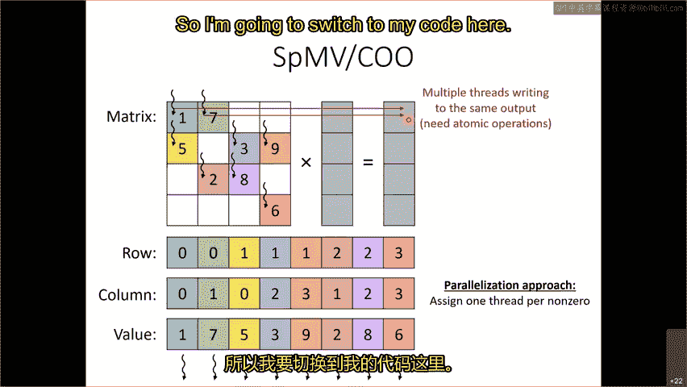

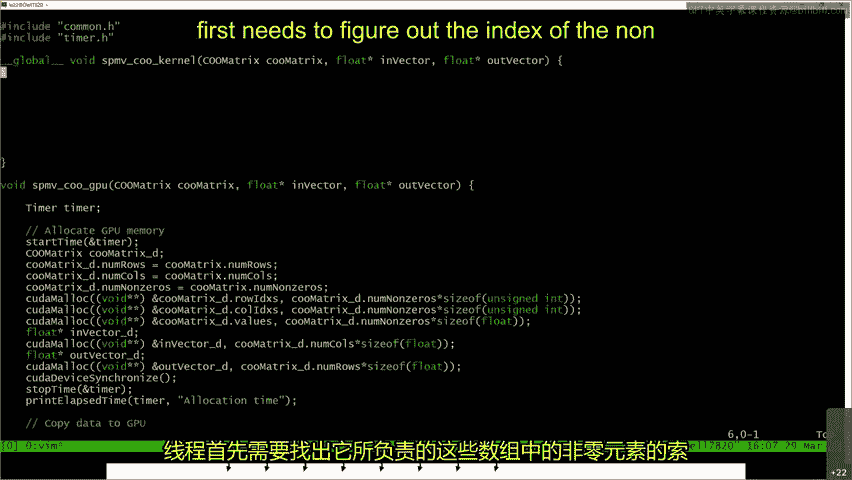

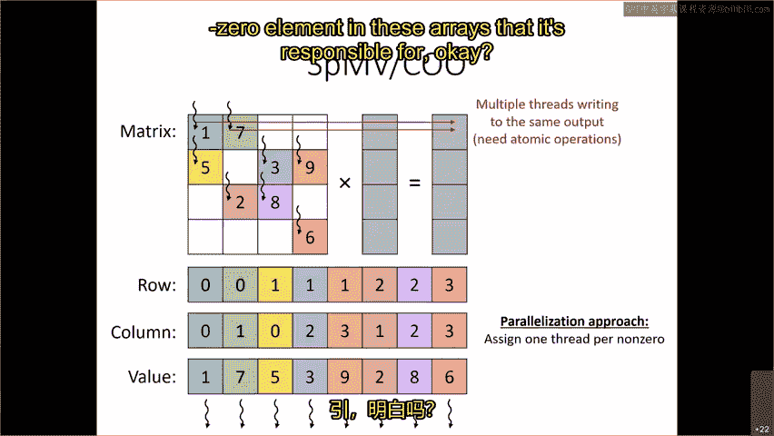

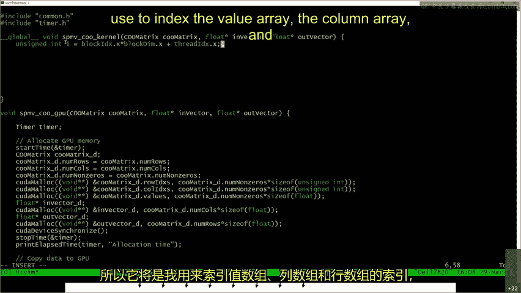

这样，数组中的第 `i` 个元素就完整地描述了矩阵中的一个非零值：`(values[i], row_indices[i], col_indices[i])`。

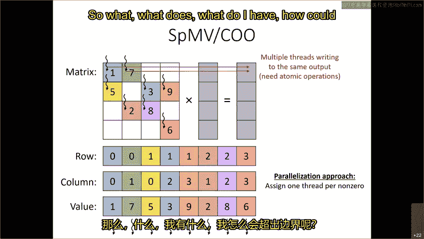

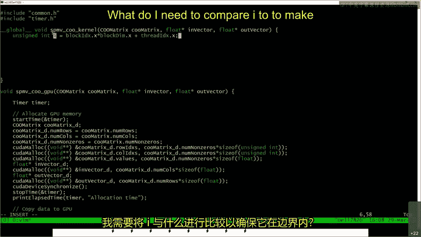

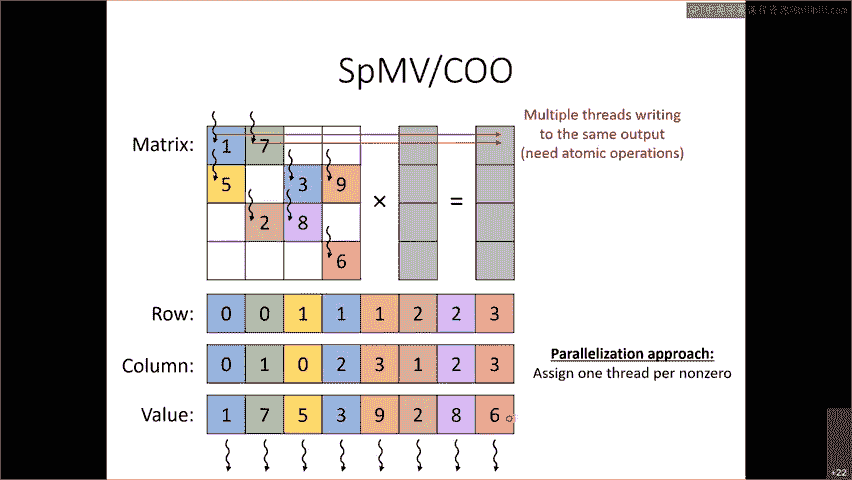

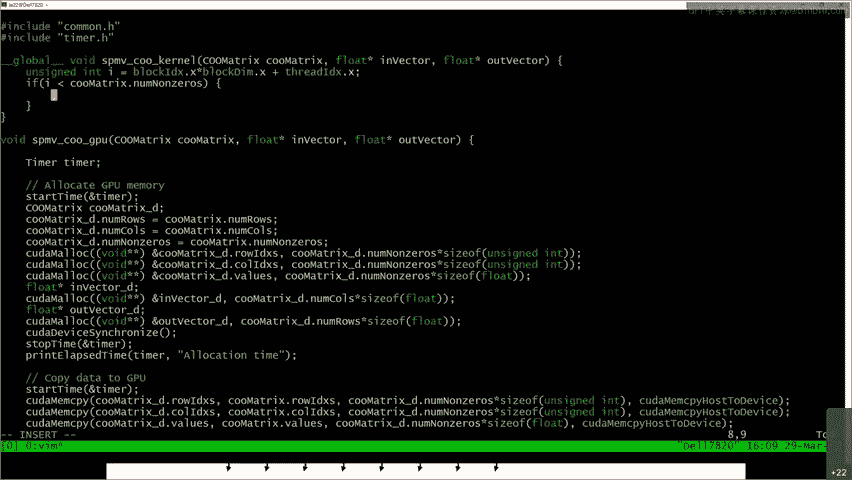

### 基于COO格式的SPMV实现

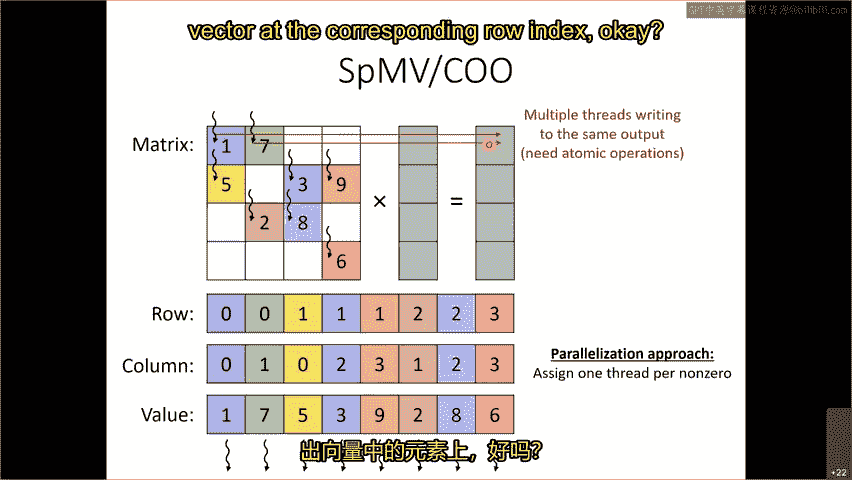

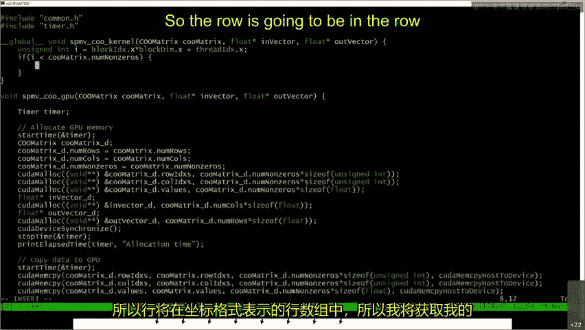

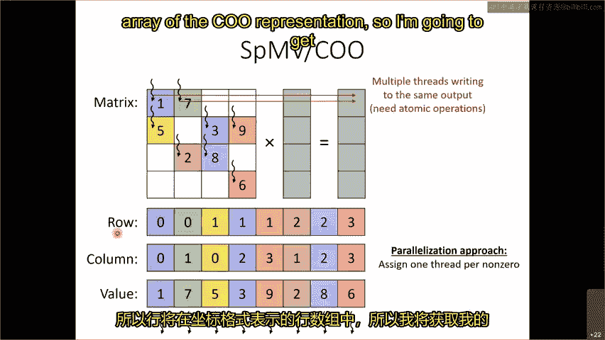

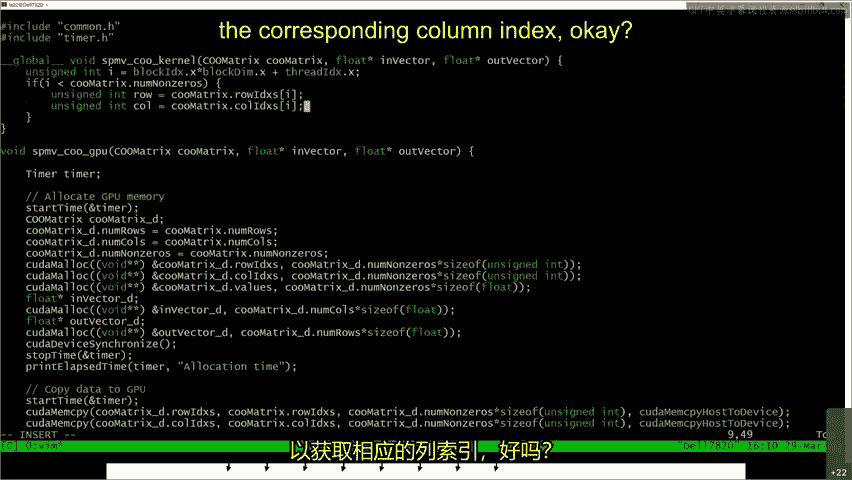

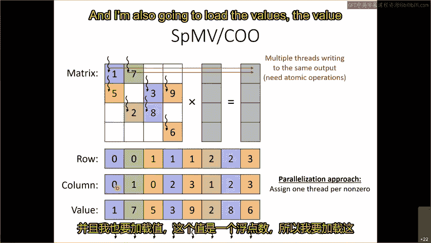

在COO格式下，实现SPMV最自然的并行化策略是：**为每一个非零元素分配一个线程**。

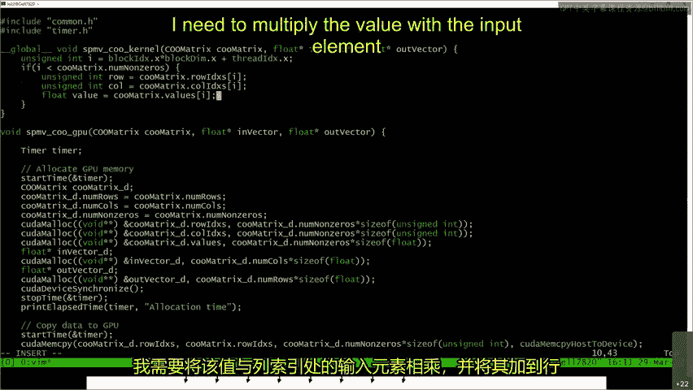

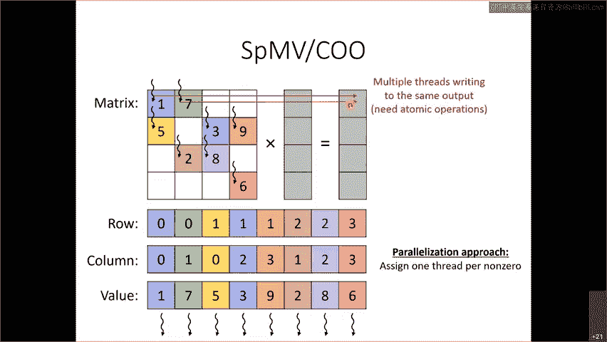

每个线程的执行步骤如下：
1.  根据线程ID `i`，从 `values`、`row_indices` 和 `col_indices` 数组中读取其负责的非零值 `val`、行号 `row` 和列号 `col`。
2.  从输入向量 `x` 中读取 `x[col]`。
3.  计算部分结果 `partial = val * x[col]`。
4.  将这个部分结果累加到输出向量 `y` 的 `y[row]` 位置。

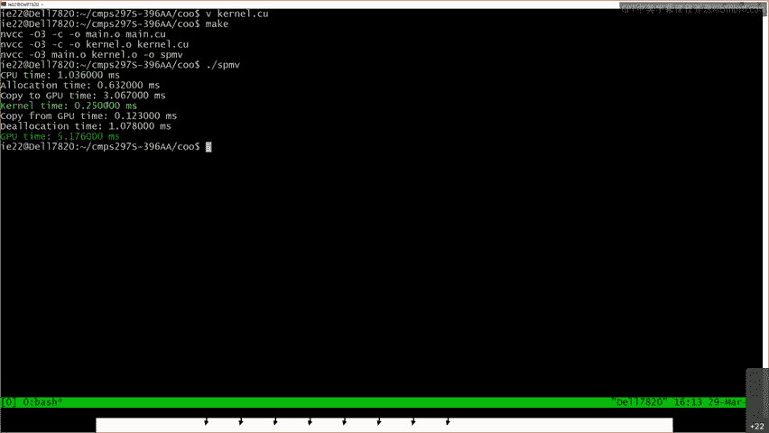

由于多个线程可能同时更新同一个输出元素 `y[row]`，因此第4步需要使用**原子操作**来避免竞态条件。

以下是该内核函数的伪代码示例：
```cuda
__global__ void spmv_coo_kernel(COOMatrix coo, float* x, float* y) {
    int i = blockIdx.x * blockDim.x + threadIdx.x; // 线程索引，对应非零元素索引
    if (i >= coo.num_nonzeros) return;

    int row = coo.row_indices[i];
    int col = coo.col_indices[i];
    float val = coo.values[i];

    float partial = val * x[col];
    atomicAdd(&y[row], partial); // 必须使用原子操作
}
```

### COO格式的优缺点分析

基于SPMV应用，我们来总结COO格式的优缺点。

**优点：**
*   **灵活性高**：非零元素可以任意顺序存储，添加新元素非常容易（只需追加到数组末尾）。
*   **可访问性**：给定一个非零元素，可以立即获取其行和列索引。这使得跨非零元素并行化非常容易。
*   **内存合并访问**：线程按顺序访问 `values`、`row_indices`、`col_indices` 数组，访问模式是连续的，具有良好的内存合并性。
*   **负载均衡**：每个线程只处理一个非零元素，工作量相同，没有控制流发散。

**缺点：**
*   **空间效率较低**：需要为每个非零元素存储行和列索引，如果矩阵非常稀疏，这仍比稠密存储好，但相比其他格式有额外开销。
*   **特定访问模式困难**：给定一个行号，很难快速找到该行所有的非零元素（需要搜索整个 `row_indices` 数组）。因此，难以实现“每个输出元素一个线程”的并行策略。
*   **需要原子操作**：在SPMV中，由于多个线程可能写入同一内存位置，必须使用开销较大的原子操作。

## 压缩稀疏行格式

为了克服COO格式在SPMV中需要原子操作的缺点，我们接下来看压缩稀疏行格式。

### CSR格式的原理

CSR格式按行组织非零元素。它存储三个数组：
*   `values`: 按**行优先**顺序存储所有非零值。同一行的非零值在数组中连续存放。
*   `col_indices`: 存储每个非零值对应的列索引，与 `values` 数组一一对应。
*   `row_ptr`: 这是一个长度等于 `行数 + 1` 的数组。`row_ptr[i]` 给出了第 `i` 行的第一个非零元素在 `values` 和 `col_indices` 数组中的起始索引。第 `i` 行的非零元素范围是 `row_ptr[i]` 到 `row_ptr[i+1]-1`。

使用之前同一个矩阵的例子，在CSR格式下：
*   `values`: `[1, 7, 5, 3, 9, 2, 8]` (注意：非零值已按行分组)
*   `col_indices`: `[0, 1, 0, 2, 3, 1, 2]`
*   `row_ptr`: `[0, 2, 5, 7]`。解读：第0行非零元素索引从0开始（到1结束）；第1行从索引2开始（到4结束）；第2行从索引5开始（到6结束）。

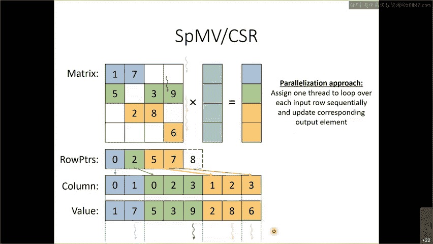

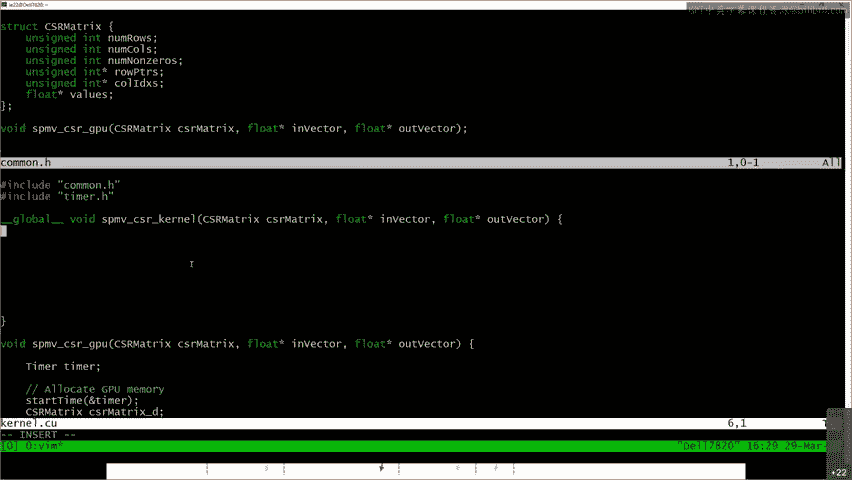

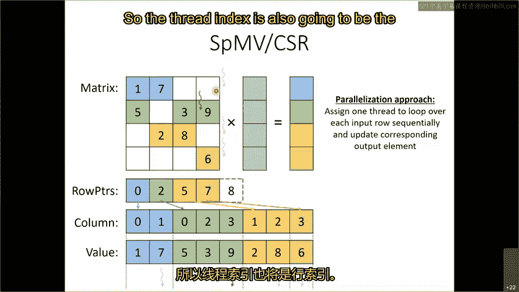

### 基于CSR格式的SPMV实现

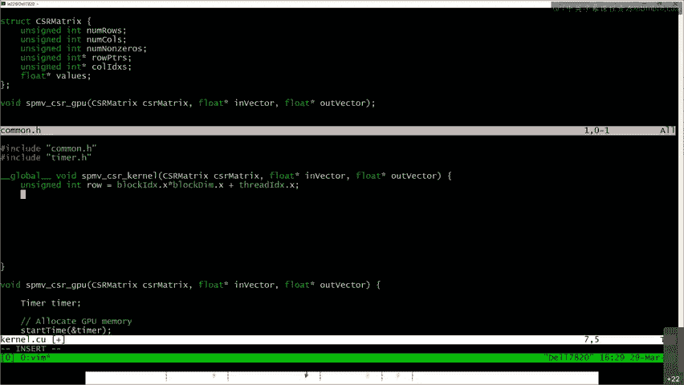

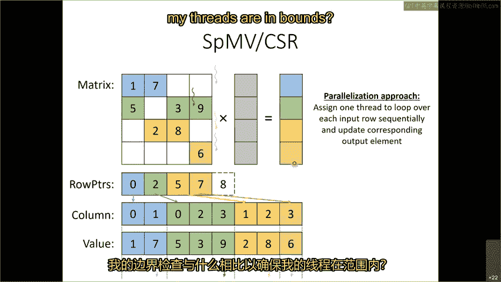

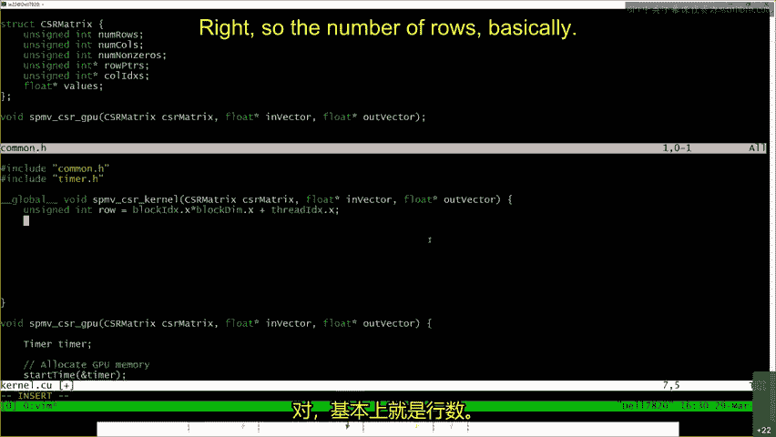


在CSR格式下，实现SPMV最自然的并行化策略是：**为输出向量的每一个元素（即矩阵的每一行）分配一个线程**。

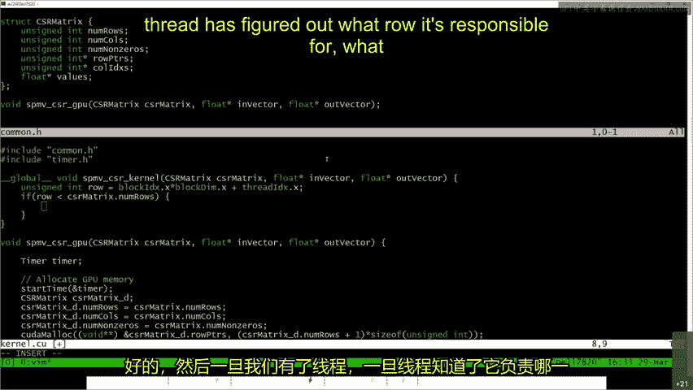

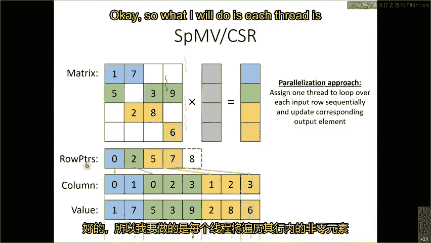

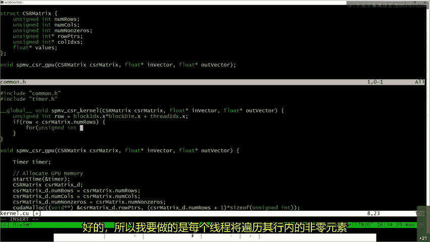


每个线程的执行步骤如下：
1.  线程ID `row` 直接对应其负责的输出行号。
2.  通过 `row_ptr[row]` 和 `row_ptr[row+1]` 确定该行非零元素在 `values` 和 `col_indices` 数组中的范围。
3.  遍历该范围内的所有非零元素：对于每个元素，读取其值 `val` 和列号 `col`，计算 `val * x[col]`，并累加到一个局部变量 `sum` 中。
4.  遍历结束后，将 `sum` 写入输出向量 `y[row]`。

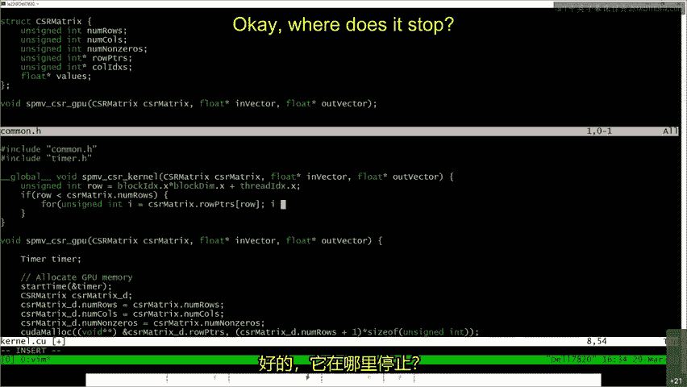

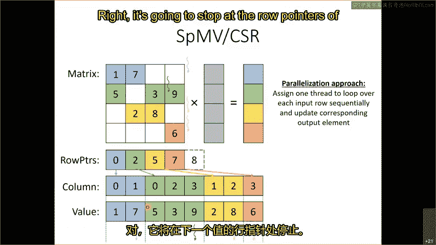

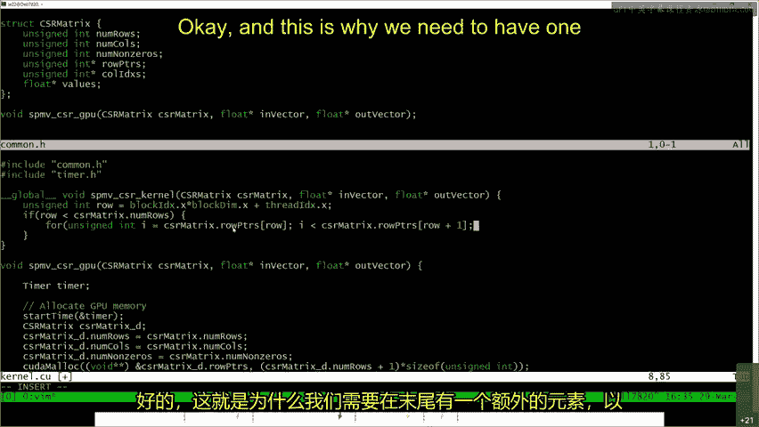


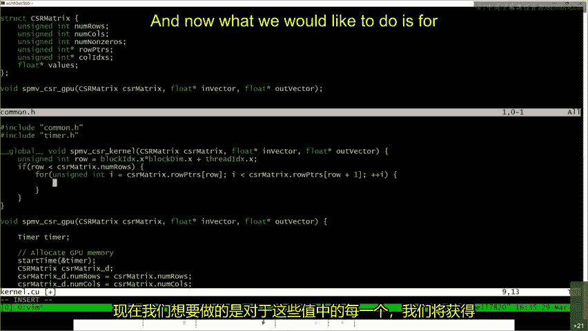

由于每个输出元素 `y[row]` 只被一个线程写入，因此**不需要原子操作**。

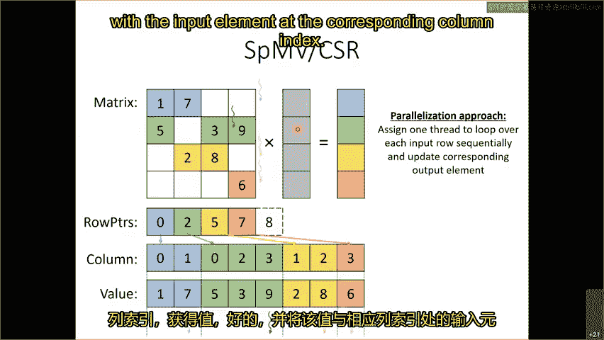

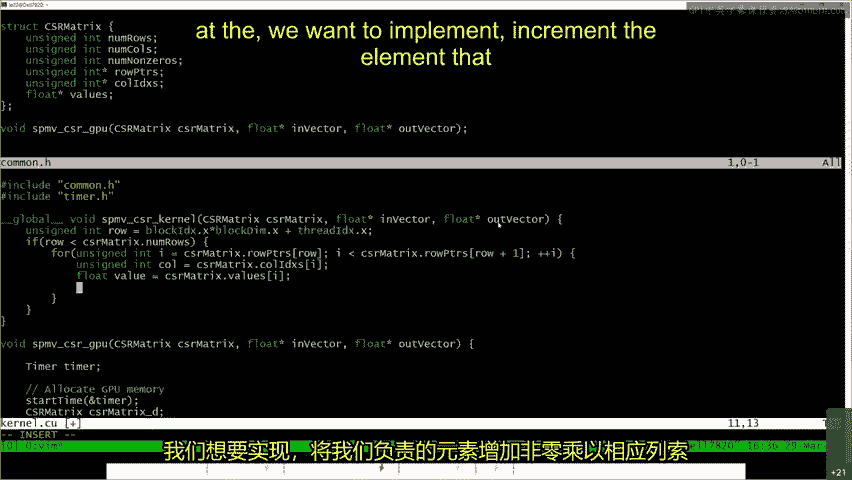

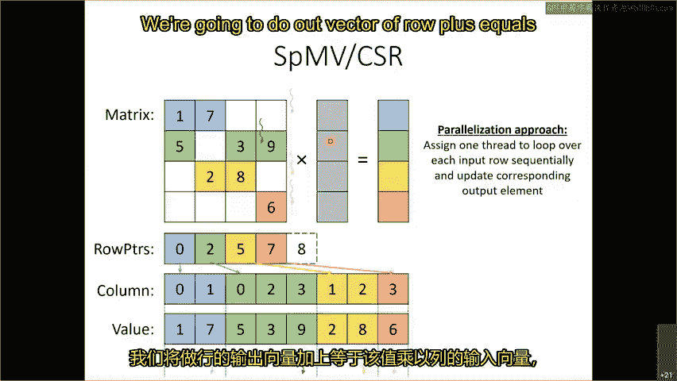

以下是该内核函数的伪代码示例：
```cuda
__global__ void spmv_csr_kernel(CSRMatrix csr, float* x, float* y) {
    int row = blockIdx.x * blockDim.x + threadIdx.x; // 线程索引，对应行号
    if (row >= csr.num_rows) return;

    float sum = 0.0f;
    int row_start = csr.row_ptr[row];
    int row_end = csr.row_ptr[row + 1];

    for (int j = row_start; j < row_end; ++j) {
        int col = csr.col_indices[j];
        float val = csr.values[j];
        sum += val * x[col];
    }
    y[row] = sum; // 无需原子操作
}
```

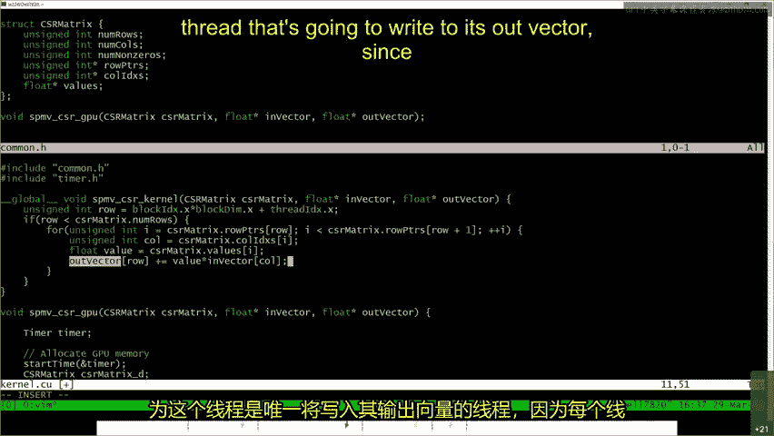

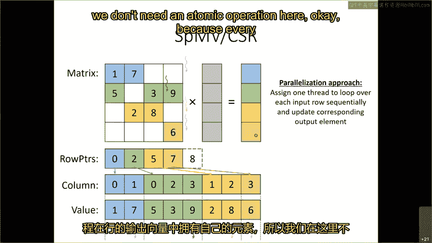

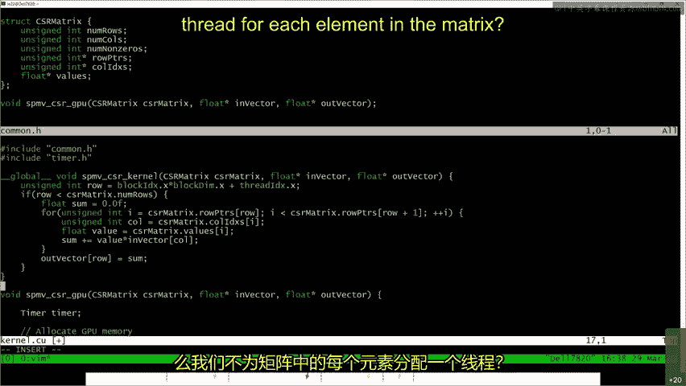

### CSR格式的优缺点分析

现在，我们来分析CSR格式在SPMV应用中的表现。


**优点：**
*   **空间效率更高**：相比COO，它用更小的 `row_ptr` 数组替代了 `row_indices` 数组，节省了存储空间。
*   **可访问性**：给定一个行号，可以快速定位到该行所有非零元素。这使得按行并行化（如SPMV）非常高效。
*   **无需原子操作**：在SPMV中，每个输出元素由唯一线程计算和写入，消除了同步开销。
*   **输出写入合并**：线程按行号顺序写入输出向量 `y`，写入操作是合并的。

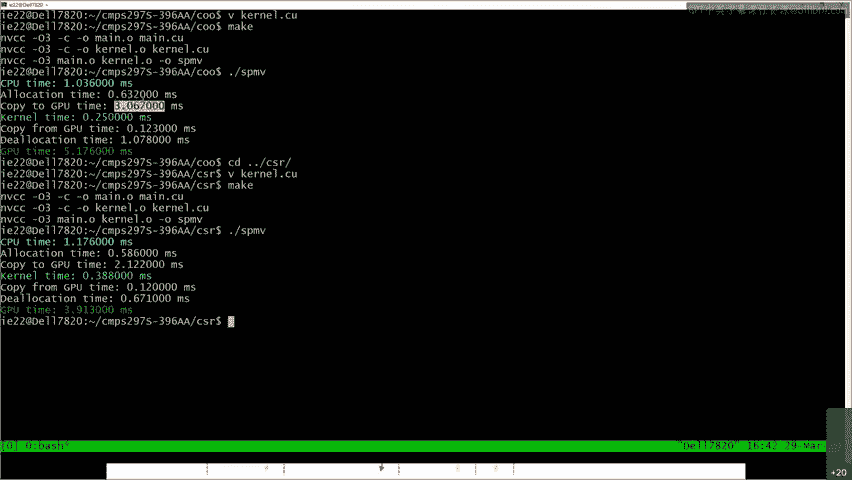

**缺点：**
*   **灵活性差**：添加或删除非零元素可能涉及移动大量数据和更新 `row_ptr` 数组，成本较高。
*   **特定访问模式困难**：给定一个非零元素，很难找到其行号（需在 `row_ptr` 中搜索）。给定一个列号，也很难找到该列所有非零元素。因此，难以实现“每个非零元素一个线程”的并行策略。
*   **内存访问未合并**：线程在遍历其负责的行时，对 `values` 和 `col_indices` 数组的访问是跳跃式的，不同线程访问的位置不相邻，导致内存访问无法合并。
*   **负载不均衡/控制流发散**：不同行的非零元素数量可能差异很大，导致线程间工作量不均。有些线程很快完成，有些则要处理很多元素，造成GPU利用率下降和控制流发散。

> **扩展：CSC格式**
> 与CSR对应的是**压缩稀疏列格式**。CSC按列存储非零元素，并有一个 `col_ptr` 数组。它使得按列访问非零元素变得容易，适用于需要列遍历的运算。

## 性能对比与总结

在本节课中，我们一起学习了两种基础的稀疏矩阵存储格式：COO和CSR，并基于SPMV运算分析了它们的实现与特性。

通过实际代码测试，我们可能会发现，对于某些矩阵，即使COO需要原子操作，其性能也可能优于CSR。这是因为COO格式对矩阵数据的访问是完美合并的，而CSR格式的未合并访问和控制流发散带来的性能损失，有时会超过原子操作的开销。此外，CSR格式在空间效率上通常优于COO。

两种格式的核心权衡在于：
*   **COO**：**灵活性**和**合并访问**更优，但需要**原子操作**。
*   **CSR**：**空间效率**更高且**无需原子操作**，但存在**未合并访问**和**控制流发散**。

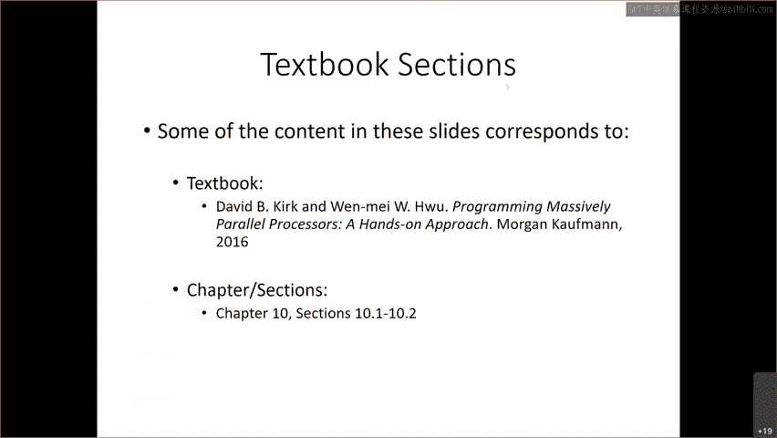

显然，我们希望能有一种格式，既能像CSR一样避免原子操作，又能像COO一样实现内存合并访问，同时还能改善负载均衡。这正是我们下节课将要探讨的内容。下一次，我们将介绍ELLPACK和锯齿状对角线格式，它们旨在解决CSR格式在内存访问模式和负载均衡方面的缺陷。