# GPU计算：第18讲：图处理


## 概述

在本节课中，我们将学习如何在GPU上进行图处理。我们将首先回顾稀疏矩阵计算，然后探讨如何利用稀疏矩阵的存储格式来表示图。接着，我们将介绍两种主要的图处理并行化方法：顶点中心法和边中心法，并以广度优先搜索为例，详细分析这两种方法的实现、性能差异及其适用场景。

## 回顾：稀疏矩阵存储格式

上一节我们介绍了稀疏矩阵计算，本节我们来看看如何将这些知识应用于图处理。我们之前讨论过四种稀疏矩阵存储格式：COO、CSR、ELL和JDS。

*   **COO格式**：存储非零元素的行索引、列索引和值。
*   **CSR格式**：存储行指针、列索引和值，便于按行访问。
*   **ELL格式**：通过填充使所有行具有相同数量的非零元素，并按列主序存储，以实现内存访问合并。
*   **JDS格式**：对行按长度排序并存储排序信息，然后按列主序存储，以减少控制流分歧并实现内存访问合并。

## 图的表示

图由顶点和边组成。我们可以用邻接矩阵来逻辑上表示一个图。邻接矩阵通常非常稀疏，因此可以使用我们学过的稀疏矩阵存储格式来表示图。

为了简化讨论，我们专注于**无权图**（所有边权重为1）和**无向图**（邻接矩阵对称）。这意味着在存储时，我们通常不需要存储值数组，只需关注非零元素的位置。

以下是使用不同稀疏格式表示图的方法：

*   **COO格式表示图**：相当于存储边的列表。包含两个数组：源顶点数组和目的顶点数组。对于加权图，还需要第三个权重数组。
    *   源顶点数组：`[0, 0, 1, 2, 3, 3]`
    *   目的顶点数组：`[1, 2, 0, 0, 1, 2]`
*   **CSR格式表示图**：便于查找某个顶点的所有邻居。包含源指针数组和目的顶点数组。
    *   源指针数组：`[0, 2, 5, 6]` （表示顶点i的邻居在目的数组中的起始位置）
    *   目的顶点数组：`[1, 2, 0, 2, 3, 0]`

对于无向图，CSR和CSC格式是等价的。图的性质（如顶点度数的分布）会影响并行化策略和存储格式的选择。

## 图处理的并行化方法

主要有两种并行化图处理的方法：顶点中心法和边中心法。

*   **顶点中心法**：为图中的每个顶点分配一个线程。该线程负责执行与该顶点相关的操作，通常需要访问该顶点的邻居列表。因此，**CSR或CSC格式**更适合这种方法，因为它们便于快速查找某个顶点的所有邻居。
*   **边中心法**：为图中的每条边分配一个线程。该线程负责执行与该边相关的操作，通常需要访问该边的源顶点和目的顶点。因此，**COO格式**更适合这种方法，因为它便于快速查找每条边的端点。

在某些算法中（例如三角形计数），可能需要同时查找边的端点以及端点的邻居，这时就需要**混合表示**，同时维护COO和CSR两种格式。

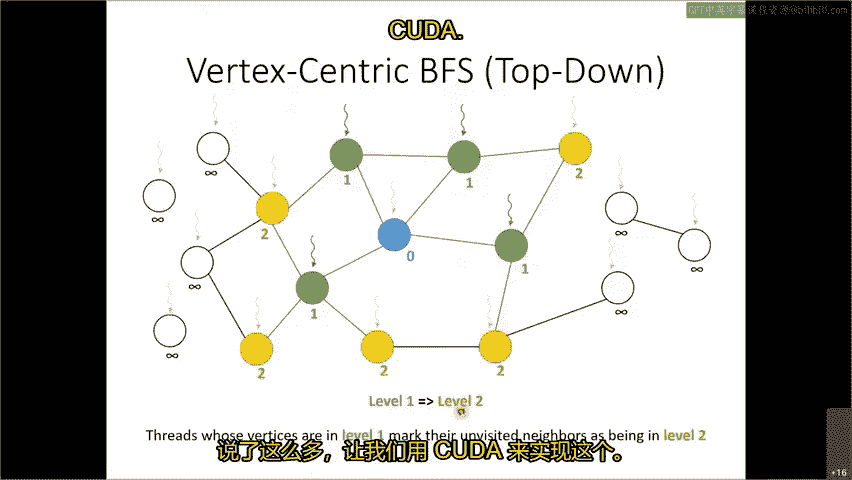

## 案例研究：广度优先搜索

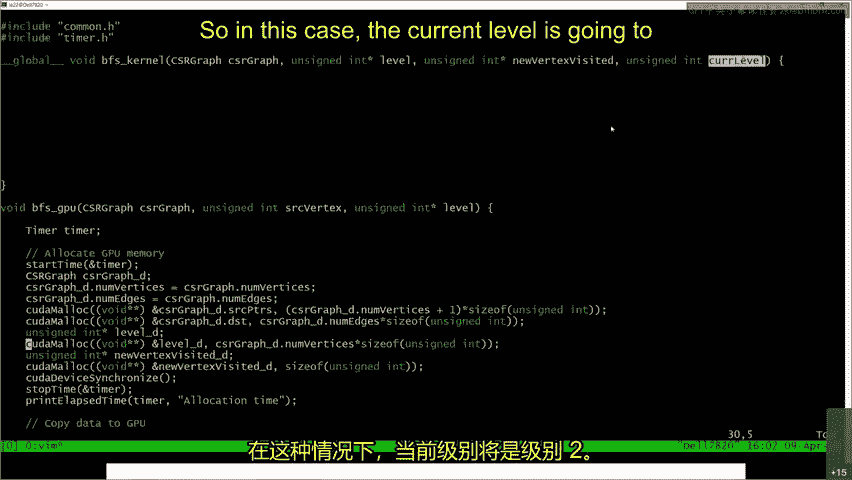

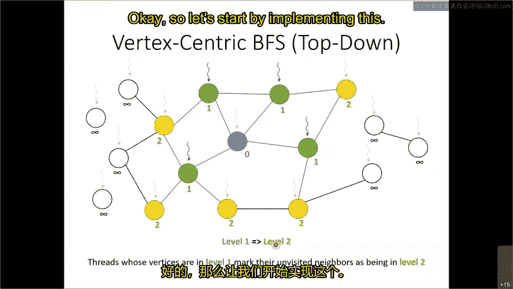

我们将以广度优先搜索为例，具体分析顶点中心法和边中心法的实现。BFS的目标是找到从源顶点到图中所有其他顶点的距离（层级）。

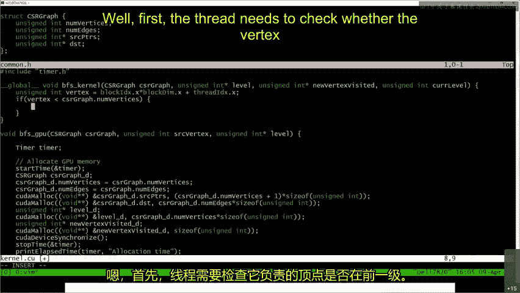

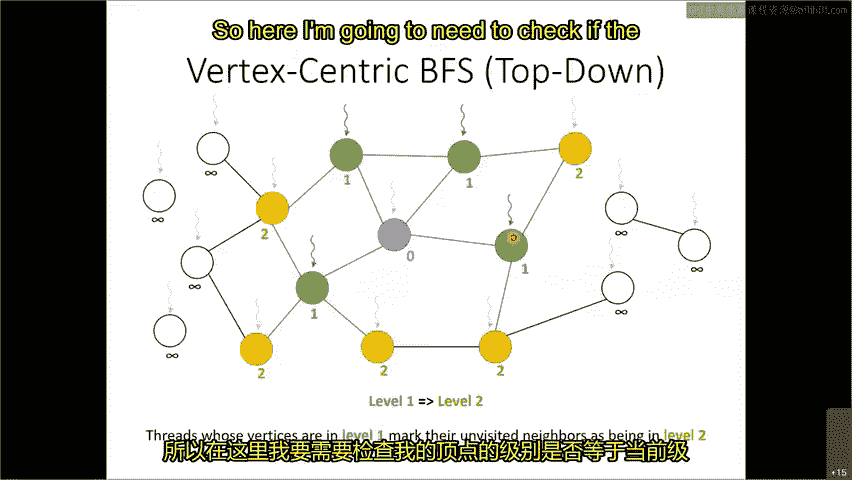

BFS算法从源顶点（层级0）开始，逐层向外探索：
1.  访问当前层级所有顶点的未访问邻居。
2.  将这些邻居标记为下一层级。
3.  重复此过程，直到没有新的顶点被访问。

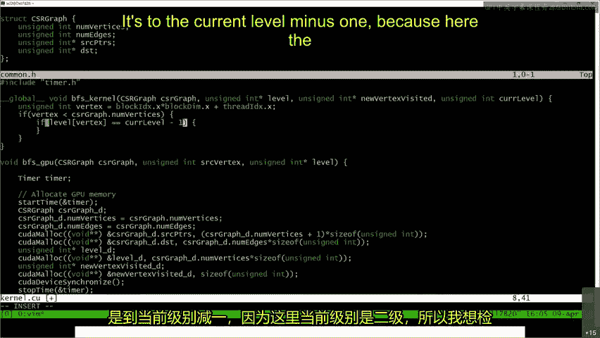

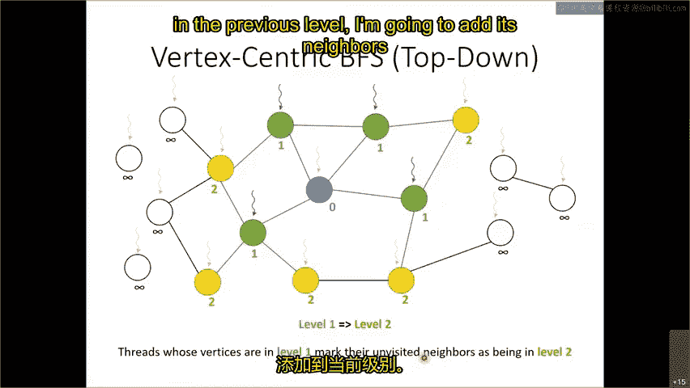

### 顶点中心法 - 自顶向下方法

在自顶向下方法中，每次迭代为每个顶点启动一个线程。线程检查其负责的顶点是否属于**上一层级**。如果是，则该线程遍历该顶点的所有邻居，并将未访问的邻居标记为**当前层级**。

这种方法类似于在BFS树中，父顶点寻找其子顶点。

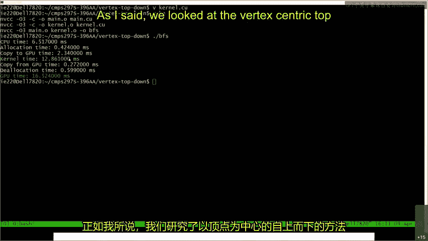

以下是该方法的CUDA内核伪代码核心逻辑：
```cpp
unsigned int vertex = threadIdx.x + blockIdx.x * blockDim.x;
if (vertex < num_vertices) {
    if (level[vertex] == current_level - 1) { // 顶点属于上一层级
        for (int edge = csr.src_ptr[vertex]; edge < csr.src_ptr[vertex+1]; edge++) {
            unsigned int neighbor = csr.dst[edge];
            if (level[neighbor] == INF) { // 邻居未访问
                level[neighbor] = current_level; // 标记为当前层级
                visited_flag = 1; // 设置已访问新顶点标志
            }
        }
    }
}
```
**缺点**：存在控制流分歧。只有少数顶点（上一层级的顶点）的线程会执行大量工作（遍历邻居），而其他线程立即退出。此外，对于高度数顶点，其线程需要遍历很长的邻居列表。

### 顶点中心法 - 自底向上方法

在自底向上方法中，每次迭代同样为每个顶点启动一个线程。但线程检查其负责的顶点是否**尚未被访问**。如果是，则该线程遍历该顶点的所有邻居，检查是否有邻居属于**上一层级**。一旦找到，就将自身顶点标记为**当前层级**并提前退出循环。

这种方法类似于潜在的子顶点通过检查其父顶点来确定自己是否属于当前层级。

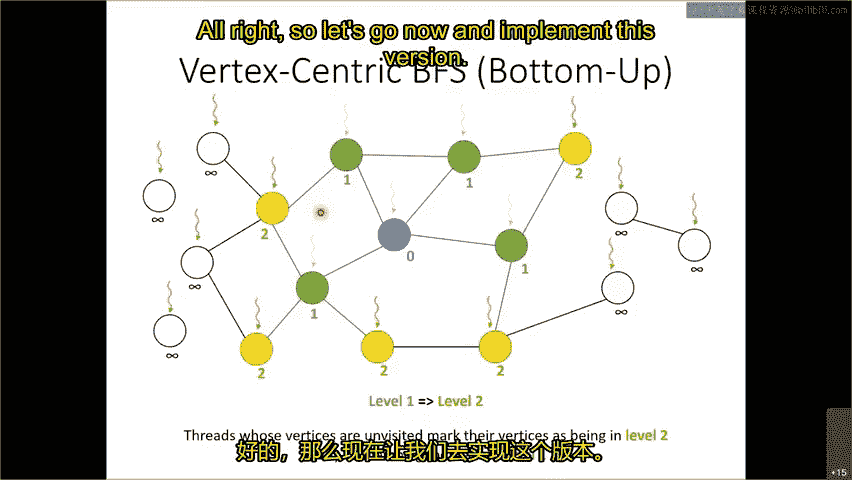

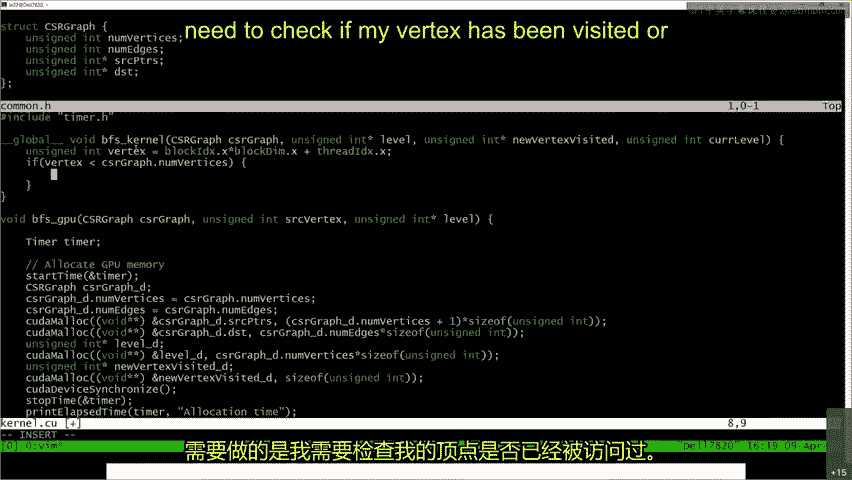

以下是该方法的CUDA内核伪代码核心逻辑：
```cpp
unsigned int vertex = threadIdx.x + blockIdx.x * blockDim.x;
if (vertex < num_vertices) {
    if (level[vertex] == INF) { // 顶点未访问
        for (int edge = csr.src_ptr[vertex]; edge < csr.src_ptr[vertex+1]; edge++) {
            unsigned int neighbor = csr.dst[edge];
            if (level[neighbor] == current_level - 1) { // 邻居属于上一层级
                level[vertex] = current_level; // 将自身标记为当前层级
                visited_flag = 1; // 设置已访问新顶点标志
                break; // 提前退出
            }
        }
    }
}
```
**优点**：对于高度数顶点，一旦找到一个已访问的邻居，线程就可以提前退出，减少了不必要的遍历。在后期迭代中，当大多数顶点已被访问时，只有少数未访问顶点的线程需要工作，效率较高。
**缺点**：在早期迭代中，由于已访问顶点很少，大多数未访问顶点的线程会遍历所有邻居却一无所获，造成大量冗余工作。

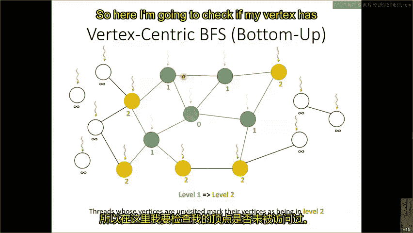

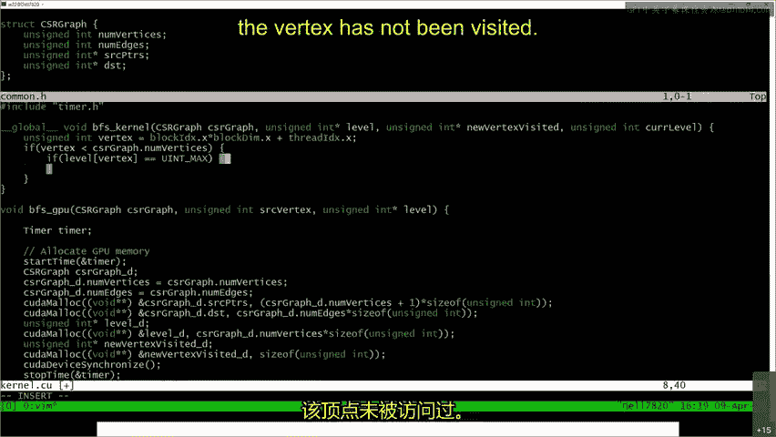

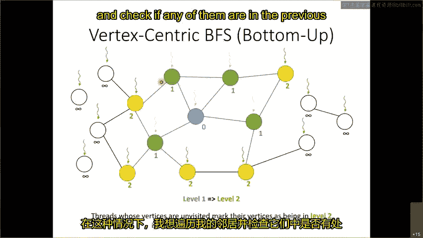

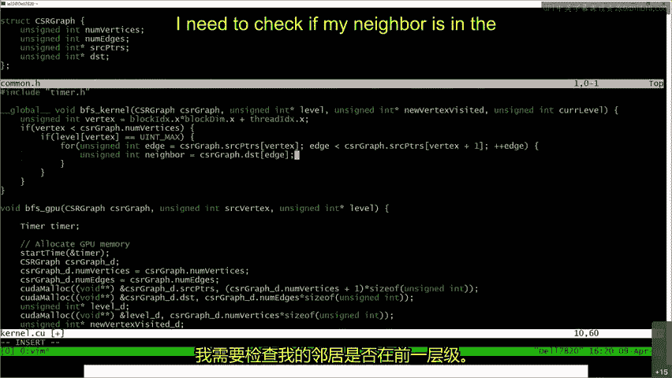

### 方向优化BFS

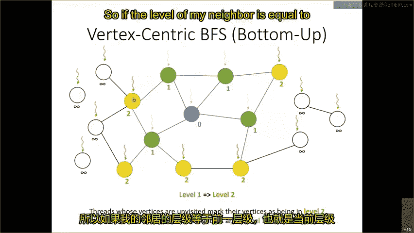

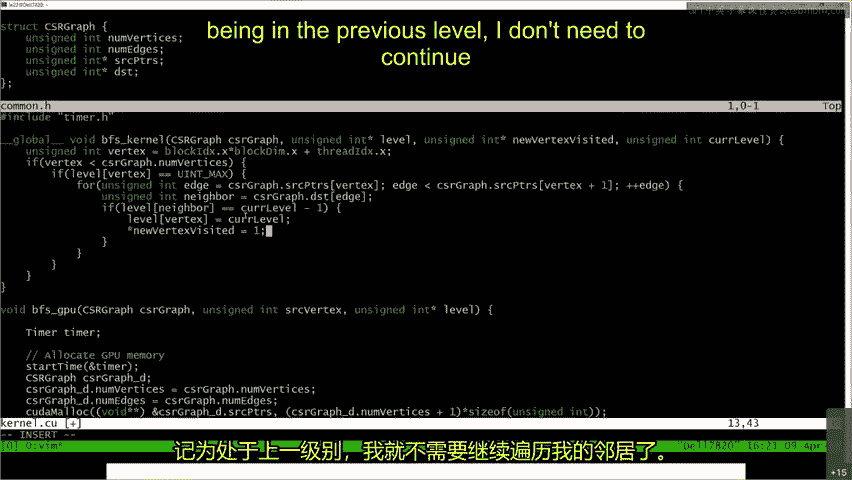

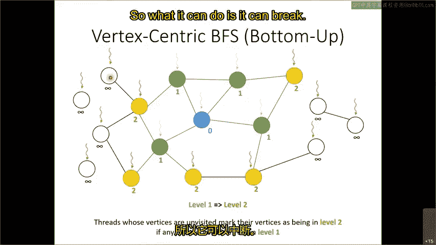

结合自顶向下和自底向上方法的优点：
*   **早期迭代**：使用**自顶向下**方法。此时已访问顶点（前沿）很小，工作量大。
*   **后期迭代**：切换为**自底向上**方法。此时未访问顶点集合变小，自底向上方法更高效。
这种自适应策略通常能获得最佳整体性能。

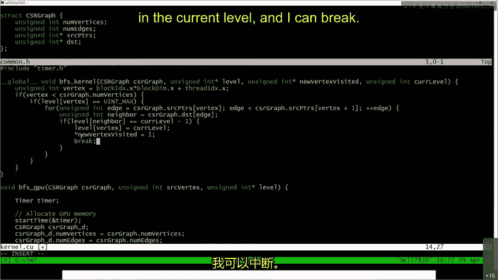

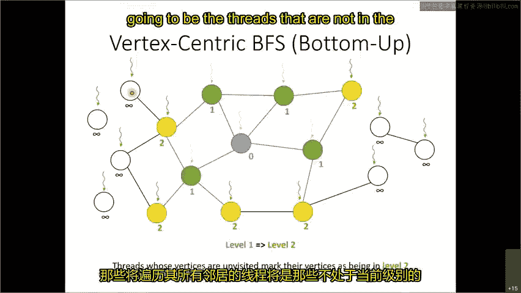

### 边中心法

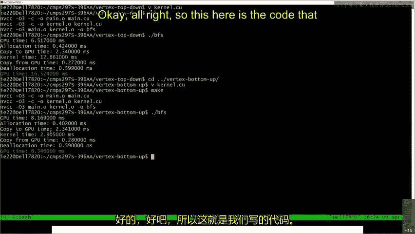

在边中心法中，每次迭代为图中的每条边启动一个线程。线程检查其负责的边的**源顶点**是否属于**上一层级**，并且**目的顶点**是否未被访问。如果条件满足，则将目的顶点标记为**当前层级**。

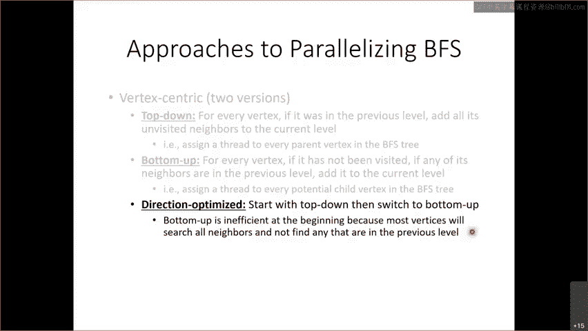

以下是该方法的CUDA内核伪代码核心逻辑：
```cpp
unsigned int edge = threadIdx.x + blockIdx.x * blockDim.x;
if (edge < num_edges) {
    unsigned int src = coo.src[edge];
    unsigned int dst = coo.dst[edge];
    if (level[src] == current_level - 1 && level[dst] == INF) {
        level[dst] = current_level;
        visited_flag = 1;
    }
}
```
**优点**：没有循环，每个线程只处理一条边，控制流分歧小，并行度非常高。
**缺点**：每次迭代都启动所有边的线程，即使大部分边不参与当前迭代，存在冗余工作。

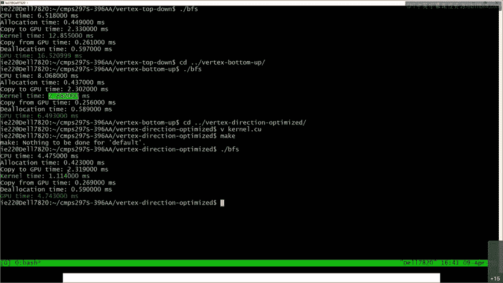

## 数据结构的影响

最佳BFS并行化策略**高度依赖于图的结构**：

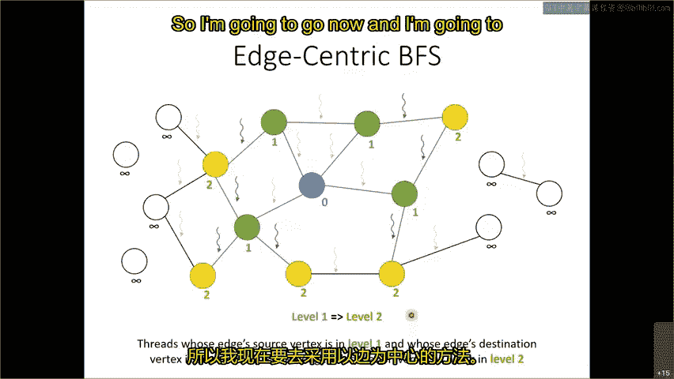

*   **高度数图**：顶点度数差异大。
    *   **自底向上**和**边中心法**表现更好，因为它们能更好地处理负载不平衡（高度数顶点）。
    *   **自顶向下**方法表现较差，因为处理高度数顶点的线程会成为瓶颈。
*   **低度数图**：顶点度数相对均匀。
    *   **自顶向下**方法表现更好，因为每次迭代的前沿规模可控，工作负载均衡。
    *   典型的例子是道路网络图。

因此，没有一种算法在所有数据集上都是最优的，需要根据图的特点进行选择。

## BFS与SpMV的相似性

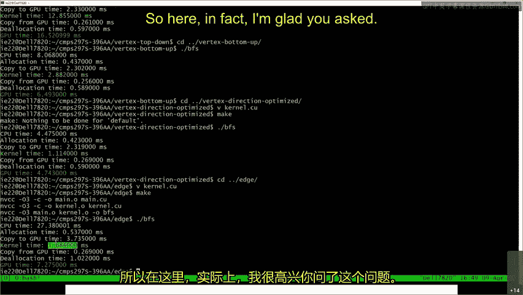

图处理与稀疏线性代数之间存在紧密联系。BFS操作，特别是自底向上的顶点中心法，与稀疏矩阵-向量乘法在计算模式上非常相似：

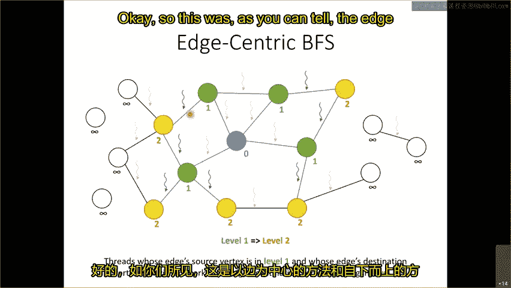

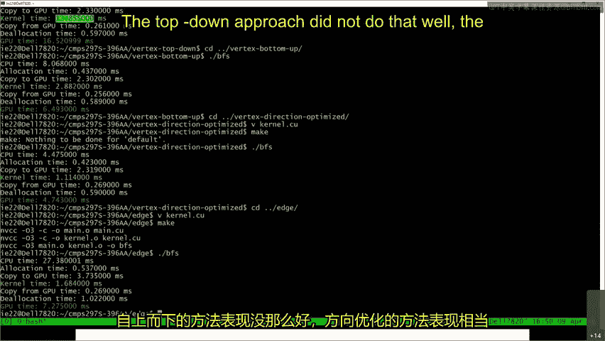

*   **SpMV**：`for each row i: for each nonzero (i, j): output[i] += matrix[i][j] * input[j]`
*   **BFS（自底向上）**：`for each vertex v: for each neighbor u of v: if (level[u] == L-1) then level[v] = L`

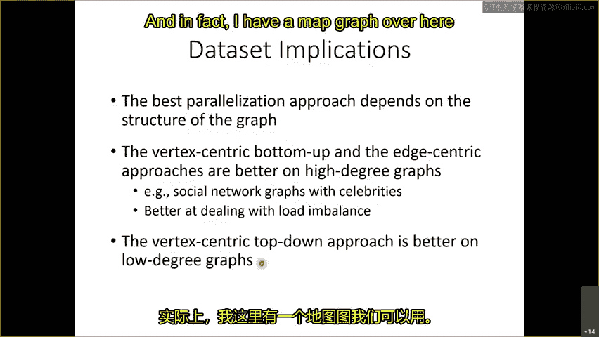

许多图算法可以表述为稀疏线性代数操作。这样做的优势是可以利用成熟的高性能稀疏线性代数库。缺点是，这种表述有时并非解决特定图问题的最直接或最高效的方法。

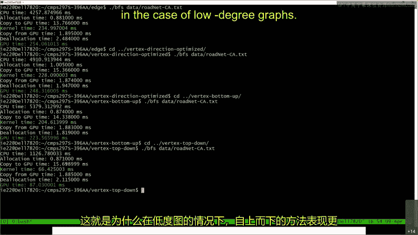

## 冗余工作与前沿优化

本节课讨论的所有方法都有一个共同点：**每次迭代都检查所有顶点或边**，无论它们是否与当前迭代相关。
*   **优点**：实现简单，并行度高，线程间无需同步。
*   **缺点**：产生大量冗余工作，许多线程空转。

下次课程将介绍另一种策略：**前沿优化**。该策略旨在只处理与当前迭代相关的顶点或边（即“前沿”）。这需要动态构建和维护这些前沿集合，虽然减少了冗余工作，但引入了线程间的同步和通信开销。这是一种在并行度、冗余工作和同步开销之间的权衡。

## 总结

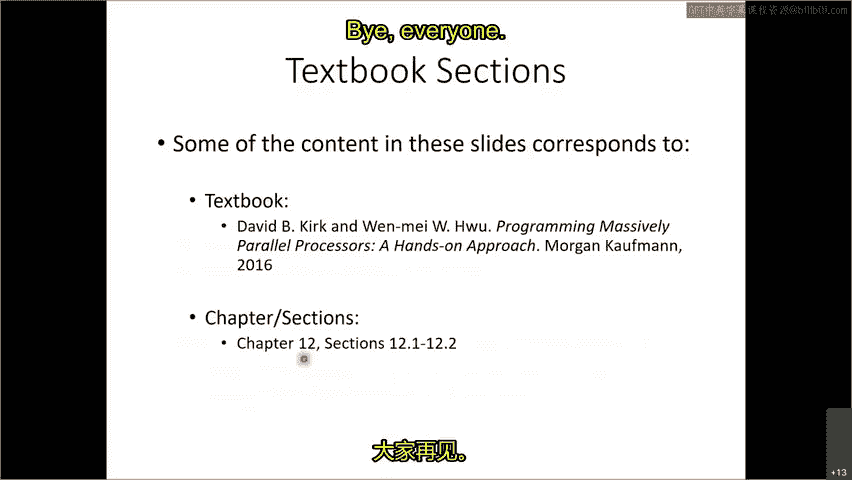

本节课我们一起学习了GPU上的图处理。我们回顾了稀疏矩阵格式如何用于表示图，并深入探讨了两种主要的并行化范式：顶点中心法和边中心法。通过以广度优先搜索为例，我们分析了自顶向下、自底向上、方向优化以及边中心等具体实现方法的原理、代码结构和性能特点。我们了解到，图的结构（如度数分布）显著影响算法性能，因此需要根据数据特征选择合适的方法。最后，我们指出了当前方法存在的冗余工作问题，并预告了下节课将探讨的前沿优化策略。