# GPU计算：19：图处理（第二部分）🚀

在本节课中，我们将继续学习图处理算法。我们将重点探讨如何通过**前沿队列**和**私有化**等技术来减少冗余计算，并优化BFS（广度优先搜索）在GPU上的实现性能。

---

## 概述

上一节我们介绍了图处理的基础知识，包括图的表示方法（如COO、CSR格式）以及BFS的几种并行实现（顶点中心化、边中心化）。我们观察到，之前的实现方法在每次迭代中都会检查所有顶点或边，这导致了大量的冗余工作。

本节中，我们将学习一种更高效的方法：**前沿队列**。这种方法的核心思想是，在每次迭代中，我们只处理那些在上一层级中被访问过的顶点（即“前沿”），从而避免为不相关的顶点启动线程。虽然这引入了更多的同步开销，但能显著减少计算冗余。

---

## 前沿队列方法

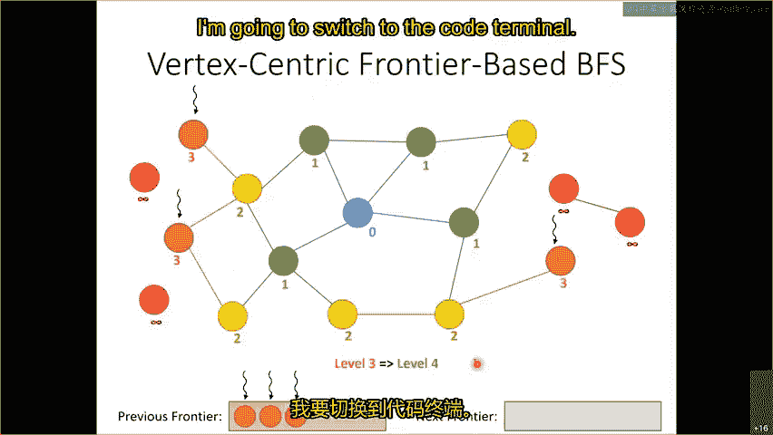

上一节我们介绍了BFS的几种实现，它们都存在检查冗余的问题。本节中我们来看看如何通过前沿队列来优化。

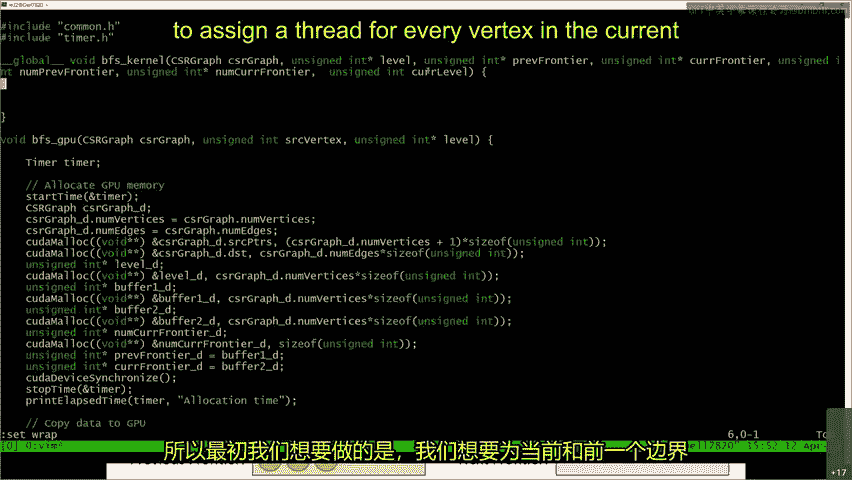

我们的目标是：在每一层级，只检查属于上一层级的顶点。为此，我们将在每个层级构建一个队列（称为“前沿”），其中包含在该层级被访问的顶点。在下一层级，我们只启动线程来处理这个前沿队列中的顶点。

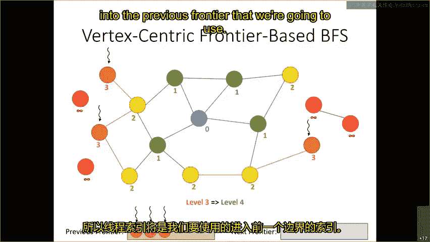

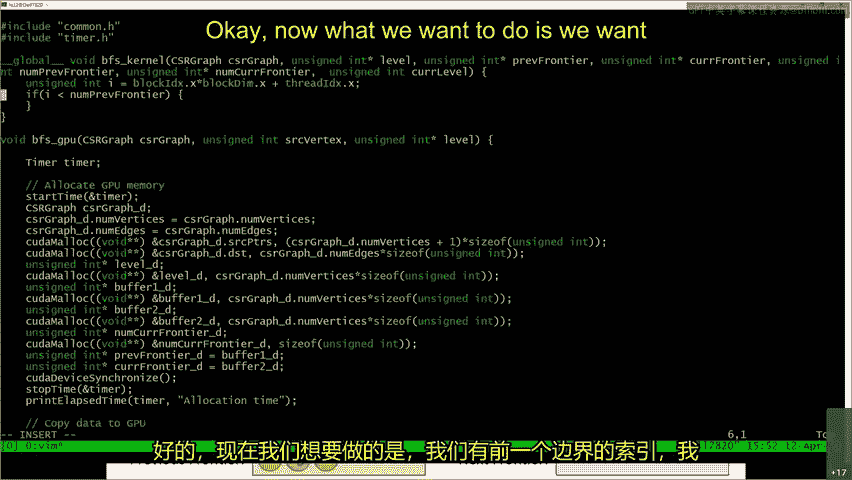

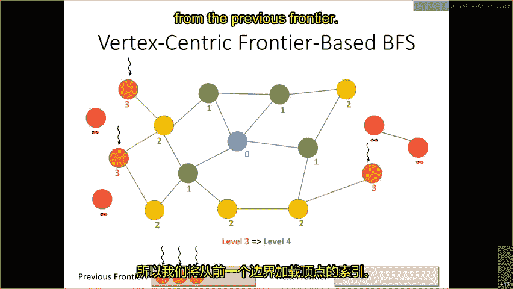

以下是该方法的步骤：
1.  初始化前沿队列，仅包含源顶点。
2.  对于当前前沿队列中的每个顶点，检查其所有邻居。
3.  如果邻居未被访问，则将其标记为已访问（属于下一层级），并加入下一个前沿队列。
4.  将下一个前沿队列设置为当前前沿，重复步骤2-3，直到没有新的顶点可访问。

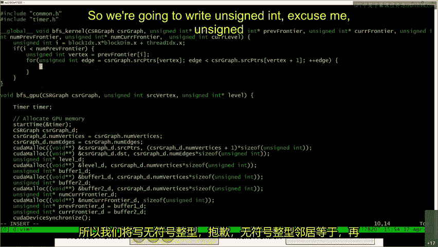

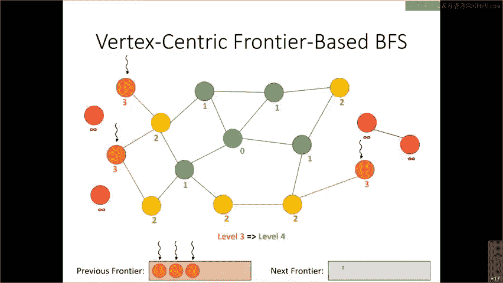

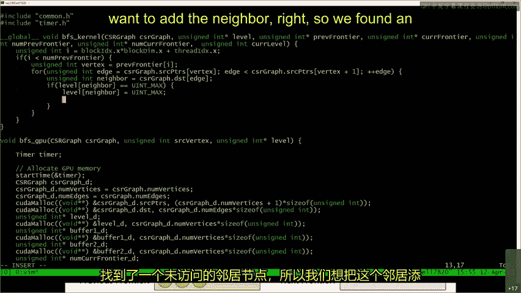

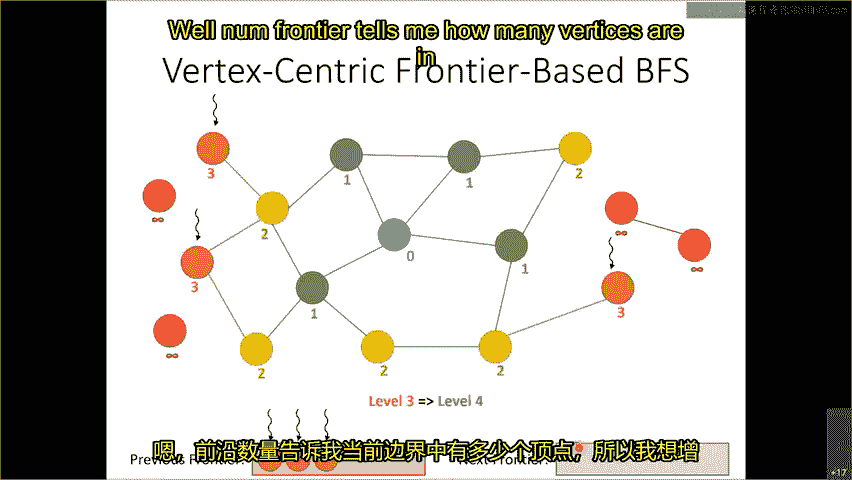

这种方法减少了线程的浪费启动，但需要同步操作来安全地向共享队列中添加顶点。

---

## 基础实现与原子操作

让我们开始实现基础的前沿队列方法。首先，我们需要在每次迭代中启动与前沿队列中顶点数量相等的线程。

以下是核心步骤的伪代码描述：

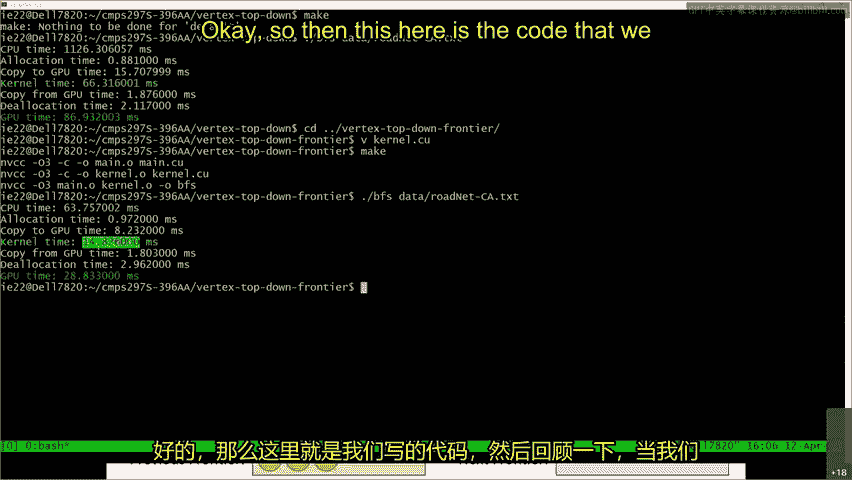

```cpp
// 假设有以下参数：
// prev_frontier: 存储上一层级顶点的数组
// num_prev: 上一层级顶点数量
// curr_frontier: 用于存储当前层级（下一层级）顶点的数组
// num_curr: 当前层级顶点数量的指针（初始为0）
// level: 存储每个顶点所属层级的数组
// current_level: 当前正在处理的层级号

// 每个线程处理prev_frontier中的一个顶点
int tid = blockIdx.x * blockDim.x + threadIdx.x;
if (tid < num_prev) {
    int vertex = prev_frontier[tid];
    // 遍历该顶点的所有出边（邻居）
    for (int edge = graph.src_ptr[vertex]; edge < graph.src_ptr[vertex+1]; edge++) {
        int neighbor = graph.dst[edge];
        // 关键步骤：使用原子比较交换操作来检查并标记邻居
        // 如果neighbor的层级还是未访问状态（例如UINT_MAX），则将其设置为current_level
        unsigned int old_level = atomicCAS(&level[neighbor], UINT_MAX, current_level);
        if (old_level == UINT_MAX) {
            // 成功标记该邻居为本层级，将其加入当前前沿队列
            int pos = atomicAdd(num_curr, 1); // 原子地获取队列中的写入位置
            curr_frontier[pos] = neighbor;
        }
    }
}
```

**代码解释**：
*   `atomicCAS` (Compare And Swap): 这是一个原子操作。它比较 `level[neighbor]` 的当前值是否等于 `UINT_MAX`（表示未访问）。如果是，则将其原子地设置为 `current_level` 并返回旧值 `UINT_MAX`；如果不是，则不做修改，直接返回当前值。这确保了即使多个线程同时发现同一个未访问邻居，也只有一个线程能成功将其标记并加入队列，从而避免了重复添加。
*   `atomicAdd`: 这是一个原子加法操作。多个线程需要安全地向 `curr_frontier` 队列末尾添加元素。`atomicAdd(num_curr, 1)` 会原子地将 `num_curr` 的值加1，并返回加1之前的值，这个返回值就是该线程可以安全写入的队列索引。

通过使用这些原子操作，我们解决了向共享队列添加元素时的**竞态条件**问题。

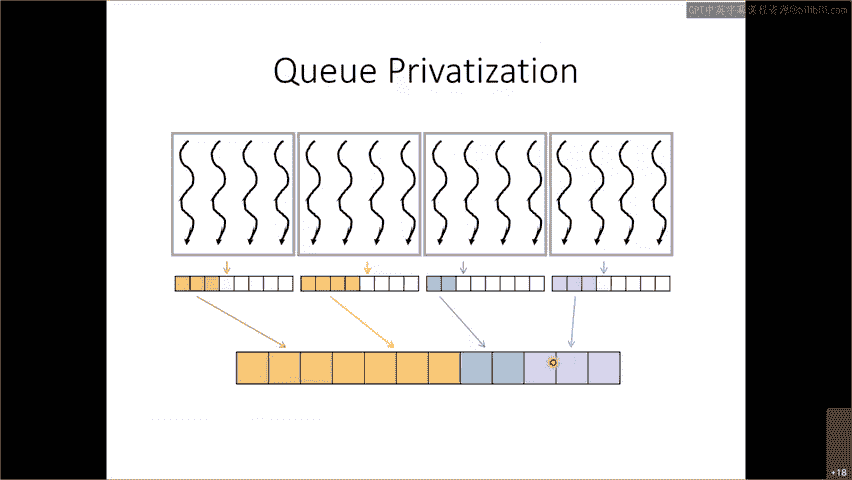

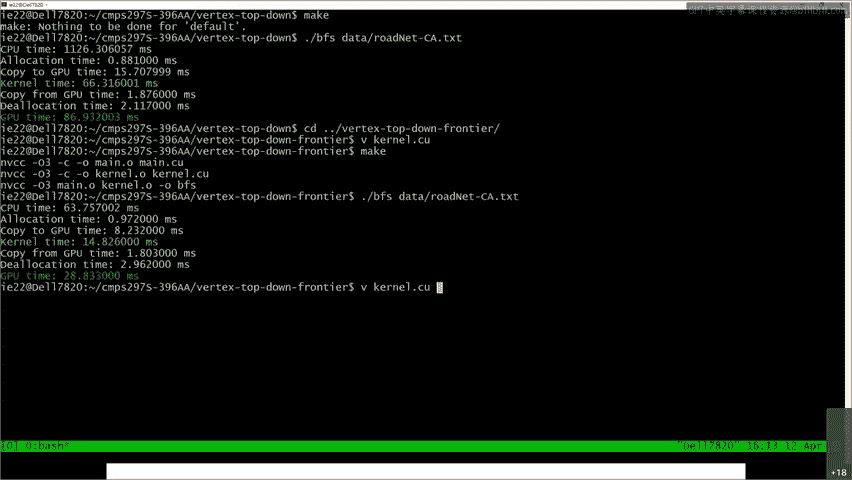

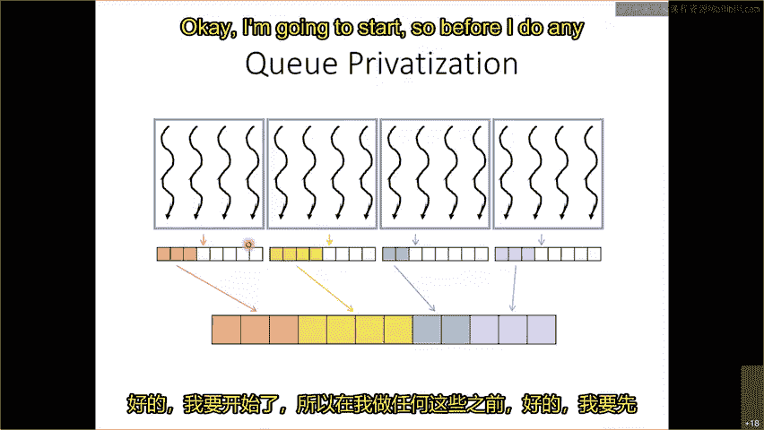

---

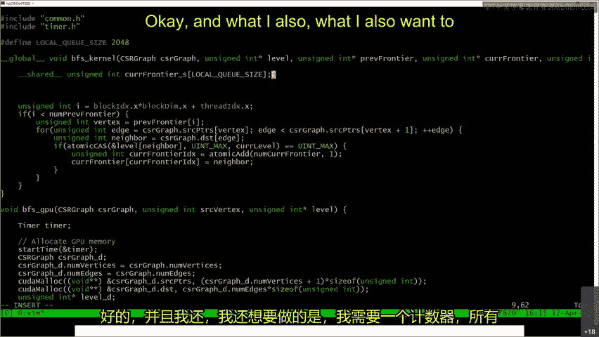

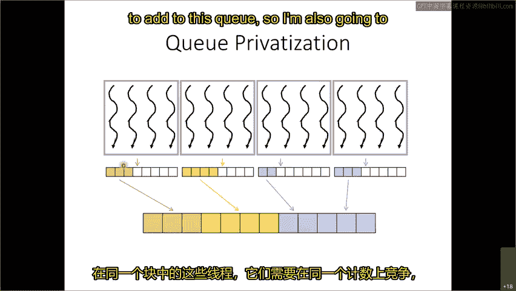

## 优化：队列私有化

基础实现中，所有线程都通过原子操作竞争同一个全局队列计数器 (`num_curr`)，这在高并发时会导致严重的序列化瓶颈和访问延迟。

为了解决这个问题，我们可以应用**私有化**策略。思路是让每个线程块维护自己的私有队列（放在共享内存中），线程只向本线程块的私有队列添加元素。待所有线程处理完后，再由每个线程块一次性将其私有队列的内容合并到全局队列中。

以下是优化步骤：
1.  在共享内存中为每个线程块声明一个私有队列 `local_queue` 及其计数器 `local_count`。
2.  线程在处理顶点时，使用原子操作向 `local_count` 和 `local_queue` 添加元素（共享内存原子操作速度更快）。
3.  设置一个私有队列的大小上限。如果写满，则溢出的元素直接写入全局队列（回退机制）。
4.  处理结束后，通过线程块内同步 (`__syncthreads()`)。
5.  由线程块内的一个线程（如threadIdx.x == 0）使用一次原子操作，向全局计数器申请一块连续空间，大小为该线程块私有队列的元素数量。
6.  该线程将申请到的起始索引存入共享变量，再次同步后，线程块内所有线程协作将私有队列中的数据拷贝到全局队列的指定位置。

这种方法的优点是：
*   将全局原子操作冲突分散到各个线程块内的共享内存原子操作，冲突大大减少。
*   从私有队列向全局队列写入数据时，内存访问模式是合并的，效率更高。

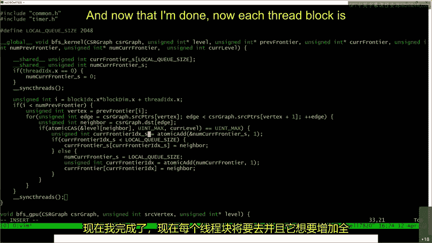

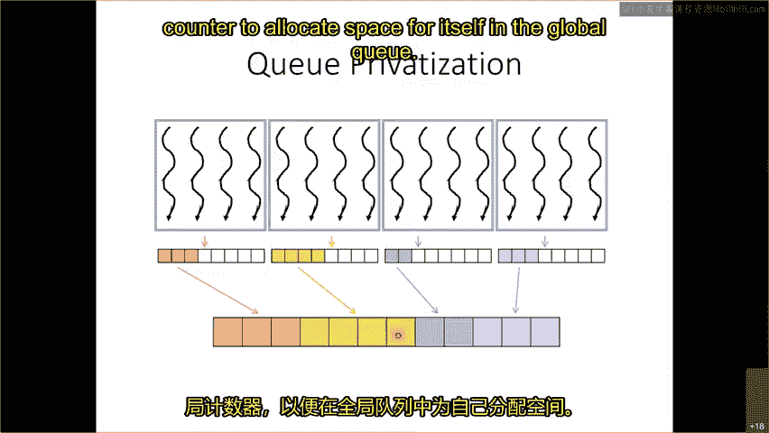

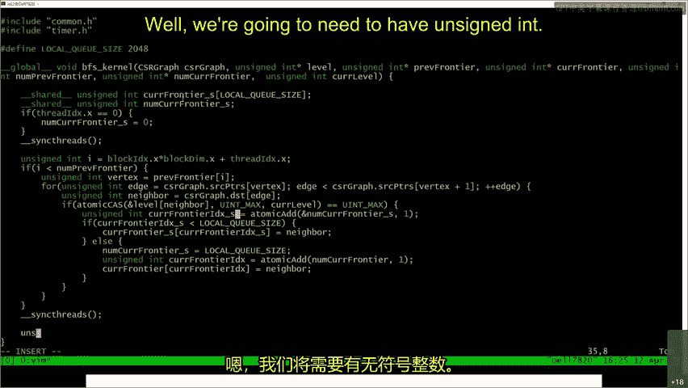

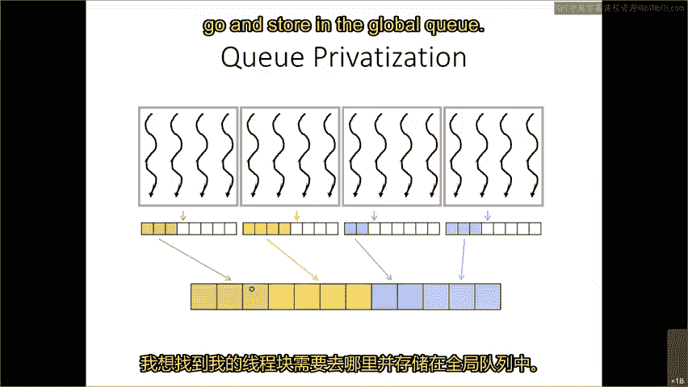

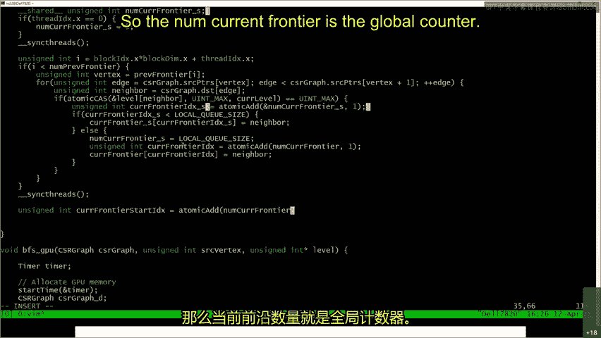

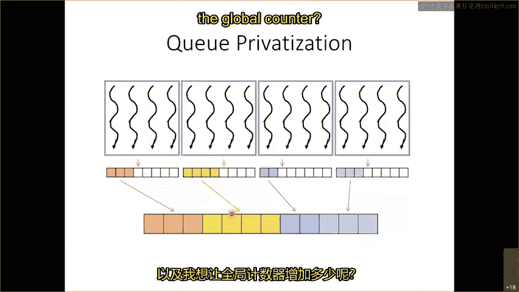

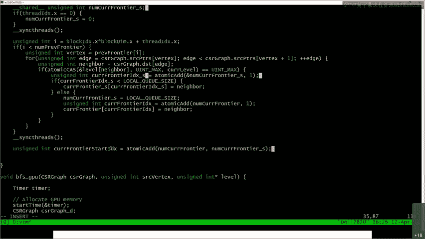

---

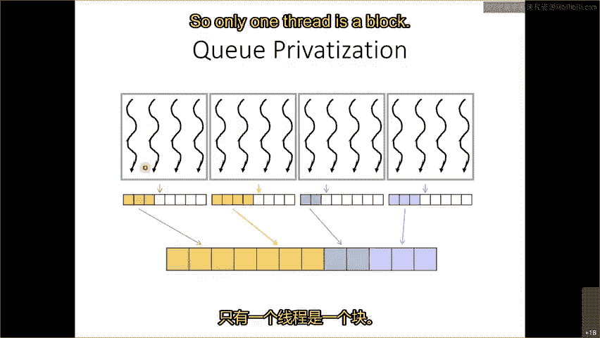

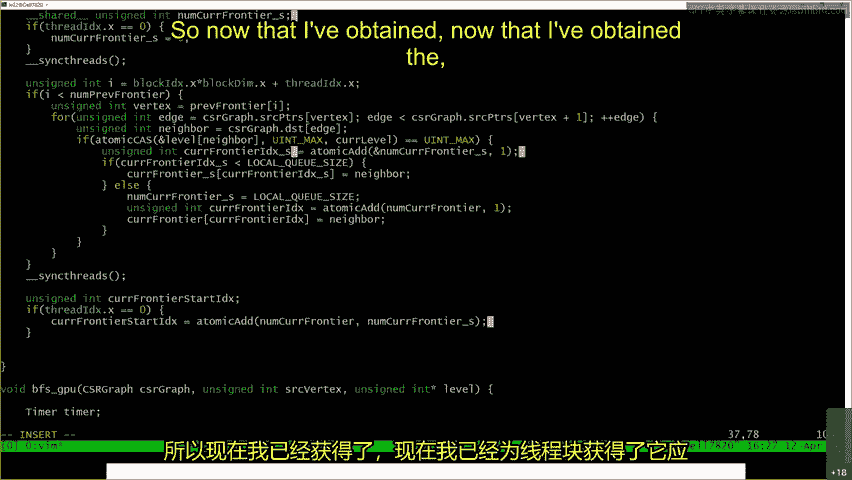

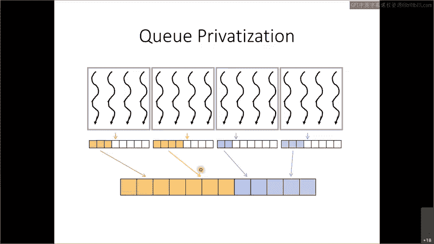

## 进一步优化：减少内核启动开销

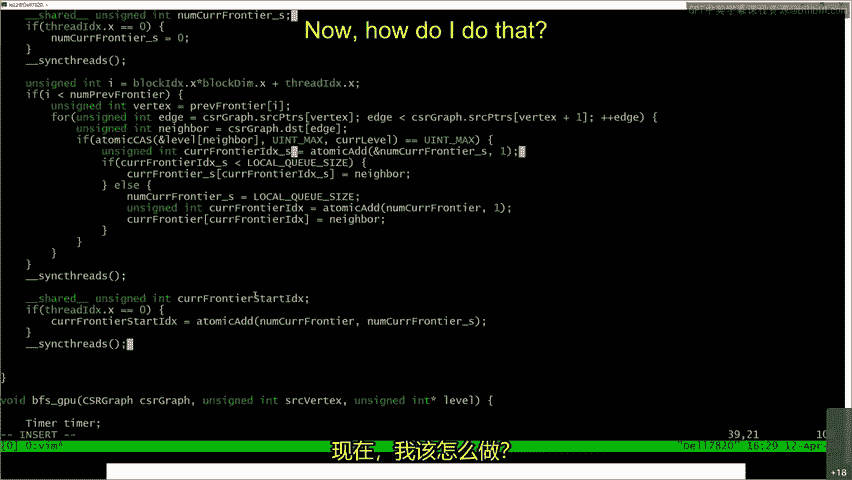

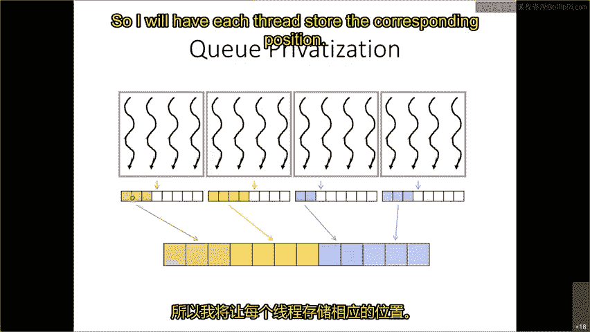

在前沿队列方法中，我们为图的每一层级都启动了一次内核。内核启动本身有一定开销，并且需要在CPU和GPU之间传输前沿队列的大小等信息。

我们可以观察到，在图搜索的开始和结束阶段，前沿队列通常很小（可能只需要一个线程块就能处理）。对于这些连续的小层级，我们可以尝试在**单个内核启动中处理多个层级**。

优化思路：
*   在内核中，不仅处理当前前沿队列来生成下一队列，还可以检查下一队列的大小。
*   如果下一队列的大小也足够小（例如，小于一个线程块能处理的最大顶点数），那么我们可以直接在同一个线程块内，使用 `__syncthreads()` 进行同步，然后继续处理下一层级的顶点。
*   这样就避免了为这个小层级再次启动内核的开销。

这种优化将多个小的网格启动合并为一次，特别适用于社交网络等图中常见的长尾层级分布，可以进一步减少总体运行时间。

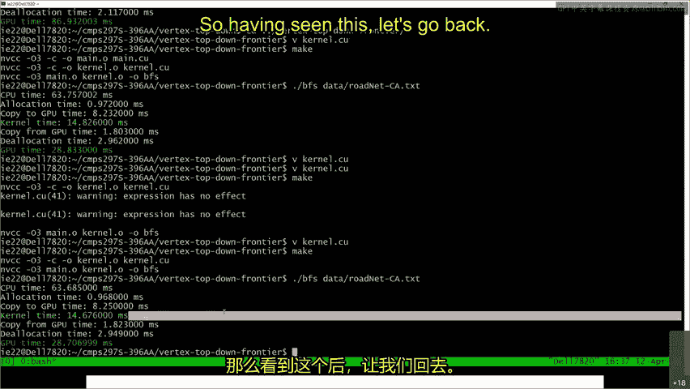

---

## 总结

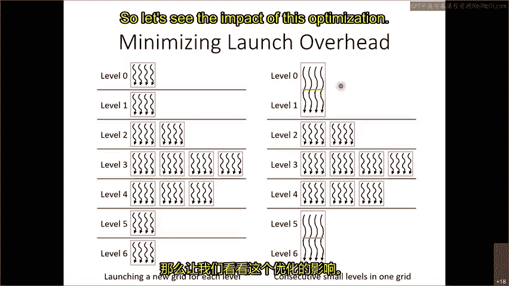

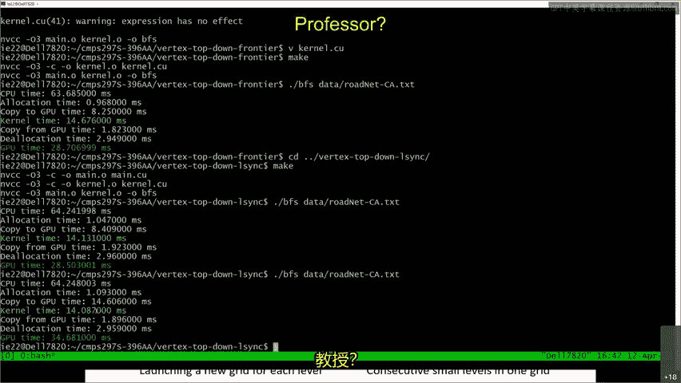

本节课中我们一起学习了如何优化GPU上的图处理算法，特别是BFS。

1.  **前沿队列方法**：通过只处理活跃顶点（前沿）来消除冗余计算，核心是使用原子操作 (`atomicCAS`, `atomicAdd`) 来安全地维护队列。
2.  **队列私有化**：通过让每个线程块维护私有队列，减少了全局原子操作的冲突，并改善了内存访问模式，从而提升了性能。
3.  **减少内核启动**：通过在内核中处理连续的小型前沿队列，合并多个层级的计算，减少了内核启动和CPU-GPU通信的开销。

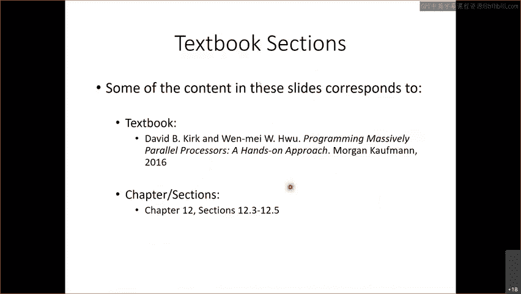

这些优化技术体现了GPU编程中常见的权衡：通过增加同步和更复杂的逻辑来减少总计算量和开销，从而在合适的场景下获得显著的性能提升。理解图的特性和硬件行为对于选择和应用这些优化至关重要。