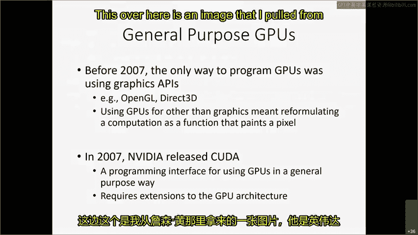
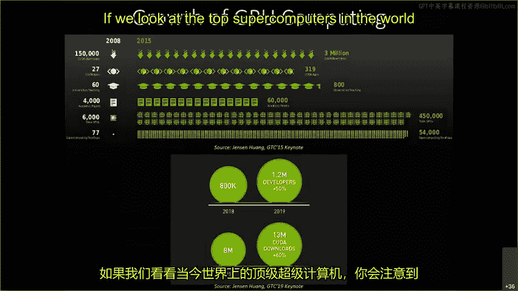
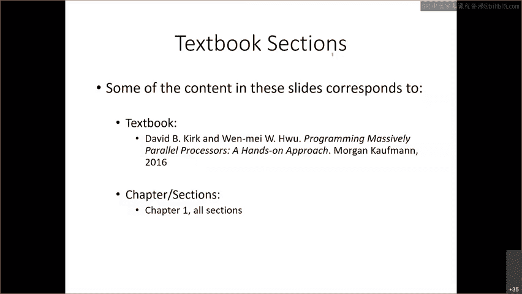

# GPU计算：01：课程介绍与动机

在本节课中，我们将要学习GPU计算的基本概念、其出现的历史背景，以及它与传统CPU在设计哲学上的根本区别。我们将从计算机技术的发展历史讲起，理解为什么并行计算和GPU变得如此重要。

## 计算机技术的发展与摩尔定律

首先，我们来回顾一下计算机技术在过去半个世纪的发展历程。计算机科学和电子工程专业的学生应该对此非常熟悉。你们还记得摩尔定律吗？

摩尔定律并非物理定律，而是英特尔联合创始人戈登·摩尔提出的一个预测。他预测，单位面积集成电路上可容纳的晶体管数量，大约每18到24个月便会增加一倍。

这个预测在过去的半个世纪里基本成立，半导体行业也以此为目标进行发展。然而，正如一位同学指出的，这个趋势正在走向终结。因为晶体管尺寸已经小到难以继续缩小的物理极限。

晶体管数量的持续翻倍带来了一个好处：晶体管越小，开关速度就越快。这意味着我们可以提高处理器的时钟频率。因此，在2005年之前，处理器频率也遵循着类似的翻倍趋势。如果你在2005年之前购买了一台新电脑，即使运行相同的程序，速度也会比两年前的旧电脑快一倍，这主要归功于频率的提升。

## 频率停滞与并行计算的兴起

上一节我们介绍了频率提升带来的“免费午餐”，但这种情况在2005年左右发生了变化。我们继续获得更多的晶体管，但无法再让它们更快地开关了。有谁知道为什么吗？

原因在于功耗和散热。让晶体管更快地开关会产生更多热量。如果散热技术无法及时带走这些热量，CPU就会过热损坏。因此，在2005年左右，处理器频率的提升停滞了。

这意味着，仅仅依靠购买更新的电脑，不再能自动获得程序运行速度的翻倍提升。当然，单线程性能并未完全停滞，它仍在缓慢提升，主要得益于编译器技术的进步，以及利用额外晶体管实现的更复杂的硬件技术，例如分支预测和乱序执行。

由于单线程性能提升放缓，我们获得了更多晶体管却无法显著提升性能，那么人们开始用这些额外的晶体管做什么呢？

答案就是增加核心数量。硬件设计者开始在处理器中集成更多核心。这标志着并行计算开始成为主流。软件也必须跟上硬件的步伐，开发者需要重写程序以利用并行能力。免费的“性能午餐”就此结束。

## 系统设计的两种取向：延迟导向与吞吐量导向

在深入探讨CPU和GPU的区别之前，我们先来了解两种通用的系统设计思路。这不仅适用于计算机系统，也适用于任何旨在完成任务的系统设计。

这两种设计思路分别是**延迟导向设计**和**吞吐量导向设计**。

延迟导向设计旨在最小化完成单个任务所需的时间。一个典型的例子是**汽车**。汽车的设计目标是尽快将一个人从A点送到B点。

吞吐量导向设计则旨在最大化在给定时间内完成的任务数量，即使每个独立任务耗时更长。一个典型的例子是**公共汽车**。公交车一次可以运送很多人，虽然每个人到达目的地的时间可能比开车要长。

选择哪种设计取决于任务规模。运送1到4个人，汽车是高效的选择。但若要运送20个人，公交车只需一趟，而汽车需要往返多次，此时公交车就成为了更具吸引力的解决方案。

## CPU与GPU：延迟与吞吐量的设计哲学

理解了通用设计思路后，我们将其应用到处理器设计上。CPU是**延迟导向设计**的典型代表，而GPU则是**吞吐量导向设计**的典型代表。

换句话说，如果你希望以最快速度完成**一个**任务，应该使用CPU。但如果你希望在特定时间内完成**许多**小任务，GPU就成为了更佳选择。

以下是这两种设计哲学如何具体影响CPU和GPU设计的几个方面：

**1. 算术逻辑单元**
*   **CPU**：拥有少量但非常强大的ALU。这些ALU占用大量芯片面积，经过高度优化，旨在将单个算术运算（如加法、乘法）的延迟降到最低。
*   **GPU**：拥有大量小型、简单的ALU。每个ALU执行运算的延迟较长，但通过大量ALU并行工作以及流水线技术，可以实现极高的整体运算吞吐量。

**2. 缓存**
*   **CPU**：配备大容量缓存。目的是将访问慢速DRAM内存的高延迟操作，转化为访问快速缓存的低延迟操作，从而降低单线程的访存延迟。
*   **GPU**：缓存容量较小。这意味着缓存命中率较低，更多访问需要去到延迟更高的内存。但这样做的好处是可以将更多的芯片面积用于计算单元（ALU），而不是缓存。

**3. 控制逻辑**
*   **CPU**：采用复杂昂贵的控制逻辑来降低延迟，例如分支预测、数据前递、乱序执行等。这些技术需要大量额外的硬件支持。
*   **GPU**：控制逻辑相对简单。运算分支、数据冲突等带来的延迟更高，但这是为了节省芯片面积，以容纳更多计算单元，从而换取高吞吐量。

**4. 多线程与延迟隐藏**
由于CPU操作延迟较低，流水线中的“气泡”（空闲周期）相对较少。为了进一步隐藏这些短暂的延迟，CPU采用**适度规模的多线程**（例如，每个核心同时运行2个线程，即超线程技术）。当一个线程的指令因等待而无法执行时，可以执行另一个线程的指令来填充流水线。

GPU则不同。其ALU运算、内存访问和控制决策的延迟都非常高，流水线中容易出现大量气泡。为了隐藏这些高延迟，GPU采用了**大规模的多线程**。单个GPU核心上会同时调度并准备执行数十甚至上百个线程。当某个线程需要等待时，硬件可以立刻从众多就绪线程中挑选另一个线程的指令来执行，从而保持计算单元的忙碌，实现高吞吐量。

**5. 时钟频率**
*   **CPU**：通常具有较高的时钟频率。
*   **GPU**：由于集成了海量的计算单元，功耗已经很大，因此通常运行在相对较低的时钟频率以控制总功耗和散热。

## GPU的起源与发展

上一节我们对比了CPU和GPU的设计哲学，那么GPU最初是从何而来的呢？

GPU的全称是**图形处理单元**。它最初是为图形渲染而设计的。图形工作负载有一个独特的特点：**高度并行**。例如，渲染屏幕上的成千上万个像素，这些像素的计算在很大程度上是相互独立的。因此，GPU从诞生之初就被设计成一种拥有大规模并行能力和高吞吐量的架构。

后来，人们意识到，尽管GPU是为图形设计的，但它同样适用于其他需要高吞吐量的计算任务。这催生了**通用GPU计算**的趋势。

在2007年之前，编程GPU只能通过特定的图形API（如OpenGL、Direct3D）。想要进行通用计算的研究人员，必须将自己的计算问题“伪装”成图形渲染问题，过程非常繁琐。

2007年，英伟达发布了**CUDA**平台。这是一个革命性的变化，它提供了一个直接的编程接口，让开发者能够像编写通用程序一样为GPU编写代码。同时，GPU硬件架构也进行了相应扩展，以更好地支持通用计算。这标志着GPU计算时代的真正开始。

此后，GPU在科学计算、深度学习等领域被广泛采用。根据2020年11月的全球超级计算机TOP500榜单，前10名中有6台使用了GPU加速。在能效榜单（Green500）上，前10名中有7台是GPU加速的超级计算机。虽然单个GPU功耗可能更高，但由于其强大的并行计算能力能极大缩短任务完成时间，因此从完成单位计算量所消耗的总能量来看，GPU往往更具能效优势。

## 为什么是GPU取得了成功？

并行处理器有多种设计可能，为什么最终是GPU取得了巨大成功？这背后有技术和市场的双重原因。

芯片设计制造成本极高，需要巨大的销量来分摊成本。当并行计算成为主流时，GPU已经拥有了一个庞大的现有市场——**游戏产业**。这使得GPU厂商在向通用计算领域拓展时，拥有其他潜在竞争对手所不具备的规模优势和成本分摊能力。

根据2019年的市场划分，GPU收入中58%来自游戏，数据中心占24%（其中包含科学计算和深度学习）。如果一家公司只为科学计算市场设计一款专用并行芯片，其销量将难以支撑高昂的研发制造成本。而GPU厂商则可以依托游戏市场的稳定收入，来发展和推广其通用计算能力。

这也带来一个有趣的考量：GPU架构的改进必须兼顾所有主要市场。一项可能大幅提升科学计算性能但会损害游戏性能的改进，很可能不会被采纳，因为游戏仍是最大的客户基础。

## 课程总结与教材

本节课中，我们一起学习了：
1.  **摩尔定律的终结**如何促使计算范式从提升单核频率转向增加核心数量，即并行计算。
2.  系统设计的两种基本哲学：**延迟导向**（如CPU）与**吞吐量导向**（如GPU），以及它们在ALU、缓存、控制逻辑和多线程策略上的具体体现。
3.  GPU的**起源**（图形处理）及其向**通用计算**演进的关键里程碑（CUDA的发布）。
4.  GPU在当今高性能与高效能计算中的**重要地位**，以及其取得成功的**市场因素**。

本课程将主要关注如何使用GPU进行通用目的编程，重点案例将来自科学计算和深度学习领域。

**推荐教材**：《Programming Massively Parallel Processors: A Hands-on Approach》 by David Kirk and Wen-mei Hwu。课程内容将与教材章节对应，建议课后阅读以加深理解。

---
*注：后续课程将开始具体学习GPU架构细节和编程方法。*