# GPU计算：第21讲：固定内存与流

在本节课中，我们将要学习两个紧密相关的主题：固定内存和CUDA流。我们将探讨如何通过使用固定内存来优化主机与设备之间的数据传输，以及如何利用CUDA流来实现数据传输与内核执行的并行化，从而进一步提升GPU程序的整体性能。

上一讲我们介绍了线程束内的同步，学习了如何利用同一线程束内线程的特殊关系进行快速同步。本节中，我们来看看如何优化主机与设备间的通信。


## 什么是固定内存？

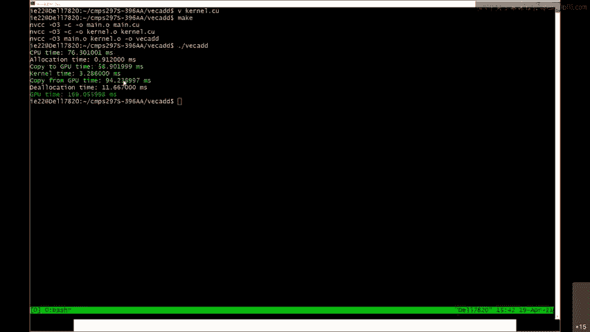

首先，我们来谈谈固定内存。什么是固定内存？

回想一下我们之前编写的向量加法代码。我们分配了主机内存，将源向量复制到设备，调用加法内核，然后将结果向量复制回主机。当我们分析这段代码的性能时，会发现GPU的总执行时间主要由数据拷贝时间主导，而内核计算时间其实很短。

那么，我们能否优化这个拷贝过程，减少每次在主机和设备之间复制数据所花费的时间呢？

为了理解如何优化拷贝，我们首先需要了解调用 `cudaMemcpy` 时发生了什么。这个过程使用了直接内存访问技术。

*   **直接内存访问**：DMA允许硬件单元（如DMA引擎）在不涉及CPU的情况下直接访问内存。当从主机内存复制数据到GPU内存时，CPU并不参与逐字节的读写，而是由DMA引擎负责完成传输，这样CPU就可以去处理其他任务。

然而，DMA引擎使用**物理地址**来访问内存，而CPU使用**虚拟地址**。操作系统可以动态地将虚拟页面换出到磁盘，或重新映射到不同的物理页面。如果DMA引擎正在读取的物理页面被操作系统换出或移动，DMA引擎无法察觉，从而导致它读取到错误的数据。

为了避免数据损坏，任何被DMA访问的内存页面都必须被“锁定”或“固定”在物理内存中，防止操作系统移动或换出它们。这就是**固定内存**。

默认情况下，使用 `malloc` 分配的内存不是固定的。因此，当调用 `cudaMemcpy` 时，CUDA运行时会执行以下步骤：
1.  将数据从用户分配的缓冲区复制到一个内部的、固定的临时缓冲区。
2.  然后，DMA引擎从这个固定缓冲区将数据复制到设备内存。

可以看到，这实际上进行了两次拷贝，带来了额外的开销。

## 如何使用固定内存进行优化？

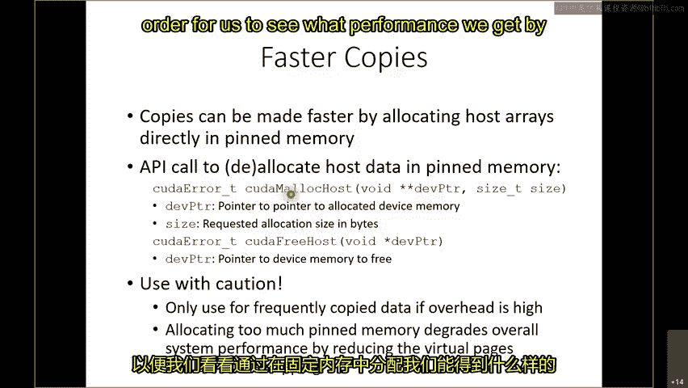

为了优化拷贝，我们可以避免这额外的拷贝。方法就是直接将我们的主机数组分配在固定内存中。这样，DMA引擎可以直接从我们的缓冲区读取数据。

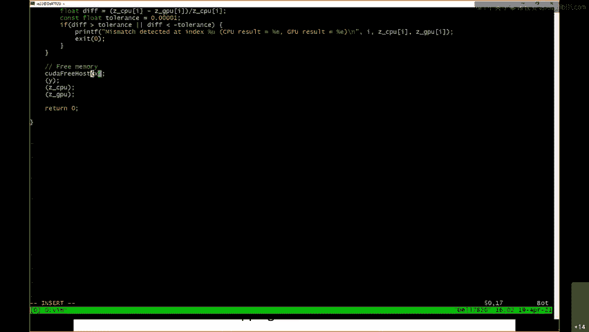

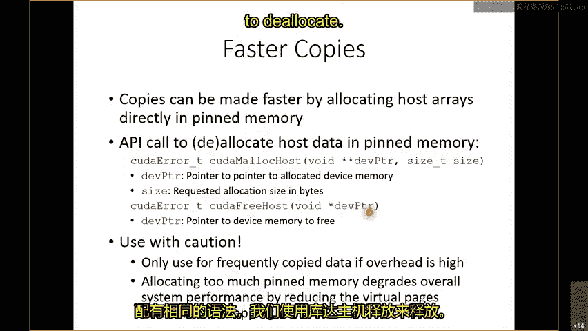

CUDA提供了专门的API来分配和释放固定内存：
*   使用 `cudaMallocHost` 分配固定内存。
*   使用 `cudaFreeHost` 释放固定内存。

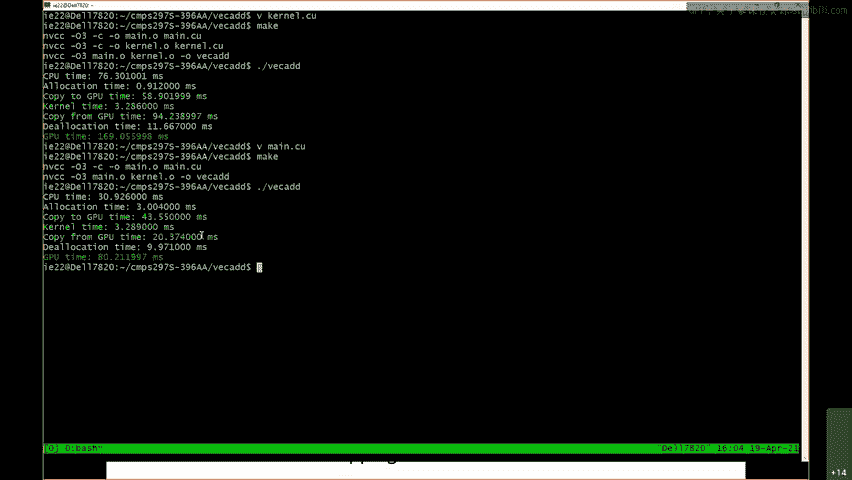

其语法与 `cudaMalloc` 和 `cudaFree` 类似。

**重要提示**：不应将所有内存都分配为固定内存。固定内存会减少操作系统可用于交换的虚拟页面数量，从而可能降低系统整体性能。固定内存应仅用于需要频繁在主机和设备之间传输的数据。

通过将主机数组分配在固定内存中，我们观察到向量加法示例的GPU执行时间显著减少，因为拷贝时间大幅缩短。

## 什么是CUDA流？

接下来，我们讨论CUDA流。这涉及到系统架构层面的并行性，是一种任务并行或流水线并行。

在一个典型系统中，我们有CPU、主机内存、GPU和设备内存。系统实际上能够**同时**执行以下操作：
*   在GPU上执行内核计算。
*   将数据从主机内存复制到设备内存。
*   将数据从设备内存复制回主机内存。

这是三种不同的硬件资源。然而，我们之前的代码是顺序执行的：先拷贝所有数据到设备，然后执行内核，最后将所有数据拷贝回主机。在每个阶段，其他资源都处于空闲状态。

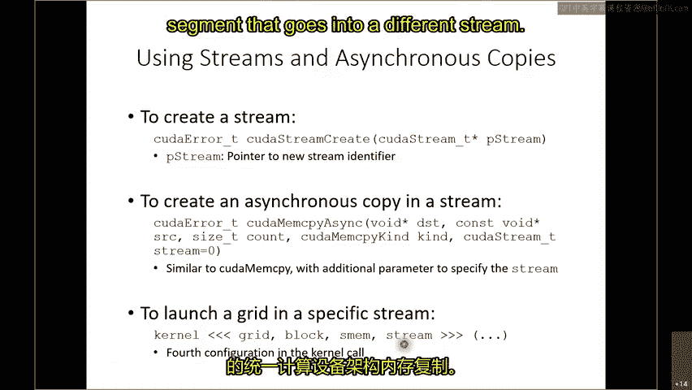

为了更充分地利用硬件，我们可以采用流水线技术。例如，在向量加法中，我们可以将输入数组分成多个段。然后：
1.  将第一段数据（A1, B1）拷贝到设备。
2.  当第一段数据在设备上就绪后，启动内核计算 C1 = A1 + B1。**同时**，开始将第二段数据（A2, B2）拷贝到设备。
3.  当第一段计算完成，开始将结果C1拷贝回主机。**同时**，对已就绪的第二段数据（A2, B2）执行内核计算，并开始拷贝第三段数据（A3, B3）到设备。

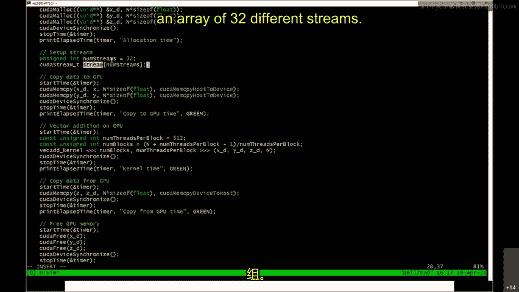

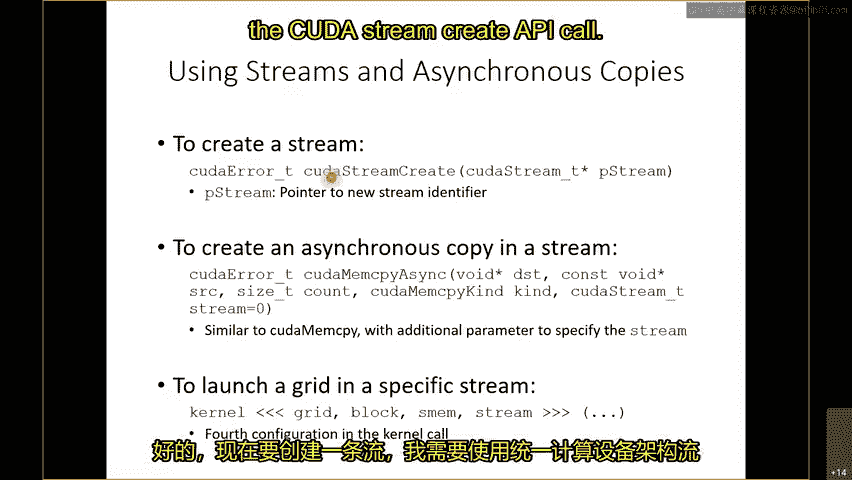

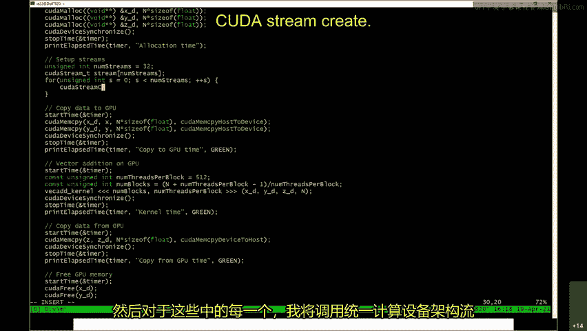

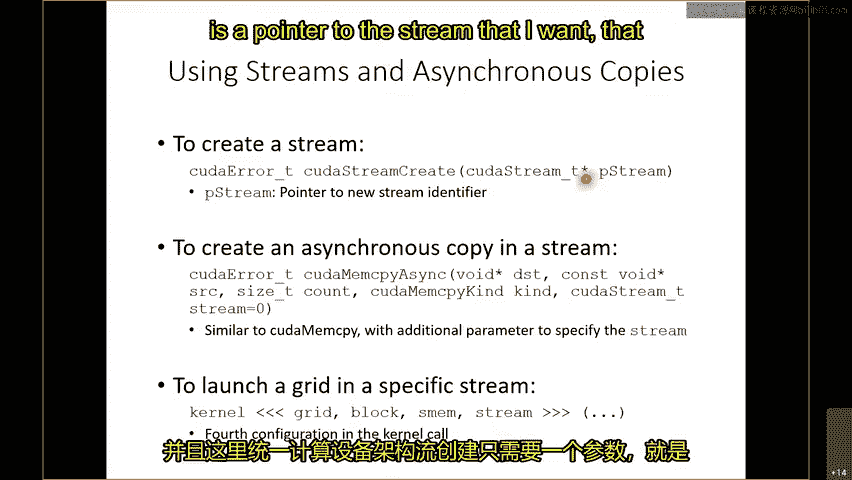

如此循环，我们就能重叠不同段的拷贝和计算操作，实现并行。

## 如何使用流实现流水线？

为了实现这种流水线，我们需要：
1.  **异步内存拷贝**：允许主机发起拷贝操作后立即继续执行，而不等待拷贝完成。
2.  **CUDA流**：流是一系列按顺序执行的操作（如内存拷贝、内核启动）的队列。**不同流中的操作可以并行执行**，而同一流中的操作则按顺序执行。

默认情况下，所有操作都放入“默认流”（stream 0）中，因此它们是串行的。

以下是使用流和异步操作的关键API：
*   `cudaStreamCreate`：创建一个新的流。
*   `cudaMemcpyAsync`：执行异步内存拷贝，可以指定目标流。
*   **内核启动**：在内核配置中，第四个可选参数就是流标识符。

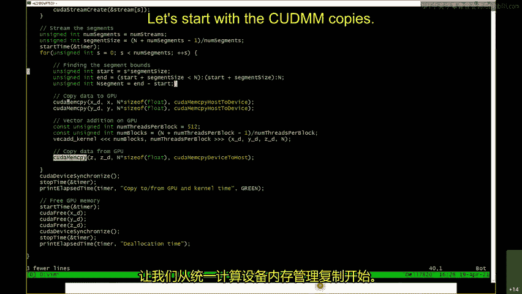

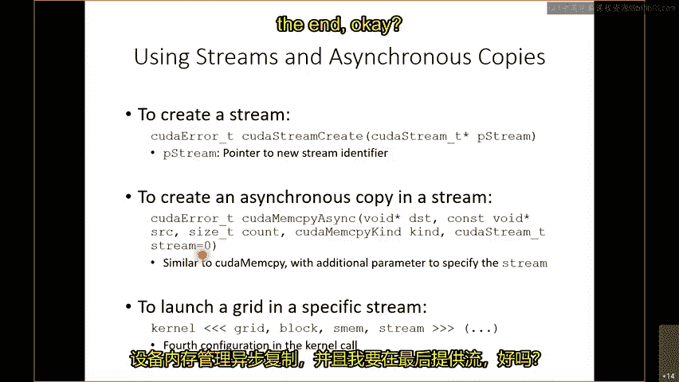

以下是实现流水线向量加法的核心步骤代码示例：

```c
// 1. 创建多个流
int num_streams = 32;
cudaStream_t streams[num_streams];
for (int i = 0; i < num_streams; ++i) {
    cudaStreamCreate(&streams[i]);
}

// 2. 计算分段大小
size_t segment_size = (n + num_streams - 1) / num_streams; // 向上取整

// 3. 为每个分段提交异步操作到对应的流
for (int s = 0; s < num_streams; ++s) {
    size_t start = s * segment_size;
    size_t end = min(start + segment_size, n);
    size_t seg_len = end - start;

    // 异步拷贝主机到设备 (指定流)
    cudaMemcpyAsync(&d_x[start], &h_x[start], seg_len * sizeof(float), cudaMemcpyHostToDevice, streams[s]);
    cudaMemcpyAsync(&d_y[start], &h_y[start], seg_len * sizeof(float), cudaMemcpyHostToDevice, streams[s]);

    // 在内核启动中指定相同的流
    vector_add_kernel<<<grid_dim, block_dim, 0, streams[s]>>>(&d_x[start], &d_y[start], &d_z[start], seg_len);

    // 异步拷贝设备到主机 (指定流)
    cudaMemcpyAsync(&h_z[start], &d_z[start], seg_len * sizeof(float), cudaMemcpyDeviceToHost, streams[s]);
}

// 4. 等待所有流中的操作完成
cudaDeviceSynchronize();

// 5. 销毁流
for (int i = 0; i < num_streams; ++i) {
    cudaStreamDestroy(streams[i]);
}
```

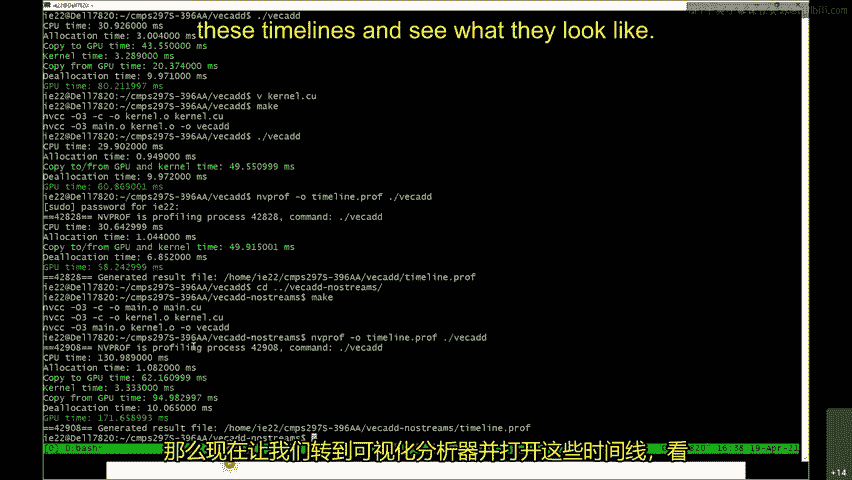

通过性能分析工具（如 NVIDIA Nsight Systems）查看时间线，可以清晰地看到不同流中的内存拷贝（H2D, D2H）和内核执行（Compute）操作实现了重叠。最耗时的操作（通常是H2D拷贝）的“尾部”时间掩盖了其他操作的延迟，从而提升了整体吞吐量。

## 总结

本节课中我们一起学习了优化GPU程序通信性能的两个关键技术。

首先，我们了解了**固定内存**。通过使用 `cudaMallocHost` 直接将数据分配在主机端的固定内存中，可以避免CUDA运行时在默认拷贝路径中的额外缓冲拷贝，从而显著减少主机与设备间的数据传输时间。

其次，我们深入探讨了**CUDA流**。通过创建多个流，并将计算任务分段，利用 `cudaMemcpyAsync` 和指定流的内核启动，我们可以实现数据传输与内核执行的流水线并行。这允许设备在计算一个数据段的同时，接收下一个数据段并传回上一个结果段，充分重叠了不同硬件资源（PCIe带宽、GPU计算单元）的操作，隐藏了操作延迟，最终提升了程序的整体执行效率。

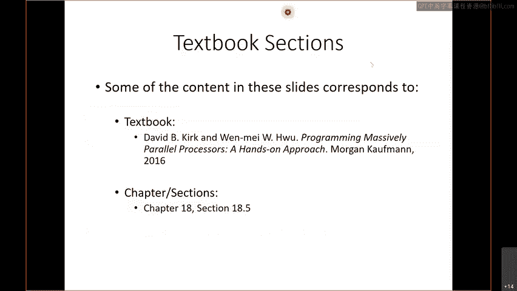

掌握固定内存和流的使用，对于构建高性能的、数据密集型的CUDA应用程序至关重要。