# GPU计算｜CMPS 297S396AA：22：动态并行性


在本节课中，我们将要学习CUDA编程中的一个高级特性：动态并行性。它允许GPU上的线程在运行时启动新的内核网格，这对于处理具有嵌套并行性或工作负载大小未知的应用程序非常有用。

上一节我们介绍了固定内存和CUDA流，它们用于优化主机与设备间的数据传输。本节中我们来看看动态并行性，它允许GPU线程自身启动新的内核，从而在GPU上实现更灵活的并行计算模式。

## 什么是动态并行性？

动态并行性指的是在GPU上执行的线程能够启动新的网格在GPU上运行的能力。如果一个网格中的线程正在GPU上运行，那么其中任何一个线程都可以去启动另一个线程网格。

为什么需要这样做？一个主要原因是，当我们的计算需要启动多个内核时，可以直接从GPU启动，而无需再与CPU同步。更重要的是，它适用于具有**嵌套并行性**的应用程序。

## 嵌套并行性

嵌套并行性是指应用程序中存在多个层次的并行性。例如，我们有一批可以并行执行的工作单元，而每个工作单元内部又包含更多可以并行执行的工作。当内层并行工作的数量在编译时未知时，动态并行性就特别有用。如果内层工作量未知，我们无法预先启动固定数量的线程。此时，让每个线程在运行时发现自己内部有多少并行性，然后自己启动更多线程，就变得非常有用。

以下是具有嵌套并行性模式的两种主要应用类型：

*   **不规则嵌套工作**：不同线程内部具有不同数量的嵌套并行工作。例如，在图算法中，每个顶点（对应一个线程）可能有不同数量的邻居需要并行访问。另一个例子是贝塞尔曲线绘制，每条曲线（对应一个线程）根据其曲率可能需要不同数量的点来绘制。
*   **递归深度未知**：所有线程可能具有相同数量的嵌套工作，但线程是否启动更多工作取决于运行时信息。例如，在四叉树/八叉树空间划分中，一个线程负责处理一个区域框，根据框内点的活动情况决定是否进一步细分（递归）。另一个例子是分治算法，如快速排序，根据分区属性决定是否继续划分。

CUDA SDK中包含了贝塞尔曲线、四叉树和快速排序的动态并行性示例。本节课我们将以广度优先搜索图算法为例进行讲解。

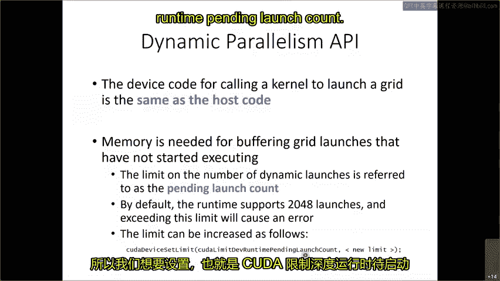

## 在BFS中应用动态并行性

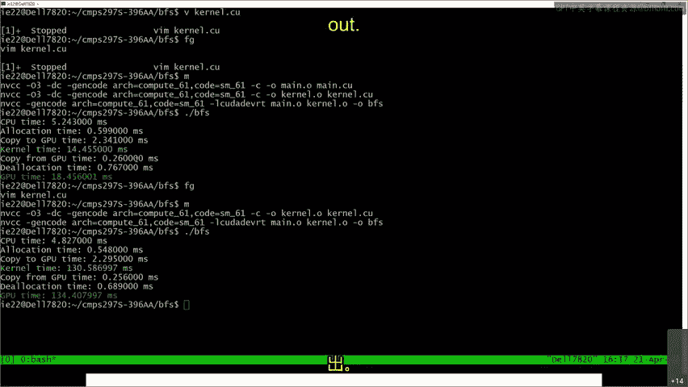

作为回顾，我们之前实现的BFS使用“边界”法。在每次迭代中，前一边界中的每个顶点（对应一个线程）会顺序访问其所有邻居，并决定是否将邻居加入当前边界。

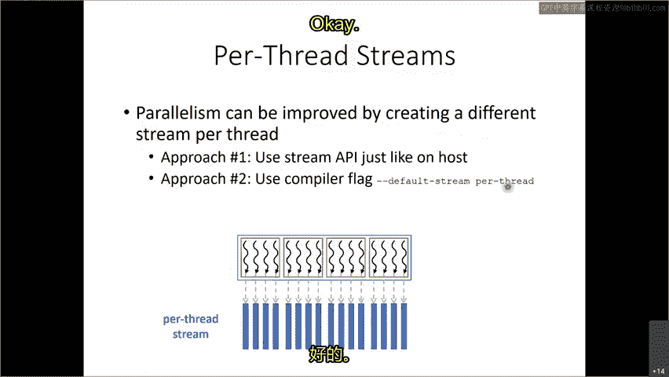

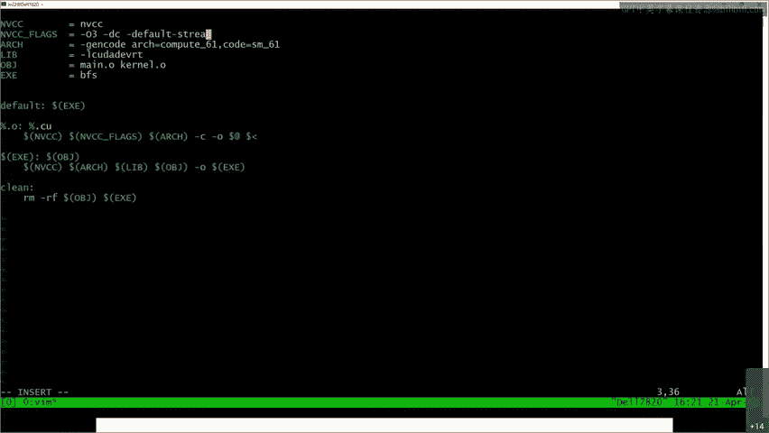

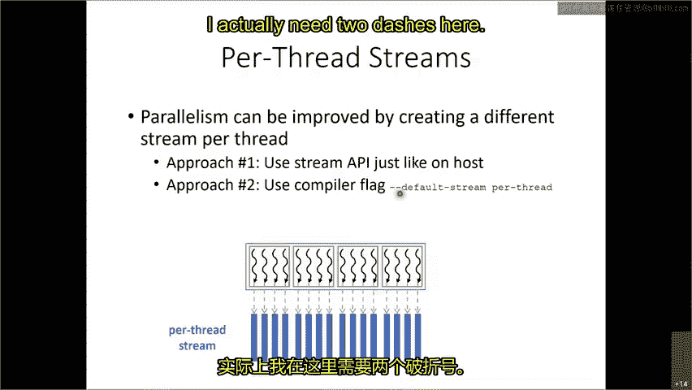

关键点在于这个顺序访问邻居的循环。我们可以使用动态并行性来并行化这个循环，即为每个邻居分配一个线程来处理。

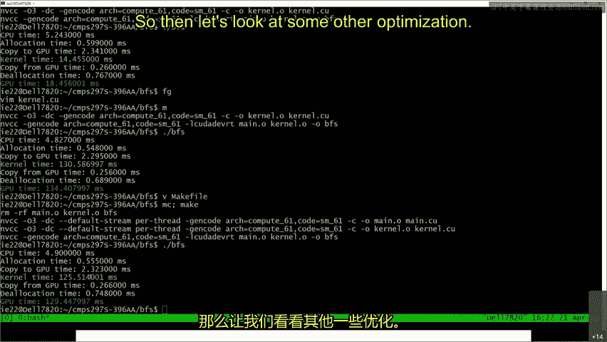

以下是之前顺序处理邻居的核心循环代码：
```c
for (unsigned int i = 0; i < num_neighbors; ++i) {
    // 加载邻居顶点索引
    // 尝试原子性地访问该邻居
    // 如果访问成功，将其加入当前边界
}
```
使用动态并行性后，父线程将启动一个子内核网格，网格中的每个线程负责处理一个邻居。子内核的代码大致如下：
```c
__global__ void bfs_child_kernel(...) {
    unsigned int i = threadIdx.x + blockIdx.x * blockDim.x;
    if (i < num_neighbors) {
        // 加载第i个邻居的顶点索引
        // 尝试原子性地访问该邻居
        // 如果访问成功，将其加入当前边界
    }
}
```
父线程中启动子内核的代码：
```c
// 计算网格配置
unsigned int threads_per_block = 1024;
unsigned int num_blocks = (num_neighbors + threads_per_block - 1) / threads_per_block;
// 启动子内核
bfs_child_kernel<<<num_blocks, threads_per_block>>>(...);
```
## 性能挑战与优化

直接为每个边界顶点线程启动一个子网格会导致性能严重下降（可能慢10倍以上）。主要原因包括：

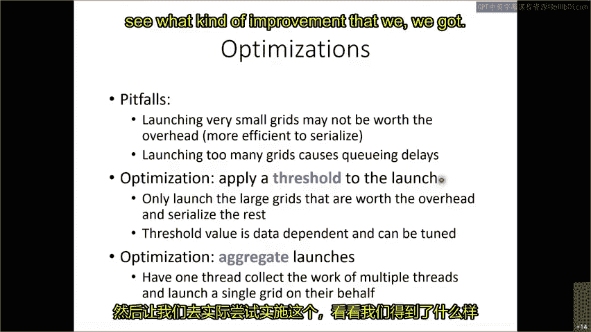

1.  **待处理启动数限制**：GPU运行时默认最多缓冲2048个动态启动的网格。超过此限制可能导致错误或挂起。可以使用 `cudaDeviceSetLimit(cudaLimitDevRuntimePendingLaunchCount, ...)` 提高限制，但这并非根本解决方案。
2.  **流与序列化**：默认情况下，同一线程块内的所有线程共享同一个默认流。它们发起的动态内核会在这个流中序列化执行，即使GPU有空闲资源。可以通过编译器标志 `--default-stream per-thread` 改为每个线程拥有独立的默认流，从而允许更多并发。
3.  **大量小网格开销**：许多顶点只有少量邻居，为它们启动网格（可能只有几个线程）的开销远大于并行收益，并且会因网格太小而无法充分利用SM。

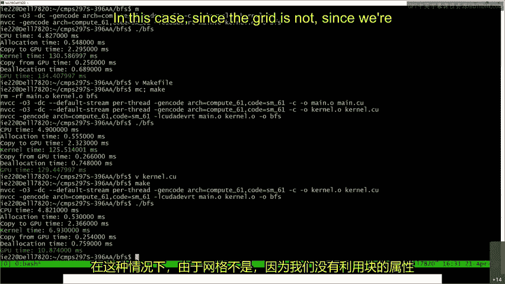

针对以上问题，我们可以进行以下优化：


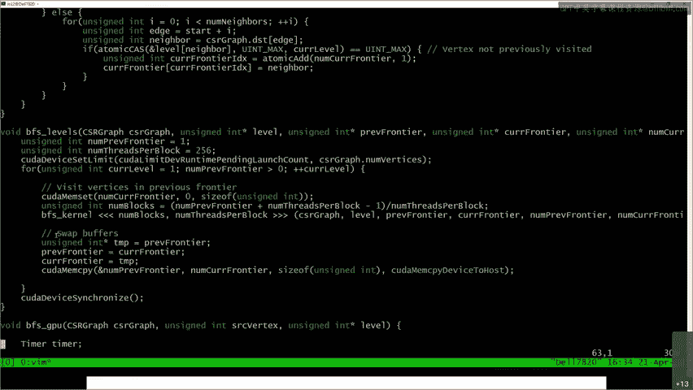

*   **优化1：设置启动阈值**：仅当邻居数量超过某个阈值（例如1024）时，才使用动态并行性启动子网格。否则，仍在父线程中顺序处理邻居。这显著减少了动态启动的数量和开销。
*   **优化2：聚合启动**（概念性）：让一个线程（例如一个Warp或一个块中的线程）收集多个线程的工作，然后代表它们发起一个更大的联合网格。这更复杂，通常需要线程间通信和协作。

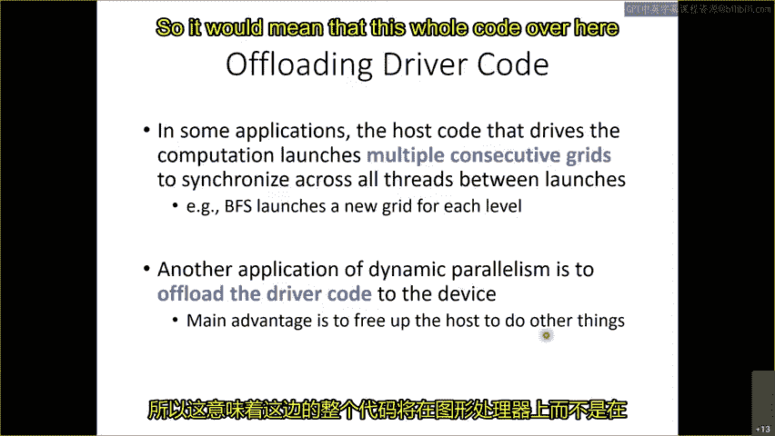

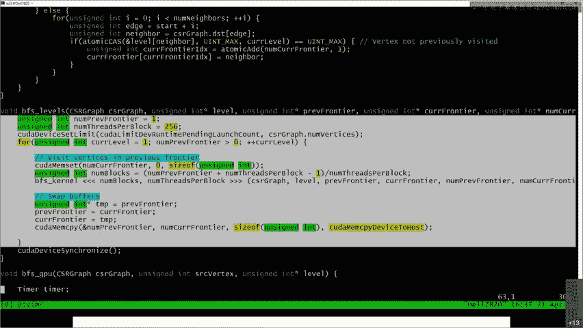

应用**启动阈值优化**后，BFS性能从远差于静态版本转变为优于静态版本，展示了动态并行性在特定场景下的威力。

## 其他主题

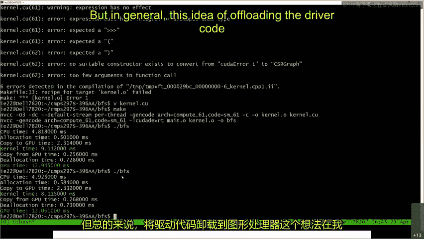


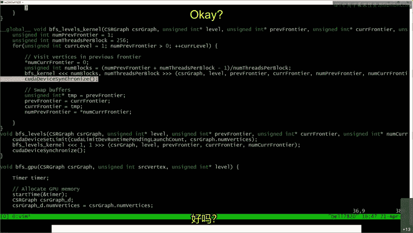

*   **卸载驱动代码**：可以将主机端驱动计算循环（例如BFS中遍历各层的主循环）也放到GPU上一个线程中执行。这样主机只需启动一次内核即可完成整个计算，从而被释放出来执行其他任务。但这通常不是为了提升性能，而是为了释放CPU。
*   **内存可见性**：父线程在启动子网格前对全局内存的写入，对子网格中的线程是可见的。子网格对全局内存的写入，只有在父线程调用 `cudaDeviceSynchronize()` 同步后，才对父线程可见。局部内存和共享内存的指针不应传递给子网格，因为子网格可能在不同的SM上执行。
*   **嵌套深度**：硬件对动态启动的嵌套深度有限制，当前硬件通常为24层。超过此深度将无法启动新的网格。

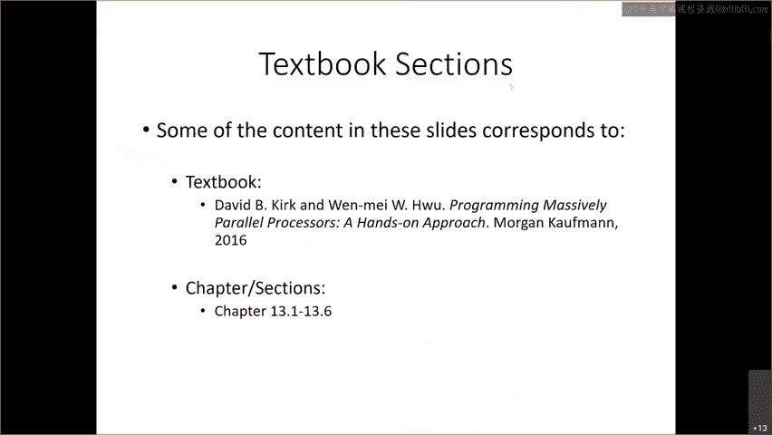

本节课中我们一起学习了CUDA动态并行性的概念、应用场景（特别是嵌套并行性）、以及如何在广度优先搜索算法中实现并优化它。我们还了解了待处理启动限制、流的影响、以及通过设置阈值来避免过多小网格开销的优化方法。最后，我们简要探讨了卸载驱动代码、内存可见性和嵌套深度等其他相关主题。动态并行性是一个强大的工具，但需要谨慎使用并配合适当的优化策略。