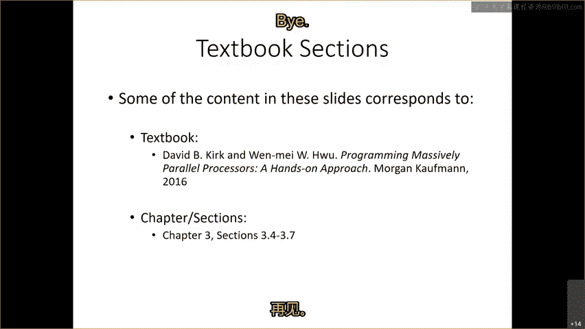

# GPU计算：04：GPU架构

## 概述

在本节课中，我们将暂时告别代码编写，深入探讨GPU的硬件架构。我们将了解GPU如何组织其计算单元，以及CUDA编程模型中的线程、块和网格是如何映射到这些硬件上执行的。理解这些概念对于编写高效的GPU程序至关重要。

## 从多维数据到硬件架构

上一节我们介绍了如何处理多维数据，并编写了三个数据并行的例子。本节中，我们来看看这些线程和块是如何在GPU的物理硬件上调度和执行的。

## GPU的组成结构

一个GPU由多个**流式多处理器**组成，我们简称为SM。每个SM内部包含多个**核心**，这些核心是执行算术运算的单元。同一个SM内的核心共享控制逻辑和一部分内存。所有SM都可以访问同一个**全局内存**，也就是我们在第一讲中从CPU复制数据到GPU时使用的内存。

以本课程使用的Volta V100 GPU为例，它拥有80个SM，每个SM有64个核心，总计5120个处理核心。

## 线程块在SM上的调度

那么，我们编写的网格和线程块是如何在GPU上运行的呢？线程是以**块**为单位分配给SM的。同一个线程块内的所有线程必须被分配到同一个SM上执行。然而，一个SM可以同时执行多个线程块。

线程和线程块在执行时需要资源，例如寄存器和线程特定的控制数据。由于SM的硬件资源是有限的，因此它能同时支持的线程和线程块数量也是有限的。这解释了为什么线程块中的线程数存在上限（例如1024）。

如果一个网格启动的线程块数量超过了GPU能同时执行的数量，多余的线程块会排队等待，直到有SM空闲出来。

## 线程块内的协作与同步

线程在同一个块内被分配到同一个SM，这使得它们能够以不同块之间线程无法实现的方式进行协作。

以下是线程块内协作的主要方式：

*   **屏障同步**：线程可以调用 `__syncthreads()` 函数。这个屏障会确保块内的所有线程都到达代码中的这一点后，才允许任何线程继续执行。这有助于线程间协调工作。
*   **共享内存**：每个SM上都有一块**共享内存**，同一线程块内的线程可以访问这块共享内存，而不同块之间的线程则不能。这为线程间快速交换数据提供了可能。

这种协作能力是将网格划分为块的动机之一。当同一块内的线程在同一个SM上时，支持它们之间的同步和通信会更加高效。

## 透明可扩展性

线程块之间不进行同步或协作，这使得它们彼此独立。这种独立性带来了一个关键优势：**透明可扩展性**。

这意味着同一段代码可以在拥有不同数量SM的GPU设备上运行。在SM较少的设备上，线程块可能会被顺序执行；在SM较多的设备上，更多的线程块则可以并行执行。代码无需修改即可适应不同硬件规模的并行能力。

程序员**不应**编写试图在不同块之间进行同步的代码。因为块可能以任何顺序执行，甚至可能不会同时驻留在SM上，强行同步可能导致**死锁**。硬件不支持在块之间进行高效的上下文切换，因为这需要保存和恢复大量线程的上下文（如寄存器），开销巨大。

## Warp：SM上的调度单元

当一个线程块被调度到SM上后，它会被进一步划分为更小的单元，称为 **Warp**。Warp是SM上进行调度的基本单位。

Warp的大小是设备特定的，但迄今为止一直是32个线程。例如，一个包含1024个线程的线程块会被分成32个Warp，每个Warp包含32个线程。

Warp的特殊之处在于，同一个Warp内的所有线程以**单指令多数据**的模式执行。这意味着硬件会取一条指令，然后让Warp内的所有线程执行这条相同的指令，但每个线程操作的是自己的数据。

SIMD的优势在于，它可以将取指、译码等控制逻辑的开销分摊到多个执行单元（核心）上，从而用更少的控制硬件支持更多的计算核心。

## 控制流分歧

SIMD模式的一个主要缺点是处理**控制流分歧**。当Warp内的线程遇到条件分支（如if-else语句）并需要执行不同的路径时，问题就出现了。

由于所有线程必须执行相同的指令，硬件会依次处理每条唯一路径：先执行“then”路径，此时条件为“假”的线程被禁用（不执行但占用资源）；然后执行“else”路径，此时条件为“真”的线程被禁用。最后，所有线程在分支结束后重新汇合。

这导致了硬件利用率下降，称为**SIMD效率**降低。在循环中，如果不同线程的循环次数不同，情况会更糟，因为所有线程都必须等待迭代次数最多的那个线程完成。

程序员可以通过组织数据或线程ID来尽量减少同一个Warp内的控制流分歧，例如对数据进行排序，让具有相似执行路径的线程聚集在同一个Warp里。

## 延迟隐藏与多线程

当Warp执行遇到长延迟操作（如未命中的内存访问或复杂的多周期算术运算）时，它需要等待。为了避免流水线停顿，GPU采用了**多线程**技术。

SM上会同时驻留许多Warp（远多于其核心数）。当一个Warp因长延迟操作而停滞时，调度器会迅速将其换出，并换入另一个就绪的Warp到核心上执行。通过这种方式，GPU的计算核心可以始终保持忙碌，从而隐藏操作延迟，实现高吞吐量。

例如，Volta V100的每个SM最多可支持2048个线程（即64个Warp），但其只有64个核心。这种高“线程-核心比”（32:1）确保了总有足够多的就绪Warp来填充因延迟而产生的空闲周期，这与CPU（通常为2:1）追求低延迟的设计哲学不同。

## 占用率

SM的**占用率**是指其实际活跃的Warp（或线程）数量与硬件支持的最大数量之比。通常，我们希望最大化占用率，因为更高的占用率意味着有更多可用的Warp来隐藏延迟。

然而，占用率可能受到多种因素的限制：

*   **线程块大小**：如果线程块大小设置不当，可能无法充分利用SM的线程容量。例如，若块大小太小，可能会受限于SM支持的最大块数量；若块大小不能被最大线程数整除，会导致线程资源浪费。
*   **寄存器使用量**：如果每个线程使用了大量寄存器，可能会在达到最大线程数之前就用完SM上的寄存器资源。
*   **共享内存使用量**：过度使用共享内存也会限制SM上可同时驻留的线程块数量。

因此，在选择线程块大小时，需要综合考虑这些约束，以优化占用率和最终性能。CUDA提供了 `cudaGetDeviceProperties` API，供程序员查询设备的这些具体限制。

## 总结

本节课我们一起学习了GPU的核心架构。我们了解了GPU由多个SM组成，SM内部包含众多核心。CUDA中的线程块被调度到SM上执行，并进一步划分为Warp，Warp以SIMD模式运行。我们探讨了控制流分歧带来的挑战、通过多线程和Warp调度来隐藏延迟的策略，以及占用率的概念及其对性能的影响。理解这些硬件原理是进行GPU性能优化的基础。