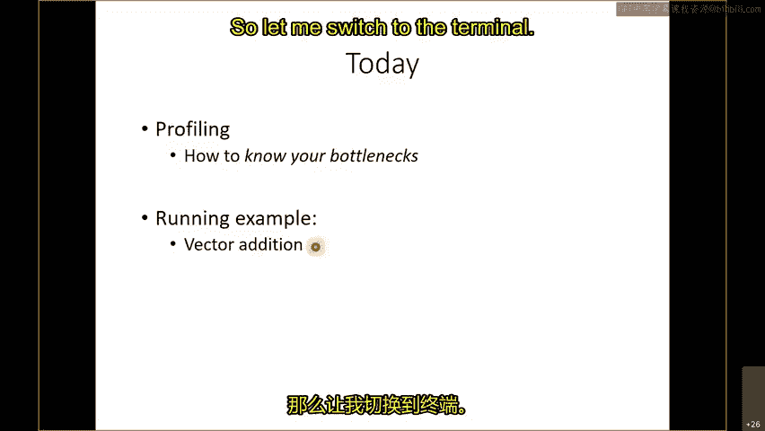
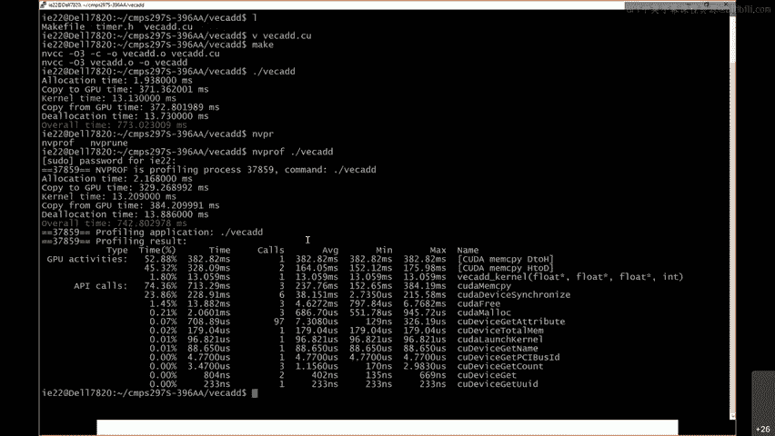
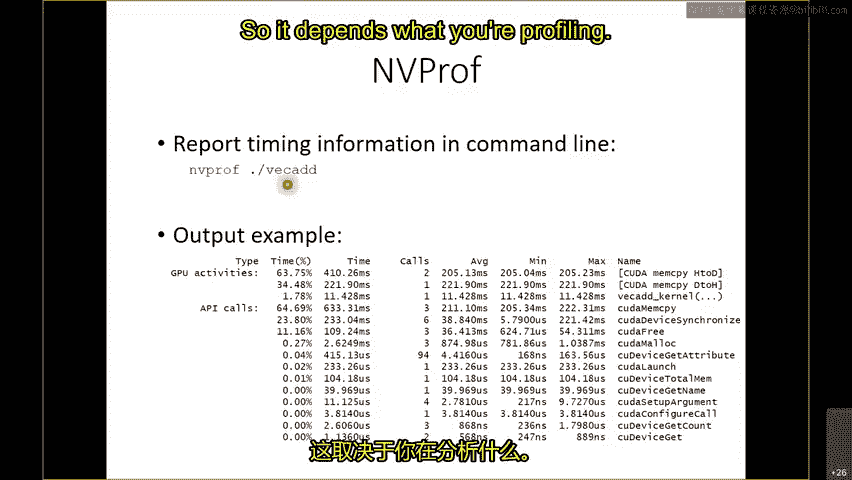
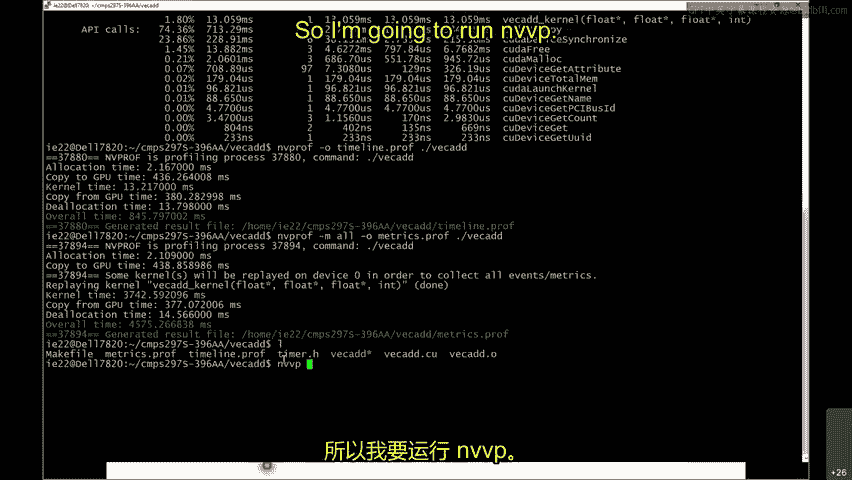
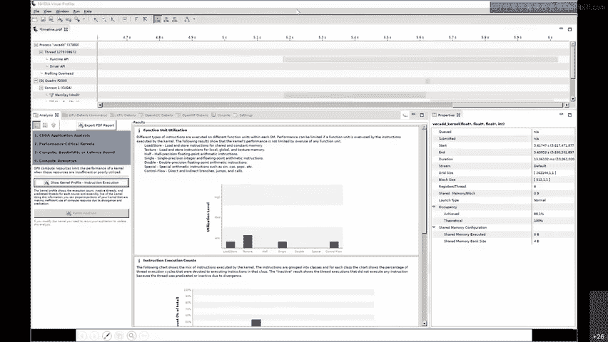
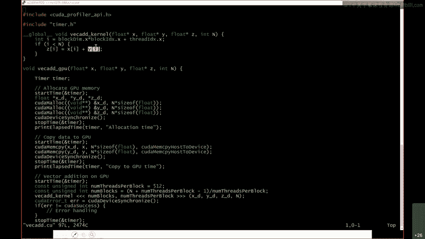
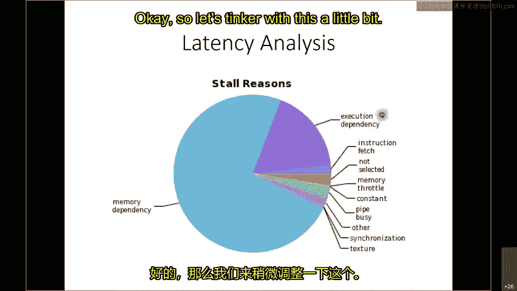
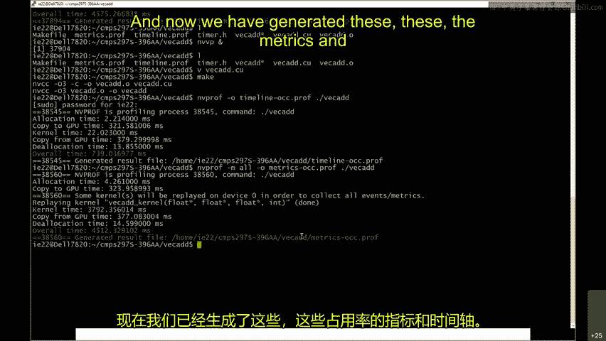
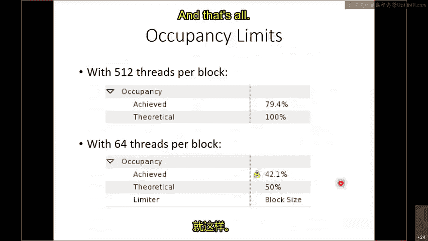

# GPU计算：07：性能剖析


在本节课中，我们将学习如何剖析CUDA应用程序，以了解其性能表现并识别瓶颈。我们将使用NVIDIA提供的性能剖析工具，通过一个向量加法的实例，学习如何收集和分析性能数据，从而指导我们进行有效的优化。

## 概述

上一节我们讨论了DRAM内存的组织结构、内存合并与分散访问、以及线程粗化等优化技术。我们了解到，不同的优化策略（如提高占用率、使用共享内存分块）之间可能存在权衡。因此，在应用优化之前，准确识别应用程序的性能瓶颈至关重要。本节我们将学习如何使用性能剖析工具来“了解你的瓶颈”。

## 性能剖析工具简介

CUDA平台提供了一个名为`nvprof`的性能剖析器。它可以测量应用程序中各种操作（如内核执行、内存拷贝）所花费的时间，并收集更详细的硬件性能指标。

### 基本时间线剖析

最简单的使用方式是直接运行`nvprof`并指定你的可执行文件。它会输出一个表格，列出所有CUDA API调用和GPU活动及其耗时。



```bash
nvprof ./vector_add
```

输出结果会显示：
*   **GPU活动**：如内核执行、设备内存拷贝。
*   **API调用**：如`cudaMalloc`，`cudaMemcpy`等CPU端调用。
*   每项活动的**耗时**、**调用次数**以及占总执行时间的**百分比**。

这种方式可以快速获得应用程序的时间分布概览。

### 导出数据以进行可视化分析



为了进行更深入的分析，我们可以将剖析数据导出到文件，并使用NVIDIA Visual Profiler (`nvvp`) 进行可视化。

首先，导出时间线数据：
```bash
nvprof -o timeline.prof ./vector_add
```



接着，导出详细的性能指标（如占用率、缓存命中率、内存带宽）。这需要使用硬件计数器，因此剖析器会多次运行内核以收集不同指标，导致总执行时间变长。
```bash
nvprof --metrics all -o metrics.prof ./vector_add
```

现在，我们可以启动可视化性能剖析器并导入生成的文件：
```bash
nvvp &
```
在`nvvp`中，选择“导入”功能，然后指定`timeline.prof`和`metrics.prof`文件。

## 分析向量加法内核



让我们以向量加法内核为例，使用`nvvp`进行分析。

### 时间线视图

时间线视图直观地展示了应用程序中各种活动的顺序和持续时间。我们可以看到：
*   `cudaMemcpy`（主机到设备）用于传输输入数组。
*   `vector_add`内核的执行。
*   `cudaMemcpy`（设备到主机）用于取回结果。
这个视图有助于理解整体执行流程和识别大的时间开销所在。

### 内核性能分析

点击分析单个内核，我们可以获得其配置和资源使用情况：
*   **网格与块大小**：例如，`(N/512, 1, 1)` 网格，`(512, 1, 1)` 块。
*   **寄存器使用量**：每个线程使用的寄存器数量。
*   **共享内存使用量**：每个线程块使用的共享内存量。
*   **占用率**：实际占用率与理论最大占用率。

对于我们的向量加法，由于块大小足够大（512），且未使用共享内存，寄存器使用量低，因此理论占用率可达100%，实际占用率也接近这个值（例如88.1%）。

### 识别性能瓶颈

执行“内核分析”功能，工具会显示计算单元和内存系统的利用率。

对于向量加法，分析结果显示：
*   **内存系统利用率很高**（>80%）。
*   **计算单元利用率很低**（约10%）。
*   结论提示：**“内核性能受内存带宽限制”**。

这验证了我们之前的分析：向量加法是内存密集型操作，计算与内存访问的比率很低，因此瓶颈在于全局内存带宽。

以下是更详细的分析维度：

**内存带宽分析**
此视图展示了内存层次结构中各部分的利用率。对于向量加法：
*   **设备内存（全局内存）** 利用率接近峰值。
*   **L2缓存**、**统一缓存**、**共享内存** 利用率很低。
*   图表清晰地显示，几乎所有请求都流向全局内存。



**计算分析**
此视图展示了核心内部各功能单元的使用情况。
*   **负载/存储单元**、**单精度浮点单元**、**控制流单元**的利用率都较低。
*   **指令计数**显示，执行了大量的加载/存储指令和整数指令（用于地址计算），相对较少的浮点运算指令。



**延迟分析**
此视图专注于占用率，这是隐藏延迟的关键。
*   对于初始配置（块大小512），占用率不是限制因素。
*   工具会显示，如果更改块大小或共享内存使用量，将如何影响理论占用率。

### 一个占用率受限的例子

如果我们故意将线程块大小设置为一个很小的值（例如32），重新编译并剖析：

```bash
nvprof -o timeline_occ.prof ./vector_add_small_block
nvprof --metrics all -o metrics_occ.prof ./vector_add_small_block
```

在`nvvp`中分析新数据：
*   **占用率分析**会显示，理论最大占用率降至50%（因为SM上最大线程数2048 / 每块线程数32 = 最大块数64，但SM的块数量限制可能更低，例如32，导致最大线程数为1024）。
*   **延迟分析**视图会明确提示“GPU利用率可能受块大小限制”，并用红色高亮块数量限制。
*   内核执行时间会显著增加，因为低占用率无法有效隐藏内存访问延迟。

这个例子说明了如何利用剖析工具来诊断由资源限制（此处为块大小）导致的低占用率问题。



## 总结



本节课我们一起学习了CUDA性能剖析的基本方法。我们了解到：
1.  **`nvprof`命令行工具**可以快速获取应用程序的时间分布和性能指标。
2.  **NVIDIA Visual Profiler (`nvvp`)** 提供了强大的可视化界面，用于深入分析性能瓶颈。
3.  通过剖析，我们可以确定内核是**受计算限制**还是**受内存带宽限制**。
4.  我们可以分析**内存层次结构的利用率**、**计算单元利用率**以及**占用率**，从而找到优化的方向。
5.  性能剖析是理解优化权衡和做出正确优化决策的关键步骤。在应用共享内存分块或线程粗化等优化之前，务必先了解当前的瓶颈所在。




记住，优化的目标是找到在竞争性优化策略之间的最佳平衡点，而性能剖析正是照亮这条道路的灯塔。