# GPU计算：08：卷积与常量内存

在本节课中，我们将开始学习并行模式，第一个要讨论的模式是卷积。我们还将利用卷积这个例子，来介绍GPU架构和CUDA编程模型中的一个新特性：常量内存。

## 课程回顾

在进入新的主题之前，我们先简要回顾一下之前学过的内容。

到目前为止，我们已经学习了GPU计算的基础知识。课程初期，我们探讨了由于频率停滞和功耗墙的限制，单线程性能发展停滞，这推动了并行计算的发展。我们比较了CPU（面向延迟的设计）和GPU（面向吞吐量的设计）的差异。

*   **CPU（面向延迟）**：专注于使单个任务尽可能快，使用强大的ALU、大容量缓存、复杂的控制流（如分支预测、数据转发）和少量多线程来隐藏延迟。
*   **GPU（面向吞吐量）**：拥有大量较简单的ALU，通过大规模并行来获得高吞吐量。缓存较小，控制逻辑更简单，从而能将更多芯片面积用于计算单元。通过海量线程来隐藏操作的高延迟。

我们了解了典型系统中GPU如何与CPU协同工作：CPU拥有主内存，GPU拥有设备内存。通常的流程是：在GPU上分配内存，将数据从CPU主内存复制到GPU内存，在GPU上执行内核（访问设备内存），然后将结果复制回CPU，最后释放GPU内存。虽然也有像统一内存这样的方式，但这是使用GPU的典型模式之一。

我们从简单的向量加法内核开始，学习了数据并行性，并看到它非常适合GPU。我们了解了网格如何组织成线程块和线程，以及如何计算线程索引，使每个线程对不同数据执行相同操作。

接着，我们学习了网格可以组织成多维线程数组（如2D、3D网格），以及多维数据通常按行主序存储。为了访问动态分配的多维数组，我们需要将线程获得的二维索引转换为一维索引。我们通过多个例子实践了这一点，包括RGB转灰度、图像模糊（这是卷积的一个特例）以及矩阵乘法。矩阵乘法的例子在后续几讲中持续被用作优化案例。

在学习了CUDA编程模型的基础后，我们转向讨论GPU架构。我们了解到GPU被组织成多个流式多处理器（SM），每个SM包含多个共享内存和控制单元的核，所有SM都能访问相同的全局内存。

网格在SM上调度时，被划分为线程块。调度以块为单位，这意味着同一个块内的所有线程会在同一个SM上同时运行。当然，一个SM上可以同时运行多个线程块。线程块在SM上被进一步划分为线程束（Warp），调度以线程束为单位。线程束的一个特点是，同一个线程束内的线程遵循SIMD模型执行，即所有线程在不同数据上执行相同的指令。

线程束大小自GPU引入以来一直是32，但这在未来可能会改变。由于线程束以SIMD方式执行，这引出了控制流发散的问题。如果同一个线程束内的线程需要走不同的控制路径（例如if语句），那么所有线程会先执行then部分（不满足条件的线程不活动），然后一起执行else部分（满足条件的线程不活动）。这些不活动的线程占用了计算资源但没有执行工作，导致硬件利用率低下。我们希望尽量减少这种情况，并将在未来的并行模式中看到相关例子。

我们还讨论了延迟隐藏。通过在SM上调度比核心数量更多的线程束和线程，当一个线程束遇到长延迟操作时，可以将其换出并换入另一个线程束执行。通过这种方式，我们可以隐藏延迟。为了隐藏延迟，我们希望有尽可能多的线程调度在SM上，这就引入了占用率的概念。每个SM的最大线程数取决于设备（例如V100是2048），但其他因素也可能限制占用率，例如每个SM能容纳的块数、每个线程使用的寄存器数量或SM的共享内存大小。我们需要关注资源使用情况，以确保最大化SM上的线程数。

接下来，我们研究了GPU架构中的内存。同一SM上的线程可以访问共享内存。我们可以利用共享内存来存放计划重用的数据。例如，在分块矩阵乘法中，我们不是让每个线程加载整行和整列，而是让同一个块内的线程协作加载A和B的一个数据块到共享内存中，然后进行计算。这减少了全局内存访问次数，提高了计算与全局内存访问的比率。

我们还了解了DRAM的组织方式。访问DRAM阵列本身很慢，但一旦开始DRAM突发传输，访问突发数据的一部分是很快的。因此，最好让线程在发出内存请求时访问同一个DRAM突发中的数据。如果访问不同的DRAM突发，就需要反复访问DRAM阵列。如果有多个DRAM阵列，我们可以在从一个DRAM阵列读取时，从另一个DRAM阵列的突发中服务数据，从而隐藏延迟。这也是最大化GPU占用率的另一个动机，因为高占用率不仅能帮助我们隐藏流水线延迟，还能提供大量内存访问请求，有助于隐藏内存访问延迟。

基于以上，我们总结了一个常见优化清单：
*   调整资源以最大化占用率。
*   最小化控制流发散。
*   采用合并访问的内存访问模式。
*   使用共享内存分块以捕获数据重用。
*   使用线程粗化以减轻并行化开销。
*   私有化（我们尚未涉及，将在后续讨论）。

选择应用哪种优化取决于应用程序的性能瓶颈是什么。优化通常是用一种资源换取另一种资源，因此需要确保用充裕的资源去换取瓶颈资源。这意味着我们需要选择合适的优化。为了了解瓶颈，CUDA提供了性能分析工具，可以帮助我们分析应用程序，找出哪些资源被充分利用，哪些没有，从而评估瓶颈所在。

以上是对课程第一部分——GPU计算基础知识的快速回顾。接下来，我们将进入课程的第二部分：并行模式。我们将花相当多的时间讨论这些模式，并希望随着每个模式的介绍，引入新的架构特性或优化技术。因此，学习并行模式的目标不仅是了解模式本身，也是利用这些模式来学习新的优化技术、方法或硬件特性。今天，我们将从卷积开始。

## 什么是卷积？

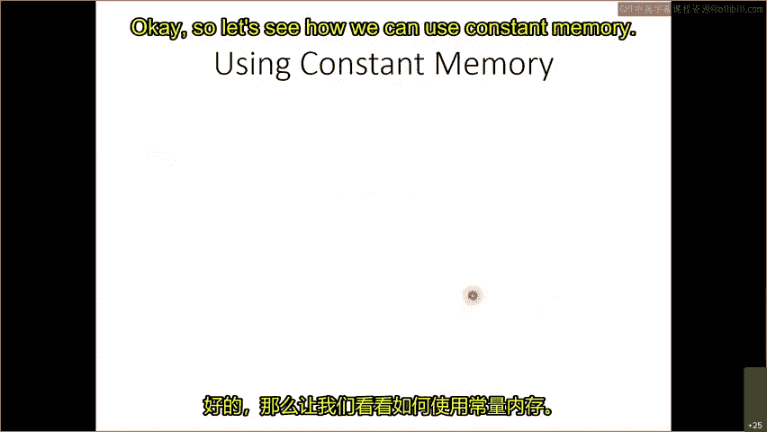

卷积是一种运算，它有一个输入。卷积运算的输出是：**输出中的每个元素都是对应输入元素及其邻域元素的加权和**。

我们之前看到的图像模糊就是卷积的一个特例，其中所有权重都相同。在图像模糊中，我们遍历输入元素并计算平均值。然而，在更一般的卷积形式中，我们可以为每个输入元素设置不同的权重。

这些权重由卷积掩码（Mask）决定。为了避免与CUDA内核函数混淆，这里我们称其为“掩码”而不是“核”。这个掩码由一组权重构成。这些权重被应用于输入，通过计算输入的加权平均（根据掩码中的权重）来得到输出。

卷积在信号处理、图像处理、视频处理等领域非常有用。它通常用于将信号（可能是一维信号、像素或图像等二维数据）转换为更理想的值。例如：
*   高斯模糊卷积：比我们之前看到的简单模糊更复杂，距离中心越远的像素权重越低。
*   图像锐化卷积。
*   边缘检测卷积。

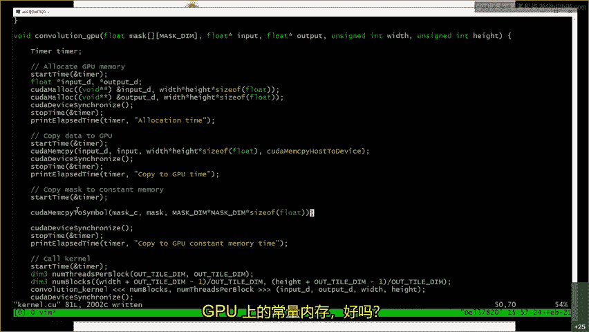

卷积操作所实现的变换取决于掩码中的权重。本节课我们将以二维卷积为例，因为它易于可视化且足够复杂。当然，也存在一维和三维卷积。

## 如何并行化卷积？

基于我们目前所学，你认为并行化卷积的好方法是什么？一个简单的方法是：**为每个输出元素分配一个线程**。这个线程负责遍历对应的输入邻域元素和掩码，计算加权和。这是一种非常简单的卷积并行化方法，当然还有其他方法，但今天我们将采用这种方法。

这种方法很直接：每个线程负责一个输出元素，只需一个循环来遍历输入和掩码。

这里需要注意的一点是，掩码通常很小（例如5x5），并且对所有线程都是相同的。所有线程将访问输入的不同部分，但都会访问相同的掩码。因此，在这种情况下，由于掩码很小、所有线程都访问它、并且掩码在内核执行期间不会改变，我们可以将掩码存储在一个称为**常量内存**的特殊位置。

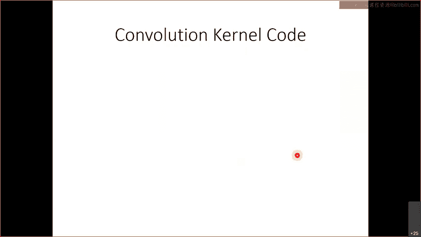

## 常量内存简介


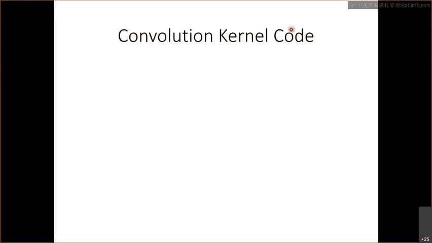

之前介绍CUDA编程模型时，我们提到线程可以访问寄存器（同一块内的线程各有自己的寄存器），同一块内的线程可以访问共享内存，网格中的所有线程可以访问全局内存。实际上，网格中的所有线程还可以访问**常量内存**。

我们希望将掩码放入常量内存，因为访问常量内存比访问全局内存更快。稍后会解释原因。现在，让我们看看如何在CUDA编程模型中使用常量内存。

### 声明常量内存数组

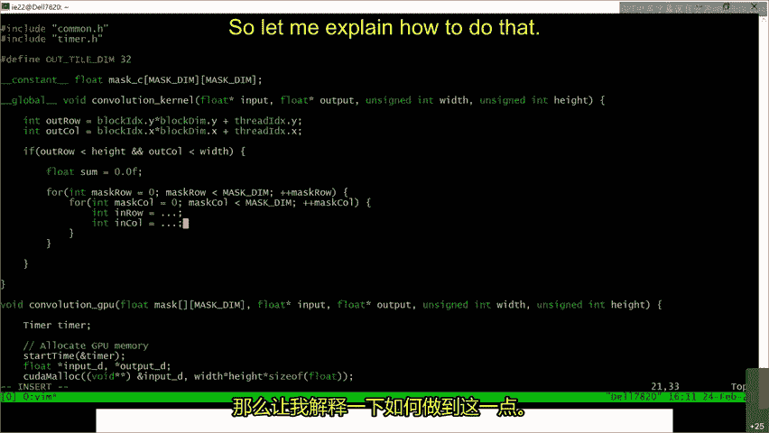

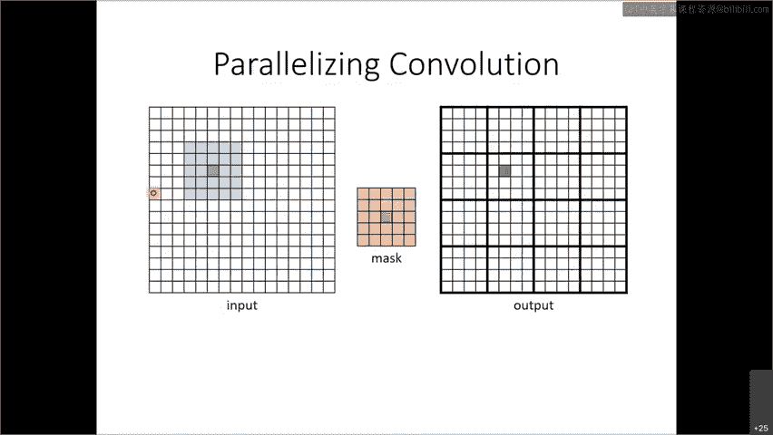

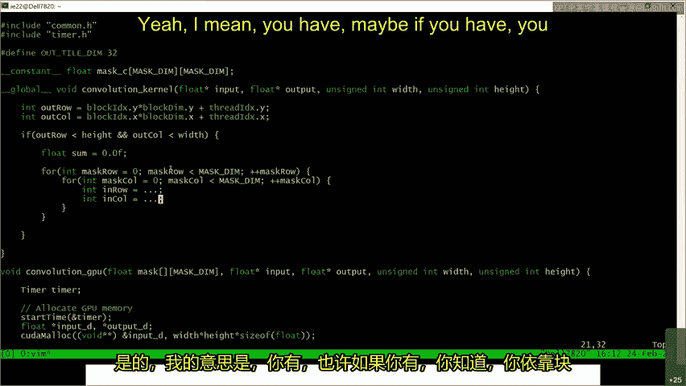

要在常量内存中声明数组，可以使用 `__constant__` 限定符。

```c
__constant__ float mask_c[MASK_DIM][MASK_DIM];
```
这里，`mask_c` 是我们给常量内存数组起的名字（使用 `_c` 后缀是一种约定，表示常量内存）。`MASK_DIM` 是掩码的维度（例如5）。

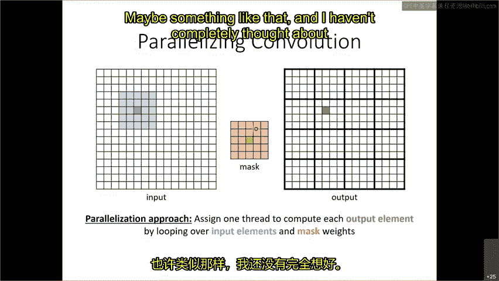

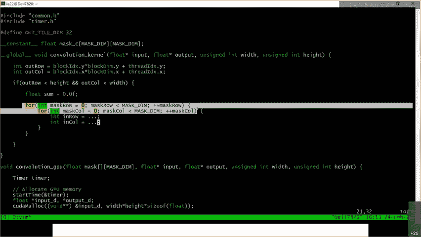

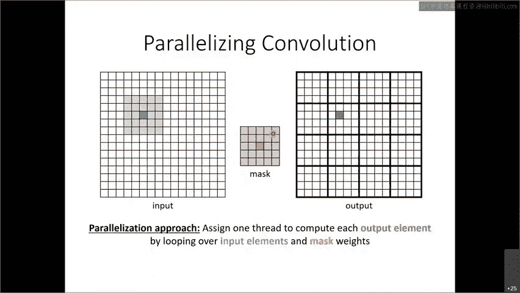

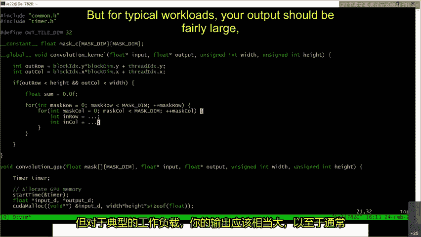

### 从主机复制数据到常量内存

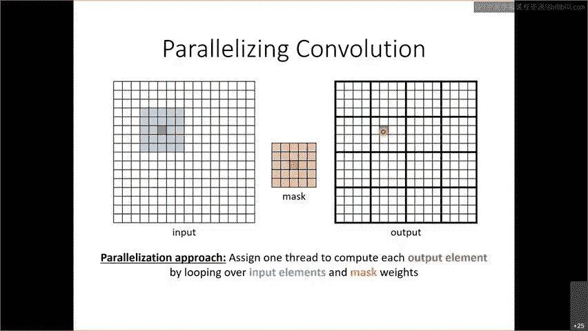

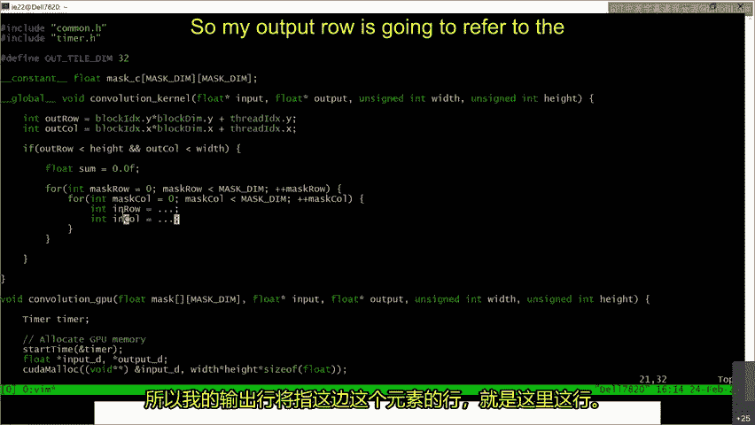

常量内存意味着在GPU执行时不能写入，但可以从CPU复制数据到其中。在主机代码中，我们使用一个特殊的CUDA复制函数 `cudaMemcpyToSymbol`。

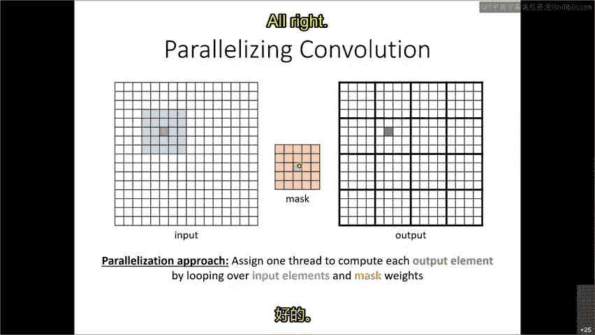

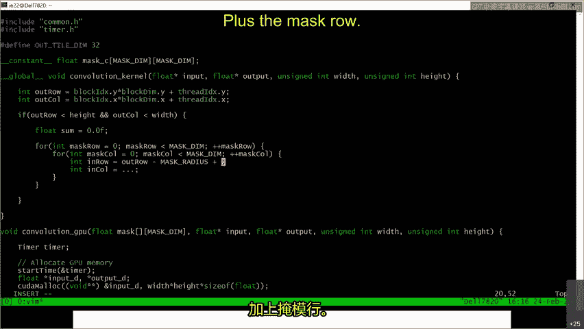

```c
cudaMemcpyToSymbol(mask_c, mask, MASK_DIM * MASK_DIM * sizeof(float));
```
*   `mask_c`：目标指针（常量内存中的数组）。
*   `mask`：源指针（主机上的掩码数组）。
*   第三个参数：要复制的数据大小（掩码元素个数 × 每个元素大小）。

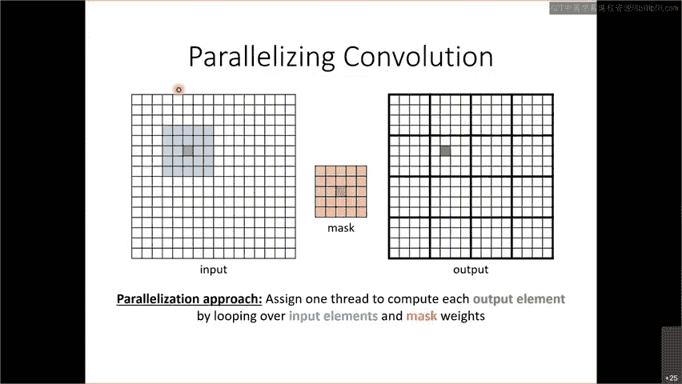

### 常量内存的特点与优势

常量内存有一个限制：**只能分配最多64KB**。这一点很重要，否则我们可能会想把整个输入矩阵（如果它们在内核执行期间不变）都放进常量内存。但常量内存的权衡是：速度快，但容量小。

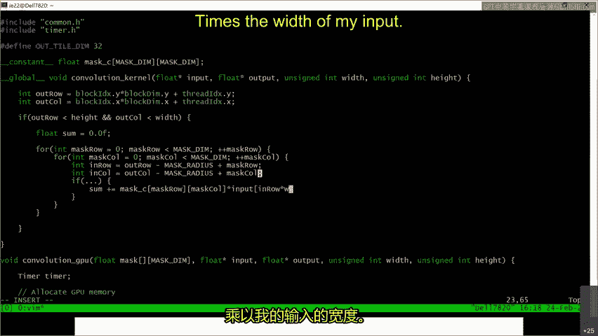

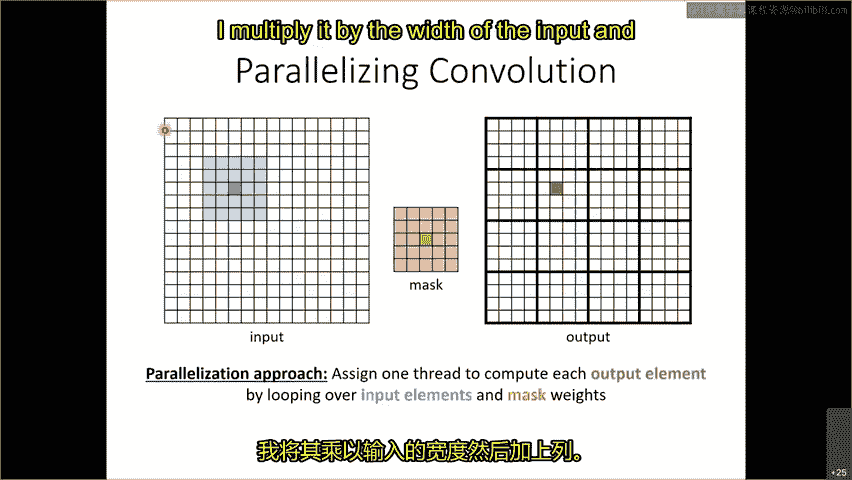

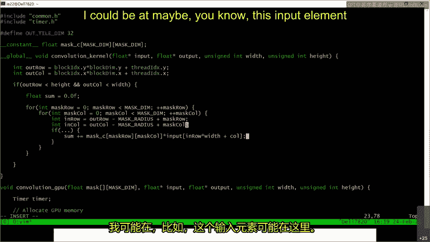

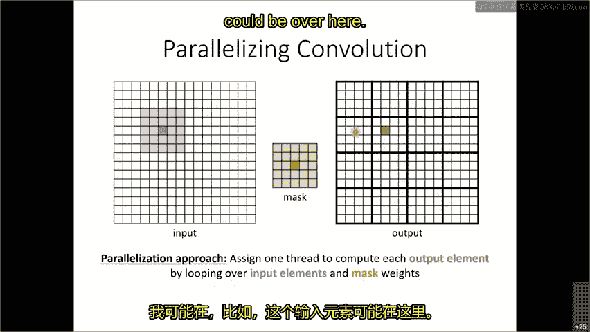

那么，为什么知道数据是常量就能让它更快？为什么容量有限？
1.  **缓存效率**：为常量数据构建高效缓存更容易。因为不需要支持写入操作，所以无需跟踪数据变化（脏位）和写回机制，实现成本更低。
2.  **无需缓存一致性**：在并行处理器中，如果多个线程可以写入同一数据，就需要缓存一致性协议来确保不同缓存间的数据一致性。对于常量数据，则不需要支持缓存一致性。
3.  **容量小，命中率高**：由于总容量小，缓存可以容纳所有常量数据，从而最小化缓存失效，保持低缺失率。

从编程模型看，所有线程访问相同的常量内存。实际上，每个SM内部都有一个常量缓存，它与L1缓存或共享内存是不同的。

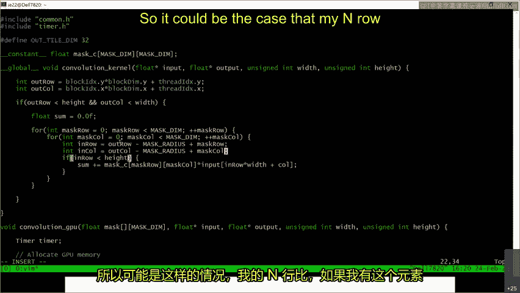

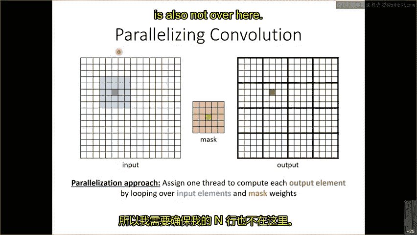

**为什么不使用共享内存？** 当然可以将掩码放入共享内存，但这需要程序员手动管理（加载到共享内存）。而常量缓存是由硬件管理的，对程序员透明。

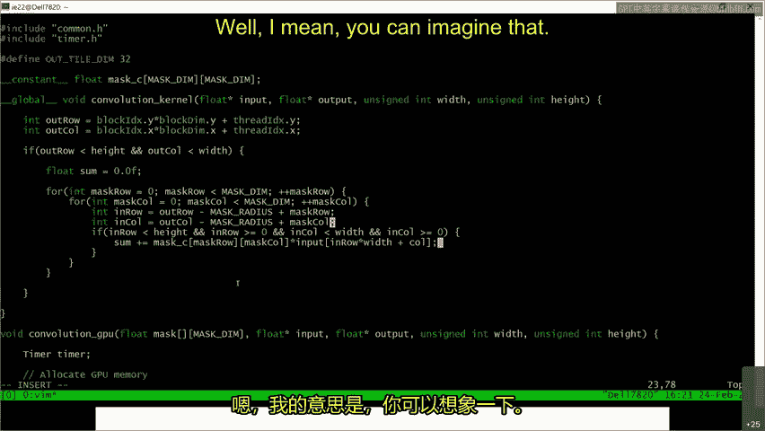

## 编写卷积内核

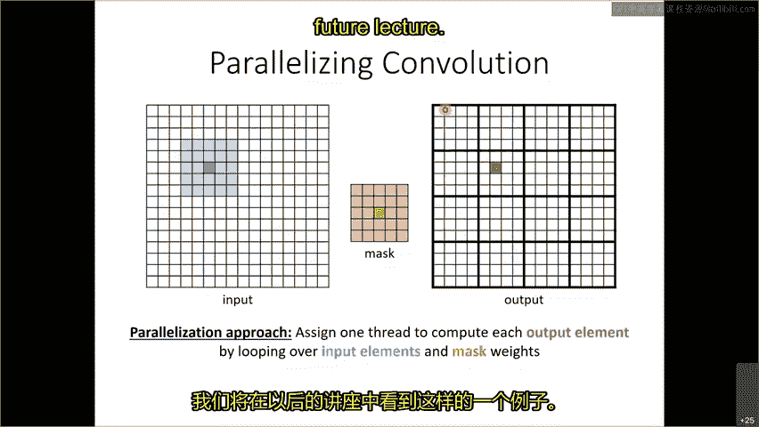

现在我们已经知道如何分配和使用常量内存，接下来编写卷积内核。它将与图像模糊内核非常相似。

基本思路是：每个线程负责计算一个输出元素。线程首先计算自己负责的输出元素的行列索引，然后检查边界条件（确保线程在输出图像范围内）。接着，线程初始化一个累加器 `sum`，然后循环遍历掩码的所有元素。对于每个掩码元素，计算对应的输入元素的行列索引，检查该输入索引是否在有效范围内，如果在，则从全局内存加载输入值，与常量内存中的掩码权重相乘，并累加到 `sum` 中。循环结束后，将 `sum` 写入输出数组的对应位置。

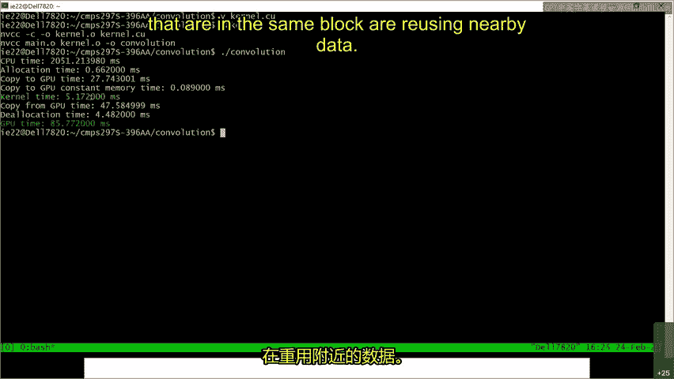

边界检查是必要的，因为对于边缘的输出元素，其对应的部分输入邻域可能超出图像边界。虽然边界检查会导致一些控制流发散（边缘线程与内部线程路径不同），但由于边缘线程占比较小，这种发散通常是可接受的，且优化收益不大。真正需要优化的是那些导致所有线程都发散的情况。

## 卷积性能与数据重用

卷积在GPU上性能很好。原因包括：
1.  **高度并行化**：每个输出元素一个线程，并行度很高。
2.  **数据重用**：相邻的线程（处理相邻的输出元素）会使用大量重叠的输入数据。例如，处理输出元素(i, j)的线程和使用元素(i, j+1)的线程，它们的输入邻域有很大重叠。

这种数据重用提示我们可以进行优化。主要的优化手段是**共享内存分块**。

### 分块卷积优化思路

我们可以让一个线程块协作加载一个输入数据块到共享内存中。每个线程加载输入块中的一个元素。然后，线程块内的线程可以基于共享内存中的数据块和常量内存中的掩码进行计算。

这里的分块与矩阵乘法的分块略有不同。在卷积中，**输入块的大小大于输出块的大小**。具体来说，如果输出块大小为 `T x T`，掩码大小为 `M x M`，那么需要的输入块大小至少为 `(T + M - 1) x (T + M - 1)`。

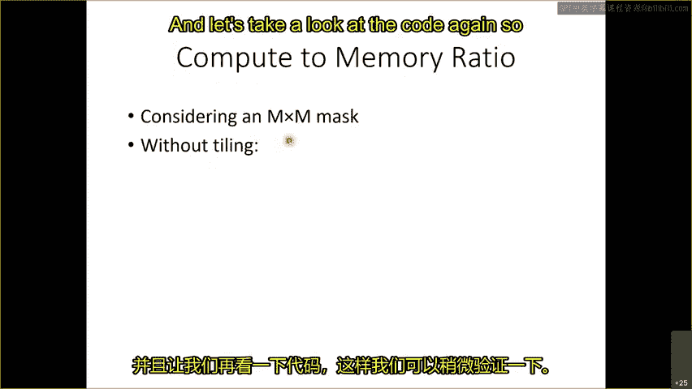

因此，线程块的大小（线程数）需要与输入块的大小匹配。在加载阶段，所有线程都参与将输入块加载到共享内存。但在计算阶段，只有一部分线程（对应输出块内的位置）会进行计算并将结果写回全局内存。换句话说，我们超额配置了线程，其中一部分线程仅负责加载数据而不进行计算。

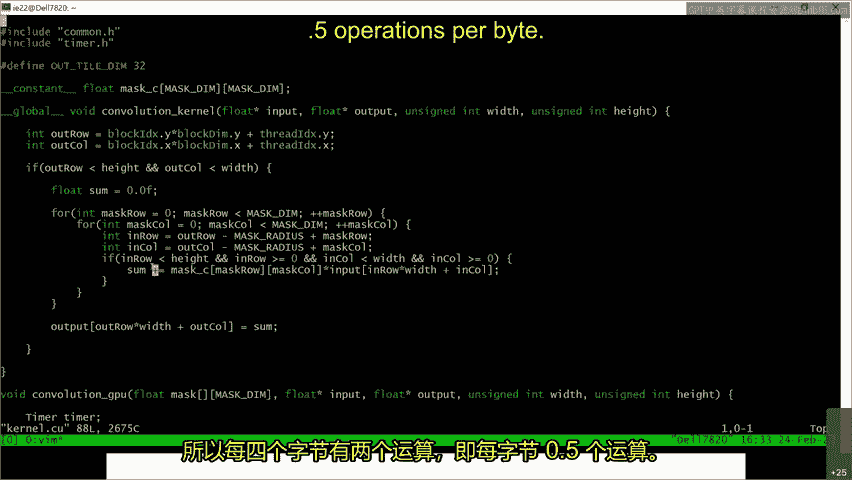

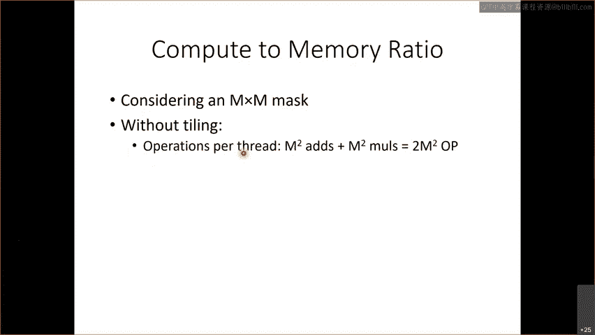

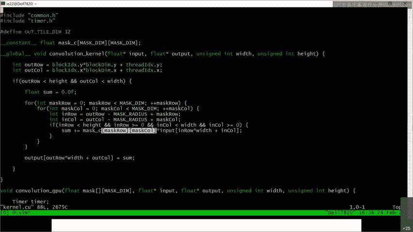

另一种方法是让线程数等于输出块大小，然后让这些线程通过循环来加载更大的输入块，但代码会更复杂，性能提升可能有限。

### 计算与全局内存访问比率分析

我们通过计算与全局内存访问的比率来量化优化效果。

**非分块版本**：
*   每个线程的全局内存加载次数：`M²` 次（每次加载4字节浮点数）。
*   每个线程的浮点运算次数：`2 * M²` 次（每次乘加算2次操作）。
*   计算与内存访问比率：`(2 * M² ops) / (M² * 4 bytes) = 0.5 ops/byte`。

**分块版本（以线程块为单位分析）**：
*   设输入块大小为 `T x T`（元素个数）。
*   输出块大小为 `(T - M + 1) x (T - M + 1)`。
*   每个线程块的浮点运算次数：`(T - M + 1)² * 2 * M²`。
*   每个线程块的全局内存加载量：`T² * 4 bytes`（加载整个输入块）。
*   计算与内存访问比率：`[(T - M + 1)² * 2 * M² ops] / [T² * 4 bytes] ≈ 0.5 * M² * (1 - (M-1)/T)² ops/byte`。

当 `M=5`, `T=32` 时，比率约为 `9.57 ops/byte`，相比非分块版本有近19倍的提升。因此，分块能显著提高计算与内存访问的比率。

### 分块卷积的边界处理

在实现分块卷积时，需要小心处理边界。当加载输入块时，有些元素可能位于图像边界之外（称为“幽灵元素”）。有两种处理方法：
1.  在从共享内存读取时进行边界检查。
2.  **更简单的方法**：在将数据加载到共享内存时，对于越界的输入位置，直接存入0。这样，在后续基于共享内存的计算中，就无需再进行边界检查了。

## 总结

本节课中，我们一起学习了以下内容：
1.  **卷积的基本概念**：输出元素是输入邻域的加权和，在图像处理等领域有广泛应用。
2.  **卷积的并行化**：最简单的策略是为每个输出元素分配一个线程。
3.  **常量内存**：我们介绍了CUDA中的常量内存，它适用于数据量小、恒定不变且被所有线程频繁访问的情况。我们学习了如何声明常量内存变量 (`__constant__`)，以及如何使用 `cudaMemcpyToSymbol` 从主机复制数据。常量内存通过硬件管理的缓存实现快速访问，其优势源于无需写回和缓存一致性协议，并且容量小、命中率高。
4.  **卷积内核实现**：我们基于常量内存和简单的逐线程方法，勾勒出了卷积内核的代码框架。
5.  **数据重用与分块优化**：我们分析了卷积中存在的数据重用模式，并提出了使用共享内存进行分块优化的思路。这种优化可以显著减少全局内存访问，提高计算与内存访问的比率。我们还讨论了分块时输入块与输出块大小不匹配的问题，以及边界条件（幽灵元素）的简化处理方法。

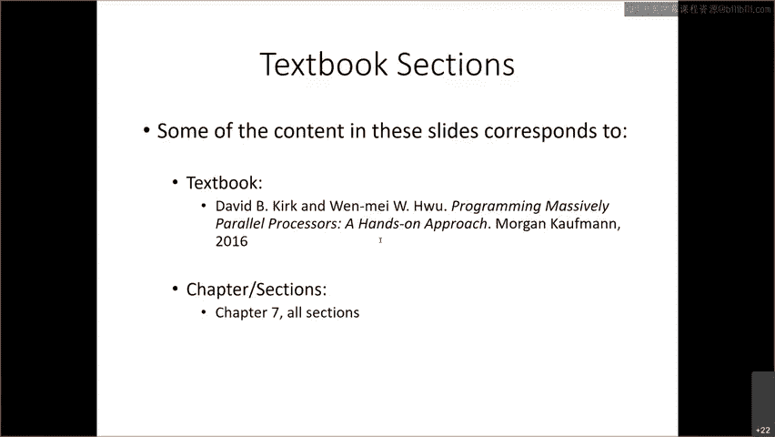

通过卷积这个并行模式，我们不仅学习了一种重要的算法模式，也深入了解了常量内存这一GPU硬件特性及其适用场景。在接下来的课程中，我们将继续探索其他并行模式和优化技术。