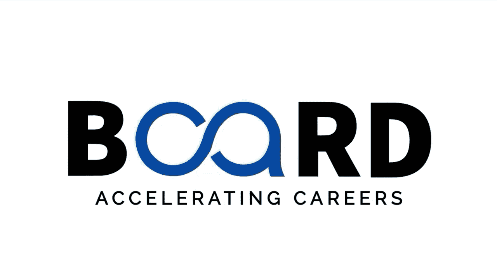

# Board Infinity【中英⚡生成式AI：提示词工程基础｜Generative AI： Prompt Engineering Basics】 p02 P2 02_认识你的导师 -BV1AVjFzaEkP_p2-

Hi， I'm Nathan Agraal an experienced data science professional。

 14 years of expertise in generative VI， large language models， machine learning。

 natural language processing， deep learning and analytics。

I have worked across diverse industries such as healthcare， technology， audit， shipping。

 and logistics。During my journey I have had the honor of mentoring and providing guidance to numerous students in the realm of data science。

 AI and related technologies， sharing my expertise and observing the progress of my learners is a great source of satisfaction and motivation for me。

 I am eager to join you on this journey as they learn together。

