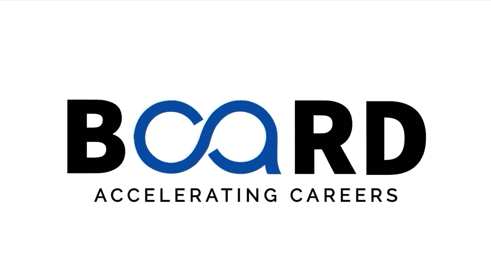

# Board Infinity【中英⚡生成式AI：提示词工程基础｜Generative AI： Prompt Engineering Basics】 p04 P4 02_生成式AI在各行业的演变 -BV1AVjFzaEkP_p4-

Hey there， welcome back the last video introduced us to Generative AI explaining how large language models we call them LLMs。

😊，Geneerate new content using neural networks and transforma architecture and vast training data。

In this video， we are going to take a closer look at how Generative AI is transforming industries。

Some in ways you would expect and others that might surprise you as well now let's rewind a bit AI isn't new neural letters actually have been around since 1950s but things really started heating up in 2014 with the introduction of generative aver networks which we call them Jans as well this was a game changer because it allowed AI to create realistic image by having two models complete against each other kind of like AI rivalry then in 2017 something big happened the Transoma architecture was introduced this breakthrough completely changed how AI processes languages。

makingking it possible for AI to understand context better and generate human like text from there we saw models like BRT in 2018 GPT in 2019 and of course Chad GPT in 2022。

Which made AI conversations feel more natural than ever before Now let's talk about the real world impact。

😊，AI isn't just something researchers experiment with it already deeply embedded in industries worldwide。

Here is how geneative AI is reshaping nearly every industry。And the ability to effectively。

communicate with AI through prompt engineering is becoming an essential skill as we move forward in this course we will explore how you can leverage these capabilities to get the best result from AI in the next video we will look at some of the key generative AI models and their use cases thank you and see you there in the next video。

