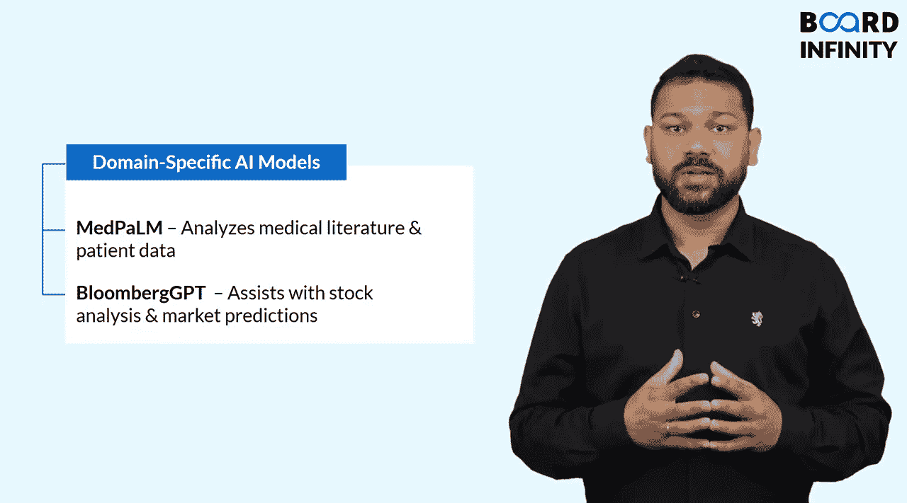

# Board Infinity【中英⚡生成式AI：提示词工程基础｜Generative AI： Prompt Engineering Basics】 p05 P5 03_关键模型（GPT、BERT、T5等）及其应用场景 -BV1AVjFzaEkP_p5-

Hey there， welcome back so far we have explored how Gene AIU works and how it is transforming different industries。

Now let' us take a closer look at some of the key AI models powering today's AI applications GT。

 the master of text generation， first up we have GPT generative retrained transformer。

 so family of models developed by open AI think of GPT as your go to AI for generation of humanlike text。

 whether it is writing articles answering questions or even gene code。

 it's what powers tools like chat GT。What makes G unique well it is auto regressive meaning it predicts a next word in the sequence one step at a time。

That is why it is so good at creating coherent flowing responses if you have ever used AI for drafting emails。

 chatbots or creative writing chances are GP was behind it next we have B bidirectional encoder representations。

From transformers created by Google。Unlike GT， which reads text from left to right。

 but processes word in both the directions at once。Making it an expert at understanding context。

 this makes BRT perfect for search engines， sentiment analysis and text classification。

 ever typed a wake search query into Google and still got exactly what you needed that is Bt working its magic helping Google to understand your intent。

😊，Now let's talk about T5 text 2 text transfer transformer T5 treats every NLP or national language processing task as a text generation problem。

That means it can handle translations， summars， or even Q&A task all within a single framework。

Need to translate text from one language to another。Summarize our long report。

 answer complex questions。T5 is your go to model for this task domainome specific AI models aside from these general purpose models。

 we also have specialized AI models trained for a specific field for example， MePm for healthcare。

This helps doctors to analyze medical literature patient data。

 another is Bloomberg GPT for finance this is trained on financial data to assist with stock analysis。

 market predictions or even financial reporting。

Why does this matter for prompt injury？

Knowing how these model works help us to craft better prompts tailored to their strengths。

In this course， we will primarily focus on generalized models like GPT。

But these skills you learn here can be applied to any AI models you work with in the future。

Or present all right that is a wrap for this video in the next one we will dive into the real world applications of generative VI see you there。

😊。

