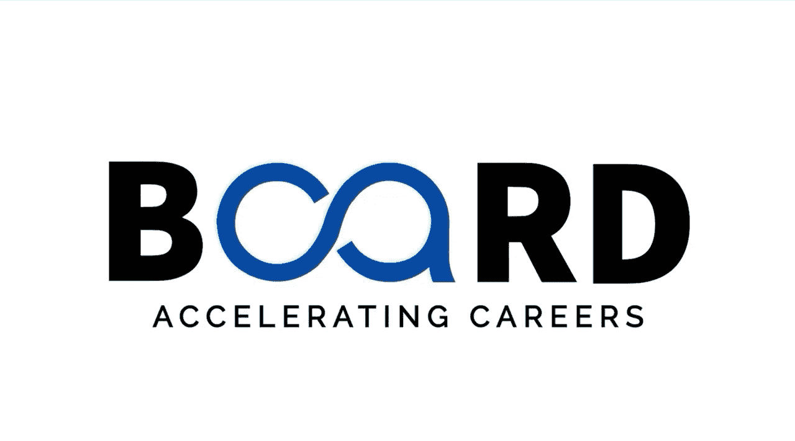

# Board Infinity【中英⚡生成式AI：提示词工程基础｜Generative AI： Prompt Engineering Basics】 p06 P6 04_实际应用：文本生成、内容创作与自动化 -BV1AVjFzaEkP_p6-

Welcome back now that we have covered the foundations of generative AI lets bring it to life with the real world applications AI isn't just a futuristic concept its already empowering industries through tech generation content creation and automation let's start with content marketing businesses today use AI to draft blog post create product descriptions and generate engaging social media content tools like Jasper and copy dot AI are helping marketing teams to scale their content production but here's the key AI works the best when paired with human creativity。

AI draft and human refines。This collaboration leads to high quality。

Engaging content Now think about customer service chatbot powered by Geneative AI are transforming the way companies interact with customers。

Platforms like Intercom and driftft provide 247 support， answering FAQs， troubleshooting issues。

 and seamlessly escalating complex cases to human agents。When needed。The results， faster responses。

Improve customer satisfaction。Software development is another exciting area。If you are a developer。

 you probably have heard about Gitthub compilepit， an AI powered coding assistant that suggests code snippets and even complete sub functions based on the national language descriptions。

😊，Similarly， Relate Co writer is helping the developers to write and debug code more efficiently legal document automation is another game changer。

😊，AI can draft contracts， summarize reports and extract key details from the legal documents law firms now use AI power tools to create first draft of their contracts。

Saving countless arts of attorneys and legal teams。

And let's not forget email management features like Gmail smart compose and smart reply help users to craft responses quickly summarize long email threads and prioritize key messages making inbox management smoother than ever Finally in education AI is making learning more personalized it generates lesson plans quizzes custom study material tailored to different skill levels helping both teachers and students What's a common thread in all these applications the quality of AIs output depends on the quality of the input the prompts a well structured prompt can make the difference between a vague response and a insightful response and that's exactly we will dive into the next video in the next lesson we will start unlocking the power of prompt engineering learning how to craft precise effective prompts that。

Cs the best possible results。So thank you and see you in the next video。

