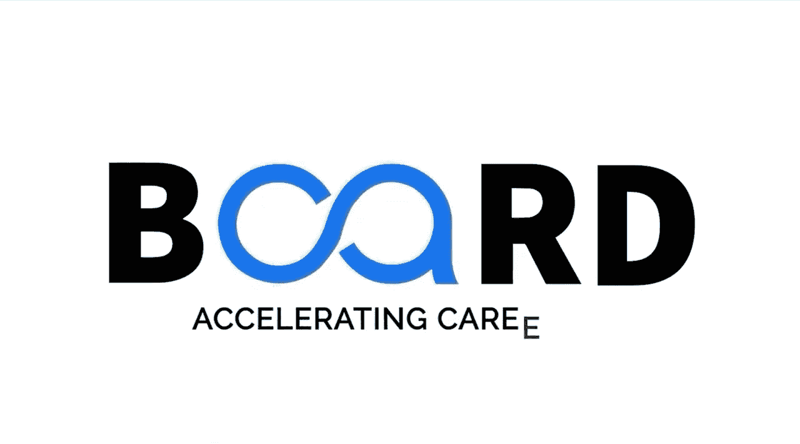

# Board Infinity【中英⚡生成式AI：提示词工程基础｜Generative AI： Prompt Engineering Basics】 p07 P7 01_什么是提示工程及其重要性 -BV1AVjFzaEkP_p7-

Welcome to this video now that we have explored the evaluation and the real world applications of Geneative AI it' is time to focus on a skill that can make all the difference in how effectively you use AI which is prompt engineering so what exactly is prompt engineering simply put its practice of carefully crafting inputs to AI models to get the best possible outputs。

 think of it as giving a clear instructions to AI so that it can generate the responses that align with your age。

 lets compare it how you would ask a friend for a restaurant recommendations。😊，If you just say。

 where should I eat？You might get a very vague response。But if you ask。

Can you recommend a great Italian restaurant nearby that's affordable？

You will get a much more relevant answer。Thats the same principle applies to AI the way you phrase your input directly impact the quality of the output now why does。

Prompt engineering matter there are several reasons why mastering prompt engineering is a game changer First it bridges the gap between human intent and AI capabilities even the most powerful AI models don't inheritantly understand what you want a well crafted prompt ensures your intent is clearly communicated second it significantly improves the output quality a awake prompt might produce a generic unhelpful response。

While a well engineered one can generate precise insight poolol and high quality content。

 third it saves time and effort instead of trial and error。

 good promptngs streamlining AI interactions， reducing back and forth refinements fourth it ensures consistency。

Organizations use structured prompts to maintain a consistent voice， whether for customer service。

Content generation or research Finally， it helps navigate AI。

And its limitations every AI model has constraints biases， hallucinations and gaps in the knowledge。

 smart prompting helps work around these limitations to get the best possible result just like learning to Google effectively becomes a key skill in the early internet area Pro engineering is now an essential skill in the AI age。

😊，Whether you are an AI for writing。Research， coding， automation。

 understanding how to craft effective prompts will set you apart in the next video we will break down how prompt influence AI responses and uncover the mechanics behind this process。

 so stay tuned。

