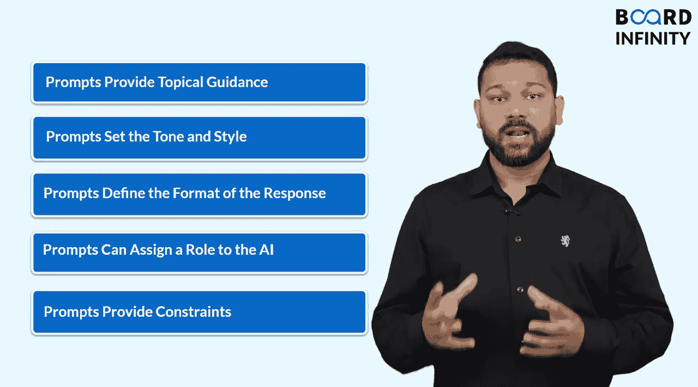
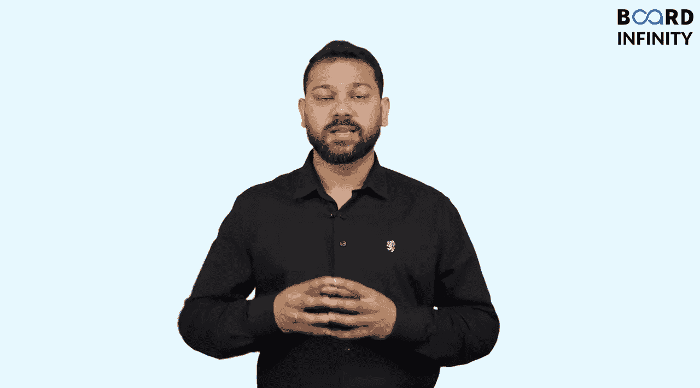
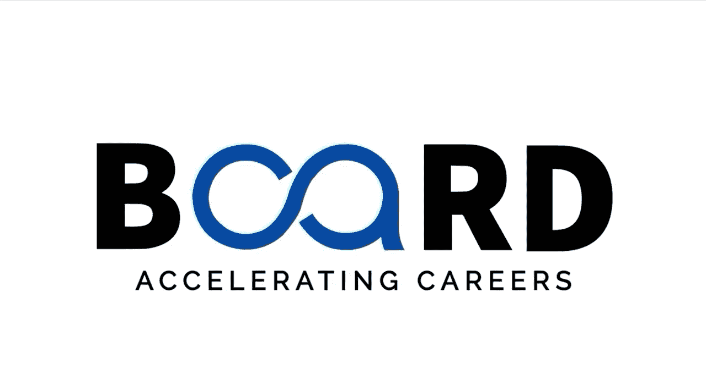

# Board Infinity【中英⚡生成式AI：提示词工程基础｜Generative AI： Prompt Engineering Basics】 p08 P8 02_提示如何塑造AI的回应 -BV1AVjFzaEkP_p8-

Hi there in the last video we saw why pro engineering is important。In this video。

 let's dive into the fascinating topic， how prompts actually shape AI responses and mechanics behind the process。

Think of prompt like a setting up a scene in a play。You provide the setup， the correctors。

 the setting and the situation and then AI continues the scene based on what you have established the way you phrase your prompt has a huge impact on the kind of response you get so how exactly do prompts influence AI behavior let us break it down。

First， prompts provide topical guidance。If you include the phrase climate change in your prompt。

 the AI is much more likely to generate the response related to environmental issues。

 rather than say say economics， the words you choose act as signpost directing the model towards a relevant topic second prompt set the tone and the style。

Want a formal research black dancer。Use professional academic language in your prompt。

Prefer a fun casual response。Write prompts like you are texting a friend。

 AI mirrors the tone you set third。Prompts define the format of the response。

You can shape how AI structures its output。If you say list up pros and cons of remote work AI will give you a structured list if you ask for a step by step guide it will organize the answer accordingly Next prompts can assign a role to AI。

You can tell AI to act as a cyberseity expert or explain this like a teacher。

Speaking to a fifth grader。By doing this， you are setting up AI's perspective。

 guiding it to respond through a specific lens。😊，Finally， the prompt provide constraints。

Want a brief summary instead of a long essay。Need our response under 50 word。

Adding constant like extend quantum computing in simple sentence。

Helps AI to tailor your answer to your needs understanding this relationship between prompt and the response helps explain why some prompt works better than the others model isnt consciously deciding how to interpret your prompt。

😊。

It's making statistical predictions based on the patterns in the training data。😊。

Your prompt activates certain patterns and context within the model。

Guiding which predictions it makes in the next video。

 we will put this practice into exploring key principles for crafting powerful prompts。😊。

See you there， thank you。

