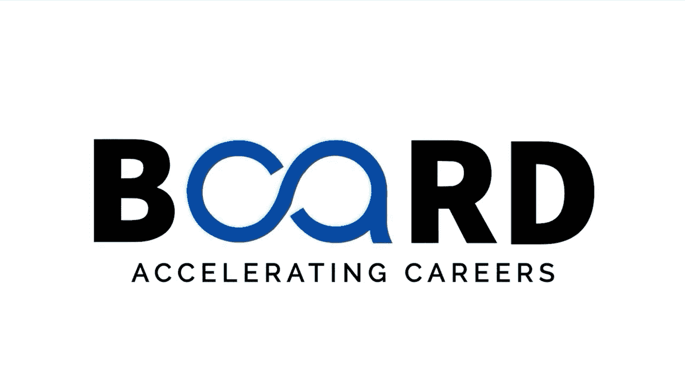

# Board Infinity【中英⚡生成式AI：提示词工程基础｜Generative AI： Prompt Engineering Basics】 p10 P10 04_提示设计中的常见陷阱及如何避免 -BV1AVjFzaEkP_p10-

Hi there we have covered the fundamentals of prompt engineering now let' us talk about what not to do。

Even experienced user can run into issues like lead to vague， misleading or incomplete AI responses。

But don't worry， once you recognize your pitfalls they are easy to avoid first major pitfall is being too awake when prompts lack specificity。

 AI responses tend to be very generic and unhelpful。

 for example asking give me marketing ideas will yield much less useful result then suggest five social media marketing strategy for a small organic bakery targeting health conscious menials。

Always ask yourself， have I provided enough details to get the precise answer？😊。

Another common mistake is overlooking context AI models don't automatically know your situation。

If you are asking for help。With a technical issue， for example， you need to include key details。

What software tools are you using what version what have you already tried without context AI might make incorrect assumptions。

 give you the answers that doesn't fit your needs many users fail into the trap of compound prompt。

Trying to ask multiple ungd questions in a single prompt。

This often results in incomplete answers as AI might focus on one aspect while neglecting the other。

Break complex queries into separate focused prompt ambiguous language is another pitfall。

Tms with multiple meaning can lead to misinterpretation for instance。

 asking about Python applications could refer to applications written in Python or applications for Python stake be precise with terminologies some users provide excessive unnecessary information burying the actual request in Un relevant information。

While context is more important， focus on details that actually matter for generating the response for your need。

Another mistake is using jargons or abbreviations without explanation。

While modern AI systems recognize many specialized terms。Clarity is always better。😊。

Define uncommon abbreviations or industry specific terminologies。

Many users fail to specify their audience。Content appropriate for expert。Defers from that for big。

Explicitly state who will be reading using the information。😊。

Neeging to set constraints often leads to responses that are either too lengthy or too technical。

Specify parameters like length。Complexity level or format to get more useful results。

To avoid these pitfalls， you can develop a simple prompt template for common task here is a basic structure。

First is context， what background information does AI need second is specific request。

 what do you want it to do？Third is formal preference。

Do you want a table a summary or step by step guide next is constraints。

 word limit formal or casual tool audience who is this information for by stretching your prompt this way you will consistently get better research that's wrap for this lesson in the next lesson we will build on these ideas and explore advanced techniques to fine your prompt。

Even further。See you there。

