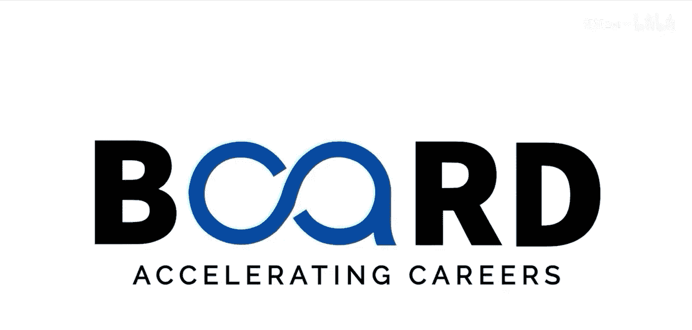

# Board Infinity【中英⚡生成式AI：提示词工程基础｜Generative AI： Prompt Engineering Basics】 p13 P13 03_使用创意与具体的提示修饰符 -BV1AVjFzaEkP_p13-

Welcome back。In the last video， we covered chain of thought and re of Thr prompting。In this video。

 we are diving into prompt modifiers， powerful tweaks that helps you fine tune AI responses with precision。

😊，Pron modifiers are additional phases or instructions that find use AI behavior in the specific ways。

Think of them as adjusting the setting on a camera to get exactly the right shot。

Let's explore how creative and specific modifiers。😊。

Can enhance your prompt let's start with style modifiers style modifiers influence the tone and the presentation of the response。

By adding phrases like write in a style of a scientific journal。

 explain like I am 5 years old or respond as if you are a Victorian era poet。😊。

You direct AI to adopt a particular voice or approach。

Forware modifiers specify how information should be structured。

 instructionss like present this as a bullet point list。

Another could be organize this into a table with columns and pros columns for pros and cons or format this as a step by step guide。

 this ensures the response is organized in your preferred way next could be prospective modifiers。

Perspective modifiers ask the AI to approach a topic from a particular viewpoint phrases like analyze this from。

The perspective of an environmental scientist。Consider this question as both a consumer and a business owner。

😊，Or evaluate this policy from multiple stakeholders perspective。

 these kind of modifiers can yield more nuance responses；

 another could be less modifiers less modifiers help control the verity of the response。😊。

Instructions such as keep this under 100 words。Provide a comprehensive analysis or give me a brief overview followed by an in depth explanation。

These kind of modifiers help you to get responses of appropriate details。For your needs。

Creativity modifiers adjust how conventional or innovative your responses should look like。

Phrases like。Think outside the box。Or provide unconventional solutions or stick to established best practices this kind of modifiers signals whether you want。

Standard or creative approaches another could be audience modifiers which specify who the content is for。

For example write this for technical audience familiar with machine learning terminologies。

 explain this to someone with no background in finance or create content appropriate for middle school students this kind of modifiers helps tailor complexity and terminies you can combine multiple modifiers to create highly specific prompts for example explain quantum computing in simple terms under 200 words for high school students using everyday analogies and conversational tone。

The most effective modifier are specific and clear。Vake instructions like， make this good。😊。

Write this better。Don't give AI enough directions。Instead， tell it exactly how to improve。

Try a different combination of our modifiers and see what works best for your needs。

This concludes module1 of our course now you have solid foundation in Geneative AI concepts and prompt engineering fundamentals in the next module we will build on these skills to explore advanced prompt engineering techniques for specialized task thank you for joining me in this journey see you again。

