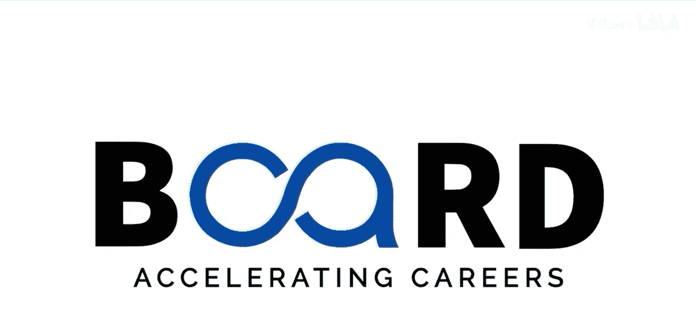

# Board Infinity【中英⚡生成式AI：提示词工程基础｜Generative AI： Prompt Engineering Basics】 p14 P14 01_优化与微调提示以提高准确性 -BV1AVjFzaEkP_p14-

Welcome back now that you have got the basics of prompt engineering down。

 its time to take things to the next level。In this video we will focus on refining and fine tuning your prompts to get even more precise reliable and useful response from AI think of it like adjusting a camera lens a broad prompt captures the bigger picture but fine tuning sharpens the details bringing your desired response into crystal clear focus the better your prompt the better your results lets start with precision language every word in your prompt matters so choose terminologies carefully。

For example， instead of asking。😊，How do companies raise money try what are the primary equity financing methods for early stage technology startups？

The latter uses the precise terms that trigger more specific answer。

Or the knowledge from the LLMs adding qualifying parameters is another powerful technique。

These parameters set boundaries around what you want， for instance， extend quantum computing。

 focusing only practical applications currently in use， excluding theoretical possibilities。😊。

This approach filters out unnecessary information and keeps the response focused context enrichment involves providing background information that shapes the AI's understanding。

For example， I am a software developer transitioning from Java to Python。😊。

Exed Python decorators in a way that leverages my existing programming knowledge this context helps AI tailor its explanation appropriately domestic framing involves。

😊，Using technologies and concepts from particularly fields。

A prompt like using pathological technology， explain how ideas spread through social networks。

Signals to the AI that you want responses using specialized language from that field。

Nummerical specificity helps control both the scope and depth of the responses。Requesting。

List exactly three evidence based strategies for improving sleep quality。

 each with23 supporting research findings。This provides clear parameters for the response。😊。

When dealing with complex topics， try decomposition。😊。

Breaking the topic into smaller and more manageable parts instead of asking about climate change broadly。

 you might first ask about greenhouse gas mechanisms。😊，Then about measurement methods。

And finally about mitigation strategies， remember that refinement is ongoing process。

Start with a basic prompt， analyze the response， identify the gaps and refine accordingly the more specific and the structured your prompt are the better AI will perform。

Next， we will explore different prompt structures and how they influence AI responses。Stay tuned。

