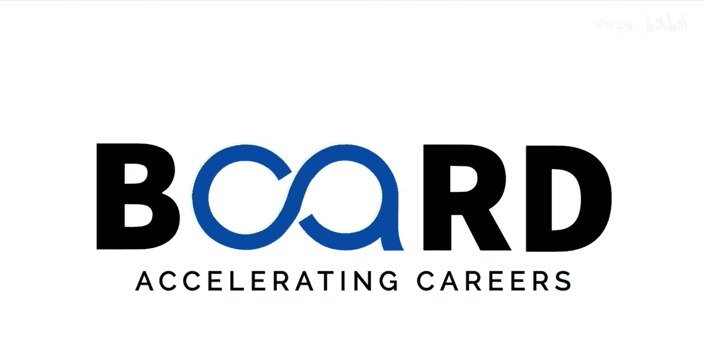

# Board Infinity【中英⚡生成式AI：提示词工程基础｜Generative AI： Prompt Engineering Basics】 p15 P15 02_尝试不同的提示结构、具体性与上下文 -BV1AVjFzaEkP_p15-

Welcome back Now that we have explored how to refine and fine tune prompts。

 let's take it a step further。In this video， we are going to experiment with different prompt structures and see how they impact AI responses think of it like building a conversation。

😊，How you ask something determines how useful the responses will be。

The structure of your prompt is just as important as the words you use so let us dive in let us examine several effective prompt structures the first is the role task context criteria framework this structure begins by assigning a role to AI。

Specifies the task provides context and sets evaluation criteria let us see one example role is。😊。

You are an experienced financial analyst the task is evaluate the financial health of this company based on the following metrics now the context is。

This is a Sa startup with 2 million annual recurring revenue and 40 year over year growth criteria focus on burn rate。

Customer acquisition cost and lifetime value ratios。

See how clear and structure that is by defining each part explicitly you guide the AI towards well rounded response another powerful structure is the comparative framework which explicitly asks the AI to consider multiple perspective or approaches。

For instance。Compare these three machine learning algorithms for predicting house prices。

Leaner regression， random forest and neural networks。Evaluate each based on accuracy。

 interpretability and computational requirements。😊，If you want real word applications。

 try giving AI a scenario based structure to work with this helps generate responses that are practical and actionable。

😊，For example， imagine you are advising a small business that has just experienced a data breach what are the immediate steps that they should take in first 24 hours for complex topics the herratral breakdown structure is very effective。

😊，This begins with high level overview they systematically explore subtopics， for instance。😊。

Explain blockchain technology in three levels。One is。

A simple analogy for a complete big second the core technical components third。

Advanced concepts like consensus mechanism and smart contracts experimenting with specificity levels is also valuable。

 sometimes deliberate vagueness can encourage creative responses。😊。

While extreme specificity is precise and targeted information。😊，Compare these prompt， W。

 give me ideas for improving team communication。Now。

 the specific version of this is suggest five asynchronous communication tools for a remote software development team spread across six time zones。

Focusing on tools that integrate with Github and Slack。

 where you place context in your prompt can change the way AI processor information。

Front loading important context ensures it shapes the entire response while revealing context progressively can be useful for step by step reasoning task there is no one size fit all performance structure prompt structure。

The key is to experiment with different approaches and observe which works best for your needs in the next video we will explore iterative prompting techniques a a very powerful method for refining outputs through multiple interactions。

So see you there。

