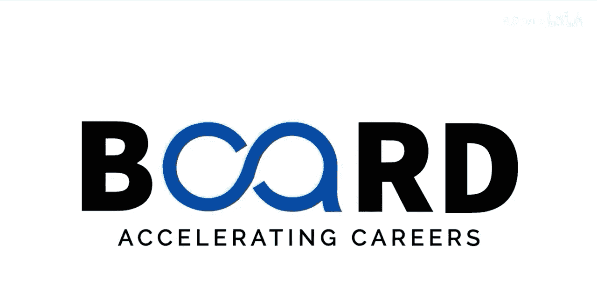

# Board Infinity【中英⚡生成式AI：提示词工程基础｜Generative AI： Prompt Engineering Basics】 p16 P16 03_迭代提示以获得更好结果 -BV1AVjFzaEkP_p16-

Welcome back。Now that we have experimented with prompt structures， specificity and the context。

 we will dive into iterative prompting， a powerful technique that transforms EI interactions into collaborative conversations。

😊，Think of it like having a conversation with a friend where every exchange build on the last to create a perfect outcome。

 imagine you are a sculptor working with clay。😊，Your first mode might capture general shape。

Then it through continuous refinement that you achieve a masterpiece。😊。

Iterative prompting works the same way。😊，You start with a basic prompt。

 then refine and tweak it step by step until AI responses is just right。

Let's walk through a practical example。😊，Suppose you are creating a content for technical blog post your initial prompt might be write our introduction to quantum computing for software developers。

After receiving the initial draft you might notice it assumes too much background knowledge；

 your follow up could be this is good， but please revise to include more foundational concepts。😊。

Assume the reader has programming experience， but no quantum physics background upon reviewing the revised version。

 you might want to make it more engaging。😊，So your next problem could be。

Now enhance this introduction with a real world application example。😊。

That would interest our developers。And add a brief roadm of what the full article will cover this iterative approach has several key advantage first it allows for progressive refinement。

😊，Addressing issues move one at a time rather than trying to perfect everything at once。Second。

It enables you to respond to unexpected elements in the AI's output。

 it lets you build complexity gradually starting with a foundation。

And adding sophisticated elements later for effective iterative prompting here are the some best practices to keep in mind begin with the clear simple prompt to lay the groundwork。

😊，Focus on one aspect at a time。Don't try to fix everything at once。

Provide explicit feedback about what works and what needs improvement。

 reference previous hydrations directly by saying take the previous response and further。😊。

Keep the conversation focused to maintain context and avoid sudden shifts。

Save successful prompts as template for future use。Remember。

 itertive prompting is a collaborative process between you and AI。

By continuously refining your prompt you guide the AI towards a desired outcome more effectively than trying to craft a single perfect prompt from the start in our next video we will explore tools and platforms that can streamline and enhance your prompt engineering workflow thank you for watching and see you in the next video。

😊。

