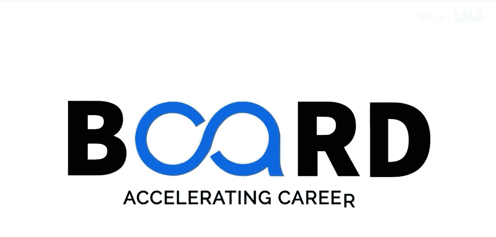

# Board Infinity【中英⚡生成式AI：提示词工程基础｜Generative AI： Prompt Engineering Basics】 p18 P18 01_利用AI进行内容创作：SEO、博客写作与数字营销 -BV1AVjFzaEkP_p18-

Hello welcome to this lesson in the last video we explore a few tools and platforms that can enhance your prompt engineering workflow here we are diving into practical applications of prompt engineering in content creation whether you are writing blog post optimizing for SEO or crafting digital marketing campaigns effective prompt engineering can empower your content workflow imagine having the power to generate high quality content with just a few well crafted prompt generative AI has been。

A game changer for content creation， enabling marketers and content creators to produce engaging material faster than ever before for SEO optimize content brand engineering techniques can help target specific keywords while maintaining readability and the value consider this advanced from structured。

Create a 500 word blog post about a particular topic。Targeting the keyword phrase。

Then you can provide your primary keyword phase， then include secondary keywords naturally two。

 three times。Structure the content with an engaging introduction。3， four sub bes。

And a conclusion with a call to action。😊，Optimize for readability with short paragraph and incorporate both statistical data and a practical advice。

Use a conversational but authoritative tone appropriate for your target audience。

This prompt isn't just about the topic it details SEO requirements。

 Q structure and the tool all crucial for boosting search rankings for distant marketing campaigns prompts can be engineered to generate consistent messaging across multiple channels a campaign prompt framework might look like develop a cohesive message framework for prompt for promoting your product across three channels。

 email social media and landing page copy。The unique value proposition is you can provide your UPV target audiences。

 demographic details of your audience。😊，Brand voices put the voice characteristics for each channel include headline options。

 body copy。And call to action phrases ensure messaging is consistent while adapting format。

And length of each channel's requirement。AI can also help with audience research through carefully constructed prompt。

 for example， based on the current digital marketing trend。

 identify five potential customer personas for your product。😊，Including their likely pain points。

 objection to purchase， preferred content types and optimal marketing channels to reach them。

For each persona suggest three specific content ideas that would address their unique concerns for content refreshing。

And repurposing prompt engineering enables efficient transformation for existing content let us see one example。

😊，Transform this blog article， then put your article into one a script for two minute YouTube video。

Second， five LinkedIn posts highlighting key insight。

 third and infographic outlining capturing the main statistics and process。

Maintain the core message while adapting to each format strength by repposing content you maximize the value of your original work and reach different audiences across the platforms the key to success in content creation is developing prompt templates that can be reused and refined over time。

Many marketing teams now maintain libraries of proven prompts for different content types。

Allowing them to consistently produce high quality materials。With minimal effort。

In our next video we will shift gears and explore how prompt engineering is being used for code generation and automation task thanks for watching the video lets keep building these skills。

😊。

